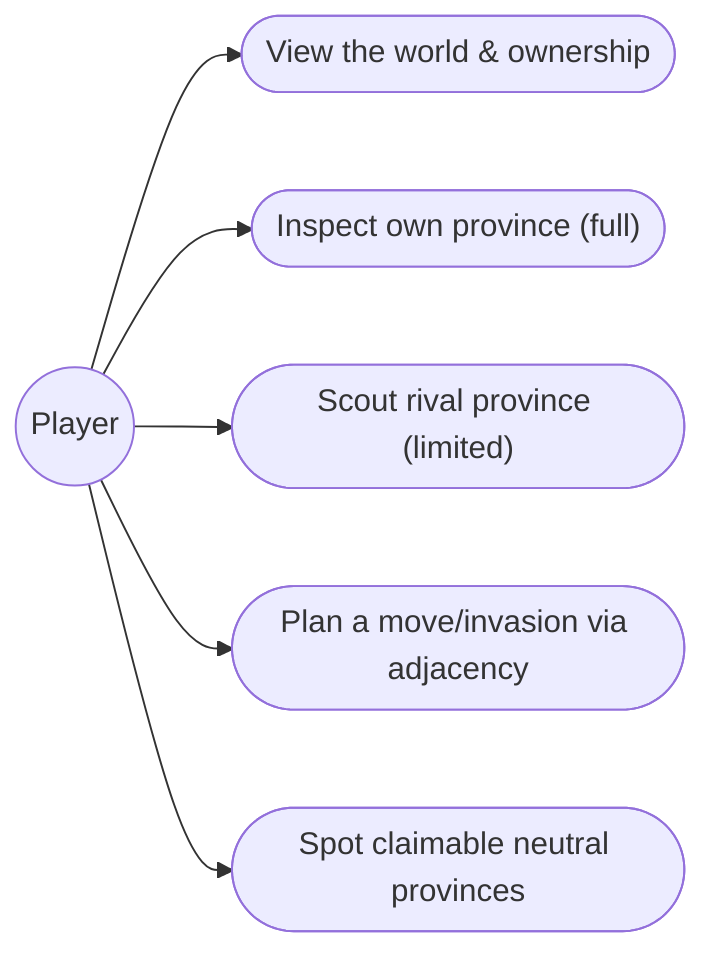
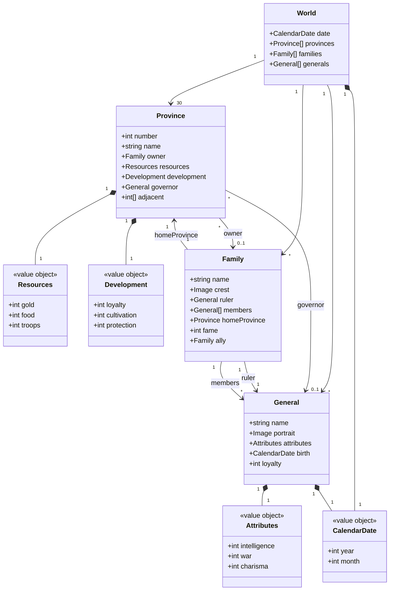

# 1. Global map — Design

## Description

The global map is the strategic screen: the fixed map of Ishmeria, its 30 provinces, and who owns each. It is the **foundation feature** — the first thing built and the surface every strategic command is launched from.

This feature owns the _view and selection_ layer: rendering provinces, showing ownership, inspecting a province, highlighting adjacency, and routing the player into a command. The commands themselves (develop, recruit, attack, move…) are owned by their own features and only _entered_ here.

## Glossary

| Term             | Meaning                                                                                                                                                        |
| ---------------- | -------------------------------------------------------------------------------------------------------------------------------------------------------------- |
| World (Ishmeria) | The top-level aggregate: the fixed island kingdom; one 30-province map shared by all four scenarios (geography never changes — only the political state does). |
| Province         | Primary territorial unit (numbered 1–30, named). Holds an owner, local economy, a governor, adjacency, and hireable Fifth Units.                               |
| Family           | A political actor that owns provinces, generals, and Gems.                                                                                                     |
| Ownership        | Each province belongs to one family, or is **neutral** (unclaimed).                                                                                            |
| Adjacency        | Which provinces border each other — the _only_ routes for movement and invasion.                                                                               |
| Governor         | The general administering a province (distinct from a family's ruler).                                                                                         |

## Functionality

- Render the fixed 30-province map of Ishmeria.
- Show each province's owning family (colour / banner), and mark neutral provinces.
- Select a province and inspect its details.
- Full detail for your own provinces; limited **scouted** detail for rival provinces.
- Highlight the selected province's adjacent provinces (valid move / attack targets).
- Act as the entry surface for province commands (launched here, resolved by their own features).
- Mark neutral provinces as claimable (claiming happens by moving in — resolution owned by movement).

## Use cases



- **Inspect own province** — select → full panel: gold, food, troops, loyalty, cultivation, protection, governor, army.
- **Scout rival** — select an enemy province → limited panel (owner, rough strength); full detail requires a scout/spy action.
- **Plan a move/invasion** — select one of your provinces → its adjacent provinces highlight; only adjacent enemy provinces are attackable.

## UI

```text
+----------------------------------------------------+
|  ISHMERIA            Month 4, 1186         [menu]  |
|                                                    |
|  (1)──(2)──(7)──(8)        << map artwork,         |
|   │    │   ╲   ╲              provinces tinted     |
|  (3)──(6)──(10)─(9)           by owning family >>  |
|   │        │                                       |
|  ...      (16)──(22)                               |
|                                                    |
+----------------------------------------------------+
| Selected: 10 Rodale             Owner: Lyle Family |
| Gold:     320  Food: 540  Troops: 410              |
| Loyalty:  70   Cult: 120  Prot:   80   Gov:  Ander |
| Adjacent: 6, 7, 9, 11, 15, 16, 17  (×7)            |
+----------------------------------------------------+
```

Rival province selected → the lower panel collapses to `Owner` + `~strength` only.

## Research

The stack is set — **Vite + vanilla TypeScript, in the browser** — so the map's rendering mechanism is a real decision now, not a deferred one.

**Finding — the source has no map geometry.** The spec gives province _adjacency_ (appendix-a) and the original _map artwork_, but **no province coordinates or region geometry** — so we author province regions ourselves whatever the mechanism, and **adjacency/highlighting stay pure data** (appendix-a), decoupled from how the map is drawn.

The map must do three things to a province _region_: **tint** it by owner, **highlight** it for adjacency, and **select** it on click — so hit-testing alone isn't enough. Against vanilla TS:

| Option | Tint + highlight | Hit-testing | Notes |
| --- | --- | --- | --- |
| **SVG** — raster artwork as base `<image>` + transparent `<path>` overlay per province | yes (`fill` + CSS class) | free (DOM events) | No library; overlay vectors stay crisp, base scales as the bitmap it is; 30 paths is trivial. Cost: author province polygons. |
| Image map — `` + `<area>` | **no** — `<area>` can't be filled/styled | free | Detects clicks only; still needs a separate overlay to show state — redundant. |
| Canvas 2D — hand-rolled | yes (draw fills) | manual (point-in-polygon / id-buffer) | One surface, full control, shares tech with the future battle board; but you build redraw + hit-testing yourself. |
| PixiJS — WebGL | yes | via Pixi | Built for many sprites / animation; overkill for a near-static 30-region map, and a dependency against the vanilla-TS lean. |

**Choice: SVG as an interaction overlay over the bitmap.** The map _is_ the original artwork — a raster image, not vector — so SVG doesn't draw the map. A single `<svg>` holds the art as a base `<image>`, with one province `<path>` overlaid in the same coordinate space (they align and scale together). Those paths are normally transparent and carry the dynamic state declaratively: a **translucent `fill`** for ownership tint (the art shows through), a **CSS class** for adjacency highlight, and a **DOM `click`** for selection — with **no library**, fitting Vite + vanilla TS and keeping the renderer a thin state → DOM adapter over the pure core (per Tests). Image maps give the same hit-testing but can't fill/highlight; Canvas and Pixi are more machinery than a static strategic map earns.

The **tactical battle** board (feature 8) is a different problem — animated unit sprites, facing, attacks — so it gets its own rendering research then (SVG vs Canvas vs Pixi weighed for _that_); we're deliberately not committing globally here.

## Domain model

The map is a view over the shared world aggregate; it reads these entities (it does not own them):



_Shape only: `name / INT / WAR / CHA / birth` follow the canonical record in appendix-b §B.2; `loyalty` is the hidden general loyalty (≠ a province's public loyalty), and `fame` lives on the ruler, not the general. Aging, stat growth/decline, and death belong to feature 4 (Character lifecycle)._

## Tests

The map is the view/selection layer, so tests target the **data** and the **render-model** (the deterministic state → view mapping the renderer consumes) — not pixels. Whether the artwork actually reads as Gemfire is manual/eyeball QA, not an automated assertion.

- **World data integrity (unit):** all 30 provinces present and named per appendix-a; adjacency is symmetric (if A borders B, B borders A); connection counts match appendix-a. Every province has exactly one authored map region, and regions map 1:1 onto provinces.
- **Selection & adjacency (unit):** selecting a province yields exactly its `adjacent` set as the highlight; inspecting your own province exposes the full panel, a rival's exposes the limited view only.
- **Render-model (unit):** the state → view mapping is a pure function — each province resolves to its owner's tint (from the family crest), neutral provinces resolve to the neutral style, and the selected province plus its neighbors carry the highlight flags. Assert the mapping, not the image.
- **Interaction (integration):** selecting a province on the map opens its panel; choosing a highlighted neighbor routes into the correct command entry. Tests the event → state → view wiring, still without asserting pixels.
