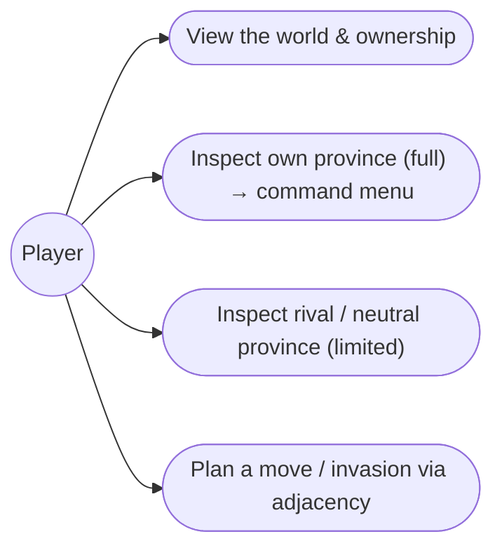
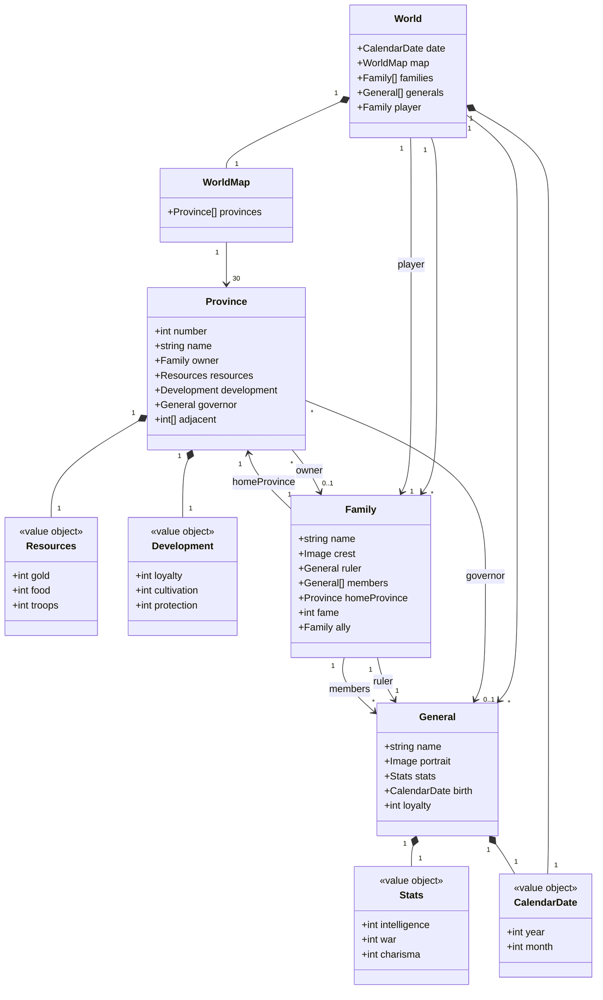

# 1. Global map

## Description

The global map is the strategic screen: the fixed map of Ishmeria, its 30 provinces, and who owns each. It is the **foundation feature** — the first thing built and the surface every strategic command is launched from.

This feature owns the _view and selection_ layer: rendering provinces, showing ownership, inspecting a province, opening its command menu, and highlighting adjacency. The commands themselves (develop, recruit, attack, move…) are owned by their own features and only _entered_ here. Two related actions start their lives here but resolve elsewhere: the **scout** that reveals a rival's hidden detail is feature 7, and **claiming** a neutral by moving into it is feature 5 — this feature only shows their starting state.

## Glossary

| Term             | Meaning                                                                                                                                                        |
| ---------------- | -------------------------------------------------------------------------------------------------------------------------------------------------------------- |
| World (Ishmeria) | The top-level aggregate: the fixed island kingdom; one 30-province map shared by all four scenarios (geography never changes — only the political state does). |
| Province         | Primary territorial unit (numbered 1–30, named). Holds an owner, local economy, a governor, adjacency, and hireable Fifth Units.                               |
| Family           | A political actor that owns provinces, generals, and Gems.                                                                                                     |
| Player           | The family you control — full detail and commands apply to its provinces. Hardcoded for now; chosen at setup (feature 16).                                     |
| Ownership        | Each province belongs to one family, or is **neutral** (unclaimed).                                                                                            |
| Adjacency        | Which provinces border each other — the _only_ routes for movement and invasion.                                                                               |
| Governor         | The general administering a province (distinct from a family's ruler).                                                                                         |

## Functionality

- Render the fixed 30-province map of Ishmeria.
- Show each province's owning family (colour / banner), and mark neutral provinces.
- Select a province and inspect its details.
- Full detail for the provinces you own; limited detail (owner and name) for rival and neutral provinces — the scout that reveals a rival is feature 7.
- Open the command menu for a province you control — the entry surface for its monthly orders. The menu only _launches_ commands; each command's behaviour is owned by its feature and resolved there. Rival and neutral provinces show no menu.
- Mark the ruler-only commands (◆ — Diplomacy, Change Lord, Entrust) apart from those any resident lord repeats (◇); with one player family the player is always ruler, so this is recorded now and enforced when vassal autonomy (feature 12) lands.
- Render the command menu inert at first — visible, non-interactive placeholders — so the surface exists before any command behaviour does.
- Highlight the selected province's adjacent provinces; acting on them (move/claim → feature 5, attack → feature 8) is entered here, resolved there.

## Use cases



- **Inspect own province** — select → full panel (gold, food, troops, loyalty, cultivation, protection, governor) plus its command menu.
- **Inspect rival / neutral** — select → limited panel: owner and name only; private detail stays hidden until a scout reveals it (feature 7), and no command menu appears (you cannot order what you do not control).
- **Plan a move / invasion** — select one of your provinces → its adjacent provinces highlight; only adjacent enemy provinces are attackable.

## UI

```text
+----------------------------------------------------+
|  ISHMERIA            Month 4, 1186         [menu]  |
|                                                    |
|  (1)──(2)──(7)──(8)        << map artwork,         |
|   │    │   ╲   ╲              provinces tinted     |
|  (3)──(6)──(10)─(9)           by owning family >>  |
|   │        │                                       |
|  ...      (16)──(22)                               |
|                                                    |
+----------------------------------------------------+
| Selected: 10 Rodale             Owner: Lyle Family |
| Gold:     320  Food: 540  Troops: 410              |
| Loyalty:  70   Cult: 120  Prot:   80   Gov:  Ander |
| Adjacent: 6, 7, 9, 11, 15, 16, 17  (×7)            |
+----------------------------------------------------+
```

Rival or neutral province selected → the lower panel collapses to identity only (owner + name); its private facts stay hidden until scouted (feature 7), and no command menu appears.

A province you own adds its command menu beneath the facts — the four in-game groups, each command an inert launch point resolved by its owning feature:

```text
+----------------------------------------------------+
| Selected: 10 Rodale (yours)         Owner: Blanche |
| ...province facts...                               |
+----------------------------------------------------+
| Military   Domestic    Diplomacy   Vassal          |
|  Attack     Develop      Ally        View          |
|  Recruit    Cultivate    Negotiate   Change Lord   |
|  Move       Protect                  Entrust       |
|  Hire       Trade                    Search        |
|             Give Food                              |
|             Transport                              |
+----------------------------------------------------+
```

The menu mirrors the in-game grouping; the canonical register of which commands exist (and whether each consumes the province's monthly action) is appendix-d §D.2.

| Group | Commands | Resolved by |
| --- | --- | --- |
| Military | Attack, Recruit, Move Troops, Hire Monster | 5 Armies & movement, 6 Fifth Units, 9 Battle |
| Domestic | Develop, Cultivation, Protection, Trade, Give Food, Transport | 3 Province economy |
| Diplomacy | Ally, Negotiate (Defection, Surrender, Sabotage, Plunder) | 11 Diplomacy |
| Vassal | View, Change Lord, Entrust, Search | 4 Generals & lords, 7 Search & treasure, 13 Strategic AI |

## Research

The stack is set — **Vite + vanilla TypeScript, in the browser** — so the map's rendering mechanism is a real decision now, not a deferred one.

**Finding — the source has no map geometry.** The spec gives province _adjacency_ (appendix-a) and the original _map artwork_, but **no province coordinates or region geometry** — so we author province regions ourselves whatever the mechanism, and **adjacency/highlighting stay pure data** (appendix-a), decoupled from how the map is drawn.

The map must do three things to a province _region_: **tint** it by owner, **highlight** it for adjacency, and **select** it on click — so hit-testing alone isn't enough. Against vanilla TS:

| Option | Tint + highlight | Hit-testing | Notes |
| --- | --- | --- | --- |
| **SVG** — raster artwork as base `<image>` + transparent `<path>` overlay per province | yes (`fill` + CSS class) | free (DOM events) | No library; overlay vectors stay crisp, base scales as the bitmap it is; 30 paths is trivial. Cost: author province polygons. |
| Image map — `` + `<area>` | **no** — `<area>` can't be filled/styled | free | Detects clicks only; still needs a separate overlay to show state — redundant. |
| Canvas 2D — hand-rolled | yes (draw fills) | manual (point-in-polygon / id-buffer) | One surface, full control, shares tech with the future battle board; but you build redraw + hit-testing yourself. |
| PixiJS — WebGL | yes | via Pixi | Built for many sprites / animation; overkill for a near-static 30-region map, and a dependency against the vanilla-TS lean. |

**Choice: SVG as an interaction overlay over the bitmap.** The map _is_ the original artwork — a raster image, not vector — so SVG doesn't draw the map. A single `<svg>` holds the art as a base `<image>`, with one province `<path>` overlaid in the same coordinate space (they align and scale together). Those paths are normally transparent and carry the dynamic state declaratively: a **translucent `fill`** for ownership tint (the art shows through), a **CSS class** for adjacency highlight, and a **DOM `click`** for selection — with **no library**, fitting Vite + vanilla TS and keeping the renderer a thin state → DOM adapter over the pure core (per Tests). Image maps give the same hit-testing but can't fill/highlight; Canvas and Pixi are more machinery than a static strategic map earns.

The **tactical battle** board (feature 8) is a different problem — animated unit sprites, facing, attacks — so it gets its own rendering research then (SVG vs Canvas vs Pixi weighed for _that_); we're deliberately not committing globally here.

## Domain model

The map is a view over the shared world aggregate; it reads these entities (it does not own them):



_Shape only: `name / INT / WAR / CHA / birth` follow the canonical record in appendix-b §B.2; `loyalty` is the hidden general loyalty (≠ a province's public loyalty), and `fame` lives on the ruler, not the general. `player` is the family you control — hardcoded now, chosen at setup (feature 16). Aging, stat growth/decline, and death belong to feature 11 (Character lifecycle)._

## Tests

The map is the view/selection layer, so tests target the **data** and the **render-model** (the deterministic state → view mapping the renderer consumes) — not pixels. Whether the artwork actually reads as Gemfire is manual/eyeball QA, not an automated assertion.

- **World data integrity (unit):** all 30 provinces present and named per appendix-a; adjacency is symmetric (if A borders B, B borders A); connection counts match appendix-a. Every province has exactly one authored map region, and regions map 1:1 onto provinces.
- **Selection & adjacency (unit):** selecting a province yields exactly its `adjacent` set as the highlight; inspecting your own province exposes the full panel, while a rival's or a neutral's exposes the limited view only (the scout reveal is feature 7).
- **Render-model (unit):** the state → view mapping is a pure function — each province resolves to its owner's tint (from the family crest), neutral provinces resolve to the neutral style, and the selected province plus its neighbors carry the highlight flags. Assert the mapping, not the image.
- **Command menu (unit):** the command menu is present only for a province the player owns; rival and neutral provinces yield no menu. Assert the render-model, not pixels.
- **Interaction (integration):** selecting a province on the map opens its panel; choosing a highlighted neighbor routes into the correct command entry. Tests the event → state → view wiring, still without asserting pixels.
