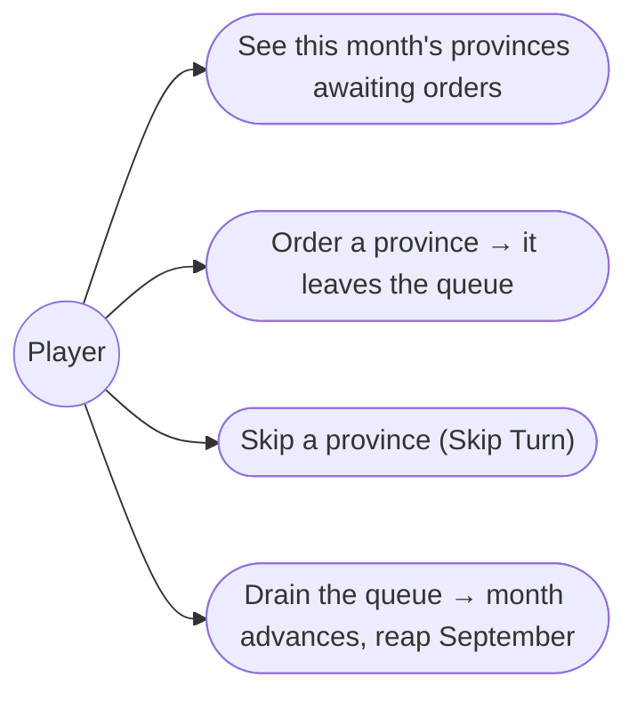
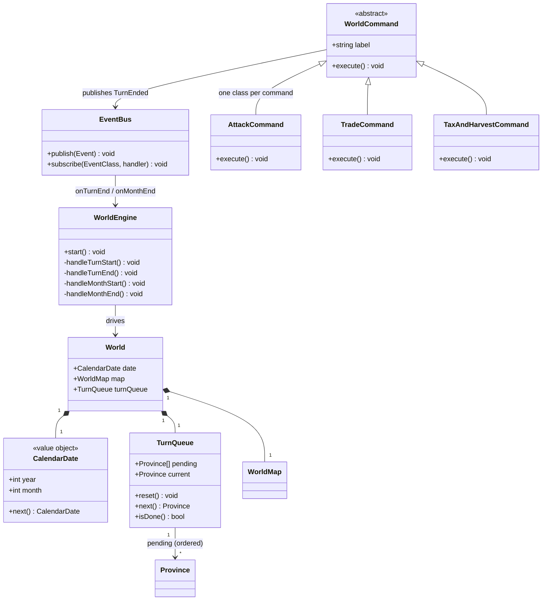
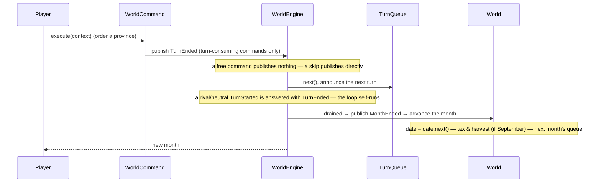

# 2. The monthly turn

## Description

Each month every province takes its turn: you order yours, rival turns resolve automatically, and when the queue drains the calendar advances and the next month begins.

This feature owns the turn machinery — the month's single global turn queue, the calendar advance, the month-start effects — and establishes the **command pattern** every order goes through. Command _behaviours_ belong to their features (economy → 3, military → 5/9, …) and start as inert placeholders. The first month-start effect — the September tax and harvest — lands here; events, rival turns, Gem cooldowns, upkeep, and victory are seams later features fill.

## Glossary

| Term                   | Meaning                                                                                                                                                                                                                                         |
| ---------------------- | ----------------------------------------------------------------------------------------------------------------------------------------------------------------------------------------------------------------------------------------------- |
| Month / calendar       | Strategic time advances one month per cycle; `CalendarDate` is (year, month 1–12).                                                                                                                                                              |
| Turn queue             | The month's single global queue of every province in turn order. A province leaves it when its turn resolves; when it empties, the month advances. Rival and neutral turns resolve automatically (no-op now, AI in feature 12).                 |
| Command                | An order (Develop, Recruit, …) — one `WorldCommand` class per command carrying its label and an `execute`. A turn-consuming command ends the turn inside its `execute`; a free command doesn't.                                                |
| Command group          | One of the four in-game command menus — Military, Domestic, Diplomacy, Vassal (from feature 1). Grouping is catalog data, not a command field.                                                                                                  |
| Command context        | What a command is constructed with: the `World` (state) and the `EventBus` (turn-consuming commands publish `TurnEnded` on it); `execute()` takes no arguments. A province command's target is the queue's current province.                    |
| Turn-consuming command | Develop, Give Food, Recruit, Attack, Transport / Move, Diplomacy, Search, Hire Monster — ends the province's turn, removing it from the queue (appendix-d §D.4).                                                                                |
| Free command           | Trade, View, Change Lord, Entrust — informational or administrative; leaves the province pending (appendix-d §D.4).                                                                                                                             |
| End-of-month           | Once the queue empties the calendar ticks and the next month begins. Month-start effects subscribe to `MonthStarted`: the September tax/harvest today; events, cooldowns, upkeep, victory later.                                                |
| Tax & harvest          | The yearly September gain per owned province: Gold (tax) and Food (harvest = `Loyalty + Cultivation × 2 + Protection`).                                                                                                                         |

## Functionality

- Build the month's queue at its start: every province, in random order.
- Provinces activate in queue order: only the queue's current province takes orders. A turn-consuming command ends its turn and advances the queue; a free command leaves it current.
- Skip the current province (Skip Turn): forfeit its action and advance the queue without a command.
- Announce every turn start (`TurnStarted`, carrying the province); the engine reacts to a rival or neutral turn by ending it immediately — feature 12 replaces that reaction with AI.
- Advance the calendar the moment the queue empties — no separate end-month action — then build the next month's queue.
- Run month-start effects as each month begins: when September arrives, add tax (Gold) and harvest (Food) to every owned province. Later effects (market swing, upkeep, events, victory) subscribe to the same `MonthStarted` event.

## Use cases



## UI

The header carries the date and whose turn it is right now — the queue's current province. That province selects itself: ordering or skipping moves the selection (and the header) to the next turn, so a month plays without touching the map. Clicking the map is for inspecting other provinces.

```text
+-----------------------------------------------------+
|  ISHMERIA            Month 4, 1186                  |
|  Turn: Rodale                                       |
+-----------------------------------------------------+
| Selected: 10 Rodale (yours)          Owner: Blanche |
| ...province facts...                                |
+-----------------------------------------------------+
| Military   Domestic    Diplomacy   Vassal           |
|  Attack     Develop      Ally        View           |
|  ...                                  [ Skip Turn ] |
+-----------------------------------------------------+
```

When your last province acts, the date rolls forward and the header presents the new month's first turn; a September advance shows up as the tax and harvest landing in the province stats.

## Research

**Command pattern for orders.** Orders are `Command` objects, not menu strings, so issuing is uniform across every feature's commands: the issuing layer just calls `execute`, never branching on what the command does. One concrete class per command (`commands/province` — `AttackCommand`, `DevelopCommand`, …) extends `WorldCommand` (a label plus a no-argument `execute`, with the `{ world, events }` context injected at construction — the same base the engine-run `TaxAndHarvestCommand` adopts); the four-menu grouping is catalog data, and the catalog is a factory (`createCommandGroups(context)`) called at the composition root once the world exists. A turn-consuming command publishes `TurnEnded` on the event bus inside its `execute`, a free command (Trade, View, Change Lord, Entrust) doesn't; a command's target is the queue's current province. Commands never know the engine exists — decoupling is one-way through the bus. Today's bodies are placeholders — each feature fills in its commands' real `execute` later. This refactors feature 1's string-button menu to render `Command`s.

**One global turn queue; ordering lives in its `reset`.** The source confirms per-province turns interleaved across families — Hartman: _"eventually, your own turn will come about"_, _"upon your turn you will be presented with your particular state's info"_; a turn-consuming command _"ends the player's turn"_ (FAQ) — but leaves the exact order open (spec §3.6: fixed / randomized / province-number / scenario-dependent). So `TurnQueue` is global and built once over the province list; each month `reset()` shuffles the provinces afresh, and a `currentIndex` walks the order — easy to revise when evidence firms up. Rival turns are no-op placeholders until feature 12 plugs into the same queue — the loop is built once. The month ends only when the queue drains, matching the original's walk-through.

**Where the action lives.** "Still to act?" is membership in the queue, not province state — a `Province` stays identity, ownership (`isOwner` / `isNeutral`), and economy; the two compose at the command layer.

**Month-start scope; gold tax unresolved.** Month-start effects subscribe to `MonthStarted` — today only the engine's tax/harvest handler; later features subscribe their own. The Food formula is known; the Gold tax formula is unresolved (appendix-d open questions, §D.6), so it is a provisional value, isolated so the real formula drops in without touching the loop.

## Domain model



_`World` is pure global state; the `WorldEngine` routes the decisions as reactions on the `EventBus`. Turn-consuming commands and the skip button publish `TurnEnded` (they never reference the engine); the engine's `TurnEnded` handler advances the queue and announces the next `TurnStarted` — or `MonthEnded` when drained, whose handler rolls the date via `CalendarDate.next` and starts the next month. Every turn start is announced; the engine's own `TurnStarted` handler ends rival and neutral turns on the spot (feature 12 swaps that reaction for AI), so the loop self-runs until a player turn surfaces. Every month starts the same way (re-shuffle via `reset()`, announce `MonthStarted` carrying the new date — its handler runs the tax/harvest command — then announce the first turn), including the first at `start()` (no date roll). The bus dispatches run-to-completion: an event published during dispatch is queued FIFO, so long reaction chains run flat and cannot overflow the stack. The queue walks a `currentIndex` — `current` is the active province, `next()` advances past it. `Province` keeps no turn state._

## Flow



## Tests

- **Calendar advance (unit):** `CalendarDate.next` is pure and rolls month 1→12, then to month 1 of the next year.
- **Turn queue (unit):** a new month's queue holds every province; assert membership/count, not the random order.
- **Issuing (unit):** executing a turn-consuming command on the current province advances the queue; a free command leaves it current; a skip advances it.
- **Advance gate (unit):** the month advances automatically when the queue drains, and not before.
- **September tax & harvest (unit):** advancing into September adds Food = `Loyalty + Cultivation × 2 + Protection` (and the provisional Gold tax) to each owned province; other months add nothing, and neutral provinces are untouched.
