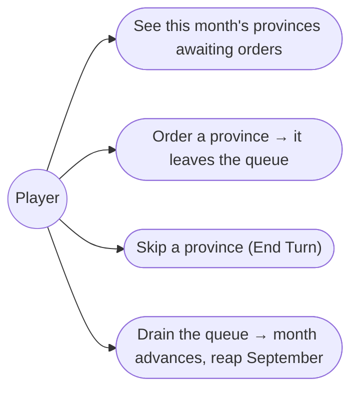
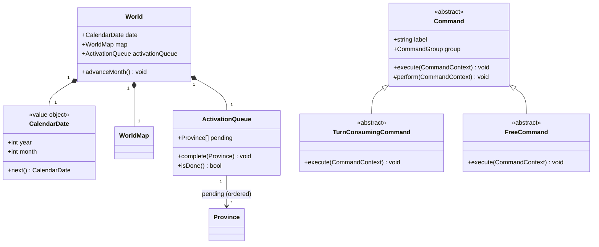
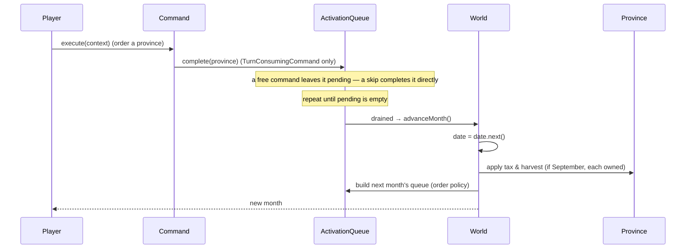

# 2. The monthly turn — Design

## Description

Each month every province takes its turn: you order yours, rival activations resolve automatically, and when the queue drains the calendar advances and end-of-month processing runs.

This feature owns the turn machinery — the month's single global activation queue, the calendar advance, the end-of-month pipeline — and establishes the **command pattern** every order goes through. Command _behaviours_ belong to their features (economy → 3, military → 5/9, …) and start as inert placeholders. The first end-of-month effect — the September tax and harvest — lands here; events, rival turns, Gem cooldowns, upkeep, and victory are seams later features fill.

## Glossary

| Term                   | Meaning                                                                                                                                                                                                                                         |
| ---------------------- | ----------------------------------------------------------------------------------------------------------------------------------------------------------------------------------------------------------------------------------------------- |
| Month / calendar       | Strategic time advances one month per cycle; `CalendarDate` is (year, month 1–12).                                                                                                                                                              |
| Activation queue       | The month's single global queue of every family's provinces in activation order. A province leaves it when its activation resolves; when it empties, the month advances. Rival activations resolve automatically (no-op now, AI in feature 13). |
| Command                | An order issued to a province (Develop, Recruit, …) — an object carrying its group and an `execute`. Whether it ends the province's turn is its _type_ (`TurnConsumingCommand` vs `FreeCommand`), not a flag.                                   |
| Command group          | One of the four in-game command menus — Military, Domestic, Diplomacy, Vassal (from feature 1).                                                                                                                                                 |
| Command context        | What `execute` receives: the target `Province` and the `World` (the queue via `world.activationQueue`).                                                                                                                                         |
| Turn-consuming command | Develop, Give Food, Recruit, Attack, Transport / Move, Diplomacy, Search, Hire Monster — ends the province's turn, removing it from the queue (appendix-d §D.4).                                                                                |
| Free command           | Trade, View, Change Lord, Entrust — informational or administrative; leaves the province pending (appendix-d §D.4).                                                                                                                             |
| End-of-month           | The pass once the queue empties: the calendar tick, the September tax/harvest, and — later — events, rival turns, cooldowns, upkeep, victory.                                                                                                   |
| Tax & harvest          | The yearly September gain per owned province: Gold (tax) and Food (harvest = `Loyalty + Cultivation × 2 + Protection`).                                                                                                                         |

## Functionality

- Build the month's queue at its start: every family's provinces in activation order (random within each family, families interleaved — an isolated, swappable policy).
- Order a province: a turn-consuming command ends its turn and removes it from the queue; a free command leaves it pending.
- Skip a province (End Turn): forfeit its action and remove it from the queue without a command.
- Resolve rival activations automatically as the queue is built — a no-op until feature 13 plugs AI into the same queue.
- Advance the calendar the moment the queue empties — no separate end-month action — then build the next month's queue.
- Run end-of-month processing as an ordered pipeline later features extend; at the September turn, add tax (Gold) and harvest (Food) to every owned province.

## Use cases



## UI

The header carries the date; a roster shows your provinces still awaiting orders — your slice of the queue — draining as each is ordered or skipped.

```text
+-----------------------------------------------------+
|  ISHMERIA            Month 4, 1186                  |
|  This month: Rodale · Ulster · Caltrop      (3 left)|
+-----------------------------------------------------+
| Selected: 10 Rodale (yours)          Owner: Blanche |
| ...province facts...                                |
+-----------------------------------------------------+
| Military   Domestic    Diplomacy   Vassal           |
|  Attack     Develop      Ally        View           |
|  ...                                  [ End Turn ]  |
+-----------------------------------------------------+
```

When the roster empties, the date rolls forward; a September advance reports the tax and harvest gained.

## Research

**Command pattern for orders.** Orders are `Command` objects, not menu strings, so issuing is uniform across every feature's commands. Turn-consumption is encoded in the type via a template method — `TurnConsumingCommand.execute` performs its effect then completes the province's activation, `FreeCommand.execute` only performs — so the issuing layer just calls `execute`, never branching on a flag. Feature 2 defines the abstractions and the command catalog with no-op `perform`s; each feature swaps in its real `perform` later. This refactors feature 1's string-button menu to render `Command`s.

**One global activation queue; order is a policy.** The source confirms per-province activation interleaved across families — Hartman: _"eventually, your own turn will come about"_, _"upon your turn you will be presented with your particular state's info"_; a turn-consuming command _"ends the player's turn"_ (FAQ) — but leaves the exact order open (spec §3.6: fixed / randomized / province-number / scenario-dependent). So `ActivationQueue` is global, ordered by an isolated policy defaulting to random-within-family with families interleaved, swappable when evidence firms up. Rival activations are no-op placeholders until feature 13 plugs into the same queue — the loop is built once. The month ends only when the queue drains, matching the original's walk-through.

**Where the action lives.** "Still to act?" is membership in the queue, not province state — a `Province` stays identity, ownership (`isOwner` / `isNeutral`), and economy; the two compose at the command layer.

**End-of-month scope; gold tax unresolved.** The pass is an ordered pipeline with one step implemented today (the September tax/harvest); later features append steps. The Food formula is known; the Gold tax formula is unresolved (appendix-d open questions, §D.6), so it is a provisional value, isolated so the real formula drops in without touching the loop.

## Domain model



_`perform` is the per-command hook (a no-op for today's placeholders); `execute` is the template method around it. A skip completes a province directly; rival activations auto-complete as the queue is built, so the pending set is effectively your own provinces until feature 13. `advanceMonth` fires the moment `activationQueue.isDone`: it rolls the date via `CalendarDate.next` (the one addition to `CalendarDate`, which already holds year / month with `equals` / `toString`), runs end-of-month processing, and builds the next queue via the order policy. `Province` keeps no turn state._

## Flow



## Tests

- **Calendar advance (unit):** `CalendarDate.next` is pure and rolls month 1→12, then to month 1 of the next year.
- **Activation queue (unit):** a new month's queue holds every owned province across all families (not just the player's); assert membership/count, not the random order.
- **Issuing (unit):** executing a `TurnConsumingCommand` removes its province from the queue; a `FreeCommand` leaves it pending; a skip removes it.
- **Advance gate (unit):** the month advances automatically when the queue drains, and not before.
- **September tax & harvest (unit):** advancing into September adds Food = `Loyalty + Cultivation × 2 + Protection` (and the provisional Gold tax) to each owned province; other months add nothing, and neutral provinces are untouched.
