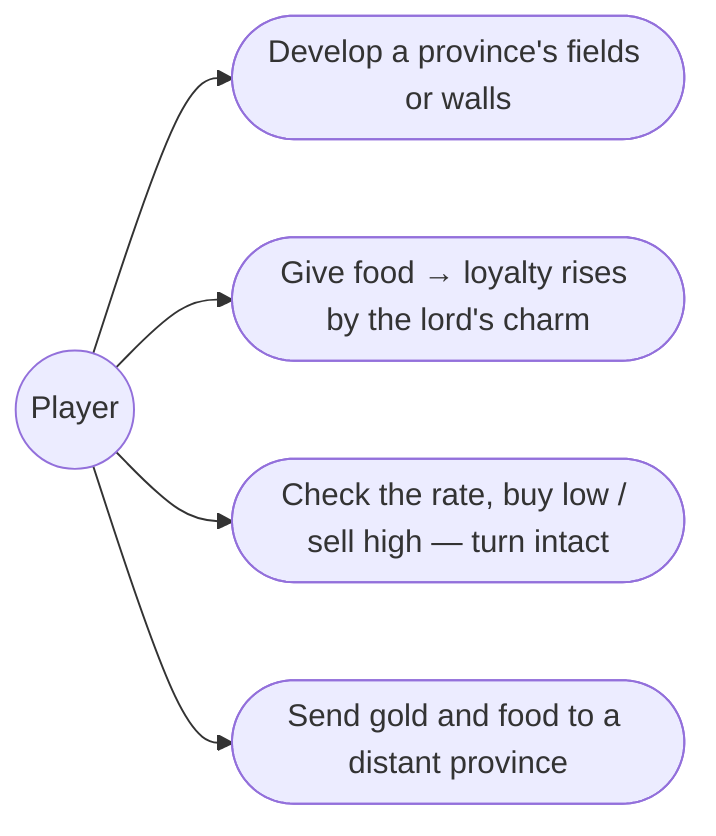
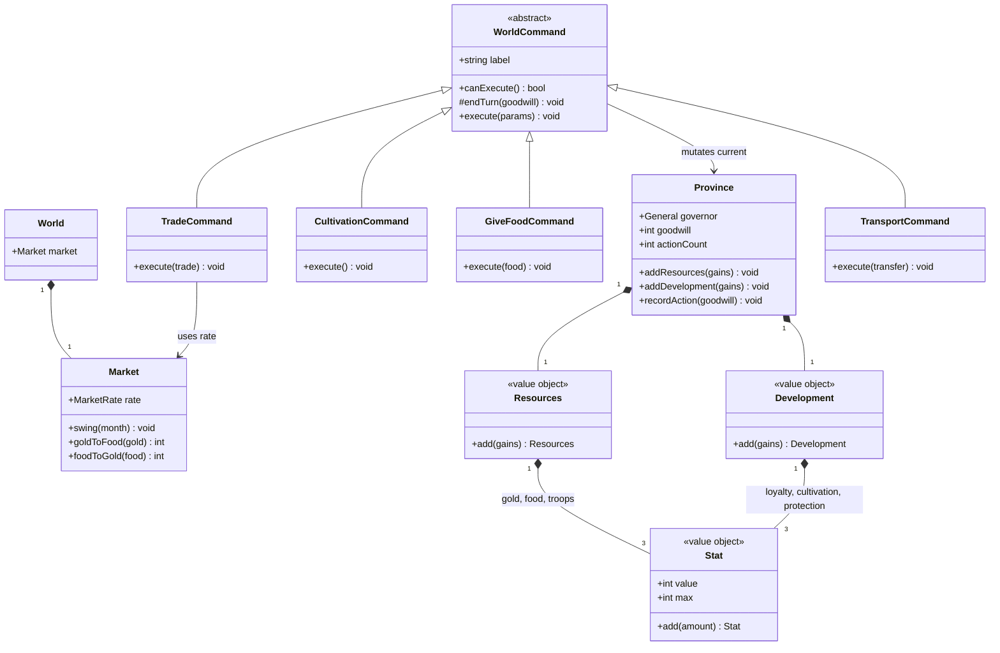
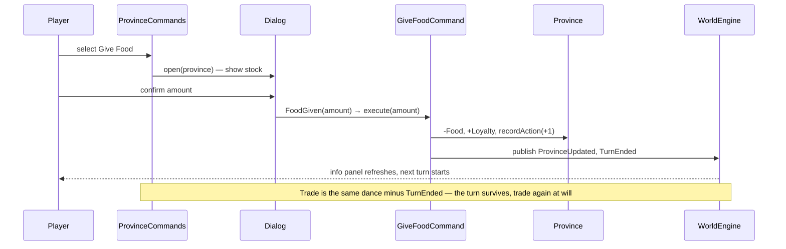

# 3. Province economy — Design

## Description

The Domestic orders that grow a province month over month: develop its fields and walls, feed its people, trade at the market, and move resources around the realm.

This feature fills in the real `execute` bodies of the five Domestic commands (Cultivation, Protection, Give Food, Trade, Transport), gives orders **parameters** for the first time (amounts and a target province), and lands the **goodwill bookkeeping** every turn-consuming order feeds — the hidden per-province counters that feature 15's event checks will consume. Out of scope: the events that spend goodwill (15), disasters that degrade stats (15), Recruit (5), and rival AI (13).

## Glossary

| Term         | Meaning                                                                                                                                                              |
| ------------ | --------------------------------------------------------------------------------------------------------------------------------------------------------------------- |
| Cultivation  | Develop order: pay 10 Gold, raise the province's Cultivation by +2…+5 (scales with the governor's Intelligence). Cap 200. Turn-consuming, goodwill +1.                |
| Protection   | Develop order: pay 10 Gold, raise Protection the same way. Cap 200. Turn-consuming, goodwill +1.                                                                      |
| Give Food    | Hand Food to the people: Loyalty + `floor(Charm × Food / 300)`, capped at 100. Turn-consuming, goodwill +1.                                                           |
| Trade        | Buy or sell Food with the merchant at the current market rate. **Free** — does not consume the turn, carries no goodwill.                                             |
| Transport    | Send Gold and Food to **any** province you own, however distant (Move Troops, feature 5, is the bordering-only military sibling). Turn-consuming, goodwill 0.        |
| Market rate  | The realm-wide exchange rate — low (1 Gold = 2 Food), average (1 = 1), or high (2 Gold = 1 Food) — swinging at month start within the season's range.                 |
| Goodwill     | A hidden per-province score: each turn-consuming order adds its modifier (appendix-d §D.5). Feature 15's event check reads and resets it.                            |
| Action count | A hidden per-province counter of turn-consuming orders taken; an event check fires at 3 (feature 15). Skip Turn and free orders don't count.                          |
| Governor     | The general running the province — their Intelligence scales Develop gains, their Charm scales Give Food.                                                             |

## Functionality

- Cultivation / Protection: spend 10 Gold to raise the stat by a governor-scaled +2…+5; the order disables while Gold < 10.
- Give Food: choose an amount from the province's stock; Loyalty rises by `floor(Charm × Food / 300)`.
- Trade: see the month's market rate, then buy or sell a chosen amount of Food at it — without spending the turn, any number of times.
- Transport: choose any other owned province and send it Gold and/or Food.
- The market rate swings at month start, picking among the rates the season allows.
- Every turn-consuming order records its goodwill and bumps the province's action count; the counters sit dormant until feature 15.
- Resource and stat caps hold everywhere: Gold/Food/Troops 0–999, Loyalty 0–100, Cultivation/Protection 0–200.

## Use cases



## UI

The Domestic menu loses the redundant `Develop` row — Cultivation and Protection sit directly in it, matching appendix-d's command table. Cultivation/Protection execute on click as today; Give Food, Trade, and Transport open a small **dialog** in the commands panel to collect their parameters. Dialogs cap inputs at what the province (and the receiver's 999 ceiling) allows, so no order can overdraw or silently lose resources — but they never preview the outcome: the merchant only says how the prices stand, and guessing what your lord's charm or the rate will yield is part of the game. Cultivation and Protection gray out while the province can't pay the 10 Gold — a click that does nothing would read as a bug — and re-check whenever the province updates, since a Trade can make them affordable mid-turn.

```text
+------------------------------+   +------------------------------+   +------------------------------+
| Give Food — Rodale           |   | Trade — Rodale               |   | Transport — Rodale           |
| Food in store: 240           |   | "The prices are low."        |   | To: [ 12 Kashmir         v ] |
| Amount: [ 100 ]  (max 240)   |   | (o) Buy   ( ) Sell           |   | Gold: [ 50 ]   (max 130)     |
|                              |   | Amount: [ 150 ] food         |   | Food: [ 200 ]  (max 240)     |
| [ Confirm ]       [ Cancel ] |   | [ Confirm ]       [ Cancel ] |   | [ Confirm ]       [ Cancel ] |
+------------------------------+   +------------------------------+   +------------------------------+
```

After any order resolves, the province info panel refreshes — development, gold, and food visibly move, which is the whole feedback loop of this feature.

## Research

**Parameterized commands.** Until now every order was a no-arg `execute()` dispatched uniformly. Three options: (1) keep `execute()` no-arg and smuggle parameters in via setters — stateful and ugly; (2) a declarative form descriptor on each command that a generic dialog engine renders — a speculative abstraction with one consumer per form; (3) make `WorldCommand` generic over its parameters (`WorldCommand<Params = void>`), let Give Food / Trade / Transport declare typed `execute(params)`, and route **explicitly** in `ProvinceCommandsControl`: those three selections open their dialog view, every other command executes on selection as today. We choose (3) — explicit calls over machinery, each dialog is a plain view publishing one typed event (`FoodGiven`, `TradeMade`, `ResourcesTransported`) that the control answers by calling the concrete command.

**Where the market lives.** The sources confirm the three rates and that the rate changes at the start of a month (FAQ: "fluctuates from month to month"), but not whether it is global or per-province, nor what drives the swing (§D.6 open question). We keep one realm-wide `Market` on `World`, re-rolled in the engine's `MonthStarted` handler from a **seasonal table** — each month allows a subset of rates and the swing picks among them:

| Months  | Rates                       |
| ------- | --------------------------- |
| Jul–Aug | low                         |
| Sep–Nov | random(low, average)        |
| Dec–Feb | random(average, high)       |
| Mar–May | high                        |
| Jun     | random(low, average, high)  |

The table is our invention — a provisional model that makes prices breathe with the year (cheap around the harvest, dear by spring) while staying one lookup. It is the tuning seam: later variants can price by how much food the realm holds, or carry a good/normal/bad yield modifier from the last harvest, without touching Trade. The rate shows only inside the Trade dialog, preserving the original's check-by-opening-Trade rhythm.

**Goodwill is part of the order's mutation.** "Every order carries goodwill" — and recording it is just another province write, like spending gold or raising loyalty: the base's protected `endTurn(goodwill = 0)` calls `province.recordAction(goodwill)` and publishes `TurnEnded`, and each command passes its §D.5 modifier at the call site (`this.endTurn(1)` from Cultivation, plain `this.endTurn()` from Transport) — no field on the base, the value lives where the order's effects live. No event in between — the bus is for flow (the queue reacts to `TurnEnded`), not for sibling state writes, and feature 15's check needs only the accumulated `actionCount` hitting 3. Turn-consuming commands call `endTurn()` instead of hand-publishing; Skip Turn keeps publishing `TurnEnded` directly — no action recorded, so a skipped month leaves the counters untouched (spec §11.2: only turn-based actions count). The counters live on `Province` and just accumulate — feature 15 reads and resets them.

**Provisional formulas, flagged.** Give Food is Medium-High confidence (`floor(CHA × Food / 300)`, spec §4.6) — adopted as is. The Develop gain is only bounded (+2…+5 scaling with Intelligence, minimum +2; thresholds unverified) — we provisionally tier it as `2 + floor(INT / 25)`, capped at +5, in one place so the real thresholds drop in. A province without a governor uses the minimums (gain +2, Charm 0). Both join appendix-d's unknown-formula register workflow.

**Caps live in a `Stat` value object.** Every capped number — Gold/Food/Troops (999), Loyalty (100), Cultivation/Protection (200) — becomes a `Stat`: a value with its max, whose `add` clamps to 0…max (negative gains spend). `Resources` and `Development` turn into groups of `Stat`s whose `add(gains)` mass-updates their members, so clamping is written once and no caller ever checks a cap by hand. The same VO is ready for generals' stats (Intelligence/War/Charm) when a later feature touches them. Dialogs additionally cap inputs (stock, affordability, receiver headroom) so the player can't *ask* for a lossy order; the domain clamp is the backstop, not the UX.

**Unaffordable orders disable.** `WorldCommand` gets `canExecute()` (default true); Cultivation and Protection override it with `gold >= 10`, and the menu disables any command whose `canExecute` is false — re-evaluated on `ProvinceUpdated`. The `execute` guard stays as the domain backstop.

**Refreshing the UI.** Orders now mutate visible state outside the turn cycle (Trade ends no turn). Commands publish `ProvinceUpdated(province)` after mutating; `GameScreenControl` refreshes the info panel when the updated province is the selected one. `TaxAndHarvestCommand` adopts the same event, fixing September's silent stat change.

## Domain model



_Every capped number is a `Stat` — value plus max, `add` clamps to 0…max, negative gains spend. `Resources` (gold, food, troops — max 999) and `Development` (loyalty 100, cultivation/protection 200) mass-update their stats via `add(gains)`; all three stay immutable value objects. `WorldCommand.endTurn(goodwill = 0)` = `province.recordAction(goodwill)` + publish `TurnEnded`; `recordAction` accumulates the hidden counters. Commands also publish `ProvinceUpdated` after mutating. `Market.swing(month)` re-rolls the rate within the month's seasonal range; the engine calls it in its `MonthStarted` handler alongside tax & harvest. The leftover `DevelopCommand` placeholder is deleted._

## Flow



## Tests

- **Market (unit):** the three rates convert both directions per the table (low 1g=2f, average 1=1, high 2g=1f); `swing` only ever lands on a rate the month's season allows (fixed months are deterministic, e.g. July → low, March → high).
- **Stat (unit):** `add` clamps to 0…max — negative gains spend and floor at 0; `Resources`/`Development` mass-update their stats under their caps (999 / 100 / 200).
- **Develop orders (unit):** Cultivation/Protection spend 10 Gold, raise their stat by the governor's tier (INT 0→+2, 99→+5), record +1 goodwill and one action, and end the turn; with Gold < 10 `canExecute` is false and `execute` refuses.
- **Give Food (unit):** deducts the given Food, raises Loyalty by `floor(CHA × Food / 300)`, records +1 goodwill, ends the turn.
- **Trade (unit):** converts at the current rate in both directions and does **not** end the turn or touch the counters.
- **Transport (unit):** moves Gold and Food onto any owned province, ends the turn, counts the action at goodwill 0.
- **Skip leaves no trace (unit):** skipping a turn changes neither goodwill nor action count.
