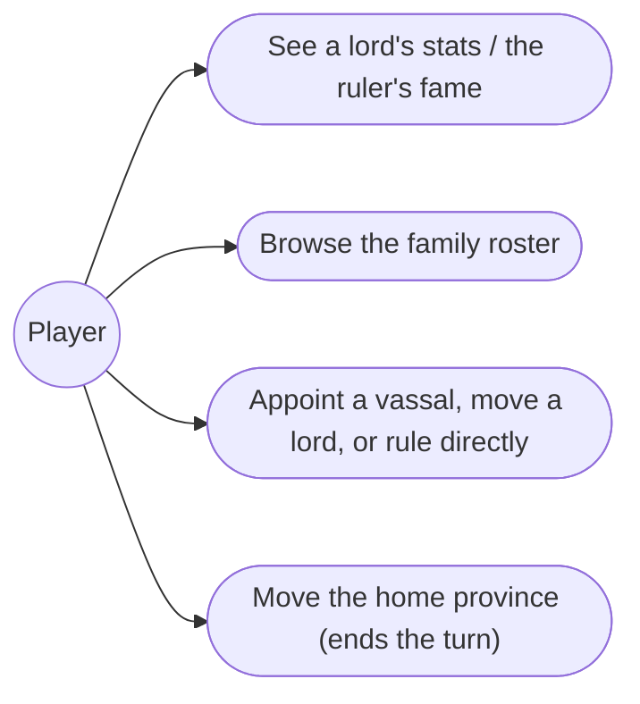
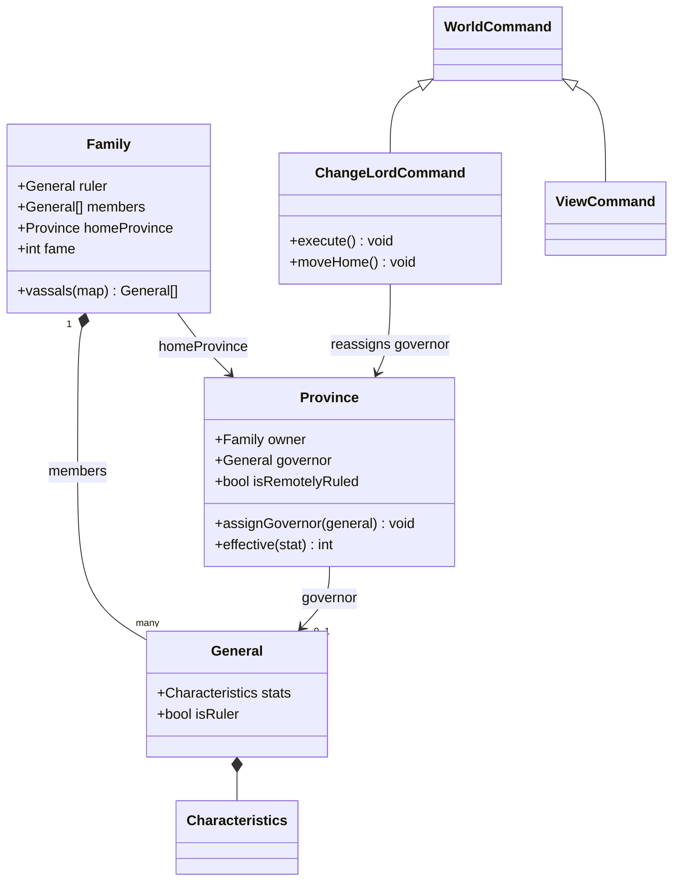
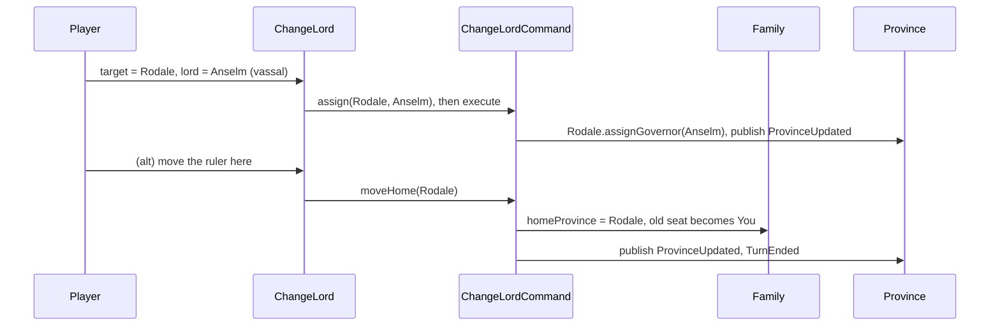

# 4. Generals & lords — Design

## Description

Manage the family: see your generals and their stats, choose who lords each province — or rule it yourself from afar at half strength — and move your seat of power. `General`, `Family` (ruler, members, home, fame), and `Province.governor` already exist and are seeded; this feature reads and reassigns them and adds the UI.

In scope: view generals' stats and the ruler's fame; appoint, move, and promote lords; rule a province directly; move the home province.

Out of scope: recruiting generals (only via Defection / capture — features 11, 10) and rewarding generals (no sourced mechanic; `General.loyalty` stays dead). We only seed the vassal pool those will use.

## Glossary

| Term          | Meaning                                                                                           |
| ------------- | ------------------------------------------------------------------------------------------------- |
| Ruler         | The family head. The only member with **Fame** and the only one who can issue Change Lord.        |
| Lord          | The general governing a province — resident, full strength. A general lords at most one province. |
| Vassal        | A member governing no province — the pool Change Lord promotes from (and Defection/capture fill). |
| Home province | The ruler's seat: governed by the ruler at **full** strength, and where ruler-level orders issue. |
| Rule directly | The ruler governs a non-home province remotely, at **half** its stats. No resident lord.          |
| Fame          | A ruler-only score, 0–100 (`Family.fame`). Feeds Ally/Defection/Surrender later; here only shown. |

## Functionality

- View a province's lord — Intelligence / War / Charisma, plus Fame when the lord is the ruler.
- Open the family roster: every member with stats, rank (ruler / lord / vassal), and posting.
- Change a province's lord: promote a **vassal**, **move** a lord in from elsewhere, or hand it to **You** (the ruler, remote at half strength). A displaced lord returns to the pool; a province a lord leaves reverts to "You".
- Move the home province: the ruler relocates, the new seat becomes full-strength, the old reverts to "You". This alone among the feature's orders ends the turn.
- Develop and Give Food read the province's **effective** stats, so a remotely-ruled province yields half.

## Use cases



## UI

The province info panel adds the governor's Intelligence / War / Charisma (and a Fame row when the governor is the ruler), plus a tag when the seat is ruled remotely so the half penalty is visible. The `View` order opens a roster of the family's members (rank, name, stats, posting) — no turn, per appendix-d — which doubles as Change Lord's picker. `Change Lord` is ruler-only and offered only from the home province; "move the ruler here" is the turn-ending move-home path, the rest are free.

```text
+-------------------------------+   +--------------------------------+
| Lord — Rodale                 |   | Change Lord                    |
| [portrait] Erin (you)         |   | Province: [ 7 Rodale       v ] |
|  INT 82   WAR 87   CHA 76     |   | New lord:                      |
|  ruler · Fame 9               |   |  ( ) You    (rule from Cardyf) |
|  ruled from Cardyf · half     |   |  (o) Anselm (vassal)           |
+-------------------------------+   |  ( ) Karl   (move from Hyland) |
                                    |  ( ) Move the ruler here (ends)|
                                    | [ Confirm ]        [ Cancel ]  |
                                    +--------------------------------+
```

## Research

**The half-strength ruler is the one real rule.** Sources are explicit: the ruler governs at half strength anywhere but home (FAQ: "half"; Hartman: "lowered greatly"). We model it as derived state, not a stored modifier — a province is remotely ruled when `governor === owner.ruler && this !== owner.homeProvince`; `Province.effective(stat)` halves there, returns the full value otherwise, 0 with no governor. Develop and Give Food switch from `governor.stats.x` to `province.effective(x)`, so the penalty lives in one place.

**Lordship is reassignment, not new structure.** `Province.governor` already runs end to end. Change Lord rewrites it: promote a vassal, move a lord (their old province reverts to "You"), or choose "You". The vassal pool is derived — `members` minus the ruler minus current governors — so there is no assignment field to sync. Change Lord is ruler-only, home-only, and consumes no turn (appendix-d), with one exception: moving the ruler to a new province relocates the home seat and **ends the turn** (FAQ).

**Fame is display-only.** Fame is the ruler's alone (`Family.fame`); its swing formula is unresolved (`appendix-d` D.6) and its consumers are later features, so this feature only reads it.

## Domain model



## Flow



## Tests

- **Effective stats (unit):** full for a resident lord and the ruler at home, `floor(stat/2)` for the ruler on a non-home province, 0 with no governor — and Develop/Give Food consume `effective`, so a remotely-ruled province develops at half.
- **Change Lord (unit):** moving a lord reverts their old province to "You" and returns any lord displaced at the destination to the pool; `canExecute` is false off the home province or for a non-ruler.
- **Move home (unit):** relocates `homeProvince`, makes the ruler the new seat's full-strength governor, sends the old seat remote, and ends the turn.
