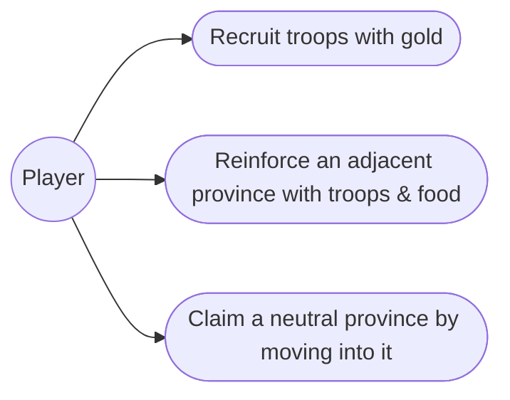
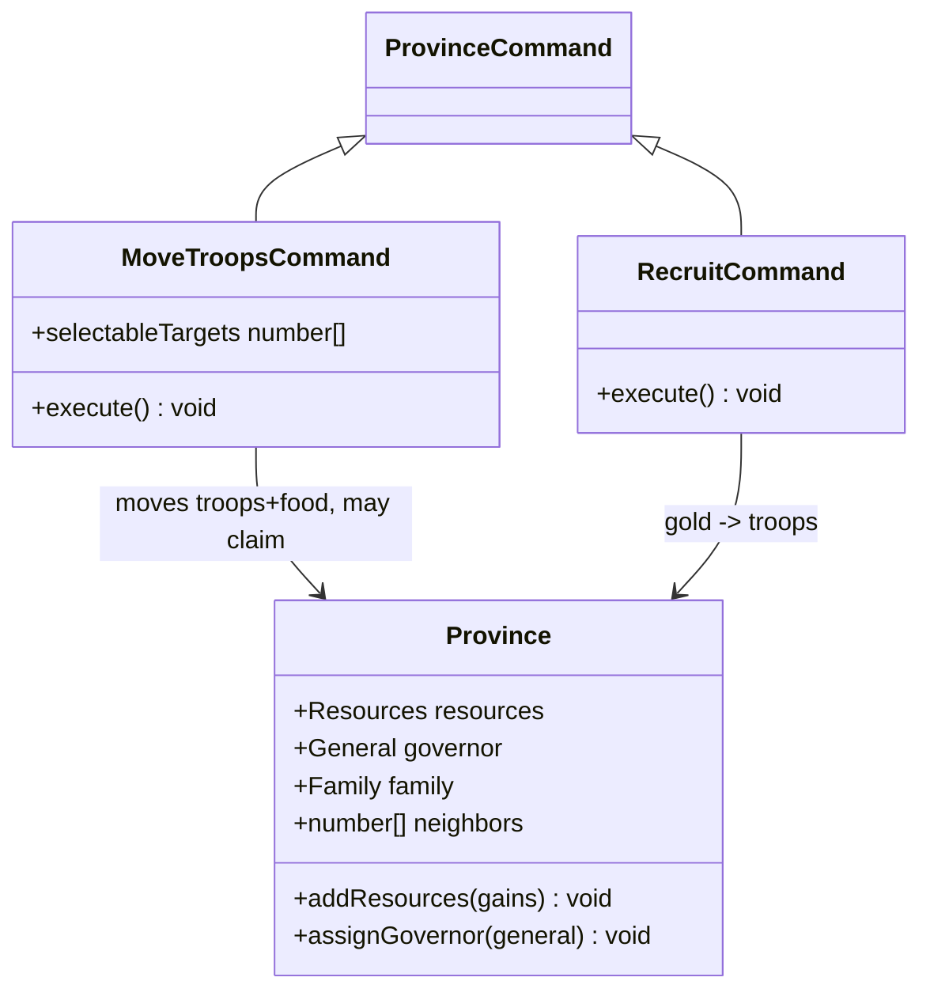
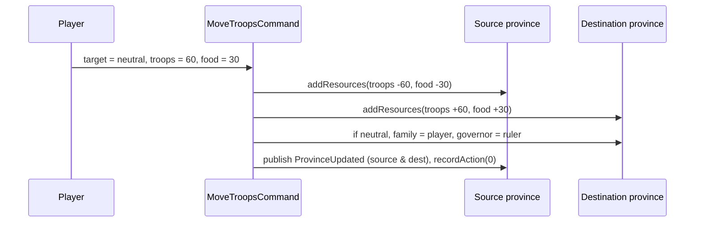

# 5. Armies & movement — Design

## Description

The bloodless strategic military layer: raise troops, move troops and food into a neighbor, and claim an unowned province by marching into it.

`Resources.troops` already exists (0–999), is seeded per province, and already renders in the province panel; `RecruitCommand` and `MoveTroopsCommand` exist only as turn-burning stubs. This feature gives them behavior.

In scope: recruit troops with gold; move troops and food into an adjacent province you own; claim an adjacent neutral province by moving into it.

There is no separate "review army strength" screen — you review a force by setting its troops and food in the action's own dialog (Move here, Attack later); the spec keeps troops as one abstract province value, so a force is just those two numbers.

Out of scope: attacking an enemy province and the battle it triggers (feature 9 — so Move never targets an enemy); choosing a commander and assembling an army (that selection lives in the Attack flow, feature 9 — recruiting here only raises the troops an army is later built from); Fifth Units (6); Gem Guardians (8); in-field food consumption and deployment cost (battle); and the tactical split of troops into Horsemen/Knights/Archers (battle).

## Glossary

| Term        | Meaning                                                                                                          |
| ----------- | ---------------------------------------------------------------------------------------------------------------- |
| Troops      | A province's military value (`Resources.troops`, 0–999). One abstract pool; unit types exist only in battle.     |
| Recruit     | Spend gold to raise a province's troops. Turn-consuming, goodwill −1.                                            |
| Move Troops | Send troops + food into an adjacent province you own, or into an adjacent neutral to claim it. Turn, goodwill 0. |
| Claim       | Taking an unowned (neutral) adjacent province by moving into it: it joins your family, ruled remotely.           |

## Functionality

- Recruit: at a province you control, convert gold to troops at 2 gold per troop, capped by gold on hand and the 999 ceiling. Ends the province's turn; goodwill −1.
- Move troops: pick an adjacent province you own, set troops and food to send (≤ what the source holds, ≤ the destination's headroom to 999); the amounts leave the source and arrive at the destination. Ends the turn; goodwill 0.
- Claim a neutral: Move Troops into an adjacent neutral province transfers it to your family — ruled remotely by the ruler (half strength, per feature 4) — seeded with the troops and food you sent. Install a resident lord afterward with Change Lord.

## Use cases



## UI

Every order here is the standard command-dialog model already used by Give Food (one amount) and Transport (map target + amounts) — no new screen, and no dedicated army view.

`Recruit` is a one-amount dialog: "How many troops (0–N)?", N = min(⌊gold / 2⌋, 999 − troops). `Move Troops` highlights the adjacent provinces you own or that are neutral; you pick one on the map, then set Troops and Food — that selection is the "review" of the force you commit. A neutral target is labelled as a claim.

```text
+--- Recruit ----------------+   +--- Move Troops ------------+
| How many troops (0-65)?    |   | To 9  (claim)              |
| [____ 40 ____]             |   | Troops (0-120)? [__ 60 __] |
| [ Yea ]        [ Nay ]     |   | Food   (0-123)? [__ 30 __] |
+----------------------------+   | [ Yea ]        [ Nay ]     |
                                 +----------------------------+
```

## Research

**Troops are one abstract province value.** The spec keeps troops as a single province-level number on the map (§6.1); types appear only in battle. This is already `Resources.troops`, so Recruit and Move just add to / move that value — no new structure, and a force's "strength" is simply the troops and food committed to it.

**Recruit costs 2 gold per troop.** This is canonical (spec §4.3, §4.5); there is no confirmed population or food cost, so gold is the only limiter. The dialog caps troops at min(⌊gold / 2⌋, 999 − troops). Turn-consuming with goodwill −1 (appendix-d §D.2, §D.5).

**Move Troops stays separate from Transport.** Appendix-d lists "Transport / Move" as one logistics command, but the codebase already splits them: Transport (Domestic; gold + food; any province you own) and Move Troops (Military; stub). We keep the split — Transport is rear-area logistics, Move Troops is the frontline order that carries troops and is the only way to claim. Move targets only adjacent provinces; an enemy neighbor is an Attack (feature 9) and is not offered here. Turn-consuming, goodwill 0.

**Claiming is part of Move.** Entering a neutral province sets its `family` to the player and its `governor` to the ruler — which is feature 4's "ruled remotely" (half-strength) state, so Move writes those two fields and needs no new ownership machinery. A claimed province needs a governor, and the remote ruler is the default; installing a resident lord is a separate, later Change Lord order. Move itself never picks a commander.

## Domain model



## Flow



## Persistence

Nothing new to persist: troops are already part of `Province.resources`, and a claim writes the same `family` / `governor` fields feature 4 already saves. (Save/load itself is feature 17.)

## Tests

- **Recruit (unit):** spends 2 gold per troop, capped by gold on hand; refuses what the province can't afford.
- **Move troops (unit):** into an adjacent province you own, debits the source and credits the destination, ownership unchanged; into an adjacent neutral, claims it for the player — ruled remotely by the ruler — seeded with the moved troops and food.
- **Selectable targets (unit):** adjacent provinces you own or that are neutral; enemy and non-adjacent provinces are excluded.
```
