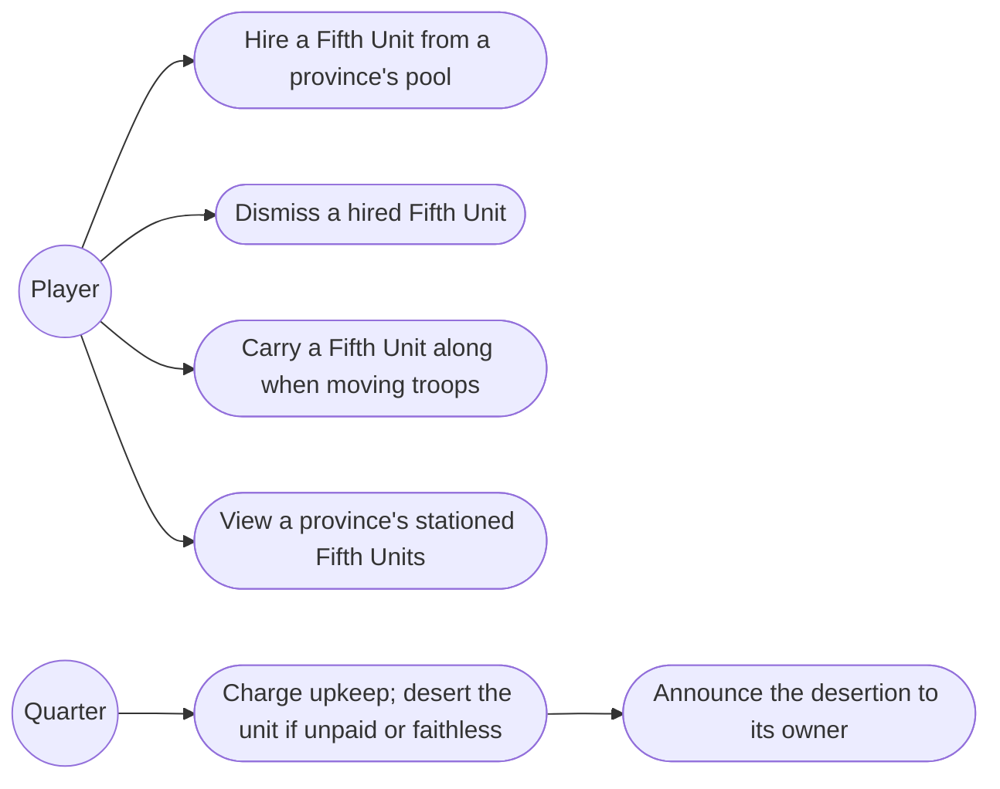
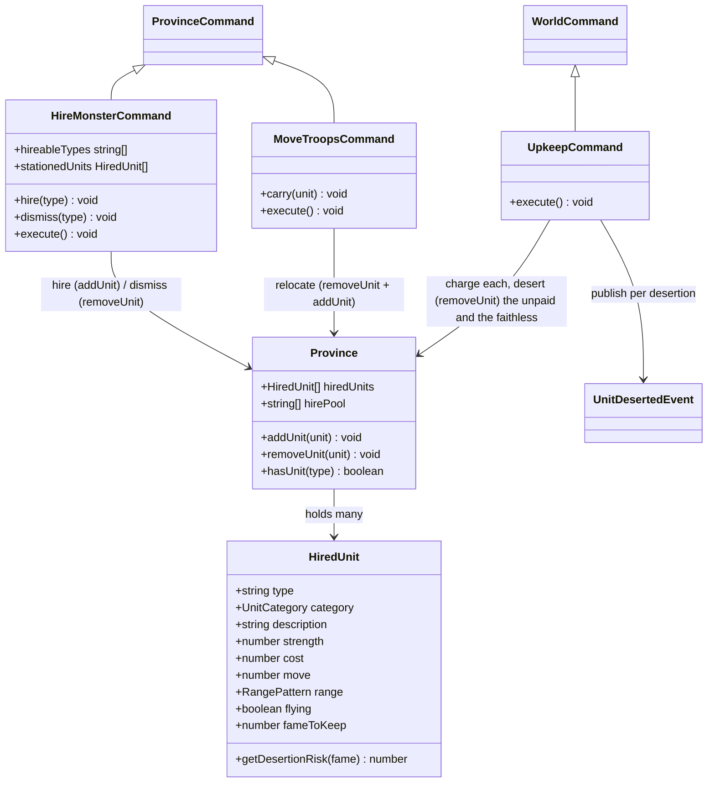
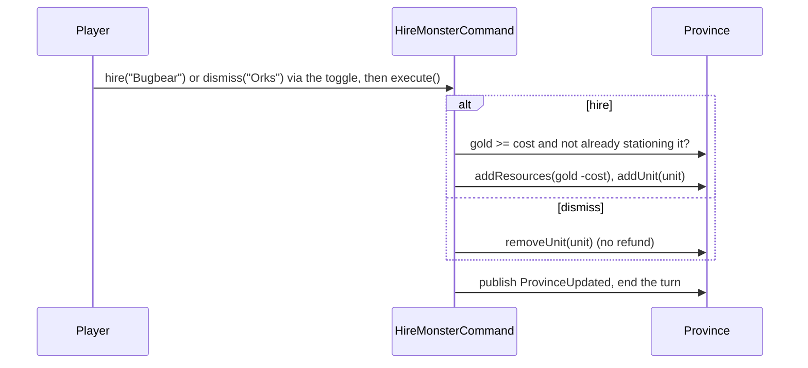
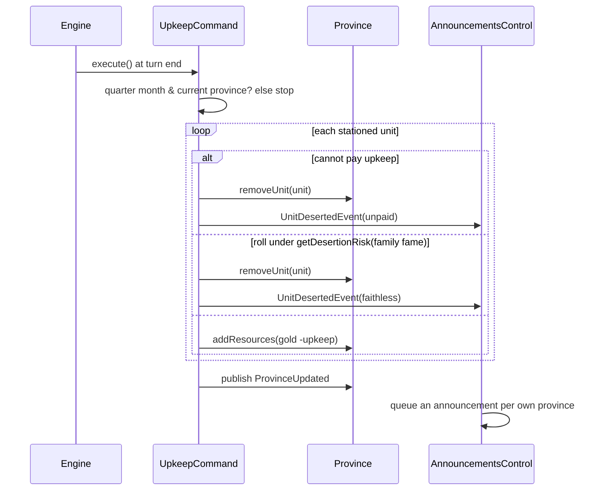

# 6. Fifth Units — Design

## Description

The hiring economy for the special units that fill an army's fifth slot: hire province-based monsters or elite mercenaries with Gold, keep them by paying quarterly upkeep and staying famous enough to hold them, and dismiss any no longer worth the cost.

`HireMonsterCommand` already exists as a turn-burning stub. This feature gives it behaviour — the one command both hires and dismisses (FAQ §6.3) — introduces the `HiredUnit` domain entity and its catalogue, and adds a quarterly upkeep tick to the turn engine.

In scope: hire available Fifth Units for Gold (a province stations several — one of each type it hires); pay their upkeep every three months or lose them to desertion; risk losing a mercenary an obscure family cannot hold, and be told when one leaves; dismiss a stationed unit; carry one stationed unit along when moving troops into a neighbour (§8.6); and see a province's stationed units through View. The last two reach back into feature 5's Move Troops and the View command, which had nothing to carry or show until Fifth Units existed.

Out of scope: the battle itself and the fifth army slot it fills (feature 8 — so a hired unit's Move, Range, flying, and Strength loss are recorded for later but unused here); Gem Guardians (feature 7) and Pastha (feature 14), the other two things that can fill the fifth slot; monster rampage (§8.10 — no observed rate to model, so it waits for the random-events feature); and dynamic changes to a province's hire pool over time (§8.3 — unconfirmed, so availability is static per scenario).

## Glossary

| Term         | Meaning                                                                                                                  |
| ------------ | ------------------------------------------------------------------------------------------------------------------------ |
| Fifth Unit   | The single special unit in an army's fifth slot; can be a Hired Fifth Unit, a Gem Guardian, or Pastha (§6.4).            |
| Hired Fifth Unit | A province-owned special unit hired through Hire Monster — a monster or an elite mercenary. Modelled as `HiredUnit`. |
| Strength     | A Fifth Unit's combat value, used instead of a troop count (§8.7). Set from the catalogue at hire time.                  |
| Hire pool    | The set of unit types a given province may hire, seeded per scenario from the ROM `mercenaries` data (§8.3).             |
| Cost         | A unit's Gold price — paid once to hire, and again as upkeep each quarter (they are the same number, §8.5).              |
| Upkeep       | The recurring Gold charge per hired unit, every three months; non-payment causes desertion.                              |
| Desertion    | Automatic loss of a hired unit at upkeep time — the province cannot pay it, or the family is too obscure to hold it.     |
| Fame to keep | The family Fame at which a mercenary is content; short of it, each quarter risks it losing faith (§8.10). Monsters ask for none. |
| Announcement | A message shown over the map telling the player something happened in their domain — a unit deserting, for now.               |
| Dismiss      | Voluntarily releasing a hired unit; no Gold is refunded (§8.11).                                                         |

## Functionality

- Hire: at a province you control, pick a type from its hire pool — any available type it does not already station — and pay its Gold cost; the unit joins the province at its catalogue Strength. Hiring ends the province's turn (the modal closes and the turn advances), like the other gold-spending orders — one hire per visit.
- Several per province: a province stations multiple hired units, one of each type it hires. Hiring is blocked only for a type already stationed there; a same-type duplicate can still arrive by Move Troops (§8.6, out of scope here).
- Upkeep: every three months, each stationed unit charges its cost in Gold against its province; any the province cannot pay desert.
- Loss of faith: a mercenary may also desert at that same quarterly check if its owning family's Fame falls short of what the unit wants — never a certainty, but likelier the further short the family falls, and an unknown house loses them at once. The stronger the mercenary, the more Fame it wants; a deserter takes no pay with it. Monsters serve any family, however obscure.
- Be told: when a unit leaves one of the player's own provinces, an announcement over the map says which unit, from where, and why — unpaid or faithless. Announcements queue, one at a time, and wait for the player rather than fading; a rival's losses go unreported, since the player has no window into another house's payroll.
- Dismiss: release a stationed unit, dropping its upkeep; no refund. The same Hire Monster screen switched to its Dismiss mode — it lists the roster a province already holds instead of the hire pool (FAQ §6.3: one order both hires and fires).
- Move a unit: a Move Troops order into an adjacent province may carry one of the source's stationed units along; it relocates from the source to the destination (which may be a freshly claimed neutral). It rides the same order — no extra turn, no goodwill change. Units move only via Move Troops, not Transport.
- View units: the View command gains a Fifth Units tab (beside General and Land) listing each stationed unit with its Strength and the province holding it. Free — View consumes no turn.

## Use cases



## UI

The Military tile's Hire Monster command opens a **modal over the map** (like the View family overview), not a sidebar dialog — inspecting a unit before paying for it wants room. A **Hire/Dismiss toggle** sits at the top (like Trade's Buy/Sell): **Hire** lists the province's hireable types (its pool minus the types it already stations); **Dismiss** lists the roster it already holds. Below the selector is a prominent **detail** of the selected unit — portrait, name, category, Strength, cost, flavour description, and the attack range drawn as a 5×5 tile grid (spec §C.6), with a battlefield picture to follow. The first unit is selected by default, so there is no empty "pick something" state; the action button reads **Hire** or **Dismiss** by mode — Hire is disabled when the province can't afford it, Dismiss is always available. The Hire Monster command tile stays selected while the modal is open (cleared when it closes), like the View overview.

```text
+--- Hire Monster ------------------------------------------- [Close] -+
|  ( Hire ) ( Dismiss )                                                |
|  [ Orks 20g ]  [ Bugbear 30g ]  [ Warriors 60g ]                     |
|                                                                      |
|  +---------+   Orks                          Attack range            |
|  |portrait |   Monster                        · · · · ·              |
|  |         |   Strength 100    20 gold        · · + · ·              |
|  +---------+   "Axe-wielding brutes"          · + O + ·              |
|                                               · · + · ·              |
|  [ Hire ]                                     · · · · ·              |
+----------------------------------------------------------------------+
```

Confirming (Hire or Dismiss) closes the modal and ends the province's turn (one action per visit); it publishes a province update so the sidebar gold reflects any spend — the modal shows no gold of its own. Close dismisses the modal without acting or ending the turn. Dismiss mode shows the stationed roster and releases a chosen unit with no refund; View's overview also lists a province's units, read-only.

`Move Troops` gains a Fifth-Unit picker below its Troops / Food / Gold fields: the source's stationed units, plus "none" — pick one to send along.

```text
+--- Move Troops (excerpt) ----+
| ...Troops / Food / Gold...   |
| Bring a 5th unit?            |
|   (•) none                   |
|   ( ) Ogre     str 100       |
|   ( ) Bugbear  str 100       |
+------------------------------+
```

`View` gains a third tab, **Fifth Units**, beside General and Land — a table of each stationed unit (portrait, category, name, Strength) and the province holding it.

A desertion in the player's own domain raises an **announcement** over the map — the deserter's portrait, one line of news, and a Continue button. It sits low over the map so the sidebar and the turn banner stay readable, and it holds until dismissed; when several land together, Continue walks through them and a note counts what is still waiting.

```text
+--- over the map -----------------------------+
|  +-------+  The Spearmen of Lorraine lost    |
|  | pic   |  faith in your house and          |
|  +-------+  deserted.                        |
|  1 more to come                 [ Continue ] |
+----------------------------------------------+
```

## Research

**`HiredUnit` now, not a `FifthUnit` hierarchy yet.** Only hired units exist in this feature; Gem Guardians (7) and Pastha (14) also fill the fifth slot but arrive later. We model the concrete `HiredUnit` and add a shared `FifthUnit` seam when the second occupant lands, rather than abstracting speculatively.

**Several units per province; hiring blocks duplicate types.** A province stations multiple hired units — confirmed in play — held as a list (`hiredUnits`). The hire constraint reads straight off that list: the Hire menu is the province's `hirePool` minus the types it currently stations, so you cannot hire a type you already hold. The stationed units are the source of truth — no separate per-type flag to keep in sync. The single fifth *army* slot (§6.4) is a battle-time constraint, not a cap on what a province may station. Move Troops can still bring in another unit, even a same-type duplicate (§8.6 — out of scope here), so the holdings are a list, not a set keyed by type. (The ROM `mercenaries` data only seeds the start state: each entry's `available` flag → the province's `hirePool`, its `hired` flag → the units already stationed there at scenario start.)

**Catalogue in config, full unit data.** The fifteen units are canonical in appendix-c §C.4 (Strength, Cost, Move, Range) and §C.7 (flying), with their flavour descriptions in the manual's Fifth Units table (e.g. Orks: "Axe-wielding brutes"). The catalogue records all of it — type, category, description, strength, cost, move, range, flying — even though Move, Range, and flying carry no behaviour until battle (feature 8); capturing the data once at its canonical source beats a later data-entry pass. `HIRED_UNITS` rows are literally `HiredUnitParams`, so a hire is `new HiredUnit(row)`. `range` is one of Gemfire's four canonical patterns (§C.6: short, long, circular, largest); the hired units use only short/long/largest, with circular reserved for the magician Gem Guardians (feature 7), so `RangePattern` models all four.

**Availability is per-scenario province data.** Each province's hire pool comes from the ROM `mercenaries[].available` flags (§8.3), which differ by scenario — so it is seeded with the rest of the scenario's province state, like ownership and resources. Dynamic availability changes (§8.3, unconfirmed) are out of scope; the pool is fixed for the campaign.

**Upkeep is charged at a province's turn-end, not in a month-start sweep.** Tax is annual and impersonal, so it stays a month-start tick; upkeep is per-province and interactive, so it falls due when that province's *turn* ends — letting the player raise Gold during the turn (e.g. sell food) before the bill lands, rather than being charged in a month-start sweep before they can act. A `WorldCommand` charges the province whose turn just ended (`turnQueue.current`, before the queue advances) and only on quarter months, so each province pays once per quarter at its own turn. The spec confirms "every three months" but not the anchor month (§8.5), so the quarter months are a single config constant and the exact set is an open question. When a province stations several units and cannot pay for all, which desert (order, or all-or-nothing) is also unconfirmed; the model charges them in turn and deserts each one the remaining Gold cannot cover.

**Loss of faith is a Fame-weighted risk on mercenaries only; rampage is a monster problem and waits.** The spec calls the loss-of-faith formula unknown (§8.10), but the player guide is unambiguous about the mechanic and which units it touches: mercenaries desert an unknown family — Lancers "early in the game when your ruler's fame is low they will probably desert you immediately after you hire them", Pikemen "until late in the game when your family has more fame", Warriors "eager to desert you … if you have high fame", Spearmen "if you have the fame to keep them" — while the monsters instead "go on a rampage (damaging your state)" (Orks, Olog-Hai). So the two categories fail differently, and only the mercenary half is modelled here. Player testing places the point where mercenaries settle down at roughly 20 Fame for the Strength-150 units and 50 for the Strength-180 ones, which is why the catalogue's `fameToKeep` tracks Strength rather than cost; Gunners and Shooters were untested and are assumed to sit with their Strength peers at 20 — the lowest-confidence rows. These numbers are observed, not read off the ROM, so they live as one catalogue field per unit and are cheap to retune.

**Desertion is a roll, not a cutoff.** Reading `fameToKeep` as a hard line would make a house at 19 Fame lose its Spearmen every quarter and a house at 20 keep them forever, which contradicts the softness in every source: "probably desert", "eager to desert", "just as easily as any other mercenary group". So the unit carries its own risk — `getDesertionRisk(fame)` is the shortfall as a fraction of what it wants, `(fameToKeep - fame) / fameToKeep`, and zero once the family is famous enough. An unknown house (0 Fame) loses a mercenary the first quarter it holds one, matching "desert you immediately after you hire them"; a house halfway there is a coin flip each quarter; the observed "sometimes" in the 40s for Strength-180 units falls out as a 1-in-5 risk rather than being special-cased. The roll happens at the quarterly upkeep tick, where the other desertion already lives, and a faithless mercenary is not charged before it leaves — it takes no pay with it. Rampage stays out: the guide describes bad events as random and gives no per-monster rate, so it belongs with the random-events feature (14) rather than being invented here.

**Desertion is reported through an announcement, not a silent removal.** A unit vanishing from a roster the player only sees on request is a mechanic they cannot learn, so the domain publishes a `UnitDesertedEvent` (province, unit, and whether it went unpaid or faithless) and the UI turns it into a message over the map. The event is the general shape future news will take — the engine states what happened, the UI decides who is told and how it reads. The control queues the events and filters them to the player's own provinces (no visibility into a rival's payroll); the view turns one into a sentence from a copy table keyed by reason, the way the overview labels province status. Announcements queue and wait for a click instead of fading on a timer: turns resolve in a burst, several quarters' news can land at once, and a message that ends the game's only feedback on a rule should not be missable. When the events feature (14) lands, its good and bad events publish their own domain events and gain their own phrasing here; nothing else about the mechanism should need to change.

**Hire and dismiss are one order; it ends the turn.** The FAQ notes Hire Monster "allows the player to both hire and fire 5th Units" (§6.3) — so they are two directions of one transaction, like Trade's Buy/Sell, sharing one command, one tile, and one modal with a **Hire/Dismiss toggle** (appendix-d's separate "Dismiss Fifth Unit" entry is the same screen reached through the toggle). Hire works over the province's hire *pool*; Dismiss over the roster it already *holds*; the toggle swaps which list the modal shows and what the action button does (Hire is disabled when unaffordable; Dismiss is always available). Either direction **ends the turn** — it commits a Gold spend or a release, like Recruit (appendix-d marks the turn cost "needs version check"). So Hire Monster is an ordinary command dialog (`consumesTurn()` is `true`); it merely renders as an overlay over the map instead of inline in the sidebar, because inspecting a unit before paying wants room. It runs the *identical* lifecycle as the sidebar dialogs: selecting the tile opens the dialog (free — browsing costs nothing, since a dialog command does not execute until confirmed), the action button confirms, `HireMonsterCommand.execute()` performs the hire or release, and the shared command framework ends the turn with the usual pacing and clears the tile. Placement (sidebar vs. map overlay) is the only thing that differs from a command like Develop — the mechanics are one path, with no bespoke open/close events. To make that work, `ProvinceCommandsControl` drives the lifecycle while the overlay dialog is hosted in the map area by `GameScreen` (where an overlay can cover the map yet leave the sidebar tile visible); the commands control is handed the overlay dialog and registers it alongside the sidebar dialogs.

**Hireable categories: Monsters and Skilled Fighters.** The manual's Fifth Units roster has three groups — Monsters, Skilled Fighters, and Magicians — but only the first two are hired through Hire Monster. The Magicians (Skulryk, Chylla, Scylla, Empyron, Zendor, Pluvius) are the six wizard Gem Guardians (feature 7), granted by gem ownership rather than hired — so this feature offers only Monsters and Skilled Fighters. The category modelled here is `'monster' | 'mercenary'` (the manual's "Skilled Fighter", spec §8.2's "Elite Human").

## Domain model



The catalogue (`HIRED_UNITS` in config) maps each type to its `category`, `strength`, and `cost`; `HiredUnit` instances are built from it at hire time. `Province.hirePool` is the list of types that province may hire, seeded per scenario; `hireableTypes` is that pool minus the types it already stations. `addUnit` / `removeUnit` are the neutral add / remove primitives: a hire calls `addUnit`; a dismiss, a desertion, and the source side of a relocation all call `removeUnit`. `HireMonsterCommand` both hires and dismisses (FAQ §6.3): `hire(type)` and `dismiss(type)` record the chosen unit and direction, and `execute()` either pays the cost and `addUnit`s, or `removeUnit`s the stationed unit with no Gold refunded (§8.11); `hireableTypes` feeds the Hire list and `stationedUnits` the Dismiss list. `MoveTroopsCommand.carry(unit)` relocates one stationed unit by removing it from the source and adding it to the destination (feature 5's command, extended here). View reads `hiredUnits` for display and mutates nothing.

## Flow





## Persistence

Each province contributes its `hiredUnits` (each unit's type plus current Strength, since Strength will erode in battle later) and the `hirePool` of types it may hire. Nothing else is new; the charge and desertion mutate the same `Province.resources.gold` already saved. (Save/load is feature 16.)

## Tests

- **Hire (unit):** spends the unit's cost in Gold and stations it at the province at its catalogue Strength; lets a province hold several different types; refuses when the province lacks the Gold, when the type is not in its pool, or when it already stations that type.
- **Upkeep (unit):** on a quarter month, charges each stationed unit's cost against its province; deserts a unit the province cannot pay; charges nothing on a non-quarter month.
- **Loss of faith (unit):** at the same tick, a mercenary serving a family with no Fame always deserts and takes no pay with it; one whose family meets its `fameToKeep` never does and is charged; halfway short, the desertion follows the roll either way; a monster stays whatever the family's Fame. Each desertion reports why it happened — unpaid or faithless.
- **Announcements (control):** a desertion in the player's own province shows a message naming the unit and the province; one in a rival's province shows nothing; several desertions queue, Continue advances through them, and the panel hides after the last.
- **Dismiss (unit):** Hire Monster in Dismiss mode removes a chosen stationed unit, leaves the rest, and refunds no Gold.
- **Carry a unit (unit):** a Move Troops order carrying a stationed unit relocates it — gone from the source, stationed at the destination (including a freshly claimed neutral) — and leaves the source's other units in place.
