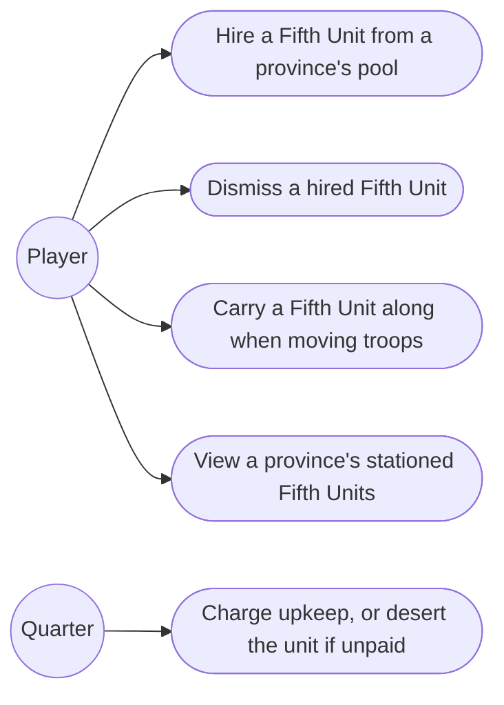
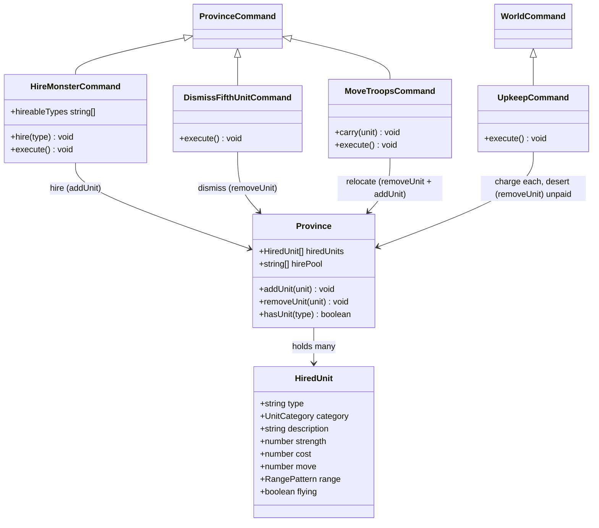
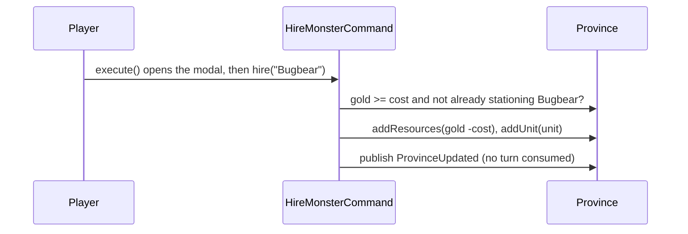
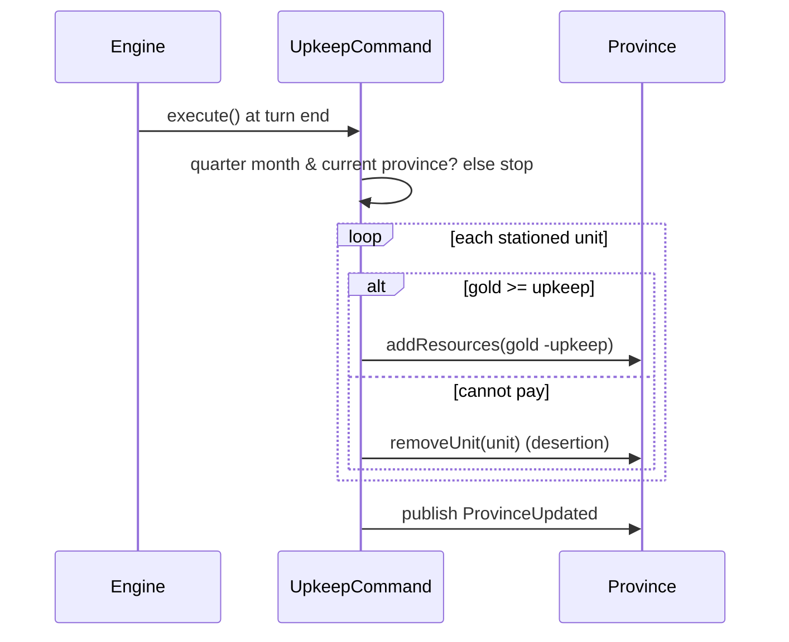

# 6. Fifth Units — Design

## Description

The hiring economy for the special units that fill an army's fifth slot: hire province-based monsters or elite mercenaries with Gold, keep them alive by paying quarterly upkeep (or watch them desert), and dismiss any no longer worth the cost.

`HireMonsterCommand` already exists as a turn-burning stub. This feature gives it behaviour — the one command both hires and dismisses (FAQ §6.3) — introduces the `HiredUnit` domain entity and its catalogue, and adds a quarterly upkeep tick to the turn engine.

In scope: hire available Fifth Units for Gold (a province stations several — one of each type it hires); pay their upkeep every three months or lose them to desertion; dismiss a stationed unit; carry one stationed unit along when moving troops into a neighbour (§8.6); and see a province's stationed units through View. The last two reach back into feature 5's Move Troops and the View command, which had nothing to carry or show until Fifth Units existed.

Out of scope: the battle itself and the fifth army slot it fills (feature 9 — so a hired unit's Move, Range, flying, and Strength loss are recorded for later but unused here); Gem Guardians (feature 8) and Pastha (feature 15), the other two things that can fill the fifth slot; rampage and mercenary loss-of-faith (§8.10 — rules unconfirmed, so desertion-on-unpaid is the only loss modelled); and dynamic changes to a province's hire pool over time (§8.3 — unconfirmed, so availability is static per scenario).

## Glossary

| Term         | Meaning                                                                                                                  |
| ------------ | ------------------------------------------------------------------------------------------------------------------------ |
| Fifth Unit   | The single special unit in an army's fifth slot; can be a Hired Fifth Unit, a Gem Guardian, or Pastha (§6.4).            |
| Hired Fifth Unit | A province-owned special unit hired through Hire Monster — a monster or an elite mercenary. Modelled as `HiredUnit`. |
| Strength     | A Fifth Unit's combat value, used instead of a troop count (§8.7). Set from the catalogue at hire time.                  |
| Hire pool    | The set of unit types a given province may hire, seeded per scenario from the ROM `mercenaries` data (§8.3).             |
| Cost         | A unit's Gold price — paid once to hire, and again as upkeep each quarter (they are the same number, §8.5).              |
| Upkeep       | The recurring Gold charge per hired unit, every three months; non-payment causes desertion.                              |
| Desertion    | Automatic loss of a hired unit when its province cannot pay upkeep.                                                      |
| Dismiss      | Voluntarily releasing a hired unit; no Gold is refunded (§8.11).                                                         |

## Functionality

- Hire: at a province you control, pick a type from its hire pool — any available type it does not already station — and pay its Gold cost; the unit joins the province at its catalogue Strength. Hiring ends the province's turn (the modal closes and the turn advances), like the other gold-spending orders — one hire per visit.
- Several per province: a province stations multiple hired units, one of each type it hires. Hiring is blocked only for a type already stationed there; a same-type duplicate can still arrive by Move Troops (§8.6, out of scope here).
- Upkeep: every three months, each stationed unit charges its cost in Gold against its province; any the province cannot pay desert.
- Dismiss: release a stationed unit, dropping its upkeep; no refund. A separate screen and command from Hire Monster — it manages what a province already holds, not the hire pool — and is built in its own slice (see Research).
- Move a unit: a Move Troops order into an adjacent province may carry one of the source's stationed units along; it relocates from the source to the destination (which may be a freshly claimed neutral). It rides the same order — no extra turn, no goodwill change. Units move only via Move Troops, not Transport.
- View units: View lists each province's stationed Fifth Units (name and Strength) in its overview, and the province info panel shows them too. Free — View consumes no turn.

## Use cases



## UI

The Military tile's Hire Monster command opens a **modal over the map** (like the View family overview), not a sidebar dialog — inspecting a unit before paying for it wants room. The modal is **hire-only**: a compact selector of the province's hireable types (its pool minus the types it already stations) across the top, and below it a prominent **detail** of the selected unit — portrait, name, category, Strength, cost, flavour description, and the attack range drawn as a 5×5 tile grid (spec §C.6), with a battlefield picture to follow. The first hireable unit is selected by default, so there is no empty "pick something" state; the Hire button commits the selected unit and is disabled when the province can't afford it. The Hire Monster command tile stays selected while the modal is open (cleared when it closes), like the View overview.

```text
+--- Hire Monster ------------------------------------------- [Close] -+
|  [ Orks 20g ]  [ Bugbear 30g ]  [ Warriors 60g ]                     |
|                                                                      |
|  +---------+   Orks                          Attack range            |
|  |portrait |   Monster                        · · · · ·              |
|  |         |   Strength 100    20 gold        · · + · ·              |
|  +---------+   "Axe-wielding brutes"          · + O + ·              |
|                                               · · + · ·              |
|  [ Hire ]                                     · · · · ·              |
+----------------------------------------------------------------------+
```

Hiring closes the modal and ends the province's turn (one hire per visit); the hire publishes a province update so the sidebar gold reflects the spend — the modal shows no gold of its own. Close dismisses the modal without hiring or ending the turn. The stationed roster and dismissing a unit are **not** here: managing what a province already holds is a separate screen and command (the View overview lists them; dismiss is a later, separate order).

`Move Troops` gains a Fifth-Unit picker below its Troops / Food / Gold fields: the source's stationed units, plus "none" — pick one to send along.

```text
+--- Move Troops (excerpt) ----+
| ...Troops / Food / Gold...   |
| Bring a 5th unit?            |
|   (•) none                   |
|   ( ) Ogre     str 100       |
|   ( ) Bugbear  str 100       |
+------------------------------+
```

`View` lists each province's stationed Fifth Units (name, Strength) in the family overview, beside the lord and stats already shown there.

## Research

**`HiredUnit` now, not a `FifthUnit` hierarchy yet.** Only hired units exist in this feature; Gem Guardians (8) and Pastha (15) also fill the fifth slot but arrive later. We model the concrete `HiredUnit` and add a shared `FifthUnit` seam when the second occupant lands, rather than abstracting speculatively.

**Several units per province; hiring blocks duplicate types.** A province stations multiple hired units — confirmed in play — held as a list (`hiredUnits`). The hire constraint reads straight off that list: the Hire menu is the province's `hirePool` minus the types it currently stations, so you cannot hire a type you already hold. The stationed units are the source of truth — no separate per-type flag to keep in sync. The single fifth *army* slot (§6.4) is a battle-time constraint, not a cap on what a province may station. Move Troops can still bring in another unit, even a same-type duplicate (§8.6 — out of scope here), so the holdings are a list, not a set keyed by type. (The ROM `mercenaries` data only seeds the start state: each entry's `available` flag → the province's `hirePool`, its `hired` flag → the units already stationed there at scenario start.)

**Catalogue in config, full unit data.** The fifteen units are canonical in appendix-c §C.4 (Strength, Cost, Move, Range) and §C.7 (flying), with their flavour descriptions in the manual's Fifth Units table (e.g. Orks: "Axe-wielding brutes"). The catalogue records all of it — type, category, description, strength, cost, move, range, flying — even though Move, Range, and flying carry no behaviour until battle (feature 9); capturing the data once at its canonical source beats a later data-entry pass. `HIRED_UNITS` rows are literally `HiredUnitParams`, so a hire is `new HiredUnit(row)`. `range` is one of Gemfire's four canonical patterns (§C.6: short, long, circular, largest); the hired units use only short/long/largest, with circular reserved for the magician Gem Guardians (feature 8), so `RangePattern` models all four.

**Availability is per-scenario province data.** Each province's hire pool comes from the ROM `mercenaries[].available` flags (§8.3), which differ by scenario — so it is seeded with the rest of the scenario's province state, like ownership and resources. Dynamic availability changes (§8.3, unconfirmed) are out of scope; the pool is fixed for the campaign.

**Upkeep is charged at a province's turn-end, not in a month-start sweep.** Tax is annual and impersonal, so it stays a month-start tick; upkeep is per-province and interactive, so it falls due when that province's *turn* ends — letting the player raise Gold during the turn (e.g. sell food) before the bill lands, rather than being charged in a month-start sweep before they can act. A `WorldCommand` charges the province whose turn just ended (`turnQueue.current`, before the queue advances) and only on quarter months, so each province pays once per quarter at its own turn. The spec confirms "every three months" but not the anchor month (§8.5), so the quarter months are a single config constant and the exact set is an open question. When a province stations several units and cannot pay for all, which desert (order, or all-or-nothing) is also unconfirmed; the model charges them in turn and deserts each one the remaining Gold cannot cover.

**Hire and dismiss are separate orders; hiring ends the turn.** The FAQ notes Hire Monster "allows the player to both hire and fire 5th Units" (§6.3), and appendix-d lists "Dismiss Fifth Unit" as its own entry. We split them: **Hire Monster** is a hire-only modal over the hire *pool*; **dismiss** belongs to the roster of what a province already *holds* — a different screen and a separate command, built in its own slice. The two are about different things (acquire vs. release), so one modal juggling both read awkwardly. Hiring **ends the turn** — it spends Gold and commits a unit, like Recruit (appendix-d marks the turn cost "needs version check"). So Hire Monster is an ordinary command dialog (`consumesTurn()` is `true`); it merely renders as an overlay over the map instead of inline in the sidebar, because inspecting a unit before paying wants room. It runs the *identical* lifecycle as the sidebar dialogs: selecting the tile opens the dialog (free — browsing costs nothing, since a dialog command does not execute until confirmed), the Hire button confirms, `HireMonsterCommand.execute()` performs the hire, and the shared command framework ends the turn with the usual pacing and clears the tile. Placement (sidebar vs. map overlay) is the only thing that differs from a command like Develop — the mechanics are one path, with no bespoke open/close events. To make that work, `ProvinceCommandsControl` drives the lifecycle while the overlay dialog is hosted in the map area by `GameScreen` (where an overlay can cover the map yet leave the sidebar tile visible); the commands control is handed the overlay dialog and registers it alongside the sidebar dialogs.

**Hireable categories: Monsters and Skilled Fighters.** The manual's Fifth Units roster has three groups — Monsters, Skilled Fighters, and Magicians — but only the first two are hired through Hire Monster. The Magicians (Skulryk, Chylla, Scylla, Empyron, Zendor, Pluvius) are the six wizard Gem Guardians (feature 8), granted by gem ownership rather than hired — so this feature offers only Monsters and Skilled Fighters. The category modelled here is `'monster' | 'mercenary'` (the manual's "Skilled Fighter", spec §8.2's "Elite Human").

## Domain model



The catalogue (`HIRED_UNITS` in config) maps each type to its `category`, `strength`, and `cost`; `HiredUnit` instances are built from it at hire time. `Province.hirePool` is the list of types that province may hire, seeded per scenario; `hireableTypes` is that pool minus the types it already stations. `addUnit` / `removeUnit` are the neutral add / remove primitives: a hire calls `addUnit`; a dismiss, a desertion, and the source side of a relocation all call `removeUnit`. `HireMonsterCommand.execute()` opens the hire modal; its `hire(type)` performs the hire directly. `DismissFifthUnitCommand` (separate slice) releases a stationed unit. `MoveTroopsCommand.carry(unit)` relocates one stationed unit by removing it from the source and adding it to the destination (feature 5's command, extended here). View reads `hiredUnits` for display and mutates nothing.

## Flow





## Persistence

Each province contributes its `hiredUnits` (each unit's type plus current Strength, since Strength will erode in battle later) and the `hirePool` of types it may hire. Nothing else is new; the charge and desertion mutate the same `Province.resources.gold` already saved. (Save/load is feature 17.)

## Tests

- **Hire (unit):** spends the unit's cost in Gold and stations it at the province at its catalogue Strength; lets a province hold several different types; refuses when the province lacks the Gold, when the type is not in its pool, or when it already stations that type.
- **Upkeep (unit):** on a quarter month, charges each stationed unit's cost against its province; deserts a unit the province cannot pay; charges nothing on a non-quarter month.
- **Dismiss (unit):** its own slice — removes a chosen stationed unit and refunds no Gold.
- **Carry a unit (unit):** a Move Troops order carrying a stationed unit relocates it — gone from the source, stationed at the destination (including a freshly claimed neutral) — and leaves the source's other units in place.
