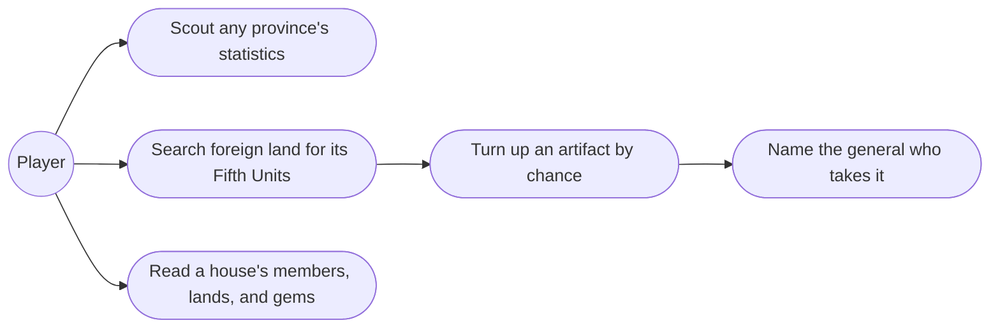
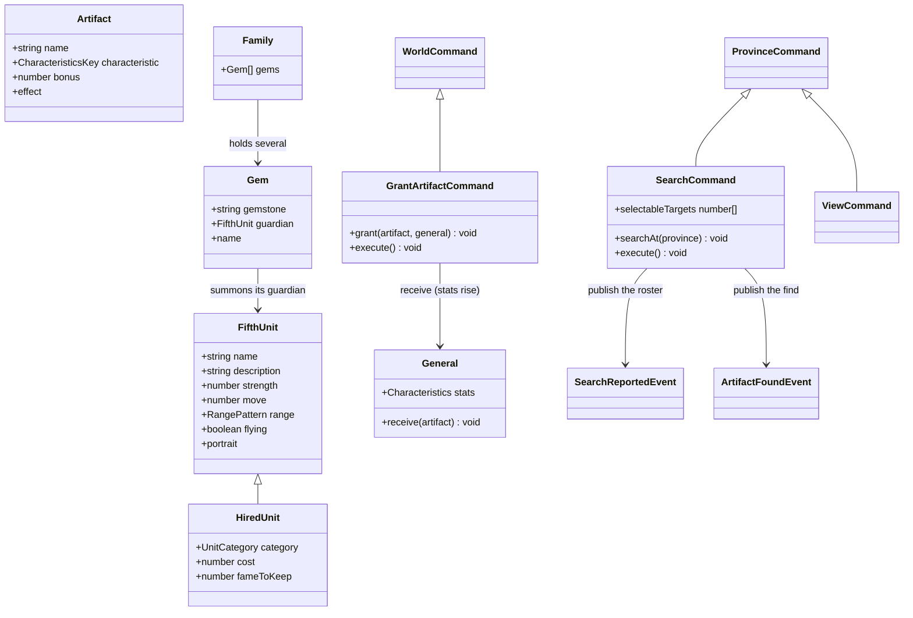
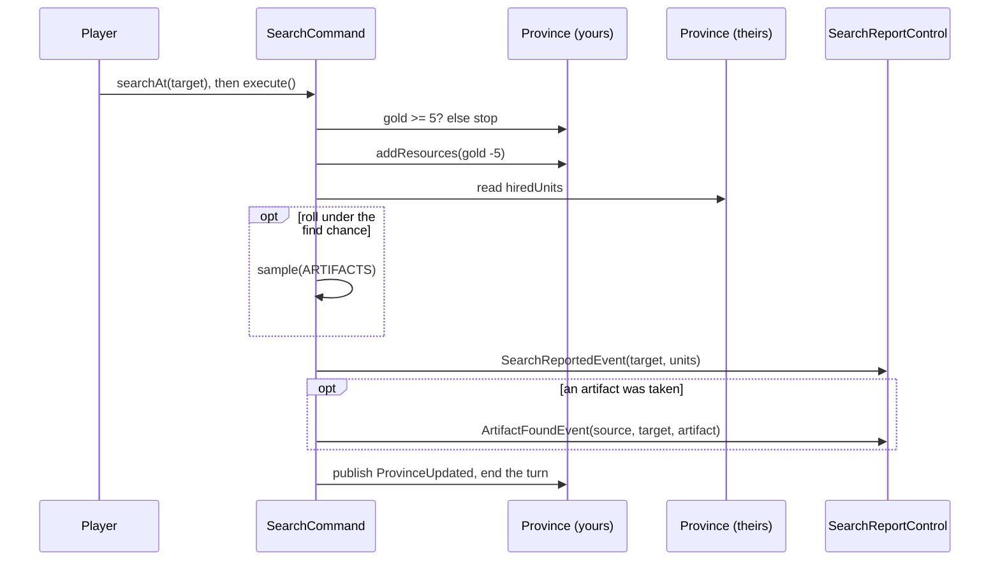
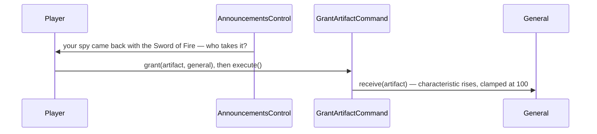

# 7. Search, Treasure & Gems — Design

## Description

What a house can learn about land it does not own, the treasure a spy stumbles on, and the gems that mark a house's power.

Two commands split the looking. **View** is free and reads any house's affairs — a province's statistics whoever owns it, the owning house's members and lands, and the gems its ruler has collected. That is the scouting you do before an attack, and the reveal feature 1 deliberately kept out of the always-on panel and deferred to here. **Search** costs the province's turn and 5 Gold to send a spy, and buys the two things View is forbidden to give: the Fifth Units stationed in foreign land, and the chance of turning up one of the kingdom's eight artifacts.

Gems enter the game here as what the spec says they are: house-level assets, seeded per scenario, held several at a time. What they cannot do here is change hands. A gem is never found, bought, or won by taking a province — only by ending the house that holds it, so claiming lives with feature 9's fall of a house.

`SearchCommand` already exists as a turn-burning stub and `ViewCommand` already opens the family overview. This feature gives Search behaviour, gives View a target, and introduces `Artifact` and `Gem` with their catalogues.

## Glossary

| Term      | Meaning                                                                                                                       |
| --------- | ----------------------------------------------------------------------------------------------------------------------------- |
| Search    | Sending a spy into a province another house holds: costs the turn and 5 Gold, reports the Fifth Units stationed there, may find an artifact. |
| Artifact  | One of eight items that permanently raise one characteristic of one general (§5.10). Modelled as `Artifact`.                  |
| Grant     | Naming the general who takes a newly found artifact: their characteristic rises for good and the artifact is spent. Done at the find, never later. |
| Gem       | One of the six wizard stones Princess Robyn loosed from the crown, or Gemfire itself with the dragon's ruby still in it. Owned by a house, never by a province or a person (§7.2). Modelled as `Gem`. |
| Guardian  | The Fifth Unit a Gem lets its house summon, named for its Gem (Zendor, Pluvius, the Dragon…). A `FifthUnit` like a hired monster, held by the Gem rather than being it; it fights in feature 8. |

## Functionality

- Scout: the View order takes any province — yours, a rival's, or neutral — and shows its governor, resources, and development, along with the owning house's members and lands. Free, and it ends nothing.
- Search: from a province you control holding at least 5 Gold, send a spy into a province another house holds. The Gold and that province's turn are spent, and the report names the Fifth Units stationed in the target with the Strength of each.
- Find an artifact: a search may also turn up an artifact nobody has found yet, which arrives as its own piece of news once the report is closed.
- Give an artifact to a general: the announcement of a find asks which family member takes it. Their characteristic rises by the artifact's bonus, capped at 100 like every characteristic, and that rise is all that remains of it.
- Learn who holds a gem: viewing a house shows the gems its ruler has collected, whoever that house is. Free, like the rest of View.
- Hold several gems: a house can hold more than one gem at a time, each shown with its Guardian's Strength.

## Use cases



## UI

**Scouting** rides the targeting machinery that already exists: the View tile lights every province, and the selected one fills the info panel with full detail while the order is open — the same trick Change Lord uses to show a target while you choose. The overview stays shut until a province is picked, because it covers the map it would otherwise be picked from, and then opens on that province's house; picking neutral land leaves it shut, since no house rules there. Closing the order returns the panel to your own province.

**Search** is a targeting command like Move Troops: selecting the tile lights the searchable provinces, and confirming spends the Gold and the turn. The result is a **report over the map** (like the Hire Monster modal), because a list of enemy units wants room and the player should read it before the turn moves on.

```text
+--- Spy report: 4: Anjou (Lyle) ------------------ [Close] -+
|  Fifth Units stationed there                               |
|  +-------+ Warriors    str 180                             |
|  +-------+ Gargoyles   str 120                             |
+------------------------------------------------------------+
```

When the province stations nothing, the list reads "No Fifth Units stationed there." The report says nothing about artifacts either way — it is the intelligence the 5 Gold bought, and nothing else.

**A find is announced**, through the queue feature 6 built for a deserting unit, once the report is closed. It is the first announcement that asks for something rather than only telling the player: the artifact's name, what it raises, and a picker of the house's members, each shown with the characteristic the artifact would raise. Continue is not offered until one of them takes it, so nothing is carried home unclaimed. The picker defaults to the searching province's governor, so the fast path is one confirm.

```text
+--- over the map -----------------------------+
|  Your spy came back from Anjou               |
|  with the Sword of Fire.                     |
|  War +30                                     |
|  It goes to  [ Erin  50    v ]      [ Take ] |
+----------------------------------------------+
```

**The overview** opens on whichever house you viewed rather than only your own, and gains one tab beside General, Land, and Fifth Units: **Gems**, listing that house's gems with their Guardians — free intelligence, which is what makes Search's 5 Gold buy so little and yet matter so much. There is no Artifacts tab and no artifact anywhere else in the interface: an artifact appears once, in the announcement that asks who takes it, and after that the only trace is a characteristic that reads higher than it did. General, Land, and Gems read the same for a rival house as for your own; **Fifth Units** is the exception — empty for anyone but you, with a line pointing at Search.

```text
+--- View: Blanche ------------------------------------------ [Close] -+
|  ( General ) ( Land ) ( Fifth Units ) ( Gems )                       |
|  +----+ Erin      INT 62  WAR 100  CHA 71   Fame 9                   |
|  |pic | ruler     Lorraine                                           |
+----------------------------------------------------------------------+
```

## Research

**View scouts, Search spies — the split is in the sources.** The FAQ is explicit that View shows "the gold, food, soldiers, loyalty, cultivation, protection, and ruler of any territory" (§4.4), and the manual's command table calls View "Spy on another province" — so reading a rival's statistics is free and unlimited. Search exists for the one gap: "The Search command does the one thing that View cannot, see 5th Units of foreign lands" (FAQ §4.4), which Hartman confirms from the other side — "You can't view the fifth units of a foreign state without using the search command." The manual draws the same line from inside the command list: "View: View your own **or other** province data", but "Fifth Unit: View **your own** special forces" — the one tab that is yours alone. That is why the roadmap's "scout a rival province" and "spy on a rival province's Fifth Unit" are two mechanisms rather than one, and why only the second costs anything. Feature 1 already anticipated this: it kept the map-selection panel at identity only for land you do not own and named the reveal as this feature's job, so scouting is a new *order*, not a loosened panel — the always-on summary stays quiet, and asking costs a click rather than a turn.

**Search costs the turn and 5 Gold.** Every source agrees it ends the turn: appendix-d lists it among the turn-consuming actions, and the FAQ calls it "the only Player command that ends the player's turn" — so much so that it advises saving first and reloading to get the turn back. Hartman supplies the price: "It costs 5 gold to use this command, and it expends the current state's turn." The FAQ corroborates that Gold pays for Search without giving a figure (§3.1). Goodwill is 0 (appendix-d D.5), so spying on a neighbour costs no standing.

**The target is a rival house's land — not your own, and not neutral.** Both sources say *enemy*: Hartman has Search investigate "another enemy controlled province", the FAQ has the player "Searching enemy territories". Neutral land is nobody's, so it is not a target, and the rule reads the same way from the other end — everything a search reports belongs to a house rather than to the ground. The Fifth Units are the owner's, the gems are the owner's, and a province with no owner would leave a spy with nothing to bring home but the artifact. Your own land is excluded for the same reason it needs no spy: you already see it. Neither source mentions adjacency, and a spy is not an army, so any rival province is reachable however distant. That is the weakest part of the rule: if a version limits Search to neighbours, only `selectableTargets` changes.

**The eight artifacts, and what a find means.** The catalogue is canonical in spec §5.10 and repeated verbatim in the FAQ: Silver Sword (War +25), Sword of Fire (+30), Sword of Victory (+40), Scroll of the Planets (Intelligence +25), Scroll of Knowledge (+30), Scroll of the Sages (+40), Moonstone (Charisma +30), Dragon Jewel (Charisma +40). They matter more than their numbers suggest, because the FAQ says a characteristic "can be increased only through good events on the territory where he or she rules or a Search item" — artifacts and events are the only growth in the game. Two things the sources do not give: how often a search finds one ("sometimes randomly", no rate) and whether an item can turn up twice. Neither guide says the eight are one-of-a-kind, so we do not pretend they are: a search rolls its chance and, on success, draws any of the eight, the Sword of Fire as readily the second time as the first. That keeps the world free of a found-so-far ledger — nothing to seed, save, or reconcile — and it is self-limiting anyway, since a characteristic stops at 100 and a house runs out of generals worth raising long before it runs out of searches. The chance itself is one flagged config constant, a probability rolled per search (0.25 to start) rather than a countdown to a guaranteed find — a spy who has come back empty four times is owed nothing.

**A grant is permanent, not equipment.** The sources describe an artifact as *raising* a stat ("Raises Military Strength +25"), and the FAQ counts it as one of only two ways a characteristic can ever increase — not as a modifier a general wears. So granting spends the artifact: the characteristic rises for good, `Stat` already clamps it at 100, and the excess is lost. That clamp is the whole decision in the feature — the +40 items are worth saving for a general who can absorb them, and an irreversible grant makes the choice matter. Modelling artifacts as removable equipment would contradict every line of source we have.

**The artifact is claimed at the find, not banked.** A found artifact goes to a named general immediately — the announcement asks who takes it and withholds Continue until someone does — so a house never holds an unassigned artifact and there is no inventory to model, no Artifacts tab, and no `Family.artifacts`. Nothing is recorded on the general either: the bonus lands on a characteristic and the artifact is done, which is exactly how the guides describe it — an item that raised somebody's stat, never a possession anyone consults later. Nothing in the sources describes an assignment step at all (appendix-d has no Equip command, and no cost or turn charge is documented anywhere), so nothing suggests a stock of items waiting to be handed out; the only thing the guides ever describe is an item that raised somebody's stat. Claiming on the spot also sharpens the one decision the feature has: you spend the +40 on the generals you have now, at the fame and stats they have now, rather than shelving it until a perfect recipient appears. The picker defaults to the searching province's governor, so the fast path is one confirm.

**A find is news; the roster is intelligence.** The two halves of a search want different screens. The Fifth Units are what the 5 Gold bought — a list the player asked for, read once, forgotten by the next turn — so they belong in a report modal that stays until dismissed. The artifact is a surprise that changes a general permanently, and the guides describe it that way: it "sometimes randomly turn[s] up" (FAQ) rather than being part of what you asked to see. Surprises in this game arrive as messages, and feature 6 already built that channel for a deserting unit, so a find is published as its own event and announced through the same queue once the report closes. Two consequences make it worth the split: the announcement already filters to the player's own house and queues when several land at once, and the report stays a pure list rather than growing a form. It does mean announcements gain their first *asking* variant — a picker and a Take in place of Continue — which is where feature 15's events with choices will land too.

**Gems are seen through View, and won only from a fallen house.** The manual promises Search will "look for gems" and its command table reads "Search for other gems", which is easy to misread twice over — as finding a gem, and as Search being how you learn who holds one. It is neither. The FAQ puts gem visibility on the ruler's View screen: View-One works on "a specific vassal in any family", and "Rulers have two other features visible: The Fame stat and a simple graph, showing which parts of Gemfire the ruler has thus far collected." So knowing who holds what is free, repeatable, and costs no turn, while the two detailed guides describe Search's output as Fifth Units and items with no gem among them. We follow the guides: Search reports what View may not show, and the gem line lives on the ruler. Spec §7.7 settles it: "the Search command can also look for Gems: Search reveals which families hold them but never transfers one. Acquisition is solely through family absorption." And absorption is not conquest of land — "Capturing a single province does not automatically transfer the enemy house's Gem", because a gem belongs to the house (§7.2); it moves when the house itself goes, by surrender, by its ruler being recruited and the family absorbed, or by banishment with no heirs. The manual says the same thing from the winning side: force a surrender and "you will claim all their former provinces and gems!" So this feature models gem *intelligence* and gem *holding*, and the roadmap's claiming moved to feature 9, next to knocking a house out of the game, with the heirless collapse in feature 11.

**Gem ownership is authored data, not derived.** The king inlaid seven gems in the crown called Gemfire, but only six are loose in Ishmeria: Princess Robyn "worked the magical gems out of the crown and hurled them into the midnight sky", and was caught as she struggled with "the very last stone, the red ruby of the dragon", which never left it (manual, The Legend of Gemfire). So a house holds one of the six wizard stones — or it holds the crown, which is what the Dragon really is, and why the Dragon sits with Eselred at Lankshire rather than being scattered like the rest. Per-scenario ownership is canonical in appendix-b §B.3, and the spec warns it is authored rather than inherited: "Flax defeats Coryll, yet Empyron passes to Tate, not Flax." So each scenario seeds its own gem-to-house map beside the rest of its province and family data, exactly as the hire pools were, and nothing tries to compute it.

**A gem is a stone; its guardian is a Fifth Unit.** Strength, Move, and Range are properties of the thing that stands on a battlefield, not of a jewel, so they do not belong on `Gem` — a house that holds Zendor holds a stone with a wizard in it, and what fights is the wizard. Feature 6 saw this coming and deferred it: it modelled the concrete `HiredUnit` and promised "a shared `FifthUnit` seam when the second occupant lands, rather than abstracting speculatively." The second occupant is here, so the seam is due, and it costs nothing invented — every field it holds is one both occupants already have. A guardian is a plain `FifthUnit` for now, with no subclass of its own, because everything that would distinguish it is battle behaviour it does not yet have: no upkeep to skip, no cooldown to sit out, no immunity to death. When feature 8 gives it those, `Guardian extends FifthUnit` is where they go, and Pastha (feature 15) joins as the third occupant.

**Whether regular troops share that base is Battle's call, not this one.** Horsemen, knights, and archers will also have a strength, a move, and a range, and it would be strange to describe the same idea twice — but no troop unit exists in the code yet, and inventing one here to parent it would be guessing at a feature we have not designed. `FifthUnit` is named for what it is today; if Battle's troop units turn out to share the shape, lifting the base to a common combatant is a rename plus a new subclass, not a redesign, and it will be done with the third case in hand instead of imagined.

**Guardian statistics are recorded now, unused until battle.** Each Gem's Guardian has canonical Strength, Move, and Range in appendix-c §C.3 (Dragon 160/2/Largest, Pluvius 160/2/Circular, Zendor 150/3/Circular, and so on), and §E.6 gives each its gemstone and element. Following the hired catalogue's precedent, each `GEMS` row carries all of it on its guardian even though only Strength is displayed here — capturing the data once at its canonical source beats a later data-entry pass, and `RangePattern` already models circular, which no hired unit uses.

**Nothing a spy learns is stored.** A search report is read once and then gone: there is no intelligence ledger, and nothing remembers which units stood in Anjou last spring. It needs none, because the two halves of intelligence age differently — gem holdings barely move and View re-reads them for free at any time, while a garrison changes month to month and is worth exactly the turn you spent on it. Storing the perishable half would quietly turn one spy into permanent vision.

## Domain model



Both catalogues are config: `ARTIFACTS` is eight rows, `GEMS` seven — the six loosed stones and the crown's own Dragon, which the model treats alike since a house holds either the same way. A find is `sample(ARTIFACTS)`, and nothing records it afterwards.

Two things the diagram cannot show. Extracting `FifthUnit` renames `HiredUnit.type` to `name`, which touches `Province.hasUnit`, the Hire Monster command and dialog, and their tests. And `receive` is `this.stats = this.stats.add({ war: 30 })` — `Stats.add` already returns a clamped copy, so the 100 cap needs no new arithmetic and the only change it forces is that `General.stats` stops being `readonly`, like `Family.ruler` and `Province.hiredUnits` before it.

## Flow





## Persistence

Each family contributes the gems it owns. Generals contribute nothing new — a received artifact lives on only in the characteristic it raised, which is already saved. Spy reports are not saved: a search is read once, and a saved game reloads with no memory of it. Gem holdings need no saving of their own beyond `Family.gems`, since View reads them fresh whenever the player asks. (Save/load is feature 17.)

## Tests

- **Search (unit):** spends 5 Gold from the searching province and ends its turn; reports the target's stationed units; refuses when the province holds less than 5 Gold; offers only provinces held by another house as targets — never your own, never neutral.
- **Find (unit):** the roll decides — a successful one announces an artifact to the searching house, a failed one announces nothing.
- **Grant (unit):** the characteristic the artifact names rises by its bonus, and anything above 100 is lost.
- **Fifth Units stay secret (control):** the overview's Fifth Units tab is empty for every house but the player's.
- **Claiming a find (control):** an announced find offers the player's own family as recipients and withholds Continue until one of them is chosen.
