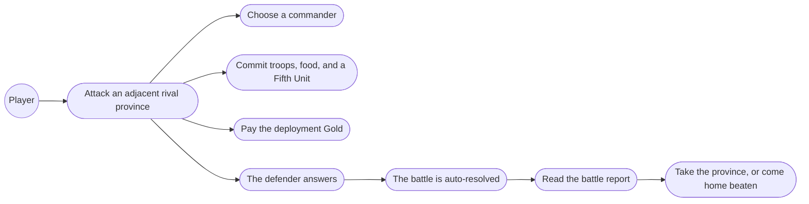
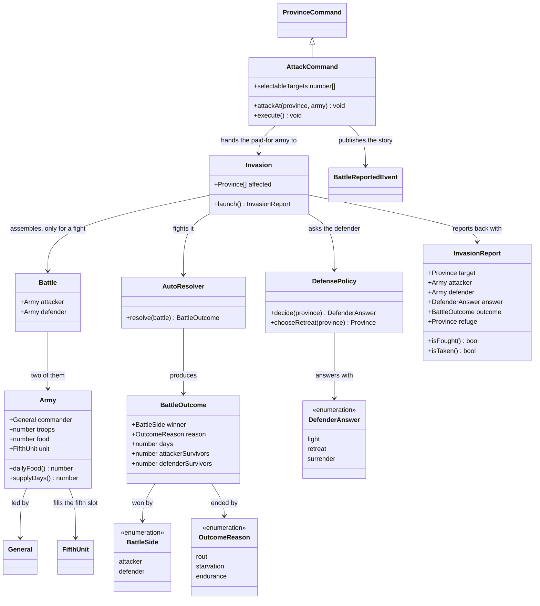
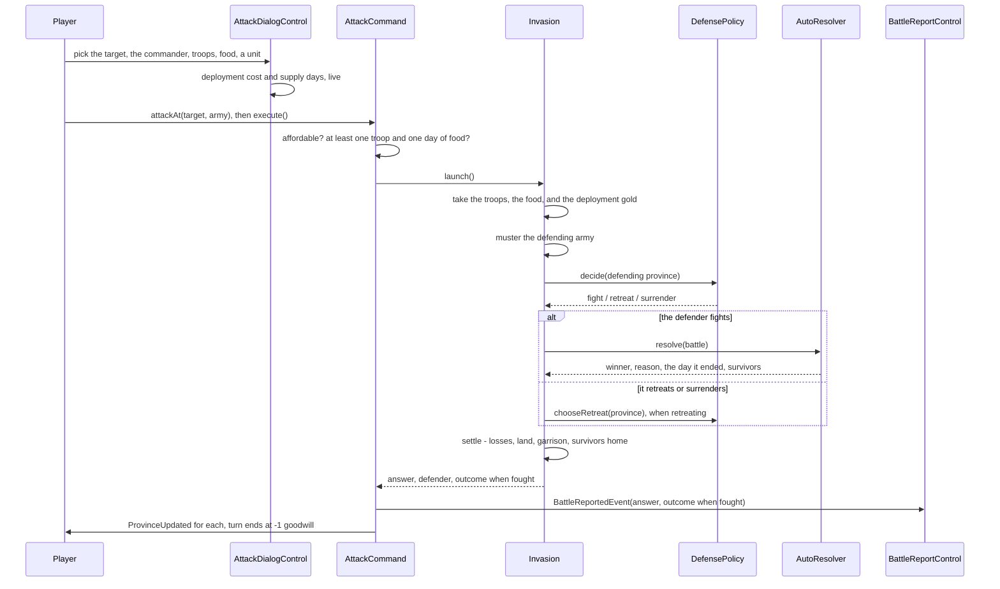
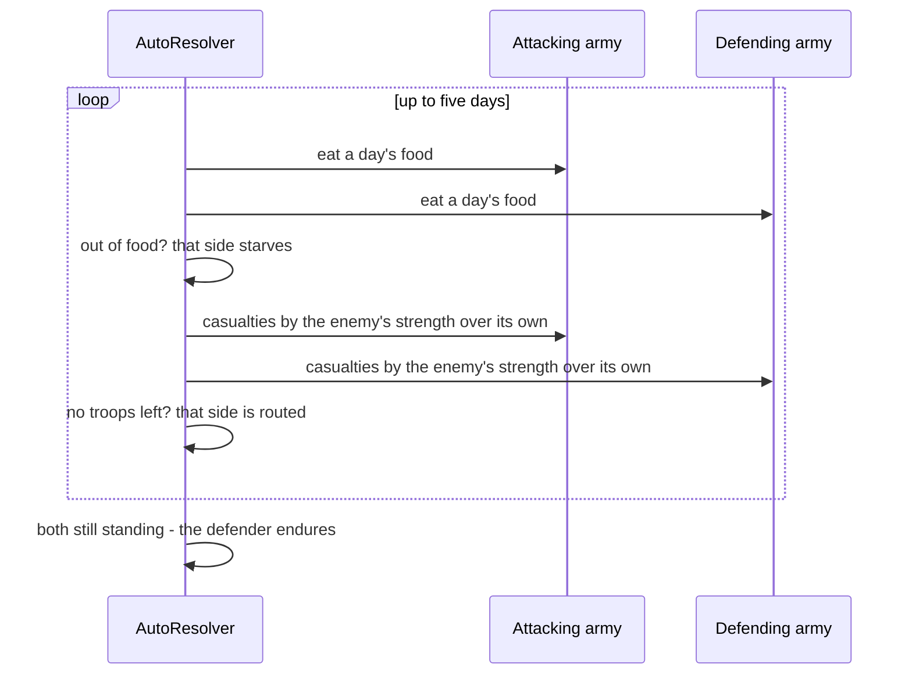

# 8.1 Launching a War — Design

## Description

The strategic half of war: the Attack order that sends an army into a neighbour another house holds, the answer the defender gives, and the settling that hands over the land.

First of feature 8's five stages, and it stops at the edge of the battlefield — a commander, troops, food, a Fifth Unit and the deployment Gold go out, and a verdict comes back, but there is no field, no cells, no facing. The verdict comes from **auto-resolution**, which plays the battle out day by day on supply and strength alone. That is not scaffolding: `Auto` is an army-level battle command in the sources (§D.3), so 8.5 replaces the arithmetic behind the seam rather than the seam itself.

`AttackCommand` already exists as a turn-burning stub, already recording the −1 goodwill the sources specify. This feature gives it a target, a dialog, an army, and a consequence.

## Glossary

| Term | Meaning |
| --- | --- |
| Invasion | One province sending its army into a neighbour another house holds, from the moment the army marches to the moment the land settles in one pair of hands. The whole event the Attack order sets off, in three parts: the defender's answer, the battle if the defender fights, and what it leaves on the map — the province in the winner's hands with the surviving army garrisoning it, or the beaten attacker's survivors back where they came from. One invasion per order, and it is over inside the month that started it. |
| Battle | Two armies in the field, fighting until one breaks, starves, or the fifth day passes. Only a defender who answers Fight raises one, so an invasion has at most one battle and often none — the battle decides who wins, never who ends up holding the province. |
| Army | What a province puts into an invasion: a commander, troops, food, and at most one Fifth Unit (§9.3). The attacker's marches out of its province and is gone from it until the invasion ends; the defender's is whatever the invaded province can field where it stands. |
| Commander | The general who leads an army. Never a unit on the field; his WAR sharpens the troops he leads (§6.2). Chosen from the generals seated in the acting province. |
| Defender's answer | What the invaded province does when the army arrives: Fight, Retreat, or Surrender, the last only when it can do neither of the others (FAQ). Two of the three end the invasion without a battle. |
| Deployment | The Gold sending an army costs, `troops / 8 + 10` (§6.1) — paid by the attacking province the moment it marches, kept whatever happens after. |
| Supply | The food an army eats each day in the field, `(troops + hired Fifth Unit strength) / 10 + 1` (§6.9), and so the days it can stay there. An army out of food loses however strong it still is. |
| Auto-resolution | Fighting a battle without playing it on the field (§D.3) — here a day loop over supply and strength, in 8.5 the real simulation run headlessly. Modelled as `AutoResolver`. |
| Report | What an invasion is remembered by: both armies, the answer, and the battle's outcome when there was a battle. The player reads it over the map; nothing keeps it afterwards. |
| Outcome | How a battle ended and which side won: a rout with nothing left standing, a starvation, or the defender enduring all five days. Belongs to the battle, not to the invasion — a surrender hands over a province with no outcome at all. |
| Guardian | The Fifth Unit a Gem lets its house summon (§C.3). Belongs to the house rather than to a province, and eats nothing (§6.9) — the two ways it differs from a hired unit. |

## Functionality

- Attack an adjacent province held by another house — never your own land, never neutral land (Move Troops claims that), never an ally's.
- Choose the commander from the generals seated in the acting province, defaulting to its governor.
- Commit troops and food out of the acting province's own stores.
- Fill the fifth slot: a hired Fifth Unit stationed in the province, or a Guardian summoned from one of the house's gems.
- Watch the deployment cost and the supply days move as you set the numbers, and be refused the order until the province can pay for what you have asked for.
- Have the defender answer: Fight with the province's own troops and Fifth Unit, Retreat to a neighbour with the lord and his soldiers, or Surrender when there is nothing left to fight or flee with.
- Have the fight settled day by day, to a limit of five days, on troops, Fifth Unit strength, the commanders' WAR, and each side's supply.
- Read a report of what happened: who led each side, what each committed, how the days went, and the verdict.
- See the province change hands when the attacker wins, garrisoned by the surviving army under its commander.
- See the beaten attacker's survivors come home, and the province stay where it was.

## Use cases



## UI

**The order is a targeting command** like Move Troops: selecting the Attack tile lights every neighbouring province another house holds, and picking one opens the commitment form. The form is the busiest in the game so far — four decisions and two derived figures — but every part of it already exists: the general picker Change Lord uses, the amount fields with their quarter/half/all fractions from Move Troops, and the Fifth Unit dropdown from carrying a unit along.

The two derived figures are what make the form readable. Deployment Gold and supply days both move with the troop count, in opposite directions, and both are the reason an attack fails before it starts — so they sit together on one line under the fields, and Yea stays disabled until the province can pay the Gold and the army carries at least one day of food.

```text
+--- Attack -----------------------------------+
|  Attack where?                               |
|  6: Hyland (Lyle)                            |
|                                              |
|  Who leads?                                  |
|  [ Erin         WAR 87     v ]               |
|                                              |
|  How many troops (1-156)?                    |
|  [ 156 ]  (1/4) (1/2) (3/4) (all)            |
|                                              |
|  How much food (16-189)?                     |
|  [ 120 ]  (1/4) (1/2) (3/4) (all)            |
|                                              |
|  Bring a 5th unit?                           |
|  [ Zendor      str 150     v ]               |
|                                              |
|  Deployment 29 gold - supply 7 days          |
|                                              |
|            [ Yea ]      [ Nay ]              |
+----------------------------------------------+
```

**The verdict is a report over the map**, on the machinery the spy report already built: it wants room, and the player must read it before the turn moves on. It names both commanders, what each committed, and what each has left, because those are the facts that shape next month. The heading carries the verdict and the day it fell on — the day count being the visible face of the food timer this stage is built around. There is no day-by-day ledger: the original never showed one, the player cannot act on it, and the arithmetic it would expose is provisional anyway.

```text
+--- Hyland holds out for five days ----- [Close] -+
|              Erin  (you)           Seth          |
|  troops              156            132          |
|  5th unit         Zendor        Pluvius          |
|  left                 31             18          |
|                                                  |
|  Hyland holds. Erin comes home with 31 troops.   |
+--------------------------------------------------+
```

A won attack reads the same way with the verdict reversed — `Hyland falls on the second day` — and the closing line says who garrisons it. A defender who retreats or surrenders produces a report with no day count and no losses, just the answer and its consequence: `Seth flees to Carveti with 132 troops. Hyland is yours.`

The Attack tile itself needs no new art — `attack.webp` has been sitting in the icon set since the military icons landed.

## Research

**The order targets an adjacent province held by another house, and nothing else.** Every source says adjacent, spec §6.3 most plainly: "A province can only directly attack neighbouring provinces." Every source also says another house's: the FAQ has battle begin "when one territory uses the Attack command to invade another territory", with a *person being invaded* who answers. Neutral land is excluded because feature 5 already took that job — you claim empty land by walking into it with Move Troops, and there is nobody there to answer an invasion. An ally's land is excluded by the manual's own rule: "The ruler must break an alliance before allying with another family, or before attacking an ally." `Family.ally` already exists as a field, so the guard is written now and starts mattering when feature 10 makes alliances real.

**The deployment cost formula is corroborated to the gold.** Spec §6.1 gives `Troops / 8 + 10`, and Hartman independently reports "roughly 22 gold per 100 soldiers you are going to deploy" — the formula returns 22.5 at exactly 100 troops. His figure is a rule of thumb rather than a rate, though — the formula charges 35 for 200 troops, not 44. Rounding is an open question in spec §6.13, so we floor it and flag the constant.

**Supply is the second price of an attack, and the sources agree on it exactly.** Spec §6.9 and the FAQ give the same formula — `Food needed per day = 1/10 × (troops + 5th Unit strength) + 1` — and both make the same exemption: Gem Guardians eat nothing, hired Fifth Units eat. The FAQ also describes the interface we are copying: "The food rations remaining on each side are represented by the number below each side's commander's name. The number in the parentheses is how many days' worth of food that number is." So supply days are a *displayed* quantity in the original, not an internal one, which is why they belong on the commitment form rather than only in the resolver.

**Five days is both the ceiling and the defender's victory.** The manual lists "When attacked, defend your flag for 5 days" among the ways to win, and Hartman reports from play that "battles rarely, if ever, exceed five days in length". Those are the same fact from two sides: the battle is time-boxed, and the box closes in the defender's favour. That single rule is what makes the auto-resolution honest without a battlefield — the day count is not an invention of this stage, it is the shape the sources describe.

**Troops come from one province, and not all of them need to go.** The FAQ is explicit: "In the event of attacking another area, troops will be gathered from just one territory's pool, although not all of them have to be used." So the commitment is bounded by the acting province's own stores, exactly like Move Troops, with no pooling across the house. The FAQ's own advice — "Make sure there are enough troops built up to defend the territory they're coming from and the territory they're going to" — is advice, not a rule, so the form lets the player empty a province and does not warn him.

**Nobody fights without troops.** "Even if there's a healthy 5th Unit available, one side cannot enter combat without actual troops available" (FAQ §5.1). That one line settles three things at once: the attacker must commit at least one troop, a Fifth Unit is never an army by itself, and a defender holding a monster but no soldiers cannot answer Fight. It is also the reason Surrender exists as an answer at all.

**The commander is a real choice, and the seated generals are the candidates.** Spec §6.3 lists the commander among the things chosen before an attack, and §6.2 says he may be the ruler, a vassal, or the province's own lord. The manual's one-line description of the order ("Select a province to attack and ready war supplies: food and gold") omits him, but it omits the troop count too, so it is a summary rather than a contradiction. Who is available follows from the model we already have: `World.getResidence` seats a lord in the province he rules and every idle vassal at the family's home province, so the candidates are the acting province's governor plus — when the acting province is home — the family's unassigned vassals. So the home province can field the family's best idle general, while a lorded province is stuck with its lord. The picker defaults to the governor, so the fast path is one confirm, and it shows each candidate's WAR because that is the only stat that will matter.

**Both occupants of the fifth slot are in, and only the cooldown waits.** The manual's answer menu reads "Fight: Call up a Fifth Unit and defend your castle", and the FAQ says "both sides get to pick a 5th Unit of their choosing" — and in scenario 1 all seven families hold exactly one gem each, so a Guardian is not an exotic case but the normal contents of the slot. Both occupants are ready to field: feature 6 stationed the hired units, feature 7 seeded every gem with its Guardian's canonical Strength, Move and Range, and the `FifthUnit` base it extracted for the second occupant is exactly the type the slot needs. What 8.4 still owes is the *limit* on summoning — the 3-month cooldown after use, 5-month after defeat (§7.5) — and the calendar machinery to track it.

Deferring the Guardian would have cost more than it saved, because the food exemption (§6.9) has to be written either way, and with nothing to exempt it would sit untested in the formula for three stages. Fielding it now also forces the one difference that matters: a hired unit is stationed in a province and marches with an army, while a gem belongs to the house (§7.2), so its Guardian is summoned from wherever the house is fighting and is left behind nowhere afterwards.

The interim distortion is worth naming rather than discovering. Until the cooldown lands a Guardian is strictly better than a hired unit on every axis — no hiring cost, no upkeep, no desertion, no food, and it cannot die — so stages 8.1 to 8.3 over-value gems, and nothing stops two of a house's provinces summoning the same Guardian in one month. It is milder than it sounds because every house has one and both sides of most battles will field one: a fixed strength added to both sides compresses the ratio toward parity, which under this resolver quietly favours the defender's endurance. The five-day draw in the report above is exactly that effect: Petaria's whole army behind Zendor cannot break Hyland while Pluvius stands beside Seth, where the same attack on a Guardian-less Hyland routs it on the second day — a balance quirk, not a broken rule.

**The defender's answer is a rule now and a question later.** The FAQ gives the menu and its availability: "The person being invaded will have the option to Fight, Retreat, or Surrender. Surrender isn't an option unless the person being attacked has no men or food and doesn't have somewhere to retreat." The manual says the same from the other end — "Surrender your vassals and goods to the enemy. If you still have soldiers or food, you will be forced to fight or flee" — and describes retreat as fleeing "to the home province or a neighbouring province", choosing the path on the map when there is more than one. So the answer is three options gated by two conditions, and all of it is domain logic we can write and test today. Two of those three mean there is no battle at all, which makes the answer a fork in the invasion rather than a property of one: only Fight builds a `Battle` and calls the resolver, so `AutoResolver` never sees a non-fight and `OutcomeReason` narrows to the three verdicts a fought battle can reach.

What we cannot do today is *ask* the player. Rival houses do not take their own turns until feature 12, so no attack can ever land on the player's land in this stage — the human answer has no trigger, and building the modal that carries it would mean shipping a screen nobody can reach or verify. This project has deferred on that basis before: feature 6 declined to abstract `FifthUnit` until a second occupant existed, and got a better seam for waiting. So the roadmap's "when your land is attacked, choose to fight, retreat, or surrender" moves to feature 12, where it becomes a prompt in front of a decision this stage already implements. What ships here is `DefensePolicy`, which answers for a defender the player does not control: Fight while it has troops, Retreat to a neighbour of its own house when it has none but has somewhere to go, Surrender when it has neither. Those are the FAQ's availability rules read as a preference order, which is as close to authored behaviour as an undocumented AI gets.

**The order is not the war.** `AttackCommand` does what every other command in the rail does — offers its targets, checks that the province can pay for what was asked, publishes what happened, and ends the turn at −1 goodwill. Everything the order sets in motion — the deployment cost, mustering the defence, asking the defender, fighting the battle, and settling the land afterwards — belongs to `Invasion`, one domain object for one event. The command gets an `InvasionReport` back and publishes it whole rather than unpacking it. The feature keeps two records and no more: `BattleOutcome` is what a fought battle produced, `InvasionReport` what the whole order produced; the settling of the land is behaviour, not a third record, so it stays inside the invasion that does it. One vocabulary runs through all of it — `source` and `target` for the two provinces, `attacker` and `defender` for the two armies — so nothing is renamed on the way from the order to the report to the screen. That keeps the command the size of its peers, lets the whole war be tested without a turn queue or an event bus, and gives 8.2 an obvious seam: the battlefield replaces what `Invasion` does between the answer and the settlement, and the order above it does not change. `Invasion` mutates the map but publishes nothing; it knows which provinces it changed and the command asks it for them, because in this codebase commands talk to the bus and the domain does not. `BattleOutcome` and `InvasionReport` are different scopes rather than the same thing twice: the first is what `AutoResolver` produces from a fought battle — winner, reason, day, survivors — and exists only when there was a battle; the second is what the whole order produced, and holds the outcome when there is one.

**The resolution is shaped like the battle it stands in for.** The temptation is a single strength comparison, and it is the wrong shape: it would make food theatre. If the resolver ignores supply, the food field on the form is a lie, the supply-days figure is decoration, and the player learns a habit he will have to unlearn in 8.2. So the resolver runs the days: each day both sides eat, both sides take casualties in proportion to the enemy's effective strength over their own, and the day ends with three of the sources' five victory conditions live — rout when a side is wiped, starvation when a side's food runs out, endurance when the defender is still standing after the fifth day. Only flag capture and mid-battle retreat are missing, and both are grid concepts that arrive with the grid. Ties favour the defender, because the defender holds the ground and the endurance rule already says so. Casualties fall on troops alone: a Fifth Unit contributes its strength every day and takes none, since the destruction threshold is unresolved (D.6 #14) and damage to units is 8.3's subject.

The arithmetic is a guess and is labelled one here rather than in the code: every number of it sits in `config/battle.ts`, and the two reconstructed ones are `DAILY_CASUALTY_RATE` and `WAR_LEVERAGE`. It lives in `AutoResolver` rather than on `Army` so that the one formula 8.5 must be free to replace sits in a single place — leaving `Battle` as the plain pairing of two armies that 8.2 will hand to a battlefield instead of to the resolver. Effective strength is `(troops + hired strength) × (1 + WAR / 100 × WAR_LEVERAGE)`, one constant standing in for D.6 #9, "exact WAR contribution to combat". Daily casualties are `DAILY_CASUALTY_RATE × enemy strength / own strength` of a side's troops, one constant standing in for D.6 #8. At `DAILY_CASUALTY_RATE = 0.3` and equal commanders the break-even sits just above parity: 1.1:1 wins, but only on the fifth day and with a third of the army left, while 1.5:1 routs the defender on the third. So an attack that is merely bigger is a bad attack, which is the FAQ's whole posture toward attacking. Where that break-even falls is the one knob worth turning if the stage plays wrong; the day count and the win conditions are not knobs, they come from the sources. Casualties are recomputed from the surviving troops each day, so a bleeding army also eats less.

**Protection stays out of it.** The manual's battlefield legend says "Defense strength: unit strength equals the castle's strength", which invites wiring the Protection stat into the defender's side. Both detailed guides point the other way: the FAQ has Protection "primarily safeguard the territory against bad events", with only a vague "Protection lowers some in the event of warfare", and spec §4.8 records the same reading. The castle in that legend is a battlefield object — the wall around the defender's flag that the FAQ describes — so it belongs to 8.2 with the rest of the terrain, where it can be a wall rather than a multiplier. Leaving it out keeps one unresolved formula out of a stage that already carries two.

**The winner takes the land; the treasure and the people wait for feature 9.** The manual is maximal about the spoils — "the defenders will lose all their food, gold and territory, and the defending ruler will be completely at the mercy of the victor" — and that sentence is feature 9's entire subject: spoils, knocking a house out, taking its gems, ransoming and recruiting captives. This stage stops at the line between land and loot. The province changes hands, the surviving army stands in it, the beaten attacker's survivors come home with whatever food they had left, and nothing else moves. The same line settles retreat: the manual and FAQ both put a capture risk on a retreating lord, but there is nowhere to put a captive yet — no ransom, no recruit, no banish — so the roll arrives with the machinery that can answer it, and retreat here simply relocates the lord and his soldiers.

**The commander stays where his army stands.** Somebody must govern a conquered province, and the army is already standing in it, so the winning commander takes the seat. Where that vacates a governorship, `ChangeLordCommand` has already set the precedent for the displacement — a vacated province falls back to the family's ruler — and where the commander *is* the ruler, the existing model already has a word for the result: the taken province becomes `remote`, ruled at the distance penalty `effectiveStats` applies. This is the one judgement call in the feature with no source behind it. It is also the cheapest to reverse: if the original sends its commander home instead and seats the ruler, that is one line in the settling.

## Domain model



## Flow





## Persistence

A battle is transient: it is assembled, resolved, reported, and dropped inside a single province's turn, so nothing about it is saved. What the invasion leaves behind is all state that already saves — a province's owner, its governor, its resources, and the hired units stationed in it. `Army` and `BattleOutcome` never outlive the order that made them, and there is no such thing as a battle in progress to reload. (Save/load is feature 17; stage 8.2 will have to answer whether a battle on the field can be saved mid-fight, and the answer will probably be no.)

## Tests

- **Targets (unit):** offers only adjacent provinces held by another house — never the acting province, never a non-neighbour, never neutral land, never an ally's.
- **The commitment (unit):** takes the committed troops and food out of the acting province, charges `troops / 8 + 10` Gold, and spends the turn at −1 goodwill whether the attack wins or loses; refuses when the province cannot pay, when nothing is committed, or when the food will not cover a single day.
- **Supply (unit):** the daily rate counts a hired unit's strength and exempts a Guardian's, so the same army carrying either has different supply days.
- **The defender's answer (unit):** fights while it has troops; retreats to a province of its own house when it has none and has one; surrenders only with no troops, no food, and nowhere to go — the FAQ's availability rules, one test each.
- **Resolution, as properties not figures (unit):** a decisively stronger side wins; the same army with a higher-WAR commander does no worse than with a lower; an attacker that runs out of food loses however strong it is; a defender that survives five days wins; an even fight goes to the defender. No test asserts a casualty count, so 8.5 can replace the arithmetic without touching them.
- **Settling the land (unit):** a won attack moves the province to the attacker's house, seats the commander, garrisons the survivors, and leaves a hired unit that marched with them stationed there — while a Guardian, stationed nowhere, neither travels nor is lost; a lost attack leaves the province alone and brings the survivors home; a retreat moves the lord and his soldiers to the chosen neighbour and hands the province over without casualties.
- **The form (control):** deployment cost and supply days follow the troop count; the fifth slot offers the province's hired units and the house's Guardians together; Yea stays disabled until the province can afford the Gold and the army carries a day's food; the commander picker defaults to the governor.
