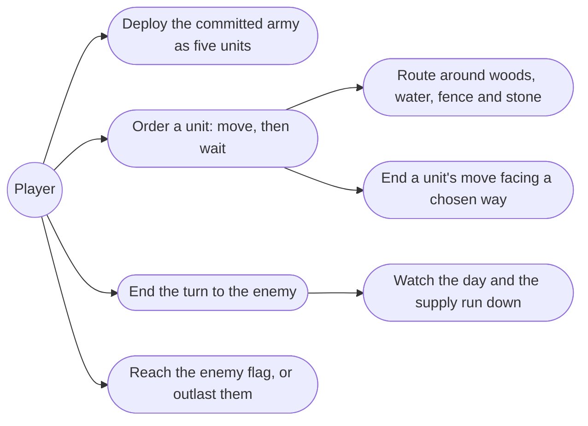
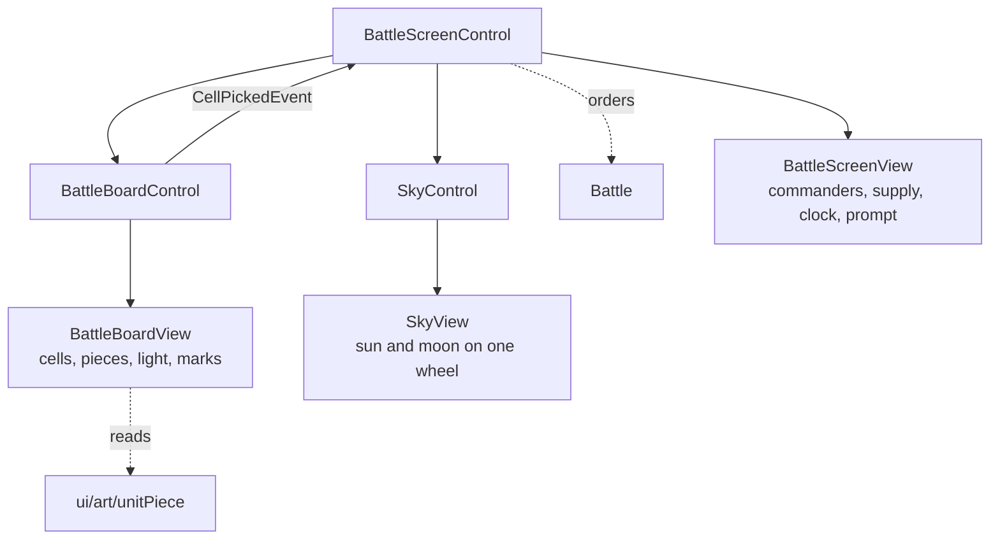
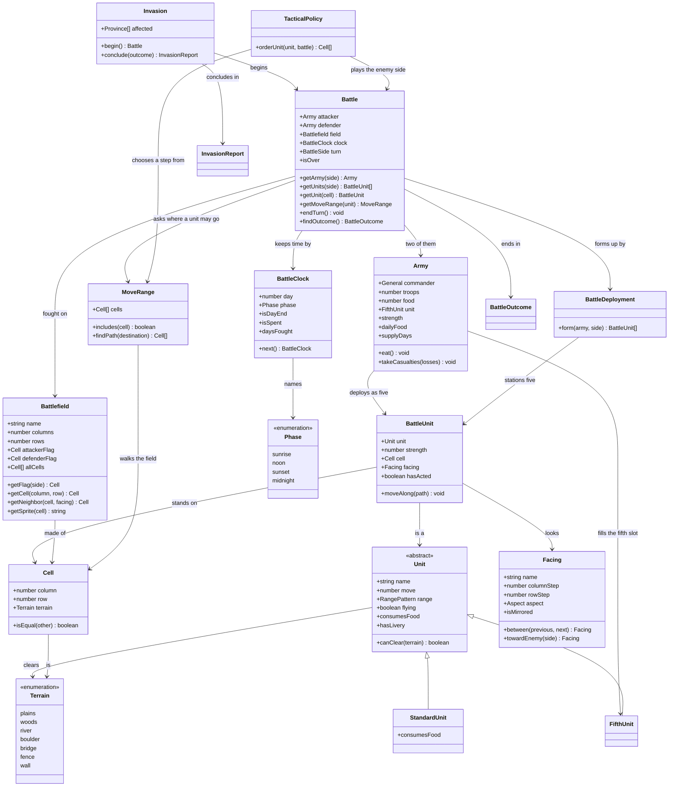
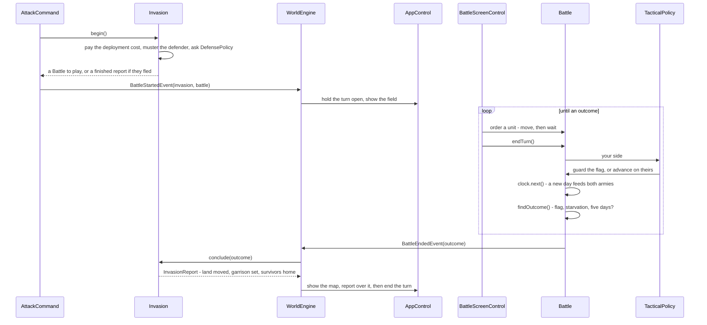

# 8.2 The Battlefield

## Description

The field itself: an army split into its five battlefield units, the defending province's own 10×8 map of woods, water, stone and castle wall, side-based turns across the sunrise-to-midnight day, movement that leaves a unit facing where it last stepped, and a race for the enemy flag.

Second of feature 8's five stages, and the one that turns a verdict into a game. 8.1 asked for a commander, troops, food and a Fifth Unit and handed back a result; here the same commitment is deployed, and the player wins it or loses it by where the pieces stand. No blows are struck — attack resolution, backlash and rout are 8.3, building and breaking fences is 8.4 — so a battle is decided by manoeuvre, blocking and supply: reach their flag, or outlast them, or as defender hold five days.

Two things make this stage cheaper than it looks. 8.1 shipped an invasion that already separates the fight from what follows it, so the field slots in where the strength ladder stood without disturbing the settlement behind it. And the thirty battlefields are no longer ours to invent: they are extracted, saved to `data/battlefields.json`, and described below.

## Glossary

| Term | Meaning |
| --- | --- |
| Invasion | One province attacking another: the whole affair, from paying the deployment cost to handing over the land. A battle is the part of an invasion that happens on a field — an invasion the defender flees or surrenders has none. |
| Battlefield | The ten-by-eight field a battle is fought on. Its terrain and both flags belong to the defending province, so invading the same province twice fights the same board (§9.2). |
| Standard unit | One of the four bodies of troops an army divides into when it deploys — Horsemen, two of Knights, and Archers (§9.3). What distinguishes them from the Fifth Unit is that they are shares of the troop count, where it is one hired creature or summoned Guardian; on the field both are a `BattleUnit`. |
| Facing | The direction a unit looks. Not an order the player gives: it is the direction of the last step of a move, and cannot be changed once the move is done (§9.12). |
| Day | Four turns to a side, named sunrise, noon, sunset and midnight. The unit that matters for supply and for the battle's limit — food is charged by the day rather than the turn, and the fifth day ends the fighting (§9.5). Kept by a `BattleClock`. |
| Flag | A side's base on the field, placed by the province's layout. Reaching the enemy's wins outright, which is what makes a battle a race rather than an attrition (§9.14).

## Functionality

- Deploy: an army's troops split into Horsemen, Knights, Knights and Archers with the remainder going to Horsemen, its Fifth Unit takes the fifth place, and the attacker forms up along the left edge against the defender on the right.
- Fight on the defending province's own field, loaded from its authored layout: plains, woods, river, boulder, bridge, fence, and the castle wall around the defending flag.
- Move a unit up to its move value, around what blocks it and over what only flying clears, then leave it facing the way it last stepped.
- Order each unit once per turn — move, then Wait — and end the turn with Done whether or not every unit has been used.
- Watch the day run sunrise → noon → sunset → midnight, four turns to a side, with each side's food charged as the day turns and the days of supply left on show.
- Win by reaching the enemy flag, or by their food running out; as defender, win by keeping your flag through the fifth day.
- Face an enemy that guards its flag when outmatched and comes for yours when it is not.

## Use cases



## UI

The battle takes the whole screen, because the map it replaces is the thing being fought over. The layout follows the manual's own battlefield legend (§On the Field), which numbers twelve elements: both commanders with their food and days of supply, the terrain, both sides' units, the day, the time of day, the place of war, both flags, and the command line.

The header is read across, as the original's is: your commander and supply on the left, theirs on the right, and between them the day, the place, and the sky. Header and command line are exactly as wide as the field, so the three read as one panel; the field itself is sized to fit whatever is left, never cropped and never upscaled past its native cell.

The field below is Londre's, exactly as `data/battlefields.json` has it — Eselred's capital and the one the campaign ends on, and by some distance the most difficult board in the set: sixteen river cells where no other field has more than seven, four bridges making three crossings, and an eleven-cell castle whose only opening faces east. Terrain fills its cell, a unit shows its kind and the way it looks, and a hollow mark is a cell the selected unit may step onto.

```text
┌─ Battle ──────────────────────────────────────────────────────┐
│ Erin                     Day 2                      Eselred   │
│ food 88, 5 days       Londre  (☀)          food 240, 8 days   │
├───────────────────────────────────────────────────────────────┤
│                  A  B  C  D  E  F  G  H  I  J                 │
│              1  ♠♠♠ ▫  ▫ ≈≈≈≈≈≈ ·  · ♠♠♠ ·  ·                 │
│              2   H↑ ▫  ▫ ═▫════ ·  ·  ·  ·  ·                 │
│              3   K→♠♠♠≈≈≈≈≈≈≈≈≈████████████ ·                 │
│              4   ◇  K→≈≈≈♠♠♠≈≈≈███ ·  k←╫╫╫ h←                │
│              5   A→≈≈≈≈≈≈≈≈≈≈≈≈███ ◆  a← ·  ★←                │
│              6   ☆↓═══ · ≈≈≈ · ███ ·  k←╫╫╫ ·                 │
│              7   · ≈≈≈ · ═══ · ████████████ ·                 │
│              8  ≈≈≈≈≈≈ · ≈≈≈ ·  ·  ·  ·  ·  ·                 │
├───────────────────────────────────────────────────────────────┤
│ ·  plains    ♠ woods     ▲ boulder    ═ bridge                │
│ ≈  river     ╫ fence     █ wall       ◇ flag                  │
│ ▫  a cell the selected unit can step onto                     │
│ H  horsemen  K knights   A archers    ☆ Fifth Unit            │
│ yours  H K A ☆ ◇         theirs  h k a ★ ◆                    │
│ each piece carries its strength, and greys out once ordered   │
│                                                               │
│ Horsemen at A2 — move where?          [ Wait ]  [ Done ]      │
└───────────────────────────────────────────────────────────────┘
```

Ordering follows the manual: select a unit — the command line names the one you picked and where it stands, as the original's does — answer where it should go, then pick a command — which in this stage is only Wait, since attacking arrives in 8.3 and fence work in 8.4. A unit that has been ordered is drained to grey and cannot be ordered again until the next turn, and Done hands over to the other side without requiring every unit to have moved. The command line names one of four states — choose a unit, move where, moving, or the enemy's turn — and the buttons follow from the state rather than being switched on and off by hand.

**A unit's strength rides on its tile.** Every piece is drawn with its troop count in the corner, the way a stack is labelled in Heroes of Might and Magic, so the board answers "how strong is that" without a roster down the side. The header therefore carries no army totals: five numbers on the field say more than one sum in the corner, and the original's side panels were a concession to a screen that could not draw a number over a sprite.

**The sky tells the time.** The indicator in the header is a wheel with the sun and the moon at opposite ends of one diameter, its centre on the horizon, and it turns a little further with every phase — the sun low in the east at sunrise, overhead at noon, low in the west at sunset, and below the horizon at midnight, when the moon has taken its place overhead. It only ever turns forwards, so a day reads as one continuous sweep rather than a set of four pictures, and exactly one body is ever in the sky. The sky's colour turns with it: cool at dawn, blue at noon, warm at dusk, near-black at midnight.

**The field is lit by the same clock.** A tint over the board multiplies the terrain and the pieces down towards the hour's colour — barely there at noon, warm at sunset, deep blue at midnight — so the time of day is legible from the field itself and not only from the corner. It is deliberately light: the board has to stay readable at midnight, which is a playing surface first and a picture second.

**Food is spent visibly.** A new day charges both armies, and the header counts the number down rather than swapping it, flashing the line as it goes. Starvation is one of the three ways this battle ends, so the moment supply drops is worth a beat of the player's attention.

The picture is a fair one for day two on this board. The attacker is still bottled up west of the river, which is why the Horsemen can reach the bridge at D2 and nothing past it; the defender keeps three units inside the castle screening the flag at H4, H5 and H6, with two more out on the eastern edge.

**Facing is shown, not chosen.** Each piece is drawn looking the way it faces — front, back and side, with the side mirrored for west — and the cells it can reach light up when it is selected; stepping onto one of them leaves the unit facing the direction of that last step. Two routes to the same cell therefore leave a unit looking two different ways, which is the whole of the mechanic — both of these are legal for the Horsemen above, and both end on C1:

```text
A2 → B2 → B1 → C1    last step east,  ends facing →
A2 → B2 → C2 → C1    last step north, ends facing ↑
```

There is no facing command and no way to turn on the spot, so a player who wants a unit to end up looking a particular way has to walk it there the long way round.

**The walk is shown, cell by cell.** An ordered unit does not appear at its destination: it slides along the route it actually took, one cell at a time, turning at each step to face the way it is going — so the route above is watched rather than inferred, and the unit's final facing is the last thing it does. The move itself is instant in the domain; only the picture takes the journey, which keeps the rules and the animation from ever disagreeing about where a unit is.

## Research

**The thirty battlefields are data, not a design problem.** Spec §09 lists "full battlefield layouts for all provinces" as an open question, and appendix-a has no terrain column, so this stage looked like it would have to invent thirty boards. It does not. The Complete Guide at gemfire.drque.net — the same site the `data/SNDATA*.json` scenario files already in this repo came from — publishes each province's field as a grid of tile images, one page per province, and every one of the thirty is a complete 10×8 of eighty cells. Extracted and saved as `data/battlefields.json`: the eighty tile ids per province, the legend that names them, and the provenance. Spec §09's open question #8 is answered, and the layout work in this stage is loading a table rather than authoring one.

**The tile vocabulary matches the manual exactly, and settles two things its prose left open.** The sheet holds sixteen tiles; fifteen are used. Reduced to kinds they are precisely the manual's own two lists — Plains, Woods, River, Boulder under "terrain", and Fence, Bridge, Castle Wall under the features that "obstruct and protect" — plus one flag tile per side. Ids 8–11 are four graphic variants of one river and 12–15 of one castle wall, so a renderer needs the variants and the rules do not. Two facts fall out that no guide states plainly. First, **fences are already on the field**: 118 of them across the thirty boards, about four apiece, which turns the FAQ's throwaway "or at least a grouping of fences" into a terrain kind this stage has to render and respect, with only building and breaking left to 8.4. Second, the castle **wraps the defending flag and leaves exactly one way in** — Londre's eleven wall cells enclose its flag on three sides with the east open — which is what the FAQ meant by a wall "partially surrounding" it, and it is what makes a race to the flag a route-finding problem rather than a sprint.

**The art ships with the layouts, and two of its limits are worth knowing now.** Sixteen flat-coloured tiles are in `public/battle-map/`, 96 px square, 1.2 KB lossless for the whole set, named by the faces they connect — `river-ns`, `wall-se`, `flag-attacker` — with the id-to-asset map and the sourcing recorded in `data/battlefields.json`. Every tile presents the same 32 px centred band on each face it joins and grass on the faces it does not, which is why the set has no seams to tune: a new tile only has to honour the band. Each kind is one tile, so the same rock repeats — the volcanic fields average 12.5 boulders, and Penzan shows one stone a dozen times over. Flat art reads that as notation rather than as copy-paste, so nothing here depends on fixing it; variants chosen from the field number and the cell's position would, and stay stable so a field renders identically every time. The second limit is the castle: there is no end-cap, so a wall stops where the entrance begins, at 44 wall-to-plains edges across the thirty boards against zero river discontinuities. That is the authored geometry rather than a missing tile — but it will look like one.

**A piece on the field is not the same picture as a preview in a dialog.** The 300 px illustrations in `public/unit/` were built for `FifthUnit.preview`, and the hire dialog is the only thing that reads them, so they already have a job and it is not this one: shrunk into a 96 px cell they fight the flat ground for attention and lose the one thing a piece must do, which is read at a glance from across the board. The field has its own set instead, in `public/battle-unit/` — bolder silhouette, less interior detail, drawn to the cell rather than reduced to it. The three standard kinds join the previews in `public/unit/` in neutral steel and off-white, because a dialog says what a Knight *is* rather than which army this one belongs to. That moves `preview` up from `FifthUnit` to `Unit`, where the base class already sits, so `/unit/` comes to mean the preview for any kind of unit — while `portrait` stays on `FifthUnit`, since only a hired creature or a Guardian is ever picked from a list by its face.

**Facing is drawn rather than annotated, which took three views.** A side-on figure cannot show north or south, so a sprite facing only east would have left half the mechanic to an overlay arrow. Three views cover all four — front for south, back for north, side for east, and the side mirrored for west at no cost — so the player reads facing off the board and no overlay is needed. Nothing in this stage strikes a blow, so facing is still only cosmetic here; 8.3's front, flank and rear rules are what give it teeth, which was the argument for drawing it properly now rather than teaching a marker the player would soon stop needing.

**Both sides field the same units, so the side is the livery — and that closes the mirror.** The original gave common units a red and a blue, and two is the whole answer because a field only ever has two sides: there is no per-family tinting to solve. Drawing every common and hired unit in both also settles a hole this design had accepted — `Skeletons` and `Orks` each sit in twelve of scenario 1's hire pools, so two provinces can field the same creature, and without liveries nothing would say whose was whose. Guardians cannot collide, each being bound to a unique gem, so they keep their own colours, which is also what makes a Guardian read as the one-off piece it is. The set is twenty-six units at three views apiece: eighteen in two liveries and eight in one, 132 pieces.

Identification was by position and adjacency rather than by eye, because the tiles are 40×16 pixels of 1992 dithering. Two counts settled it: the flag tiles appear exactly once per field, one of them in column 0 on all thirty boards; and the bridge tile touches a river cell in 22 of 22 placements, where the fence tile does so in 1 of 118.

**Terrain either blocks a unit or it does not.** No source states passability directly, but §C.7 and the FAQ both name what flying clears — "fences, trees, and rivers" — and the list is closed. Boulders and castle walls are absent from it, so they stop everything, flying included; woods, rivers and fences stop ground units and not fliers; a bridge is the ground route across a river, which is why the manual files it under features rather than terrain. The manual's aside that archers "shoot over fences and castle walls" only makes sense as a distinction if nothing walks through them. Nothing in any source describes terrain that *costs* extra movement rather than blocking it, so we do not invent a movement-cost system: a cell is passable to a unit or it is not.

**The castle is authored, and is not the Protection stat.** 8.1 deferred the manual's "unit strength equals the castle's strength" to this stage, and the manual's Domestic table — "Protection: Use 10 gold for castle walls" — made it tempting to grow the wall from the province's Protection. The data says no. Wall size is fixed per province and ranges from nothing to eleven cells: eight provinces have no castle at all, twenty-one have five to eight, and Londre alone has eleven. Against each scenario's starting Protection the correlation is only +0.28 to +0.55, which is the designers expressing "this is a fortified place" twice rather than a formula linking the two — and a computed wall would in any case have to move as the player developed a province, where the authored one cannot. So the castle is read from the layout, and Protection keeps doing what the FAQ says it does.

**The regional character of the fields is real, and it explains the data rather than replacing it.** Before the layouts turned up, the plan was five archetypes keyed to §11's seasonal disaster regions, on the strength of the FAQ's "the geography of the obstacles depends on what part of the country the battle is taking place in". The measured fields bear that reading out completely: the woodland fire region averages 12.2 woods cells and not one river or boulder, the wetland flood region 10.4 river cells, the volcanic quake region 12.5 boulders and no woods or water, and the northern snow region is bare plains throughout — against whole-map averages of 5.6, 2.8 and 1.7. That is a good check on the spec's regional model and it is worth keeping as an explanation of why a board looks the way it does, but it is no longer a generator: we load thirty measured fields instead of deriving five.

**Facing is the direction of the last step, and that is documented rather than reconstructed.** The FAQ's battle-commands section is unusually precise: "Take care in how a character gets from point A to point B, since it could affect which direction the unit is facing when they're done moving. Units cannot change the direction they face after they're done moving." Facing is an output of the path, not an input — there is no turn command, and a unit that wants to face north must arrive from the south. It matters here even without attacks, because the front/flank/rear rules of 8.3 will read the facing this stage sets, and a player who learns to walk the long way round now is learning the real game rather than an interim one. The one thing that changes facing later is attacking (FAQ §5.3), which is 8.3's to add.

**Move first, then act; four rounds make a day; the attacker opens.** "The first thing a selected unit will be asked to do is Move. It's not possible to do another unit action and then move" (FAQ §5.3), and the manual's flow is the same: "Move where?" then "Which command?", with Wait as the way to finish. The day is four turns to a side at sunrise, noon, sunset and midnight — §9.5, the manual and the FAQ all agreeing — each new day beginning at sunrise, and food is charged by the day rather than the turn, which is what makes supply days a number worth showing. Two things the sources leave open: who takes the first turn, which we give to the attacker who initiated, and where exactly the five units stand at the start, which the layouts do not record either — so each side forms up on its own edge around its own flag, following the FAQ's "along the left edge" and "along the right edge". Both are flagged guesses.

**The fifth slot belongs here, not in 8.4.** 8.1 lets the player commit a hired unit or summon a Guardian, and charges food for the hired one. If this stage fielded only the four standard units, that commitment would vanish the moment the battle became visible — the same inconsistency that pulled Guardians forward into 8.1 in the first place. It costs nothing to avoid, because 8.1 already built the parts: an army carries whichever unit was committed, `FifthUnit` answers `consumesFood` so the Guardian exemption is settled, and a family offers its `guardians` alongside a province's hired units. What this stage needs on top is only `move` and `flying`, which the unit already carries — and flying is meaningless until there is terrain to fly over. So a side deploys five units, and 8.4 keeps the two things that genuinely need it — fences to build and break, and the gem cooldown.

**A battle can no longer resolve inside the order, and 8.1 left the seam in the right place.** In 8.1 `AttackCommand` built an `Invasion` and called `launch()`, which paid the deployment cost, mustered the defender, asked `DefensePolicy` for its answer, ran the resolver, and settled — all in one synchronous pass, with the turn ending 800ms later on the existing timer. An interactive battle cannot: something must happen between the fight and the settlement.

It turns out `launch()` already has that fracture line, because it does those steps in sequence and only the middle one changes. Splitting it in two is the whole structural change this stage needs: **`begin()`** deploys, musters and asks the answer, handing back a `Battle` to play — or, when the defender flees or surrenders, a finished `InvasionReport` with no battle in it at all; **`conclude(outcome)`** builds the report and settles exactly as before, moving the land, seating the commander, garrisoning the survivors or sending them home. Nothing inside `settle`, `capture`, `garrison` or `evacuate` is touched, and `InvasionReport` already carries what the report screen renders, so the existing `BattleReportControl` needs no new type.

Three smaller consequences. The turn must stay open: `ProvinceCommandsControl` ends a turn on a timer after `execute()`, which has to learn that a command may suspend the turn instead of finishing it. Somebody must hold the invasion between `begin()` and `conclude()`, and `WorldEngine` is the natural owner — it already brokers the turn lifecycle through events and is the only thing that knows a turn is in progress; a UI control holding a half-finished invasion would be the wrong home for it. And the screen swap needs an owner, since `main.ts` mounts `GameScreenControl` directly and nothing above it can hide it — so an `AppControl` takes the root, showing the map screen or the battle screen but not both. Feature 16's title screen will want the same shell.

What goes quiet is `AutoResolver`: with every battle now fought on the field, nothing calls it until 8.5 wires it to the Auto command. Worth saying out loud rather than discovering later, and not a reason to pull Auto forward — dormant tested code is not a defect, whereas a Fifth Unit that is paid for and never appears would be.

**`Army` is mutable, and that suits this stage.** The 8.1 design expected an immutable `Army` with the resolver keeping its own running tallies; what shipped instead mutates it, with `troops` and `food` falling as the days pass, `committedTroops` remembering what set out, and `eat()`, `takeCasualties()`, `isStarving` and `hasTroops` on the object. That is the better fit here. The clock can charge each army its `dailyFood` as a day turns, exactly as the resolver's day loop did, and a battlefield unit is a share of an army's troops rather than a copy of them — so a rout is `hasTroops` going false, and starvation is `isStarving`, with neither reimplemented on the field.

**The enemy is a stub with the FAQ's posture, kept honest by naming.** A field needs an opponent and 8.5 owns the real one, but the FAQ describes the original well enough to stub: "the computer AI will stay back and guard its flag if the player has the clear advantage of numbers. If both sides are about equal in force, or the computer has the numerical advantage, they will take a more aggressive approach and advance towards the player's flag." Two behaviours and one comparison, which gives the player something to play against rather than a statue. It goes in `TacticalPolicy`, so 8.5 replaces a body rather than removing a class, exactly as `AutoResolver` and `DefensePolicy` were shaped.

**Three of the five victory conditions work without a single blow.** Of the sources' five ways to win — flag, rout, starvation, forced retreat, defender endurance (§9.14) — flag capture, starvation and the defender's five days need no combat at all, and they are the three that make the field a game rather than a diorama: an attacker who cannot find a way over Londre's river and round its castle loses to the food timer as surely as to a sword. Reaching the flag is immediate, with no requirement to hold it — "capturing the enemy flag is an immediate victory condition. There is no confirmed requirement to hold the flag for multiple turns" (§9.14) — and units block that route by standing in it, which the FAQ makes explicit: both sides "can only use the bodies of their units and built Fences along with natural obstacles of the terrain to block the path for the enemy to capture their flag." Rout and retreat arrive with the blows in 8.3.

## Overview

The screen is three components. `BattleScreenControl` owns the battle, the turn loop and the enemy's pacing, and draws the chrome — commanders, supply, clock, place and the command line. `BattleBoard` owns the field: the eighty cells, the pieces, the daylight layer, the reach marks and the walk. `Sky` owns the time-of-day wheel. Both children are ordinary Control/View pairs — the parent tells them what to show and hears back one event, `CellPickedEvent`, carrying the `Cell` the player clicked.

Only a View touches the DOM. The board's view builds its cells and pieces imperatively, because eighty data-shaped tiles are not markup a template can declare, and keys them by the domain objects they stand for — `Map<Cell, HTMLElement>` and `Map<BattleUnit, HTMLElement>` — so nothing is ever found by index. Its control owns the parts that happen over time: the walk's stepping, its cancellation, and the pause between the enemy's orders.

Asset paths are presentation, not domain. `src/ui/art/unitPiece.ts` builds a piece's file from a unit's kind, side and facing; `unitPreview.ts` builds the dialog portrait. The domain contributes only the facts they are made of — a unit's name, whether it `hasLivery`, and which way it faces — and never a `.webp` in sight.



## Domain model



## Flow



## Persistence

A battle contributes nothing to a save. It begins and ends inside one province's turn, and a save taken between monthly turns can never be holding one — so there is no grid, clock, or unit position to write, and no half-fought battle to reload. That is a decision as much as an observation: making a battle savable would mean persisting the whole tactical state for the sake of a quit taken mid-fight, and the original did not offer it either. The layouts themselves are static reference data, loaded like the province and unit catalogues and never written. (Save/load is feature 17.)

## Tests

- **Deployment (unit):** troops split four ways with the remainder to Horsemen; the committed Fifth Unit takes the fifth place; each side forms up on its own edge around the flag its province's layout puts there.
- **Loading a field (unit):** every one of the thirty layouts is eighty cells with exactly one flag per side; a province's field is the one its number names; the tile variants of river and wall all read as one terrain each.
- **Passability (unit):** ground units are stopped by woods, rivers, fences, boulders and walls; a bridge carries them over a river; a flying unit clears woods, rivers and fences but not boulders or walls; no unit enters an occupied cell; nothing moves further than its move value.
- **Facing (unit):** a unit ends facing the direction of its last step, so two paths to one cell leave it looking two ways — and its facing cannot be changed once the move is done.
- **The clock (unit):** four turns a side make a day, the phases run sunrise to midnight, each new day charges both sides their daily food, and a unit that has been ordered cannot be ordered again until the next turn.
- **Victory (unit):** a unit reaching the enemy flag ends the battle at once; a side whose food runs out loses; the defender wins when the fifth day closes with its flag unreached, reported as five days fought and not six.
- **Splitting the invasion (unit):** `begin()` charges the deployment cost, musters the defender and returns a battle when the answer is Fight, and a finished report with no battle when it is Retreat or Surrender; `conclude()` settles the same way 8.1's tests already assert, so those tests keep passing against the split.
- **Deploying a short army (unit):** an army too small to split four ways fields only the units it can fill, never a body of zero strength.
- **The screen (control):** the battle takes the root from the map when it starts and gives it back when it ends, and the acting province's turn stays open until the outcome arrives.
