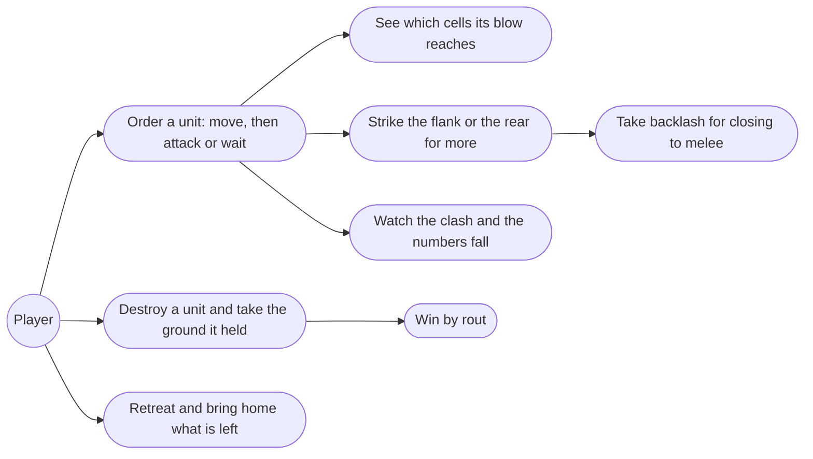
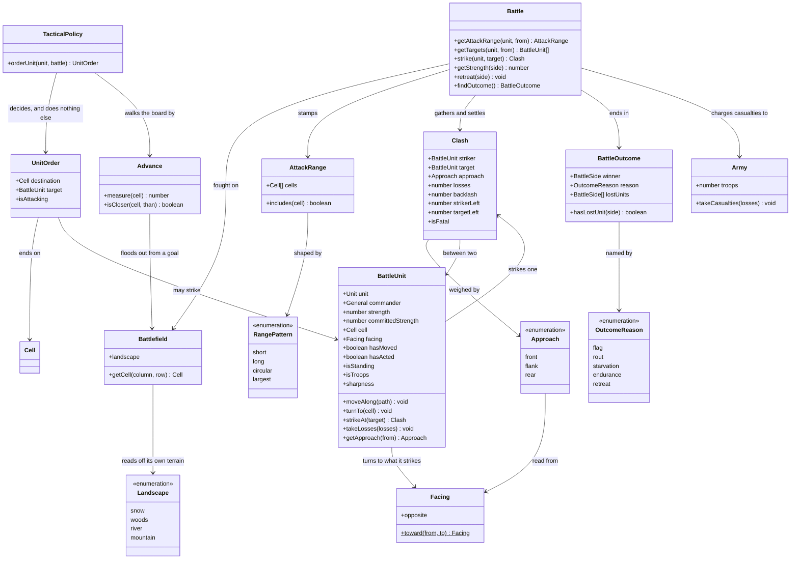
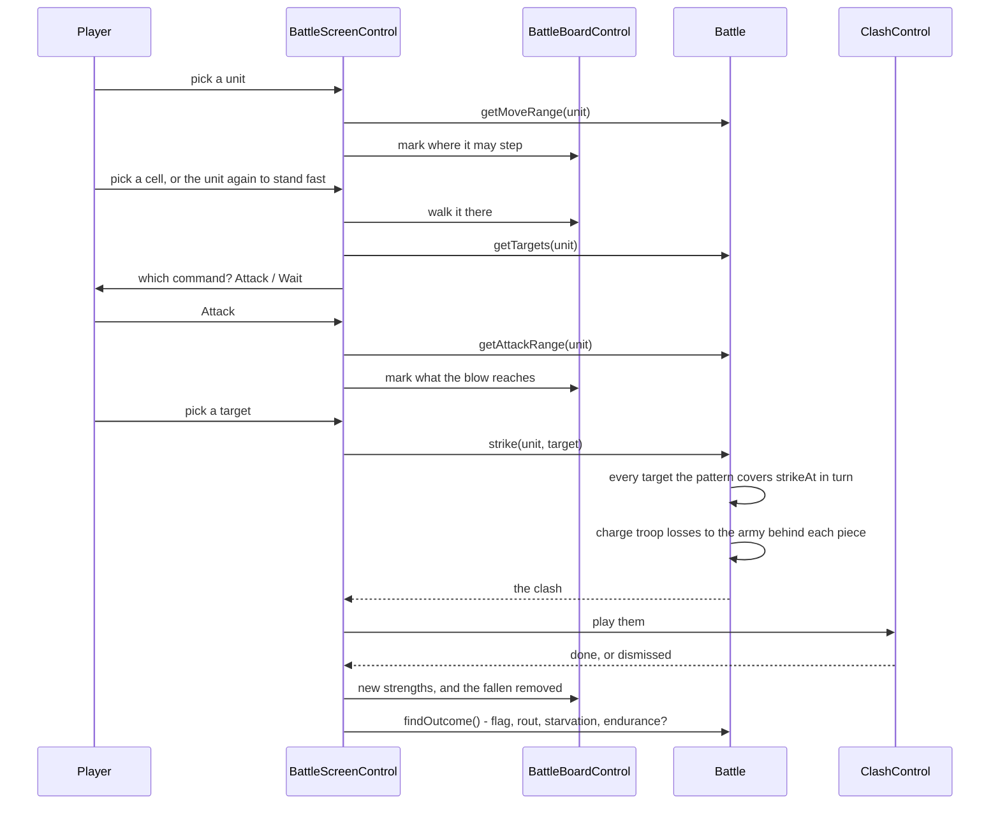
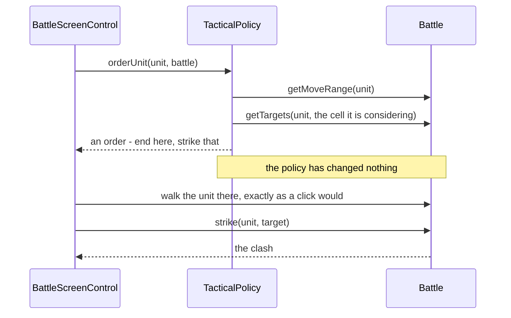

# 8.3 Blows and Casualties — Design

## Description

What happens when two units meet: the pattern of cells a unit's blow reaches, the approach it is struck from, the casualties it takes, the backlash the striker takes in return, and the two ways a battle can now end that 8.2 could not offer — a side wiped off the field, and a player who has seen enough and goes home.

Third of feature 8's five stages, and the one that makes the field dangerous. 8.2 shipped a race: two armies manoeuvring around each other for a flag, unable to touch. Everything it built for that race was built to be read here — facing was drawn on every piece so front, flank and rear would have somewhere to land; strength was badged on every piece so a number would have somewhere to fall; and the four range patterns were already on `Unit`, drawn in the hire dialog but never used to hit anything. This stage spends that groundwork rather than laying more.

It also carries the stage's one piece of theatre. The original interrupts the field for every blow with a full-screen side-on scene — both units named, both strengths on a banner, the strike, the fallen — and that scene is the game's signature. The armies in it cost nothing, because 8.2 drew every unit from the side in both liveries. What it does buy is the ground they stand on: sixteen painted backdrops, four kinds of country at four hours of the day, chosen by the province being fought over and the clock already running.

## Glossary

| Term | Meaning |
| --- | --- |
| Clash | One unit striking another and what came of it: the face the blow landed on, the casualties it dealt, and the backlash it took back. One Attack is one clash, whatever the unit's pattern reaches — and the scene the game cuts to is named after it because that is exactly what it shows. |
| Attack range | The cells a unit's blow reaches, stamped around it by its kind's pattern — short, long, circular or largest (§C.6). It says how far and in which directions a unit can strike, not how many it strikes: the blow lands on one of them. Unlike a move range it is not walked, and it ignores terrain, walls, and anyone standing in the way. |
| Approach | Which face of a unit a blow lands on: front, flank or rear (§9.12). Front is the worst way to attack and the safest way to be attacked; rear is the reverse. A reading of the way a unit is looking rather than a thing in its own right — one of the named kinds the field is described in, like terrain and the phases of the day. |
| Backlash | The casualties a striker takes from the unit it struck — the price of melee. Not a second blow: it belongs to the clash it happened in, and the struck unit does not spend its turn on it (§9.11). |
| Order | What a unit is told to do on its turn: a cell to end on, and — when something of theirs stands in its pattern from there — a unit to strike. Intent rather than history, which is why one is written the same way whether the player clicked it or the enemy's policy chose it. |
| Landscape | What kind of country a province is: northern snow, woods, wetland or volcanic rock. A fact about the place, recorded on the province beside its name and its neighbours — not something inferred from the field it is fought over. |
| Rout | A side with nothing left standing on the field. Distinct from starvation and from an emptied treasury of troops: an army whose four bodies of troops are gone but whose Guardian still stands has not routed. |
| Retreat | Abandoning the field mid-battle. Ends the battle in the enemy's favour and brings home whatever survived (§9.15). Not the same as the defender's pre-battle flight, which 8.1 already answers before a field is ever drawn. |

## Functionality

- Order a unit to move and then act: Attack when something of theirs stands in its pattern, Wait otherwise — and a unit may stand fast and still strike.
- Strike by the pattern the unit's kind carries — short, long, circular or largest — over terrain, over the castle wall, and over anyone in between.
- Strike one unit per attack, whatever the pattern covers — a wider pattern reaches further and from more directions, it does not hit more of them at once.
- Weigh every blow by the approach it lands from: front is worst, flank better, rear best.
- Take backlash from a unit struck in melee, reduced when it is struck from the flank or the rear, and none at all when the blow was thrown from two cells away.
- Have the commander's WAR sharpen the troops he leads, on the blow he strikes and the backlash he takes.
- Turn a unit to face what it struck, so attacking is itself a commitment of facing.
- Take casualties on the piece and on the army behind it, so supply, the report and the settlement all stay honest.
- Clear a piece off the field at zero strength, freeing the cell it was blocking.
- Win by rout when nothing of theirs stands.
- Retreat from a losing battle — asked twice, never by accident — and come home with what is left.
- Watch each blow as a clash: both units, both numbers, the strike, and the fallen — on the province's own country, lit by the hour the battle has reached.

## Use cases



## UI

Two additions to 8.2's screen and no rearranging of it: the command line grows the step the FAQ always described, and a blow cuts to a scene.

**A unit is picked up, and then the board is the menu.** Click one of yours and it shows both halves of what it may do at once: hollow marks on the cells it can step onto, and a mark on every enemy its pattern reaches from where it stands. Clicking a hollow cell walks it there; clicking a marked enemy strikes. There is no Attack button and no mode to enter, because the two choices never overlap — a cell you can step onto is empty by definition, and a cell you can strike has something of theirs standing in it.

The manual's own sequence is still what happens, it is just no longer typed out. Move first, then act: once a unit has walked, the marks are redrawn from where it now stands, and only strikes remain. Three things follow, and each of them removes a click the player was making for nothing.

- **A unit that arrives with nothing in reach is finished.** There is no decision left to confirm, so its turn ends where it stands rather than waiting to be told that it has nothing to do.
- **A unit that can already strike from where it stands does not have to stand fast first.** Its targets were marked the moment it was picked up.
- **Picking up another unit is always allowed.** If the one you had has already moved, it takes its stand where it is — the move is spent either way, and making the player say so is making the player do the bookkeeping.

`[ Wait ]` survives for the one case that is a real decision: a unit that could strike and would rather not. `[ Done ]` still ends the turn whether or not every unit has been used.

```text
┌─ Battle ──────────────────────────────────────────────────────┐
│ Erin                     Day 3                      Eselred   │
│ food 71, 4 days        Londre  (☾)         food 210, 7 days   │
├───────────────────────────────────────────────────────────────┤
│                  A  B  C  D  E  F  G  H  I  J                 │
│              1  ♠♠♠ ·  · ≈≈≈≈≈≈ K→ ▫ ♠♠♠ ☆↓ ·                 │
│              2   ·  ·  · ══════ ▫  K→ A↓ H→ ·                 │
│              3   · ♠♠♠≈≈≈≈≈≈≈≈≈████████████ ·                 │
│              4   ◇  · ≈≈≈♠♠♠≈≈≈███ a←▪k←╫╫╫ ·                 │
│              5   · ≈≈≈≈≈≈≈≈≈≈≈≈███ ◆  ·  ★← h←                │
│              6   · ═══ · ≈≈≈ · ███ ·  k←╫╫╫ ·                 │
│              7   · ≈≈≈ · ═══ · ████████████ ·                 │
│              8  ≈≈≈≈≈≈ · ≈≈≈ ·  ·  ·  ·  ·  ·                 │
├───────────────────────────────────────────────────────────────┤
│ ▫  a cell it can step onto   ▪ an enemy it can strike         │
│ yours  H K A ☆ ◇         theirs  h k a ★ ◆                    │
│                                                               │
│ [ Retreat ] Archers at H2 — move, or strike? [ Wait ][ Done ] │
└───────────────────────────────────────────────────────────────┘
```

The Archers at H2 have the long pattern, which is exactly the four cells two steps away on a straight line: F2 and J2, both empty; H4, where a Knights stands inside the castle; and one cell off the north edge, clipped away. H3 is castle wall and the arrows go over it, which is the manual's own claim about archers. Nothing adjacent is offered, which is the same rule read from the other side — the Horsemen at I2 are beside them and cannot be shot even if they were theirs.

**Retreat sits apart from the buttons the player presses every turn.** It ends the battle in defeat, so it is not going to live next to Done at the right edge where a mistimed second tap would find it. It sits at the far left instead, and asks — the command line becomes `Abandon the field and go home?` with `[ Retreat ]` and `[ Stay ]` — because a battle thrown away by a slip is worse than any number of extra taps.

**A blow takes the whole screen.** The field steps aside entirely for the scene the original made its signature: the province's own country from horizon to foreground, a banner naming both units with their strengths, the two formations facing each other, the strike crossing, and the struck column losing riders while its number counts down. It is deliberately not a panel over the board. A blow is the moment a battle turns, and a small box in the middle of the field reads as a notification rather than an event.

```text
┌─ Clash ───────────────────────────────────────────────────────┐
│            ┌─────────────────────────────────────┐            │
│            │ ▣ Horsemen  40   vs  150  Zendor ▣  │            │
│ ░░░░░░░░░░░░░░░░░░░░░░░░░░░░░░░░░░░░░░░░░░░░░░░░░░░░░░░░░░░░░ │
│ ░░░░░░ Londre at noon — the wetland, and nothing else ░░░░░░░ │
│ ▒▒▒▒▒▒▒▒▒▒▒▒▒▒▒▒▒▒▒▒▒▒▒▒▒▒▒▒▒▒▒▒▒▒▒▒▒▒▒▒▒▒▒▒▒▒▒▒▒▒▒▒▒▒▒▒▒▒▒▒▒ │
│ ▓▓▓▓▓▓▓▓H→▓▓▓H→▓▓▓H→▓▓▓▓▓▓▓▓▓▓▓▓▓▓▓▓▓▓▓▓▓▓▓▓▓▓▓▓▓▓▓▓▓▓▓▓▓▓▓▓▓ │
│ ▓▓▓▓▓▓▓▓H→▓▓▓H→▓▓▓H→▓▓▓▓▓▓▓▓▓▓▓▓▓▓▓▓▓▓▓▓▓▓▓▓▟█▙▓▓▓▓▓▓▓▓▓▓▓▓▓▓ │
│ ▓▓▓▓▓▓▓▓H→▓▓▓H→▓▓▓H→▓▓▓▓▓▓▓▓▓▓▓▓▓▓▓▓▓▓▓▓▓▓▓▓▐★▌▓▓▓▓▓▓▓▓▓▓▓▓▓▓ │
│ ▓▓▓▓▓▓▓▓H→▓▓▓H→▓▓▓H→▓▓▓▓▓▓▓▓▓▓▓▓▓▓▓▓▓▓▓▓▓▓▓▓▝▀▘▓▓▓▓▓▓▓▓▓▓▓▓▓▓ │
│ ▓▓▓▓▓▓▓▓▓▓▓▓▓▓▓▓▓▓▓▓▓▓▓▓▓▓▓▓▓▓▓▓▓▓▓▓▓▓▓▓▓▓▓▓▓▓▓▓▓▓▓▓▓▓▓▓▓▓▓▓▓ │
└───────────────────────────────────────────────────────────────┘
```

The two armies cost nothing to draw. Each formation is the unit's own side view from `public/battle-unit/`, repeated — the striker's in its livery facing right, the target's mirrored to face left. A body of troops is drawn as a block, files of four standing close enough to overlap, up to twelve figures; the block is a proportion of what that piece began the battle with, so twelve thinning to eight says a third of them are gone without the player doing arithmetic.

**A Guardian is one figure, and twice the size.** The original draws every ordinary unit as a block and a summoned Guardian as a single towering creature, which is the one picture that says what a Guardian is without a word of explanation. That is a fact about the unit rather than about the drawing — troops and hired bands are many, a Guardian is one — so `Unit` answers `standsAlone` and the scene reads it. It is deliberately not `hasLivery`, which happens to divide the same two groups today and means something else entirely. The two faces on the banner are the 300 px previews from `public/unit/`, which until now only the hire dialog had read.

It takes its time, because there is nothing to watch if it does not. The scene holds for a beat, the striking block lunges, the struck one flashes white and reels, the numbers count down and the fallen fade out of the line — a little over three seconds in all. A click ends it early, and `prefers-reduced-motion` skips it entirely.

**The dead leave from the front.** Casualties empty the file facing the enemy first — the striker's nearest column, the target's — because those are the figures in contact, and a block that kept its front rank while thinning behind would read as the wrong army losing. Within that file they go from the back forward, since a fallen figure fades but keeps its place in the column: taking them from the near end would leave the survivor hanging over four invisible gaps instead of standing on the ground with the rest.

The scene behind them is the one thing this stage does buy: sixteen painted backdrops in `public/landscape/`, one for each of four landscapes at each of the four hours. Which one is showing is never a decision — the province's field names the landscape and the clock names the hour.

The enemy's blows cut to it too, and they are the ones that most need it: a player who never sees what hit him is left to work it out by comparing badges. The banner counts down the way the header's food does, reusing the same helper, and the clash is dismissed by a click or by waiting it out. Under `prefers-reduced-motion` it does not play at all: the numbers change on the board, a struck piece flashes, a destroyed one goes, and the turn carries on. That is also the seam feature 17's "toggle battle animation" plugs into — the option will have something real to switch off, and the game stays playable with it off.

**The board keeps the score.** A blow is legible without the clash: the target's badge falls to its new strength, a destroyed piece is removed rather than greyed — grey already means "has acted" — and the cell it was blocking opens for anyone who wants it.

## Research

**The four range patterns are settled data, and they are stamps rather than walks.** §C.6 gives all four as tile diagrams, which resolves them exactly: short is the four orthogonal neighbours; long is the four cells exactly two steps away on a straight line; circular is the ring at two steps in any direction, sixteen cells with a hole in the middle; largest is that ring filled in, twenty-four cells. Two independent checks say the diagrams are right rather than decorative. The long pattern reproduces §C.1's prose about archers exactly — "cannot attack adjacent cells", "cannot attack diagonally" — without being told to. And the circular pattern's hole explains why the manual bothers to distinguish circular from largest at all: Pluvius cannot hit what is standing next to it, which is a real weakness for a 160-strength Guardian and a reason to close with one rather than stand off.

**The patterns are already in the repo, drawn but never fired.** `src/ui/ProvinceCommands/CommandDialog/range-grid.ts` holds all four as 5×5 rows of `o`, `x` and `+`, so the hire dialog can show a Fifth Unit's reach before you pay for it — and they match the reading above cell for cell. That is a second witness for the diagrams, written before this stage was thought about, which is worth more than the two textual checks.

It also settles where the table lives. Encoding it again in the domain would leave two copies of one canonical thing, in two layers, with nothing making them agree — and the failure would be silent and cosmetic-looking: a dialog promising a reach the battlefield does not honour. So the offsets become the domain's, `AttackRange` clips them to the board, and `rangeGrid` lays the same offsets into its 5×5 instead of keeping its own. The dialog's preview and the marks on the field then come from one table, which is also the honest description of what they are.

So an attack range needs none of `MoveRange`'s machinery. It does not flood-fill, does not respect terrain, and does not stop at bodies: §C.1 says archers "can shoot over units and obstacles" and the manual says they shoot over fences and castle walls. It is a set of offsets clipped to the board, which is why `AttackRange` is a much smaller class than the one it sits beside despite the symmetry of their names.

**Backlash falls out of the diagrams instead of being a rule per unit.** The sources give two facts and no formula: melee attacks may cause backlash, and long-range attacks do not (§9.11, §C.6). Written as a rule about *distance* rather than about unit kinds, both facts come from one line — a striker takes backlash only when it struck from an adjacent cell. Short always does, since every cell it reaches is adjacent. Long never does. Circular never does either, because its hole means it can only ever strike from two cells away, which settles a case no source mentions. Largest does, but only when the unit it struck was the one standing beside it — it is the only pattern that reaches both ways, so the same unit takes backlash or not depending on which target it chose. One rule, four patterns, nothing invented per unit.

**Facing finally has teeth, and the approach is geometry rather than a choice.** §9.12 orders the three: front worst, flank better, rear best, with rear also reducing retaliation. The approach is read from the target — the direction from the target to the striker, compared with the way the target is looking. Same direction is a front attack, opposite is a rear attack, and anything else is a flank. Circular and largest can strike from a diagonal, which has no single direction: the dominant axis decides, and a perfect diagonal counts as a flank, which is the honest answer for a blow landing on a corner.

`Facing.between` is not the tool for that, and the resemblance is a trap worth naming. It reads a single step between neighbouring cells, so any row difference at all wins over any column difference — asked about a striker two columns and one row away it answers north, when the dominant axis is plainly east. It stays what it is. What the geometry wants is a second reader — `Facing.toward`, which weighs the offset and answers with the dominant axis — and both ends of a blow use it: the target reads which of its faces was hit, and the striker turns to look at what it struck.

The FAQ's other note about facing lands here too. 8.2 recorded that the one thing which changes a unit's facing is attacking (§5.3), and left it for this stage: a unit turns to face what it strikes. That makes attacking a commitment rather than a free action — an archer who turns to shoot north has shown its flank to whatever is east of it, and a horseman who wheels to take a rear attack is offering his own rear to the next unit in the enemy's turn. It is the same lesson 8.2's movement taught, charged for a second time.

**A move no longer ends a unit's turn, and that is a change to 8.2 rather than an addition.** `BattleUnit.moveAlong` sets `hasActed` today, which was right when Wait was the only command: the move *was* the activation. With a command step after it, one flag is being asked to mean two things — that a unit has spent its move, and that it is finished for the turn. It becomes two: a unit that has moved may still strike or wait, and only striking or waiting finishes it, with `refresh()` clearing both as its side's turn comes round. 8.2's rule that a unit acts once per turn is unchanged and its test still holds; what changes is which method sets the flag. Worth writing down because it is the one place this stage edits a line 8.2 wrote rather than adding beside it.

**The damage formula is ours, and it is 8.1's formula rather than a new one.** D.6 lists three unresolved entries that all land in this stage — #8 the battle damage formula, #9 WAR's contribution, #10 the flank and rear modifiers — so something has to be invented. It does not have to be invented twice. 8.1's `AutoResolver` already reconstructed a shape that was reviewed and played: effective strength as `strength × (1 + WAR / 100 × WAR_LEVERAGE)`, and casualties as a rate against the strength ratio. This stage keeps that shape and moves it from the day to the blow.

```text
sharpness  = 1 + commander WAR / MAX_WAR × WAR_LEVERAGE
losses     = BLOW_RATE × BLOW_WEIGHT[approach] × RANGE_WEIGHT[pattern]
             × striker strength × striker sharpness / target sharpness
backlash   = BACKLASH_RATE × RETALIATION[approach]
             × surviving strength × target sharpness / striker sharpness
```

| Constant | Value | Standing in for |
| --- | ---: | --- |
| `BLOW_RATE` | 0.25 | D.6 #8 — the bite one blow takes out of a target, as a share of the striker |
| `BLOW_WEIGHT` | front 1, flank 1.4, rear 2 | D.6 #10 — §9.12's ordering, given numbers |
| `RANGE_WEIGHT` | long 0.6, the rest 1 | §C.6's "long-range attacks deal less damage" |
| `BACKLASH_RATE` | 0.2 | D.6 #8 — what a struck unit gives back |
| `RETALIATION` | front 1, flank 0.6, rear 0.3 | D.6 #10 — §9.12's "rear attacks reduce retaliation risk" |
| `WAR_LEVERAGE` | 0.5 | D.6 #9 — unchanged from 8.1 |

Losses are rounded and never less than one, so a blow always costs something, and never more than the target has left.

Those values put melee where §9.11 wants it — risky but worth it. Two bodies of forty trading frontal blows deal ten and take back six, so closing is a real cost and not a trap; the same blow into a flank deals sixteen and takes three, and into a rear twenty-four and takes one, which is the whole argument for walking the long way round. `BACKLASH_RATE` matters more than it looks: at 0.5 the counter-blow is bigger than the blow, and frontal melee becomes something no one would ever choose, which would quietly delete half the game.

**A pattern is reach, not area, and that is a deliberate departure.** §9.11 calls circular and largest "area attacks", and the first cut honoured it: one Attack struck everything of theirs the pattern covered. On the field that is not a wide attack, it is a different game. A Dragon standing among three units deals its full blow to each of them in one turn — three times any other unit's output, with no answer to it beyond never approaching — and since both sides usually field a Guardian, every battle collapses into whose Guardian reaches the other's line first. So a pattern says how far and in which directions a unit may strike, and the blow lands on the one unit the player picks.

The wide patterns keep plenty without it. Circular and largest reach two cells in every direction, the diagonals included, which no other pattern touches: they strike from places nothing can answer from, and they choose their target out of a crowd instead of taking whatever is adjacent. That is a real advantage without being an unanswerable one. It does leave the sources' word "area" unhonoured, which is written down here rather than left for a later reader to restore as a bug fix — and if it ever does come back, it comes back with a per-target weight well under one.

Casualties are proportional to the *striker's* strength and not to the target's, which is what makes a big unit durable without a separate toughness stat: a Dragon at 160 takes the same eight casualties from a body of archers as a body of archers would, and simply has twenty times as many to lose. Backlash is measured against what survived the blow, so a unit nearly destroyed hits back weakly and the exchange does not turn on who moved first. Long range carries a weight below one, which is §C.6's own sentence — "long-range attacks deal less damage but take no counter-damage" — the only part of the arithmetic that is quoted rather than guessed.

Every number sits in `config/battle.ts` beside the two 8.1 already put there. `WAR_LEVERAGE` and `MAX_WAR` are reused unchanged, which is worth noting because they are currently dead: 8.2 deleted `AutoResolver` when every battle moved onto the field, and left both constants with no reader. `DAILY_CASUALTY_RATE` is the one that does not survive — a rate per day has no meaning once damage is dealt per blow — so it goes, and `BLOW_RATE` takes its place as the single knob. At `BLOW_RATE = 0.25` and equal commanders, a front blow takes about a quarter of the striker's strength off the target, so evenly matched bodies of troops need four exchanges to destroy each other and one concentrated day to settle a flank. That is the number to turn if the stage plays wrong; the patterns, the approach ordering and the win conditions are not knobs, because they come from the sources.

One consequence worth recording now: **8.5 no longer needs a second formula.** 8.1's auto-resolution existed because there was no field to fight on. With blows resolved per unit, the Auto command is the tactical policy playing both sides quickly, over the same rules the player fights under — so what 8.5 wires up is a loop, not a parallel model of combat that could disagree with the visible one. Deleting `AutoResolver` in 8.2 turns out to have been the right call rather than an accident.

**Nothing in this stage wants to be an entity except the exchange itself.** The first cut of this design had two more classes and both were the wrong species. `Approach` was a value object holding a name and two multipliers, with three statics and a factory — which is a lookup table in a costume, and not how this codebase writes an enumeration: terrain, the phases of the day, the range patterns, the sides, the reasons a battle ends are all named string kinds, with the behaviour that reads them living on the object that has it. Front, flank and rear join that list. The reading belongs to the unit being struck, because it is that unit's own facing that decides — `target.getApproach(from)` — and the two weights are config, sitting with the rest of the reconstructed arithmetic rather than being smuggled into a domain class as fields.

`Blow` was the other one: a record with a static factory that computed it, which is a function in a costume. Splitting the two jobs answers where each belongs. The striking is behaviour, and the object that should carry it is the unit doing it — `attacker.strikeAt(target)` is the plainest sentence in this domain, and by the time a unit is asked, it is already holding every term of the formula: its strength, its facing, its kind's range, and the commander whose WAR sharpens it. What comes back is the only thing here that genuinely is a record, because two different readers need it after the fact: the screen, which has a scene to play out of it, and a test, which asserts on it instead of on two mutated numbers. It carries what each side has left as well as what each lost, so a scene played out of a queue of exchanges is never reconstructing numbers that have since moved on. It is called `Clash`, not `Blow`, because it carries the backlash too — the old name needed a glossary line explaining that a blow contained the answer to itself, which is the usual tell that a name is wrong. The battle keeps the parts above one exchange: finding every target the pattern covers, charging troop losses to the army behind each piece, and clearing away the fallen.

**The enemy decides; the screen does.** 8.2's `TacticalPolicy` does both — `orderUnit` picks a goal, finds a path, and calls `moveAlong` itself, then hands back the path so the screen can animate a move that has already happened. That is where the urge to invent a report record came from: once something has quietly mutated the board, it owes the caller an account of what it did. Turned around, the account is unnecessary. The policy answers with an order — end on this cell, strike that unit — and touches nothing; the screen carries it out with the same two steps the player's clicks drive, so the walk and the blow are performed in one place rather than two, and the enemy cannot drift into playing by rules the player never sees. It also makes the policy testable by asking it what it would do, instead of asserting on a board it has already changed. 8.5 replaces the body of one pure method.

What makes it possible is the shape of an attack range. A move range has to start from where a unit actually stands, but a stamp does not — it can be laid around a cell the unit has not reached yet, which is exactly what a policy that has moved nothing needs in order to know whether the cell it is choosing has anything to shoot from it. So `getAttackRange` and `getTargets` take the cell to reckon from, defaulting to where the unit is standing.

**The enemy was standing still, and the map was why.** 8.2's stub measured its goal as the crow flies and stepped to whichever reachable cell was nearer. On an open board that works. On Londre it does not: the river runs down the middle, so for a unit west of it no neighbour is nearer to the flag beyond the water, and the unit freezes where it stands. Playing both sides by the policy for forty turns produced **no blows at all** — the two armies never met, and the battle went to the defender on endurance having never been fought.

Two things fix it. Distance becomes the distance a unit can actually walk: `Advance` floods out from the goal across the cells that unit may enter, so the river is routed around to the bridges rather than stared at. And a unit looks for a blow before it looks at the flag — every cell it can reach, every enemy it could strike from there, weighed by the same numbers the formula uses, so it prefers a rear attack to a frontal one and prefers to strike from two cells away when its pattern allows, because that is the blow that takes no backlash. Standing fast is one of the cells it considers, so a unit already in position does not walk out of it to walk back.

The same four pairings now play out as battles: 160 against 190 goes to the fifth day and is decided by a flag with one unit left on each side; 400 against 120 routs by the third; an even 200 against 200 ends in a rout on the fifth. The stronger side wins each time, which is the least a stub owes the player.

What it still does not do is coordinate. Units decide one at a time, so they trade rather than focus, and the deployment stacks a side in a single column — 8.2's doing — which costs the first turn or two to untangle. Both are 8.5's to fix, and neither is the same defect as standing still.

One honest limit: the two paths converge on the same two steps rather than becoming one call. The player's order is assembled in halves with a walk between them — move, then command, which is the manual's flow and not ours to collapse — so `orderUnit` is the enemy's way of arriving at those two steps in one go, not a method the player's turn also calls.

**The clash is the full scene rather than a flash on the board, and most of it was already paid for.** The obvious cheap version of this stage draws a burst on the tile and moves on. The original does not, and the reason it does not is that the clash is where the player actually reads the battle: two names, two numbers, and a rank visibly thinning. Everything that moves in it was already ticked by 8.2 — the side views exist for all twenty-six units in both liveries, mirroring gives the facing-left rank for free, and `unitPreview` gives the banner faces.

**What a province looks like was already knowable, and is now written down.** The scene wanted a backdrop, and the honest options were thirty painted places or one generic one. It is four, because the provinces fall into four kinds — and finding those kinds did not need inventing: counting each field's terrain sorts all thirty with no overlap and no argument. Five northern fields carry no woods, no water and no stone at all; thirteen are wooded; eight are wetland, Londre's sixteen river cells the most of any; four are volcanic rock. The blocks are contiguous on the map, and they agree independently with §11's seasonal-disaster regions — snow in the north, fire in the woodland, flood in the wetland, quake in the volcanic southwest. The names agree too: Norwood has seventeen woods cells, Erewood nineteen.

Counting tiles is how the answer was **found**; it is not how it is **kept**. A rule that reads "more boulders than woods and water means a mountain province" is a guess with thresholds in it — nothing in the game says a field with five woods and four river cells is woodland — and it would re-decide the question, silently and differently, the first time a layout was edited. What kind of country a province is belongs to the province, beside its name and its neighbours, so `landscape` is authored in the province catalogue and simply read. §11's disaster regions name the same four groups for twenty-three of the thirty, which is as close to a second source as this fact has; the remaining seven have no disaster and take the reading their terrain gives.

Feature 14 settles it beyond doubt: seasonal disasters need exactly this classification, and a province that is woodland for the purpose of a fire while being something else for the purpose of a backdrop would be a bug waiting in the data. One fact, one home, two readers. Sixteen backdrops, 615×535 apiece, 1.6 MB for the set, each cropped so every landscape puts its horizon at the same height: the scene never jumps when a battle moves to another province, and the four hours of one landscape are the same place relit rather than four different places. They are upscaled to fill the screen with `image-rendering: pixelated`, which is the one upscale that flatters pixel art instead of smearing it.

That also retires something 8.2 built. The ground was going to be the terrain tile of the cell the target stands on, tiled across the bottom of the scene — which was the right answer while the sky was a flat colour band, and is the wrong one under a painted horizon. The tile stays where it belongs, on the board. What survives of the colour band is a single underlay in the hour's colour, so a backdrop that fails to load leaves a lit scene rather than a black hole.

Two smaller decisions inside it. Rank size follows strength rather than being a fixed five, so the scene answers "how bad was that" before the number does. And the scene is skippable by a click and silent under `prefers-reduced-motion`, because a cutscene between every pair of units in a five-day battle is the thing the original itself put an off switch on (§17).

**Rout is not the same as running out of troops.** §9.14's second victory condition is destroying all enemy units, and the temptation is to test `Army.hasTroops`, which already exists. It is the wrong test. An army's four standard bodies can all be destroyed while its Guardian stands, and a lone Dragon on the field is not a routed army — it is a very bad afternoon for whoever has to walk past it. So rout is "nothing of theirs is standing", read off the pieces, and `hasTroops` keeps meaning what it means to the province afterwards.

**Casualties have to land in two places, and only one of them is the piece.** A unit's strength lives on its `BattleUnit`, which is where a blow takes it from. But `Army.troops` is what feeds the food timer, the supply-days figure in the header, the report, and the garrison the winner leaves behind — all of which would drift into fiction if the field kept its own private tally. So a blow against a body of troops also charges the army it was split from, through the `takeCasualties` 8.1 already wrote, and a bleeding army eats less exactly as that stage intended. A Fifth Unit's losses do not charge the army, because its strength was never part of the troop count.

That leaves the two sides' strengths, which the tactical policy compares to decide whether to guard its flag or come for yours. It reads the armies today, and reading them after this change would count a Guardian at its catalogue strength no matter how battered it is. So the comparison moves onto the field — the strength of a side is the sum of what it still has standing — which is both more correct and the number a player would use. The change is contained: `TacticalPolicy` is the only reader `Army.strength` has, so nothing else has to be looked at when it stops being the number that matters on a battlefield.

**A destroyed Fifth Unit is a question this stage has to at least answer honestly.** §C.2 says a hired unit can be destroyed and a Gem Guardian cannot permanently die, and D.6 #14 leaves the destruction threshold unresolved. Doing nothing means a hired creature reduced to nothing on the field walks home intact, which is the same class of lie as an unspent Fifth Unit that never appears — the thing 8.1 refused to ship. So the threshold is the obvious one: zero on the field is destroyed, a destroyed hired unit does not come home, and a Guardian is untouched because it is a summons rather than a creature that travels. The gem's cooldown, which is what "cannot permanently die" really costs, stays 8.4's.

**Retreat is a command, not a policy.** The defender's flight is already decided before a battle exists — `DefensePolicy` answers fight, retreat or surrender in 8.1, and a battle only happens on fight. What this stage adds is the player abandoning a fight already under way, which §9.14 counts as a win for the other side and §9.15 says preserves part of the army. Both fall out of what exists: the outcome names the enemy as the winner with a new reason, and `Invasion.comeHome` already walks the survivors back to the province they set out from, so a retreat settles exactly like a defeat and no settlement code is touched. Availability is the one thing to rule on: §9.15 says retreat may be impossible without somewhere to retreat to, but the attacker always has the province he came from, so for the player it is always offered. The commander-capture risk that §9.15 hangs on a retreat is feature 9's, and stays there.

## Overview

No new screen, and one new component. `BattleScreenControl` grows a step in its ordering flow — pick a unit, move, choose a command, choose a target — and gains a third child, `ClashControl` and its `ClashView`, which own the cutscene and nothing else: the control runs the timing and reports when it is done, the view owns the banner, the ranks and the bursts. They are named after the domain record they play, the way every other view here is named after what it shows. The board learns three small things: mark the cells a blow reaches, drop a piece's strength badge, and remove a piece that has fallen.

The domain grows four classes and no new subsystem. `AttackRange` answers which cells a unit's blow reaches, standing beside `MoveRange` and sharing nothing but the shape of its interface. `Advance` answers the other half of the same question — how far every cell is from a goal for a unit that has to walk there — which is what the enemy steers by. `Clash` is the record of one exchange — who struck whom, from which face, what each of them lost — which is what the screen watches and what a test reads. The striking itself belongs to `BattleUnit`, because a unit swinging at another unit is the plainest sentence in this domain and the unit is already holding everything the swing needs. Front, flank and rear are a named kind rather than a class, the way terrain and the phases of the day are. `UnitOrder` is what a unit was told to do — a cell to end on and a unit to strike — which is intent, not history: the enemy's policy now decides an order and nothing else, and the screen carries it out through the same two steps the player's clicks drive.

## Domain model



## Flow



The enemy's turn reaches the same two steps from the other end — a decision first, and nothing moved until the screen moves it.



## Persistence

Nothing, for the same reason 8.2 contributes nothing: a battle begins and ends inside one province's turn, so no save can ever be holding one. The constants this stage adds are config, not state. (Save/load is feature 16.)

## Tests

Nothing here asserts a casualty figure. Three of this stage's rules are reconstructions rather than findings (D.6 #8, #9, #10), so every test over them is an ordering or an invariant, and `BLOW_RATE` and the weights can be retuned without a test changing.

- **Range patterns (unit):** each of the four reproduces its §C.6 diagram exactly — short the four neighbours, long only the four cells two steps away on a straight line, circular the ring of sixteen with its middle open, largest all twenty-four — and every one is clipped where it runs off the board. Nothing stops a pattern: not woods, not the castle wall, not a unit standing in between. That last one is the test worth having, because line of sight is exactly what a later reader will take for a missing feature and add.
- **Approach (unit):** a blow landing where a unit is looking is a front attack, from behind it a rear attack, from either side a flank; a diagonal resolves by its dominant axis, and a perfect diagonal counts as a flank — an arbitrary tie-break, pinned so it cannot drift.
- **Orderings, never figures (unit):** the same blow is worth more from the rear than from the flank and more from the flank than from the front; a unit under a higher-WAR commander deals no less and takes no more; a rear attack draws less backlash than a frontal one; and backlash is reckoned against what survived the blow, so a unit left with almost nothing hits back with almost nothing.
- **Backlash (unit):** a blow struck from an adjacent cell draws backlash and one struck from two cells away draws none — plus the case only the largest pattern can produce, where one attack takes backlash from the target it was standing beside and none from the one across the field.
- **Casualties (unit):** a struck body of troops loses strength on the field and charges the same losses to the army behind it, so the supply days in the header fall with it; a struck Fifth Unit charges the army nothing; nothing is taken below zero; a blow lands on the one unit it was aimed at, however many the pattern reaches, and never on its own side.
- **Destruction (unit):** a piece at zero strength leaves the field, frees the cell it was blocking for anyone walking through, and can no longer be ordered or named as a target.
- **Rout (unit):** a side with nothing standing loses — and a side whose troops are gone while its Fifth Unit still stands has not routed, which is the case `Army.hasTroops` would get wrong.
- **Settling what the field did (unit):** retreating ends the battle at once and the other side wins for that reason; a retreat and a defeat settle identically, so 8.1's invasion tests pass unchanged against both; a hired Fifth Unit destroyed on the field does not go home to its province, and a Guardian is untouched by anything that happened on it.
- **Attacking and facing (unit):** a unit turns to face what it struck, and the next blow against it is measured from where it now looks — the two rules composed, which is where the mistake would be rather than in either alone.
- **Ordering a unit (unit):** a unit may stand fast and still strike; a unit that has moved may still strike or wait, and only striking or waiting ends its turn; a unit that has struck cannot be ordered again until its side's next turn.
- **The enemy's decision (unit):** `TacticalPolicy` has no tests at all today, because until now the only way to exercise it was to let it mutate a board. Given an order to return and nothing to change, it gets them: every unit stands where it stood and every strength is untouched after it has been asked; it moves toward its own flag when outmatched and toward theirs when it is not, by a route it can actually walk — round the river rather than into it; it walks into a blow rather than waiting to be struck, and goes to the rear rather than the flank when both are a step away; and it names a target when one stands in its pattern from the cell it chose.
- **Landscape (unit):** every one of the thirty fields sorts into exactly one of the four, and the grouping is pinned province by province — so a change to the rule or to `data/battlefields.json` has to be deliberate.
- **The screen (control):** Attack is offered only when something of theirs is in reach; picking a target plays the clash and comes back to a board carrying the new strengths, with any fallen piece gone from it; under `prefers-reduced-motion` no clash plays and the turn still finishes; Retreat asks first, and does nothing if the answer is Stay.
