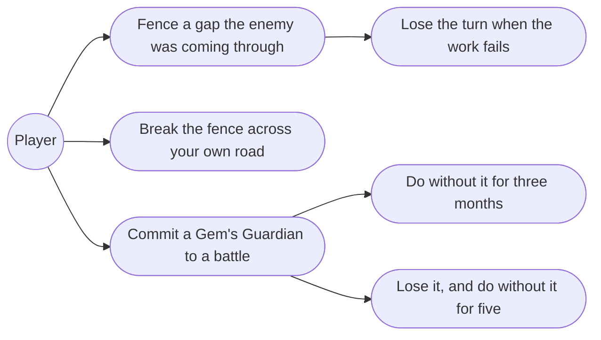
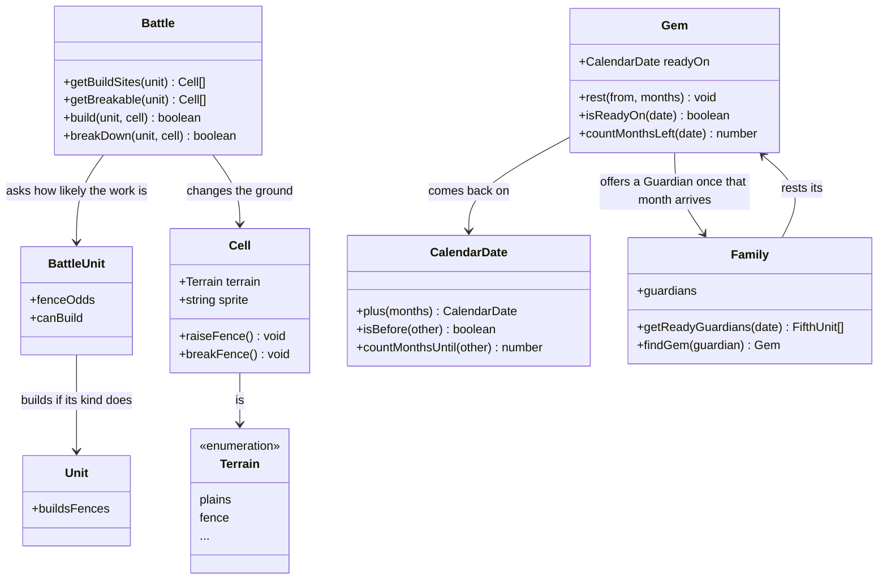
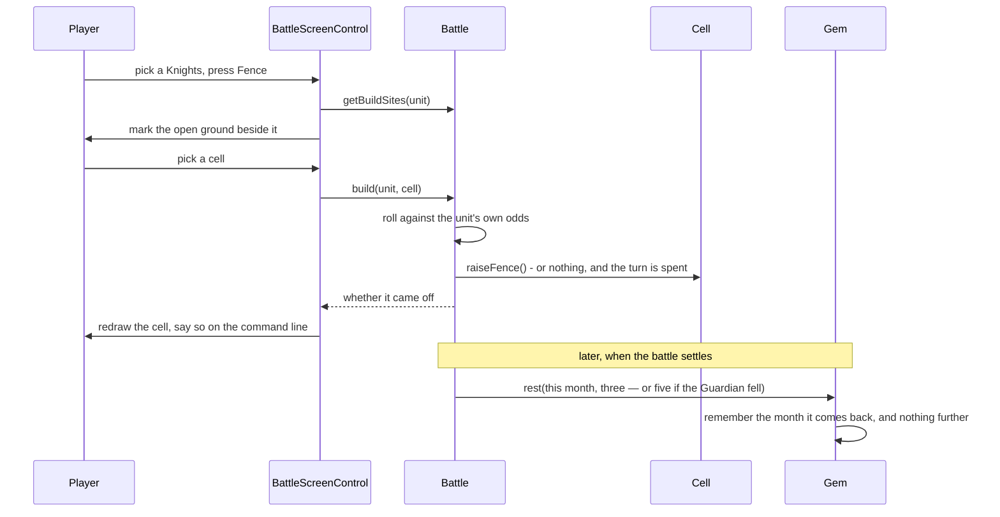

# 8.4 Fences & Cooldowns — Design

## Description

The two limits a battle carries out of itself: an obstacle a unit raises with its own hands, and a Guardian that cannot be summoned twice running.

Fourth of feature 8's five stages, and by some way the smallest. It adds no new way to win and no new way to die. What it adds is the two things the earlier stages deliberately left open — 8.2 shipped fences as terrain that could be walked around but never built or broken, and 8.1 wrote down in its own design that a Gem Guardian was strictly better than a hired unit on every axis "until the cooldown lands". This is the stage where it lands.

Both halves are small because the ground was prepared. A fence is already a terrain kind on every board, already impassable to troops and already cleared by fliers. A Gem already belongs to a house rather than a province, and the monthly turn already has a place where time passes. What is genuinely new is that **the field changes while a battle is being fought**, which nothing before this has asked of it.

## Glossary

| Term | Meaning |
| --- | --- |
| Fence | A barrier across open ground: impassable to troops, ignored by fliers, and — unlike woods or a river — something either side can put there or take away (§9.13). Eighteen dozen of them are already on the boards; this stage adds the rest. |
| Wreckage | What a broken fence leaves behind. Open ground — plains, to everything that walks or reasons about the board — that still shows what stood on it, so a player can read where a line was forced. |
| Build | A Knights unit raising a fence on open ground beside it. It can fail, and failing costs the unit its turn all the same (§9.13). |
| Break | Any unit pulling down a fence beside it. Also fallible, and also the whole of that unit's turn. |
| Rest | The months a Gem spends unusable after a battle — three if its Guardian came home, five if it fell (§7.5). The Gem rests, not the Guardian: what is spent is the house's right to summon. |

## Functionality

- Raise a fence on open ground beside a Knights unit, and watch the attempt fail sometimes.
- Pull down a fence beside any unit, with the same risk.
- Leave wreckage where a fence was broken: open ground that still shows the break.
- Keep fliers indifferent to all of it, built or authored.
- Put a Gem to rest for three months after a battle, or five if its Guardian was destroyed.
- Leave a resting Gem out of the units an army may commit, and out of what a defender musters.
- Read a Gem's rest off the calendar — the month it comes back is set once, when the battle ends, and never touched again.

## Use cases



## UI

The board is already the menu, and breaking fits it without a word of explanation: a fence you can pull down is marked exactly like an enemy you can strike, because from the player's side of the screen it is the same act — something is in the way, you are next to it, you click it.

```text
┌─ Battle ──────────────────────────────────────────────────────┐
│ Erin                     Day 4                      Eselred   │
│ food 54, 3 days        Londre  (☀)          food 180, 6 days  │
├───────────────────────────────────────────────────────────────┤
│                  A  B  C  D  E  F  G  H  I  J                 │
│              1  ♠♠♠ ·  · ≈≈≈≈≈≈ ·  · ♠♠♠ ·  ·                 │
│              2   ·  ·  · ══════ ·  ·  ·  ·  ▫                 │
│              3   · ♠♠♠≈≈≈≈≈≈≈≈≈████████████ ▫                 │
│              4   ◇  · ≈≈≈♠♠♠≈≈≈███ ·  a←▪╫╫ K←                │
│              5   · ≈≈≈≈≈≈≈≈≈≈≈≈███ ◆  ·  ▫  ▫                 │
│              6   · ═══ · ≈≈≈ · ███ ·  k←╫╫╫ ▫                 │
│              7   · ≈≈≈ · ═══ · ████████████ ·                 │
│              8  ≈≈≈≈≈≈ · ≈≈≈ ·  ·  ·  ·  ·  h←                │
├───────────────────────────────────────────────────────────────┤
│ ▫  a cell it can step onto   ▪ what it can strike or break    │
│ ╫  fence      yours  H K A ☆ ◇      theirs  h k a ★ ◆         │
│                                                               │
│ [ Retreat ]  Knights at J4      [ Fence ][ Wait ][ Done ]     │
└───────────────────────────────────────────────────────────────┘

```
The Knights at J4 has come round the castle's blind side. Londre's two authored fences sit at I4 and I6, and they are not decoration: the castle's wall runs along the north, west and south, so its only approach is from the east, and those two fences narrow that approach to the single cell at I5. Pulling one down widens the gate the defenders are counting on. That is the tactical shape of this stage in one picture — fences are where a board's geometry is negotiable.

**Building is the one command that earns a button back.** 8.3 took away Attack and Cancel because the board could say everything: a cell you may step onto is empty, a unit you may strike is not, and one click told them apart. A fence has no such tell. The cells you could build on are exactly the cells you could walk to, so one click on an empty square beside a Knights would mean two things at once. `[ Fence ]` is offered only to a Knights that has not yet acted; pressing it swaps the step-marks for build-marks and asks where.

It is worth saying that this does not undo 8.3's argument, it confirms it: the button exists precisely where the board genuinely cannot disambiguate, and nowhere else.

Both kinds of work are offered after a move as readily as before one. A unit that walks up to a fence can pull it down with what is left of its turn, and a Knights that walks into position can build there — which is the whole point of walking into position. What ends a unit's turn is the work, not the walking.

**A failed attempt has to look like something.** The work either succeeds or it does not, and both outcomes end the unit's turn — so a failure must never leave the board looking as though the click missed. Two things say it did not: the unit greys out, the way any spent unit does, and the command line reports in words — *the fence is up*, or *the Knights could not manage it*. Success also redraws the one cell that changed, which is the whole of the board's animation for this stage.

**A resting Gem is shown resting, not hidden.** When an army is being committed, a Gem in cooldown stays in the list with its months against it, greyed out and refusing the click. Removing it from the list would leave a player wondering where their Guardian went; showing it with "3 months" answers the question and teaches the rule at the same time.

## Research

**The data has been holding a slot for this feature since 8.2.** The battlefield sheet has sixteen tiles and the thirty layouts use fifteen. The odd one out is id 7, and `data/battlefields.json` records what it is: `fence-broken`. A tile that exists in the game's own art but appears in no starting field can only be a state a battle produces — which settles both that fences really are destructible and that a broken one is drawn as wreckage rather than reverting to grass. 8.2 cut the asset and shipped it unused; this stage is what it was for.

It goes further than that, and saved this stage an invention. The tile table 8.2 wrote already reads `{ terrain: 'plains', sprite: 'fence-broken' }` — so wreckage was never going to be a new kind of ground, only a new picture of ground the game already had. That is the better answer anyway: `Terrain` stays the vocabulary of what blocks whom, and nothing that walks, routes or evaluates needs to learn a seventh word.

**The field stops being static, and identity is what must survive.** Nothing before this has changed a cell after a battle began, and the code is full of arrangements that assume it never will: the board view keys its elements by `Cell` identity, the battlefield keys its sprites the same way, and both `MoveRange` and `Advance` walk maps keyed by cell. Replacing a cell object when a fence goes up would silently orphan every one of those maps — the piece would still be drawn on the old object while movement reasoned about the new one.

So the terrain changes on the cell that is already there. That makes `Cell.terrain` mutable, which is a real loss — it has been a value object with three readonly fields — and the honest defence is that a cell's terrain genuinely does change when someone builds on it, while its position does not.

Its picture moves with it. 8.2 kept the sprite for each cell in a map on the battlefield, which was fine while the ground never changed and becomes two things to keep in step the moment it does. The sprite belongs on the cell beside the terrain, so raising and breaking are one call on one object and nothing can drift; `Battlefield.getSprite` stays as the way the board asks, and now simply answers from the cell. The blast radius is small and checkable: `Battlefield.ofProvince` builds fresh cells for every battle, so nothing a fight does to the ground can leak into the next one on the same province.

**A fence needs open ground, and the art says why.** The sources do not say where a fence may be raised. The tiles do: 8.2's set presents a 32-pixel band on each face a tile joins and grass on the faces it does not, which is why the boards have no seams to tune. A fence tile has grass edges. Put it on a bridge and the river's band stops dead against it; put it on stone or wall and there is nothing for it to stand in. So a fence goes on plains — which includes wreckage, being plains that has been built on before — and nowhere else, and never on either flag, since a fence across the objective would end battles by hiding them. That also keeps the one crossing of a river from being sealed by a single unit's turn, which is a balance answer arrived at from the art rather than argued into it.

**Chance enters the battle, and it needs no machinery.** §9.13 says building and breaking can fail, and D.6 #11 leaves the formula open. The temptation is to invent something to roll dice with — an object handed to the battle that answers "does this come off?", real randomness in play and a fake one in tests. That is a stranger in this codebase and it is not needed, because the two halves of a chance are not equally interesting.

**How likely** is arithmetic over a unit's strength, and it belongs where the rest of that arithmetic already lives: beside `measureLosses` and `measureBacklash` on the unit doing the work. It is pure, it is a number, and a test can read it directly and assert that a stronger body of troops raises a fence more often than a weaker one — no injection, no seed, no fake.

**Whether it came off this time** is `Math.random() < odds`, which is the language, not a design. It is the pattern the codebase already uses for the Search command, and a test that needs a particular outcome takes hold of `Math.random` for the length of that test — the ordinary way to pin a coin flip, and one that costs the production code nothing.

Splitting it that way is what makes the interesting half testable and leaves the dull half alone. An injected roller would have made both halves ceremonious and tested neither any better.

**The failure formula is ours, and it follows the shape the sources hint at.** §9.13 guesses that success "probably depends on the unit's strength or troop count", which is the only steer available. The odds rise with the strength of the unit doing the work, floored so a weakened unit is never helpless and capped so no unit is ever certain:

| Constant | Value | Standing in for |
| --- | --- | --- |
| `FENCE_ODDS_BASE` | 0.4 | D.6 #11 — the chance before strength is counted |
| `FENCE_ODDS_PER_STRENGTH` | 0.005 | how much a body of troops adds to it |
| `FENCE_ODDS_FLOOR` | 0.3 | no unit is helpless |
| `FENCE_ODDS_CEILING` | 0.9 | no unit is certain |

A forty-strength Knights therefore raises a fence three times in five, a full-strength one four times in five. Breaking uses the same numbers, because nothing in the sources distinguishes the two and inventing a second table would be inventing twice.

**The cooldown is canonical, which makes it the cheapest thing in the stage.** §7.5 is unambiguous: three months after use, five after defeat. Both facts it needs already exist: 8.3's `BattleOutcome` reports which side lost its Fifth Unit, so "was the Guardian defeated" is answered rather than inferred.

**A rest is a date, not a countdown.** The obvious shape is a number of months on each gem that the monthly turn walks over and decrements. It is the wrong one. A counter has to be swept every month, which means a hook in the turn loop that can be forgotten, run twice, or run in the wrong order against the other monthly work — and §3 already lists "exact order of harvest, disasters, upkeep, cooldowns" as an open question, so joining that queue would be inheriting a problem for no reason. It also makes a save fragile: a countdown is a position in a process, and a process can be resumed wrongly.

So a spent Gem records the month it comes back, and being rested is a question asked of the calendar rather than a state maintained against it. Nothing ticks. There is no hook in the monthly turn at all, no sweep over houses that own gems, and the months a player sees against a resting Gem are the distance from today's date to that one, computed where it is shown. The save carries one date per gem and cannot be resumed wrongly, because there is no process to resume.

`CalendarDate` grows the two things this needs — a date some months on, and whether one date is before another — which it should arguably have had since the quarterly upkeep started asking about months.

Where the rest lives is the last decision worth stating: it belongs to the **Gem**, not to the Guardian. A house owns gems, a Guardian is what a gem summons, and what a battle spends is the house's right to summon it again. That also keeps `FifthUnit` — which hired monsters share — free of a rule that applies only to Guardians.

**This closes a distortion 8.1 wrote down rather than hid.** That stage's design recorded that fielding Guardians before their cooldown existed would over-value gems for three stages: "no hiring cost, no upkeep, no desertion, no food, and it cannot die", with nothing stopping two of a house's provinces summoning the same Guardian in the same month. Both halves end here — a Gem can be summoned once and then rests, so a house with one gem has one Guardian-backed battle every three months, and the 5-month rest is finally what a defeated Guardian costs. It is worth noting that 8.3 already made a destroyed *hired* Fifth Unit stay dead; until now a Guardian's destruction cost nothing at all.

**Eighteen dozen fences are already on the boards, so this matters from the first turn.** The thirty layouts carry 118 fences between them, about four a field, and they are not scattered at random: Londre's pair narrows the only entrance to its castle to a single cell. A stage that only added *new* fences would be a curiosity; one that lets a unit pull down the ones already there changes how every authored board plays.

## Overview

Two halves that barely touch. On the field, `Battle` gains the two acts and the terrain changes on the cell that is already there; the board view redraws the one cell that changed. On the map, `Gem` gains a rest that the monthly turn counts down and the two places that offer Guardians consult.



## Flow



## Persistence

The first thing a battle produces that outlives it. Fences are battle-scoped and vanish with the field, exactly as 8.2's grid does — but a Gem's rest is a month on the strategic calendar, so a save taken between turns has to carry it or a house would get its Guardian back by quitting. One date per gem, which is a fact rather than a position in a process: it restores to the same meaning whenever it is loaded. (Save/load is feature 16.)

## Tests

- **Who may build (unit):** a Knights can, Horsemen and Archers cannot, and neither can a Fifth Unit — asserted from the unit catalogue rather than by name.
- **Where a fence may go (unit):** open ground beside the builder, never on water, stone, wall, bridge or woods, never where a unit stands, and never beyond arm's reach; wreckage counts as open ground.
- **Breaking (unit):** any unit may pull down a fence beside it; a broken fence leaves plains drawn as wreckage, and troops walk over it.
- **Fliers (unit):** a built fence stops ground units and not fliers, exactly as an authored one does.
- **The odds (unit):** a stronger unit's odds are higher than a weaker one's, read straight off the unit — an ordering over a pure number, with no rolling involved. The floor and the ceiling hold at both extremes.
- **Success and failure (unit):** with the coin pinned, a win raises the fence and a loss leaves the ground exactly as it was — and both spend the unit's turn.
- **The field changes under the maps (unit):** after a fence goes up, a move range routes around it and the cell the board drew is the cell that changed — the same object, not a replacement.
- **Cooldown (unit):** a Gem spent in a battle is unready three months on and ready in the fourth, and five months on when its Guardian was destroyed; a resting Gem is offered to neither attacker nor defender. Asserted by asking the Gem about dates, with no turns played — the point of a date is that nothing has to happen for it to come true.
- **One Guardian, one battle (unit):** a house with a single gem has a Guardian to offer before a battle and none after it, in the same month.
- **The screen (control):** a fence beside a unit comes down on one click with no command in between; Fence is offered to a Knights and not to a Horsemen, and leaving the siting spends nothing; both kinds of work can be done after walking into place.
