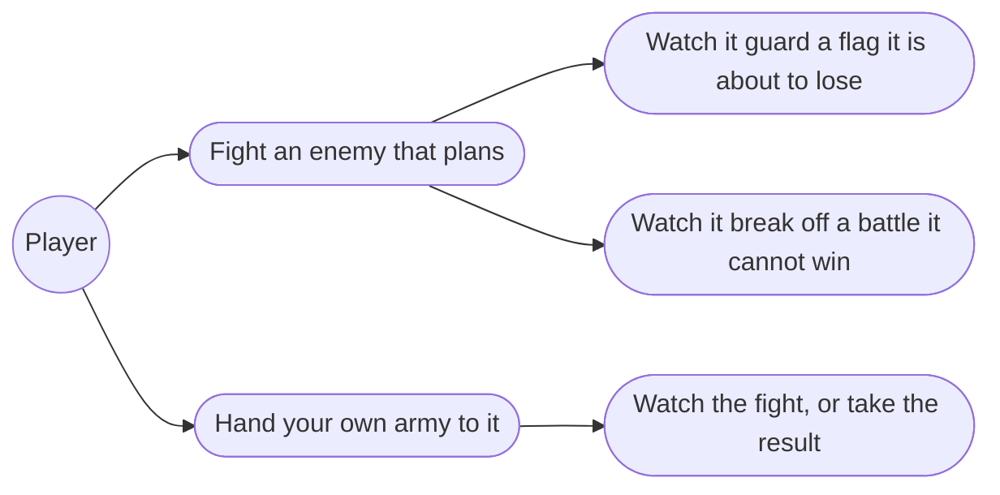
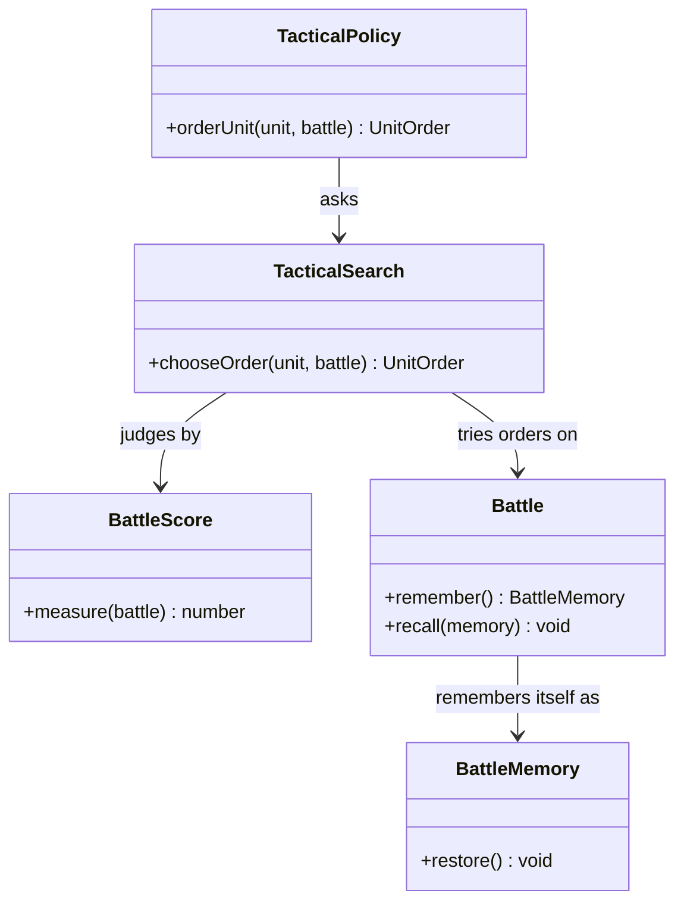

# 8.5 The Tactical AI — Design (draft)

## Description

The opponent that plays the battle properly, and the same opponent handed your own army when you would rather not fight it yourself.

Last of feature 8's five stages, and the only one that adds no rules. Everything it needs to know — what a blow costs, what a flag is worth, what starving means — was settled by 8.1 through 8.4. What it adds is judgement: looking a few moves ahead, weighing the board, and choosing the order that leaves it best off.

This document is a draft written before the stage begins. It exists because the search was prototyped during 8.3 and then taken back out, and the measurements are worth more than the code was. What 8.3 actually ships is the stub described in its own doc — a unit looks for the best blow it can reach and otherwise walks toward a flag — which is enough to play against and nowhere near enough to lose to.

## Glossary

| Term | Meaning |
| --- | --- |
| Activation | One unit being ordered: its move and the command that ends it. The unit of thinking, and the unit of search depth — not the turn, which is up to five activations at once. |
| Ply | One activation in the search tree. The side changes when a side has no unordered units left, so plies do not alternate between the two sides the way they do in chess. |
| Evaluation | A number saying how good a position is for one side, with a win at one end and a loss at the other. Everything the AI believes about the game is in here; the search only finds what the evaluation already values. |
| Memory | Everything that has to be put back after the search tries a move: where each unit stood, how it faced, what it had left, whether it had moved or acted, both armies' troops and food, the clock, and whose turn it was. |
| Auto | Handing your own army to the same opponent for one battle (§9.7), so a fight you do not want to play still plays by the rules you would have played by. |

## Functionality

- Face an enemy that looks several activations ahead and picks the order that leaves the board best for it.
- Have it defend its own flag when the flag is what is threatened, without being told that defending is a thing.
- Have it retreat when the battle is lost rather than standing to be destroyed (§9.16).
- Hand your own army to it for a battle and watch, or skip to the result.
- Keep it honest: it decides and changes nothing, so the board it hands back is the board it was given.

## Use cases

## Research

**A turn is too big to search; an activation is not.** The obvious tree — one node per turn — is out of reach: five units, each with a move range of ten to thirty cells and up to five targets from each, is on the order of a hundred million turns to consider. One node per *activation* is perfectly tractable, and it is also how the game is actually played, one unit at a time. So depth counts activations.

The consequence is worth stating plainly, because it is the first thing that looks like a bug: **the plies do not alternate**. A side orders every unit it has before the other side moves at all, so a search that is maximising stays maximising for four or five plies, then flips. Depth three from the first unit of a turn therefore never sees the enemy reply — it only coordinates that side's own units. That is why the prototype at depth three played so strangely: it walked its whole army off to attack and lost its own flag, because losing the flag was always just beyond where it could see.

**Depth was measured, and deeper genuinely plays better.** Two identical armies of 190, both sides driven by the same search on Londre:

| Depth | What happened | Cost |
| ---: | --- | ---: |
| 3 | The attacker abandons its flag; the defender walks in on day 3 | under 1ms per order |
| 5 | The attacker keeps a guard back and survives to the food limit | 2ms |
| 6 | Same, with more blows traded on the way | 6–8ms |
| 8 | The attacker finds the way into the castle and wins by flag on day 5 | 54ms |

Against the screen's 420ms pacing between enemy orders, even depth eight is affordable, and depth six leaves room on a slow machine. Alpha-beta is what makes this possible; without it the same depths are hundreds of times more expensive. Candidates need capping too — every cell the unit can reach, paired with every enemy it could strike from there, is far more than the tree can take, so they are ranked by a cheap static score and the best ten kept.

**Make and unmake, not clone.** A search that copies the battle at every node spends all its time copying. Applying the order to the real battle and putting it back afterwards costs a small record per unit, and the record has to be complete: cell, facing, strength, and both the moved and acted flags for each unit; troops and food for both armies; the clock; and whose turn it is. The last three are easy to forget and all three matter, because ending a turn advances the clock and feeds both armies. One test guards the whole thing — ask the AI for an order and assert the board is byte-for-byte what it was — and it is worth writing first.

**The evaluation is where the work is, and the prototype's was not finished.** Material and the flag race are easy: strength on each side, and how far each side's nearest unit is from the other's flag, with a win scoring off the scale. Two problems surfaced that the next attempt should start from.

The first is that distance ignores bodies. `Advance` floods out from a goal across passable ground, which is right for steering but wrong for judging a threat: a defender standing *in* the castle gate scores exactly as well as one standing behind it, because the enemy's distance to the flag is unchanged either way. Blocking is a real tactic — 8.2's own research says both sides "can only use the bodies of their units and built Fences… to block the path" — and an evaluation that cannot see it will never learn to stand in a doorway. Either the distance becomes occupancy-aware at evaluation time, which costs a flood per node, or the score gets an explicit term for holding the approach to its own flag.

The second is that the prototype always activated units in a fixed order, so it could not plan the sequence — and sequence is most of tactics. Striking with the archer before the knight closes, or moving the blocker before the unit that needs the space, are decisions it could not represent at all.

**The postures in the sources are a check, not a specification.** §9.16 describes an AI that guards its flag when clearly outmatched, advances at parity, may sit on a food advantage, and retreats when facing destruction. Those are worth keeping as acceptance criteria — a good evaluation should *produce* them — rather than coding them as rules on top of a search that would otherwise disagree with them. Where the search and the sources disagree, the evaluation is wrong.

**Auto needs no second formula.** 8.1 resolved battles with a strength ladder because there was no field; with blows resolved per unit since 8.3, handing the player's army to the same search plays the same game by the same rules at speed. What Auto adds is a loop and a way to show or skip the result, not a parallel model of combat that could contradict the visible one.

**What 8.3 leaves ready.** `TacticalPolicy.orderUnit(unit, battle)` is a pure function from a position to an intent, which is exactly the seam a search slots into — the screen performs the order and does not care how it was chosen. `Advance` already answers walking distance. `BLOW_WEIGHT` and `RETALIATION` already say what a blow from each face is worth, so candidate ranking can reuse them instead of inventing a second opinion. And `UnitOrder` already carries intent rather than history, so nothing has to be undone when an order is merely considered.

## Overview

Three pieces behind the existing seam. `BattleScore` turns a position into a number for one side. `BattleMemory` records what a trial order changed so it can be put back. `TacticalSearch` walks the tree with alpha-beta, maximising while its own side is activating and minimising while the enemy is, and hands back the best order it found. `TacticalPolicy` keeps its one method and delegates.

## Tests

- **It changes nothing (unit):** the board after an order is asked for is identical to the board before — units, strengths, facings, both acted flags, both armies, the clock and the turn.
- **It sees a win (unit):** a unit one step from the enemy flag is ordered onto it; a unit that can destroy the last standing enemy does.
- **It sees a loss coming (unit):** given a move that wins material and a move that stops the enemy reaching its flag next activation, it stops the flag.
- **Deeper plays better (unit):** the same position searched deeper never scores worse for the side searching, and across a played-out battle the deeper side beats the shallower one.
- **It costs what it should (unit):** an order at the shipped depth returns well inside the screen's pacing, asserted as a node budget rather than a wall-clock time so the test does not flake.
- **The postures hold (unit):** clearly outmatched, it stays near its flag; at parity it advances; facing destruction it retreats — asserted as behaviour over a played-out battle, not as a branch in the code.
- **Auto (control):** a battle handed to Auto finishes by itself, ends in one of the same outcomes a played battle can, and settles the province the same way.
