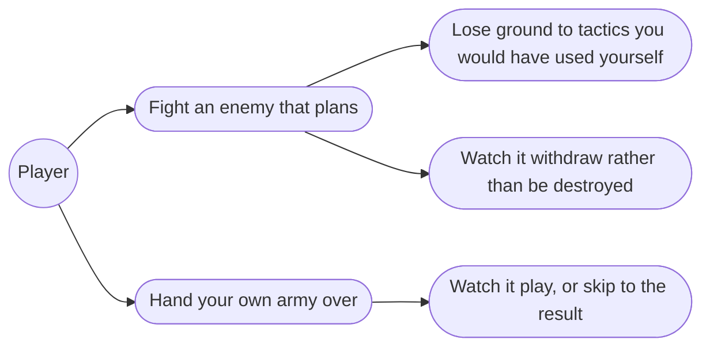
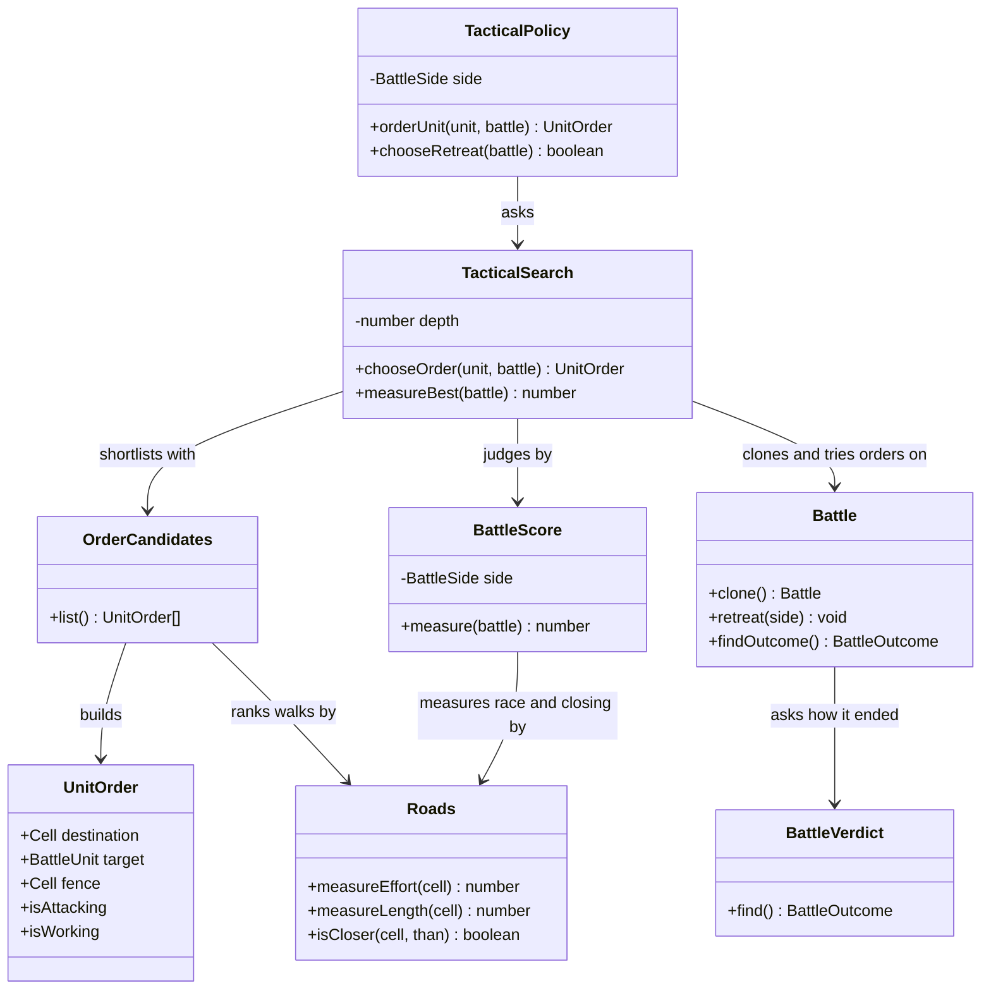
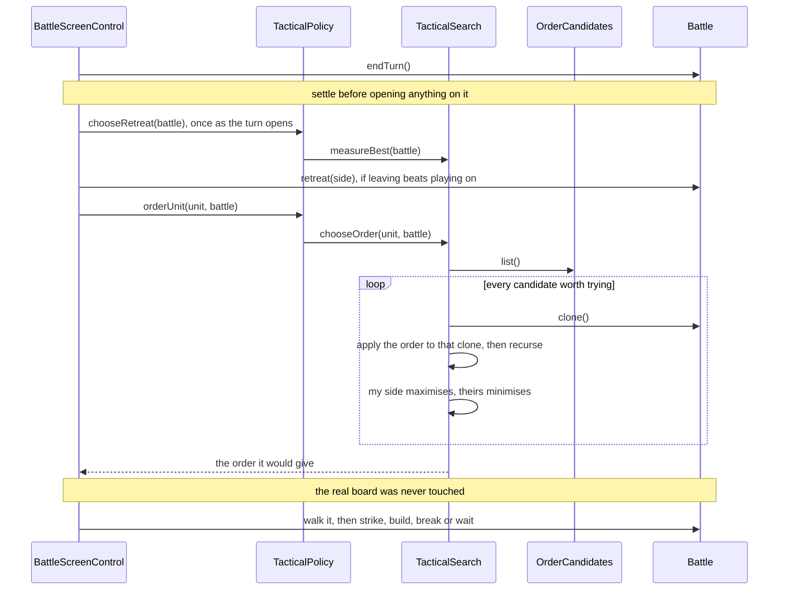

# 8.5 The Tactical AI — Design

## Description

The opponent that plays the battle properly, and the same opponent handed your own army when you would rather not fight it yourself.

## Glossary

| Term       | Meaning                                                                                                                                                                              |
| ---------- | ------------------------------------------------------------------------------------------------------------------------------------------------------------------------------------ |
| Activation | One unit being ordered: its move and the work that ends it. A turn is up to five of them, one side ordering every unit it has before the other moves at all.                         |
| Ply        | One level of the search tree, which here is one activation. The side changes only when a side has no unordered units left, so plies do not alternate the way a chess reader expects. |
| Evaluation | A number saying how good a position is for one side. The search only finds what the evaluation already values.                                                                       |
| Auto       | Handing your own army to the same opponent for one battle (§9.7).                                                                                                                    |

## Functionality

- Order a unit by searching several activations ahead for the order that leaves the board best, rather than by taking the nearest blow.
- Decide, as an army rather than a unit, whether to fight on or withdraw.
- Play a battle out with neither side ordered by hand: hand your own army over for one battle, and watch it or skip to the result.

Everything a player would describe as the AI's tactics — holding a flag, corking a bridge, ganging up, waiting out a food supply — is a consequence of the first of those, not a separate thing built. They are written down under Research as what the evaluation has to value, and asserted under Tests.

## Use cases



## UI

No new screen: the enemy already moves and strikes through the screen the player uses. The one addition is the command that hands your own side over.

```text
┌─ Battle ──────────────────────────────────────────────────────┐
│ Erin                     Day 4                      Eselred   │
│ food 54, 3 days        Londre  (☀)          food 180, 6 days  │
├───────────────────────────────────────────────────────────────┤
│                  A  B  C  D  E  F  G  H  I  J                 │
│              1  ♠♠♠ ·  · ≈≈≈≈≈≈ ·  · ♠♠♠ ·  ·                 │
│              2   ·  ·  · ══════ ·  ·  ·  ·  ·                 │
│              3   · ♠♠♠≈≈≈≈≈≈≈≈≈████████████ ·                 │
│              4   ◇  · ≈≈≈♠♠♠≈≈≈███ ·  a←╫╫╫ K←                │
│              5   · ≈≈≈≈≈≈≈≈≈≈≈≈███ ◆  ·  ·  ·                 │
│              6   · ═══ · ≈≈≈ · ███ ·  k←╫╫╫ ·                 │
│              7   · ≈≈≈ · ═══ · ████████████ ·                 │
│              8  ≈≈≈≈≈≈ · ≈≈≈ ·  ·  ·  ·  ·  h←                │
├───────────────────────────────────────────────────────────────┤
│ ╫  fence      yours  H K A ☆ ◇      theirs  h k a ★ ◆         │
│                                                               │
│ [ Retreat ][ Auto ]  Knights at J4  [ Fence ][ Wait ][ Done ] │
└───────────────────────────────────────────────────────────────┘
```

**`[ Auto ]` sits beside `[ Retreat ]`**, the two army-level commands together and away from the buttons pressed every turn. Both end the battle as the player knows it, so both confirm before they fire, and neither can be taken back. Once Auto is taken the per-unit buttons go — there is no unit to order — and `[ Skip ]` takes their place, dropping the pacing and the animation to run the battle to its end. That end arrives in about a second at the shipped depth, and the page is unresponsive until it does, which is one of the two things holding the depth where it is.

**The change a player will actually notice is the enemy building.** Until now it could not: the fence work 8.4 built — `showWork`, `showBreaking`, and the single cell redrawing where a fence went up or came down — fires only for the player's own units, because only the player could order it. An enemy that fences means those same messages and that same redraw arriving on the other side of the board — new to watch, and needing no new view work, only a branch where the screen performs an order it was given. An enemy that withdraws needs nothing either: the battle ends through `BattleEndedEvent` with its reason already, the way a player's retreat does.

## Research

### What kind of AI this should be

Five shapes were considered, and four of them built and played. The measure is not how well each plays — several play well — but what each costs to read a year from now, to test, and to change when a new tactic is wanted. All of them are fast enough on a 10×8 board; speed decided nothing.

| Approach                                | Where behaviour lives                  | Adding a tactic                                                  | How it fails                              |   Battles won |
| --------------------------------------- | -------------------------------------- | ---------------------------------------------------------------- | ----------------------------------------- | ------------: |
| Scripted rules, or a behaviour tree     | Spread across conditionals             | A new branch, and a re-reading of every branch it may contradict | Silently, in the gaps between rules       |     134 / 240 |
| Greedy, one ply, scored                 | One scoring function                   | A new term                                                       | Walks into anything one move away         |     133 / 240 |
| A written doctrine, three hundred lines | As above, with more rules              | As above, more so                                                | As above                                  |     142 / 240 |
| **Search over one evaluation**          | **One evaluation function**            | **A new term**                                                   | **Quietly, where the evaluation is flat** | **181 / 240** |
| Playouts (MCTS)                         | Nowhere — the rules are the evaluation | Nothing; it emerges                                              | Slowly, and unexplainably                 |       18 / 48 |

Six hundred battles, every approach against every other on both sides of all thirty battlefields, identical armies, seeded dice. Playing both sides matters: the defender wins a battle that runs out, so a single orientation measures the map rather than the player.

**The three rule systems are indistinguishable from one another** — 31–29, 31–29, 32–28 between them, every one inside half a standard deviation. Fifteen lines of greed, sixty of postures and three hundred of doctrine all play to the same strength. Against the search the best of them loses 23–37.

**Rules were the real alternative, and the argument against them is not that they play badly.** They play nearly as well. It is that a rule must commit in advance to a policy the position should be deciding. The clearest case: a tree that keeps a unit home to guard its flag attacks three against four and never reaches the flag it must take; a tree that brings everyone gives its own flag away fourteen times in sixty. Neither is right, because it is not a policy question. The search keeps no guard and loses its own flag _not once_ in sixty — the enemy's distance to it is simply one term, so a unit drifts back when that number gets uncomfortable and rejoins the attack when it does not. Three separate times a sensible restraint rule — wait for the odds, shoot only from cover, go home when threatened — turned into idleness through its interaction with the others.

**MCTS needs no evaluation at all**, which is its appeal: nothing has to be taught what a flag is worth. It loses on testability — there is no term to assert against, only a distribution — and on this board it is simply weak, since a battle runs some 130 activations and a random rollout is nearly all noise. Four times the thinking time did not save it.

**What the chosen approach costs, stated plainly.** A rules AI is inert where no rule fires. An evaluation-driven one is never inert: it always takes the best-scoring thing available, so wherever the evaluation is flat it picks noise, and noise looks like idiocy. That is a tax to keep paying, not a bug to fix once.

### The shape of the search

**Depth counts activations, not turns.** One node per turn is out of reach — five units, each with ten to thirty reachable cells and up to five targets from each. One node per activation is tractable, and it is how the game is played anyway.

**The plies do not alternate**, which is the first thing that will look like a bug. A side orders every unit it has before the other moves, so a maximising search stays maximising for four or five plies and then flips. A search that stops mid-turn has moved some of its units and not others, and flatters the position it stopped in.

**Ship depth four.** Over 120 battles it beats depth two 83 to 37 and no lookahead 75 to 45. Above four nothing separates: three is 57–63, five 7–5, six 6–6. So lookahead earns its place and more of it does not. Four rather than three because the two cannot be told apart directly but can against a weaker opponent — four demolishes depth two where three only edges it. A human has since beaten the shipped depth after a real fight, which is the target.

**Feature 12 should resolve its own battles at three.** Three costs a third as much and plays a battle out in half the time — worth nothing when a human is watching inside a 420ms pace, and a great deal when several rival houses fight in one monthly turn with nobody watching. `TacticalPolicy` takes a depth, so this costs an argument rather than a change.

**Units activate in the order they stand in.** Letting the search choose which unit goes next is most of what sequencing means, and costs about a whole extra ply of thinking. Measured twice over thirty maps: 32–28, then 33–27 — sixty-five battles to fifty-five, under one standard deviation. Built, measured, and removed twice rather than kept as an untested knob.

**Candidates are capped per kind, and that matters.** Every reachable cell paired with everything doable from it is more than the tree can take. Blows, fence work and walks are each ranked and capped _separately_: pooled into one ranking, a blow scores a point or two while a walk scores minus its distance, so every blow outranks every walk and a unit near a couple of them is offered no way to march at all. Ranking reuses `BLOW_WEIGHT` and `RETALIATION` rather than inventing a second opinion about a blow.

### What the evaluation counts

`BattleScore` is built for a side, and every term is that side's point of view. The weights live in `config/battle.ts`:

| Term     | Measured as                                                                                 |      Weight |
| -------- | ------------------------------------------------------------------------------------------- | ----------: |
| Outcome  | A won battle at one end, a lost one at the other                                            |      ±10000 |
| Material | This side's standing strength less the enemy's                                              | 1 per point |
| Kill     | For each enemy unit destroyed, what it was destroyed with                                   | 1 per point |
| Race     | The fewest turns any unit needs to reach the flag it contests, in plain paces over its move | 15 per turn |
| Closing  | Every one of this side's units, by the cost of its road to the flag it should gather at     |  2 per step |
| Supply   | Days of food left, capped at the days a battle can still run                                |  10 per day |

Three of these exist because a human tactic had nowhere to live. **Ganging up** needed the Kill term — two units finishing one enemy rather than wounding two leaves the same strength on the field, so a troops-only count is indifferent between them. **Corking a road** needed `Roads` to know about bodies, which `MoveRange` already did: a defender standing _in_ a gateway measured exactly like one standing behind it. **Racing for a flag** is the one tactic no affordable depth can see the end of, so it lives entirely in the Race gradient — which is why that term counts turns by the fastest unit, not cells.

Race and Closing come from one survey and read it differently, and must. `Roads` charges extra for a body or a fence in the way, so what it measures is the _effort_ a road asks for; a race wants its _length_, and dividing effort by a unit's move counts one body in a gateway as a whole turn of travel. The game itself has no notion of a movement cost — a unit enters a cell or it does not — so effort is the AI's own reading of the board, which is why it lives here and not in `Battle`. The flood carries both.

Closing follows the flag a side is _contesting_ — the enemy's while it can afford to take it, its own once it clearly cannot — which is §9.16's first posture falling out of a term rather than being coded as a rule. It is defender-only and needs a clear deficit: on a knife edge a single blow's backlash reversed every unit's objective mid-turn and marched whole armies home.

**Two cautions for whoever tunes these.** The weights began as guesses scaled by hand and are settled by playing. And zeroing any single term leaves the whole test suite green, because several terms push toward the same move — nothing here is pinned by a test, and a weight can be broken silently.

### Working on a clone

**The search plays on a clone and never touches the real battle.** Undoing each trial order is faster, and that is the whole of its case; against it, undoing needs a record of every field an order can touch, and one forgotten field rots the board under a search that still looks correct. Cloning cannot fail that way. It costs about a sixth of a node, which is not a reason to take the trap.

**What a clone has to get right.** Since 8.4 made terrain mutable the cells must be copied and each unit's `cell` rewired to the copy. `Battle`'s ordinary constructor deploys an army into formation, so cloning needs a path of its own. The clock comes along free — `BattleClock` is immutable — but it must come along: `isSpent` is the defender's endurance win and `isDayEnd` is what feeds both armies.

**A trial fence branches, it does not roll.** `Battle.build` and `breakDown` roll against `fenceOdds`, so calling them in the tree would score a whole subtree on one random sample — and a clone rolls its own dice just as badly. The search changes the clone's ground directly and scores the candidate as the odds-weighted blend of fence-up and fence-not-up, the unit's turn being spent either way. Strikes need none of this: `measureLosses` is arithmetic. The real roll happens once, when the screen performs the chosen order.

**Fences come free to the evaluation.** The Race term floods over ground a unit can actually walk, so a fence across an approach genuinely lengthens the enemy's road and the evaluation discovers fence-building without being told fences are for defence. A fence is judged a _delay_, not a wall — either side can pull one down — because judging it a wall made a single fence worth more than an army and set two units of the same side building and breaking the same cell.

### Breaking off

**Retreat is the one decision the battle cannot value on its own**, because its whole point is what happens after: an army that walks away still exists, garrisons a province and fights again, and none of that is visible from inside the field. Scored purely tactically it is simply a loss, so a search would never choose it, and §9.16 says the original does.

So it is scored as a defeat softened by the _share_ of the army that comes home — a fraction of the loss, never a multiple of raw strength. Written the second way it grew without limit: at five hundred troops leaving scored zero, which beat playing on in a dead-even position, and any large army withdrew before a blow was struck. §9.15 also says retreat preserves only part of an army and the commander may still be captured, so what leaving truly costs is feature 9's business; today's weight prices the troops alone.

**It does not fit an order**, being the army's act and not a unit's, so the policy is asked a second question once as a side's turn opens — the same shape `DefensePolicy.chooseRetreat` has on the strategic side. It answers by searching, and answers no outright for a battle already decided, where the best line _is_ the loss and any salvage would beat it.

**Leaving must beat the best of staying, not merely beat losing.** A losing side can still win by supply, and a side down to a remnant has nothing to save — so the softening carries a floor, below which leaving is worth no more than fighting on.

**A retreating enemy must be rare, or it is merely annoying.** A player takes the province either way but never destroys anything, and an enemy that always escapes reads as a game refusing to be beaten. The floor buys some of that; §9.16's own last posture buys the rest, blocking retreat while the side's own flag is under immediate threat. That one cannot be derived — a flag about to fall is a loss about to arrive, and leaving with troops intact scores better — so it is the one place behaviour sits on top of the search rather than falling out of it. The other four postures a good evaluation should _produce_; where it and they disagree, the evaluation is wrong.

### Auto

**Auto needs no second formula.** With blows resolved per unit since 8.3, handing the player's army to the same search plays the same game at speed. `AutoResolver` was deleted in 8.2 so that nothing could quietly disagree with the visible combat, and nothing here brings it back.

**It is already a battle with nobody ordering either side**, which is what feature 12 needs when two rival houses fight out of the player's sight. Nothing extra need be built: everything the AI touches is domain, and a headless resolution is a loop over those calls with the animation left out. The screen may own when things happen, never what happens.

## Overview

The stage adds three things behind a seam that already exists. Something that scores a position for one side. Something that searches ahead and comes back with the order it would give. And a board of its own to search on, so nothing it tries reaches the battle the player is watching. The policy the screen already asks for orders keeps its place and its name; it simply stops guessing and starts searching, and it grows one question an order cannot carry — whether the army should leave.

On the screen, the battle control gains a second policy, this one for the player's own side, and the paced loop that drives it. That loop is the whole of Auto. Ending a turn is where endurance and starvation are decided, and opening the next one asks a policy whether to withdraw, so the loop settles a finished battle before it opens anything on it — otherwise a won battle is reopened, its reason overwritten by a retreat, and its ending published twice. What it must not become is the only thing that knows how to play a battle to its end, since feature 12 needs the same thing with no screen at all.

## Domain model



| Class             | Responsibility                                                                                                     |
| ----------------- | ------------------------------------------------------------------------------------------------------------------ |
| `Battle`          | The battle in progress: a field, two armies, the units on it and the clock over it, and the acts that change them. |
| `BattleVerdict`   | Whether a battle is over, and which of the five endings it was.                                                    |
| `UnitOrder`       | One unit's turn: where it goes, and what it does when it gets there.                                               |
| `Roads` | The road from a goal to every cell, for one walker: how long it is, and how much is in the way. |
| `TacticalPolicy`  | What a side does: the order a unit is given, and whether the army fights on.                                       |
| `TacticalSearch`  | Which order is best, judged by looking several activations ahead.                                                  |
| `OrderCandidates` | Which of a unit's possible orders are worth considering at all.                                                    |
| `BattleScore`     | What a position is worth to one side.                                                                              |

## Flow



## Persistence

Nothing. A battle begins and ends inside one province's turn, so no save can be holding one; Auto dies with the battle, and the search's constants are config, not state.

## Tests

- **It changes nothing (unit):** the board after an order is asked for is identical to the board before — units, strengths, facings, steps, acted flags, both armies, the ground, the clock and the turn. Cloning makes this true by construction, which is the point of cloning; the test is still worth writing first, because a stray call against the real battle instead of the clone is exactly the mistake it catches.
- **A clone is a whole board (unit):** a cloned battle shares no mutable state with its original — a fence raised, a blow struck or a turn ended on the clone leaves the original untouched, and the clone's units stand on the clone's cells.
- **It rolls no dice (unit):** `Math.random` is never called while an order is being chosen, however many fences the candidates would build or break. The real roll happens when the screen performs the chosen order, and that is where the existing fence tests already pin it.
- **The order points at the real board (unit):** the `UnitOrder` handed back names a cell and a target belonging to the battle that was asked, not to the clone it was searched on. The screen acts on what it is given, so an order naming a phantom unit would strike something that is not on the field.
- **It sees a win (unit):** a unit one step from the enemy flag is ordered onto it; a unit that can destroy the last standing enemy does.
- **It sees a loss coming (unit):** given a move that wins material and a move that stops the enemy reaching its flag next activation, it stops the flag.
- **It uses the ground (unit):** given a fence that would lengthen the enemy's road to its flag, a Knights raises it; given one across its own road, a unit pulls it down.
- **It corks the road (unit):** given a bridge that is the only way to its flag, it stands on the bridge rather than beside it — and the same for a castle gate, with no rule naming either.
- **It races (unit):** with a clear road, a fast unit and no defender in reach of its own flag, it runs for the enemy flag instead of turning to trade blows; a flier does so over ground that stops the rest.
- **It costs what it should (unit):** an order at the shipped depth stays well inside a node budget, counted rather than timed so the test does not flake on a loaded machine.
- **The postures hold (unit):** clearly outmatched it stays near its flag; at parity it advances; holding a food advantage over a starving enemy it sits and waits; facing destruction with troops worth saving it retreats — asserted as behaviour over a played-out battle, not as a branch in the code.
- **It does not flee cheaply (unit):** a side merely behind on strength fights on, a side down to a remnant fights on, a side that can still outlast the enemy's food stays, and a side whose own flag is under immediate threat stays (§9.16's fifth posture, the one coded rather than derived).
- **Retreat stays rare (unit):** played across a spread of openings, the AI withdraws from a minority of battles. Asserted as a loose bound rather than a rate: the weight behind it is meant to be retuned by playing, and a test pinned to today's number would fail every time someone tunes it. What it guards is the regression where the AI suddenly leaves everything.
- **It stays in an even battle however large the armies are (unit):** the salvage is a share of the loss, not a multiple of strength, so no army is big enough to make leaving look better than an even fight.
- **It answers no for a battle already decided (unit):** the losing side, asked after the clock has run out, does not call it a withdrawal.
- **A finished battle is reported once (control):** a handed-over battle that runs out publishes one ending, and by the reason it really ended rather than as a retreat.
- **The board is not what pins these (note):** zeroing any single term of the evaluation leaves the whole suite green, because several terms push toward the same move. The tests above cover the machinery — the clone, the dice, the order handed back, the retreat guards — and the behaviour only where one term decides alone. Two tests were written that appeared to cover a term and did not, and were deleted rather than left as false cover.
- **Auto (control):** a battle handed over finishes by itself, ends in one of the outcomes a played battle can, and settles the province the same way. Skipping matches watching only with `Math.random` pinned, since fence work rolls — so the test pins it, and without pinning the claim is that both finish, not that both finish alike.
