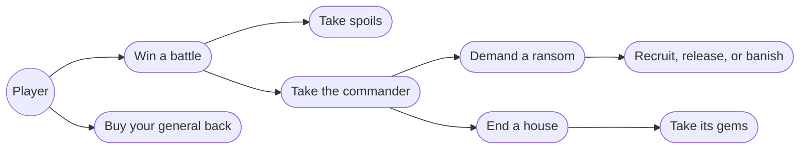
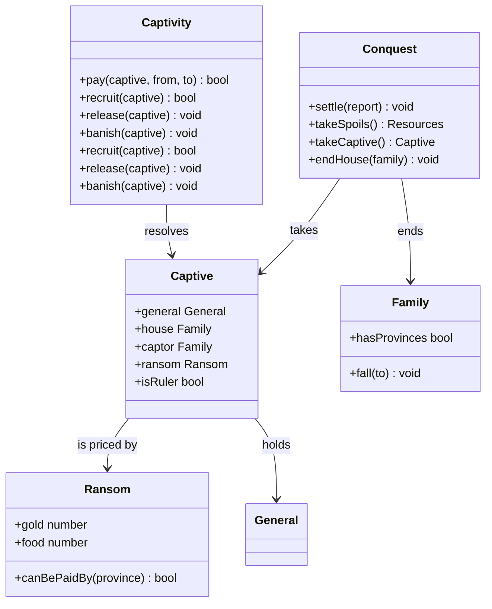
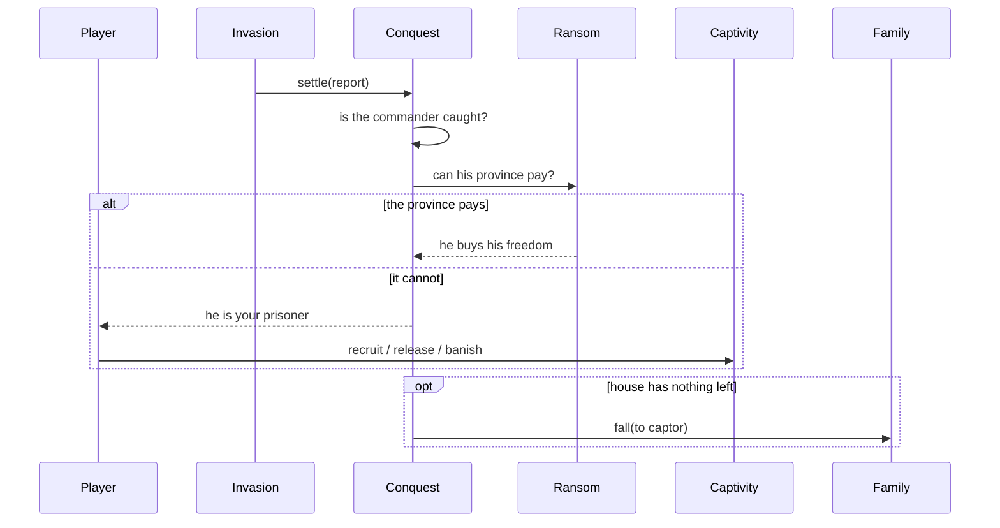

# Conquest & captives — Design

## Description

A won battle currently ends with the province changing hands and both armies going home — and because resources sit on the province, its gold and food already come with it. What is missing is everything that happens to the _people_: the losing commander may be led away in chains, ransomed, turned, freed or exiled, and a house that has nothing left stops existing — handing its gems to whoever finished it.

The battle itself is done. Everything here happens after `Invasion.settle`, on the strategic map, and most of it is a decision the player makes about a person rather than a place.

## Glossary

- **Spoils** — what the victor takes beyond the ground. Land, and the gold and food standing on it, already change hands in 8.1: resources belong to the province, and `Invasion.capture` reassigns the province. What this feature adds to the pile is ransom money.
- **Captive** — a commander taken after losing a battle, including one taken while retreating. A captive belongs to the captor's house until disposed of, and is not a member of it.
- **Ransom** — the price a beaten commander pays out of his own province to walk free, in gold _or_ food. Nobody demands it and nobody may refuse it: if the province can meet it, he is simply never taken.
- **Disposal** — what the captor does with a commander whose province could not buy him out: **Recruit**, **Release**, or **Banish**.
- **Fallen house** — a family with no provinces left, or whose ruler has been recruited or banished. A fallen house leaves the game and its gems pass to whoever ended it.
- **Exile** — a banished general: out of Ishmeria, out of the game, never recruitable again.

## Functionality

- take the province's gold and food as spoils when it falls
- capture the losing commander, whether beaten or retreating
- always capture the ruler of a house down to its last province
- almost always capture a defender with no neighbour to flee to
- let a beaten commander buy his freedom from his province's gold or food
- recruit, release, or banish a commander whose province could not pay
- end a house that has lost everything, and take its gems

## Use cases



## UI

**Captives are reported, then decided.** The battle report from 8.1 already fills the screen after a fight, so the capture line belongs in it — one sentence under the verdict, naming who was taken. The decision comes after the player closes that report, because it is a different question: the report says what happened, the dialog asks what to do about it.

**The dialog is the three choices, and nothing else.** A commander whose province could buy him out never reaches it. Each choice says what it does, because the original left the player guessing and the difference between Release and Banish is not obvious from the words.

```text
┌─ Seth is your prisoner ──────────────────────────┐
│  Seth of Lyle         WAR 77  CHA 70             │
│                                                  │
│  [ Recruit ]  take him into your house           │
│  [ Release ]  send him home the weaker for it    │
│  [ Banish  ]  out of Ishmeria, for good          │
└──────────────────────────────────────────────────┘
```

**Buying your own general back needs no dialog either** — the same rule runs for a failed attack, out of the province he set out from. You lose the gold instead of the man.

**A house falling needs no dialog** — only a line in the report and a redraw of the map: `Lyle is no more. Pluvius passes to Blanche.`

## Research

**The sources disagree about how much of this is rules and how much is chance,** and three formulas are simply not recorded. The spec marks capture probability, Recruit success, and the effect of Banish as unresolved; the FAQ gives the shape of the ransom price but says outright "I have yet to figure the formula". So the design fixes what the sources state as rules and puts the rest behind named constants, the way the AI's weights are — measurable later, wrong in an obvious place rather than a hidden one.

**What the sources do state as rules**, and which the implementation must honour exactly:

- A defender with nowhere to retreat is captured almost always; taking a family's _last_ province always captures its ruler.
- A retreating commander can still be taken — capture is not conditional on losing the field outright.
- The manual states the flow outright: "The winning ruler has 3 choices: Recruit… Release… Banish", and "if there is enough gold or food left in the province, the losing ruler may buy his or her way free". There is no demand to send and no answer to wait for.
- Recruiting a ruler brings the whole house — lands, vassals and armies — with him.
- Releasing a vassal weakens him.
- A house with no ruler and no heir disbands, and its gems go to whoever banished him.

**Where the aftermath should live** is the real structural question. `Invasion.settle` already runs losses, burials, gem rest and the province transfer, and it is the obvious place to hang capture off. It is also 90 lines that answer one question — what happened to the two armies — and captives ask a different one, about people and houses, with a UI conversation in the middle of it. Three options:

|                        |                                                                                                                                                                     |
| ---------------------- | ------------------------------------------------------------------------------------------------------------------------------------------------------------------- |
| Extend `Invasion`      | Cheapest. But `Invasion` would then own a dialog that may be answered several turns later, and it is currently a thing that starts and finishes inside one command. |
| A `Conquest` beside it | `Invasion` reports; `Conquest` takes what the report says can be taken. Clean seam, one more concept, and the two must agree about ordering.                        |
| Put it on `Family`     | Captives are really a relation between two houses. But `Family` has no idea a battle happened, and would grow a second life as a workflow.                          |

**Chosen: a `Conquest` beside `Invasion`.** It reads the `InvasionReport`, takes the captive and decides whether a house has fallen. It gives the ransom conversation somewhere to live that is not a command, and it keeps `Invasion` answering only the question it already answers.

The disposals went to a second class, `Captivity`, rather than onto `Captive` as first sketched. Recruiting moves a general between houses, banishing writes to an exile register, and both can dissolve a family and reassign its provinces — all of which need the `World`. A `Captive` that held a `World` would be a record with a map in its pocket, so `Captive` stays the fact (who is held, by whom, for how much) and `Captivity` performs the change.

**Heirs are deliberately absent.** The FAQ's rule is that banishing a ruler promotes an heir, and only a house with no heirs left disbands. Heirs arrive in feature 11, which owns the whole lifecycle — so here a house falls the moment its ruler is taken out of it, and 11 inserts the heir step in front of that. Doing it in this order means 11 changes one method rather than this feature guessing at a model it cannot test yet.

## Overview

Four pieces. **`Conquest`** settles the aftermath of an invasion: who is taken, who buys free, and whether a house is finished. **`Captive`** is the commander who could not buy free. **`Captivity`** performs the three disposals. **`CaptiveDialog`** offers them, on the battle report's frame.

## Domain model



| Class          | Responsibility                                                                        |
| -------------- | ------------------------------------------------------------------------------------- |
| `Conquest`     | What a won invasion yields: the spoils, the captive, and whether a house is finished. |
| `Captive`      | A commander held by another house, and what happens to him.                           |
| `Ransom`       | A price in gold or food, and whether a province can meet it.                          |
| `Family`       | Gains the ability to stop existing, and to hand its gems on when it does.             |

## Flow



## Persistence

A captive outlives the turn that took him, so a save carries: who is held and by whom. Exiles are a flat list of general ids that nothing may recruit again. A fallen house leaves no record beyond its absence — its gems already moved, and its provinces already carry their new owner.

## Tests

- **Spoils** — taking Hyland hands its 136 gold and 145 food to the victor. This passes today; the test exists to pin a rule nothing currently asserts.
- **Capture is certain where the rules say so** — a defender with no neighbour to flee to yields its ruler; taking a family's last province yields its ruler even if the battle was close.
- **Capture is possible where the rules say it is chancy** — a retreating commander is taken with the RNG pinned, and is not taken with it pinned the other way.
- **A province that can pay buys its commander out** — he is never taken, and the gold leaves before the victor inherits the province.
- **A province that can meet neither price** — the commander is held, and the three disposals are offered.
- **Release weakens** — a released vassal returns with less than he left with.
- **Banish is final** — an exile cannot be recruited later, by anyone.
- **Recruiting a ruler takes the house** — his lands, his vassals and his gems change owner in one move.
- **A house with nothing left falls** — it leaves the family list, its gems pass to the captor, and no province still points at it.
- **The player can be on the receiving end** — losing an attack can cost the player a general, unless the province he set out from can buy him back.
