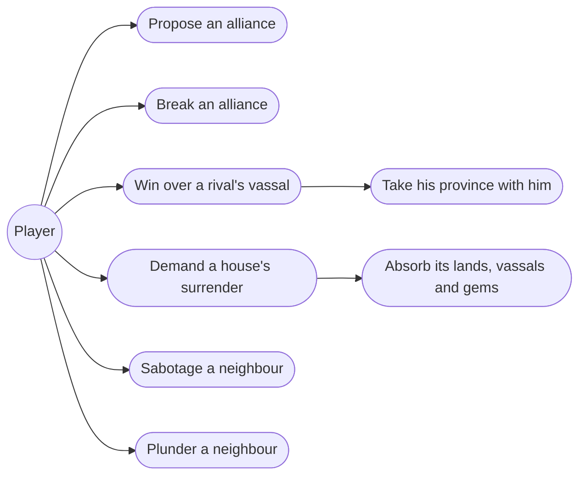
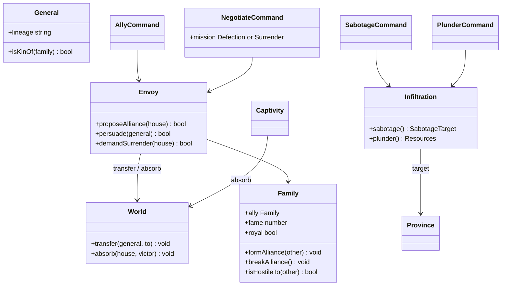
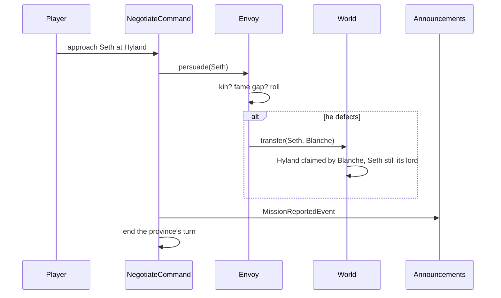
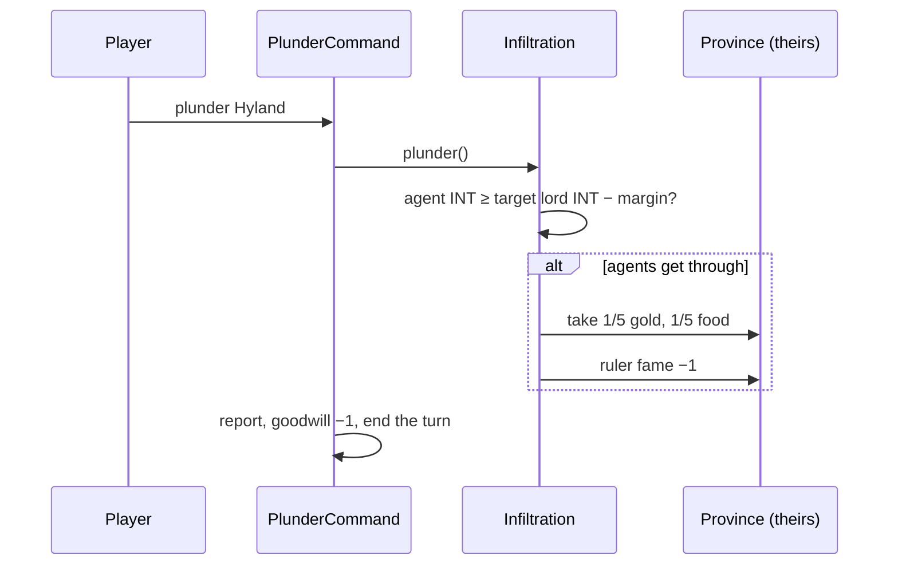

# 10. Diplomacy

## Description

Diplomacy is war fought without armies. It covers four province orders: **Ally** makes or breaks a non-aggression pact, **Negotiate** turns a rival's vassal or forces a whole house to yield, **Sabotage** wrecks a neighbour, and **Plunder** robs one. Each order uses up the province's turn just as Develop or Attack would, so choosing diplomacy always means giving up something else.

The groundwork is already in place. `Family.ally` exists and `AttackCommand` already refuses to target an ally, but nothing ever sets the field. `AllyCommand` and `NegotiateCommand` are stubs that only use up the turn. Feature 9 built everything a house needs in order to change hands, including absorbing a fallen house and handing over its gems. Surrender is the second thing that needs that machinery, so this feature lifts it out of `Captivity` instead of copying it.

## Glossary

- **Alliance** — a non-aggression pact between two houses. Neither may attack the other, and that is all it does: allies send no help, pay no tribute and never join a war. A house has at most one ally, and the royal house of Lankshire never takes one.
- **Defection** — persuading a vassal to leave his house for yours. If he is the lord of a province, the province comes with him, including its gold, food, troops and hired units.
- **Surrender** — a demand that a whole house yield. If it succeeds, the house is absorbed exactly as when its ruler is recruited: its lands, vassals and gems all pass to you.
- **Sabotage** — agents sent into a neighbouring province to destroy a fifth of one of three things: its troops, its loyalty or its protection.
- **Plunder** — agents sent into a neighbouring province to steal a fifth of its gold and a fifth of its food. It also costs the robbed ruler some fame.
- **Kin** — a general of a house's own family line, shown in the original by the family-line symbol on his card. Kin are the hardest people in the game to turn.
- **Agent** — the general whose skill a covert order relies on. That is the acting province's governor, set against the governor of the target.

## Functionality

- propose an alliance from your home province to any house but Lankshire, which may accept or refuse
- break an alliance at any time, which you must do before allying elsewhere or attacking your ally
- send an envoy to any rival province, at any distance, to win over its lord or, at its home, a vassal with no province
- take a defecting lord's province with him: resources, troops and hired units
- demand a rival house's surrender, which only a far weaker house will accept
- sabotage a neighbouring rival province, hitting its troops, loyalty or protection
- plunder a neighbouring rival province for a fifth of its gold and food, and dent its ruler's fame
- hear the outcome of every mission once it has run

## Use cases



## UI

**The Diplomacy group gets four tiles, following the original's own command table:** Ally, Negotiate, Sabotage and Plunder. Every other group already has four, so the panel stays square.

**Ally is a single tile whose action depends on whether you have an ally.** Making and breaking an alliance are two sides of one transaction, so they share a command, a tile and a dialog. There is no toggle to choose a direction, because only one direction is ever legal: with no ally you can only propose, and with an ally you must break the pact first. The tile is disabled anywhere but the home province.

With no ally, the tile lights every province of every house you could ask. Picking any one of them addresses that house:

```text
┌─ Ally with Lyle ─────────────────────────────┐
│  Ander of Lyle        Fame 9    3 provinces  │
│                                              │
│  Peace between Blanche and Lyle: neither     │
│  house may attack the other.                 │
│                              [ Yea ] [ Nay ] │
└──────────────────────────────────────────────┘
```

With an ally, the tile opens straight onto the pact, with no targeting step:

```text
┌─ Alliance with Lyle ─────────────────────────┐
│  Peace holds between Blanche and Lyle.       │
│  Break the alliance?         [ Yea ] [ Nay ] │
└──────────────────────────────────────────────┘
```

**Negotiate puts two missions behind one tile, as the original did.** The tile lights every rival province at any distance, leaving out your ally's provinces. The dialog switches between the two missions:

```text
┌─ Negotiate: 2 Carveti (Lyle) ────────────────┐
│  ( Defection )  ( Surrender )                │
│                                              │
│  ◉ Kneulf   no province      WAR 56  CHA 37  │
│                                              │
│                              [ Yea ] [ Nay ] │
└──────────────────────────────────────────────┘
```

At most provinces the list is just the lord, so Negotiate at Hyland offers only Seth. At a house's home province the lord is the ruler, who cannot defect, so the list instead shows that house's vassals who hold no province, because that is where they sit. The Surrender tab names only the house: _Demand that Lyle yield all its lands and gems to Blanche._

**Sabotage and Plunder work like Search:** the tile lights the neighbouring rival provinces, and a one-line confirm sends the agents. Neither dialog shows a chance of success, because guessing the odds is part of the game. The player can still read both governors' INT through View, just as the original allowed.

**Every outcome is announced** through the queue features 6 and 7 built, so a mission's result reads like any other news:

```text
┌─ over the map ───────────────────────────────┐
│  Seth has left Lyle for Blanche,             │
│  and Hyland comes with him.                  │
│                                 [ Continue ] │
└──────────────────────────────────────────────┘
```

A refusal is a single line, such as _Lyle will not ally with you._, _Seth stays loyal to Lyle._ or _Your agents were caught in Hyland and came back empty-handed._ A success names what was taken, such as _Your agents plundered Hyland: 27 gold, 29 food._ or _Your agents burned the walls of Hyland._ A surrender gets the same line a fallen house got in feature 9: _Lyle yields. Pluvius passes to Blanche._

## Research

**Where the sources agree, the design follows them exactly:**

- An alliance is a mutual non-aggression pact and nothing more. The FAQ says "there is no economic or military benefit", and Hartman says "besides mutual non-aggression, there is no other advantage".
- A house has one ally at a time, and the ruler "must break an alliance before allying with another family, or before attacking an ally" (manual).
- Ally works only from the home province, and "the Lankshire family does not enter alliances" (FAQ, Hartman).
- Defection works at any distance, takes a lord's province with him, and reaches vassals without a province through their house's capital (FAQ, Hartman).
- Surrender absorbs the whole house, "all their former provinces and gems" (manual), and works only against a house that is "vastly overpowered" (FAQ).
- Plunder and Sabotage target neighbours, take a fifth of their target, and are resisted by the target lord's Domestic, which the code calls INT (FAQ §3.3, §4.3; Hartman).
- Goodwill: Ally +1, Break 0, Defection 0, Surrender 0, Sabotage −1, Plunder −1 (appendix-d D.5). Every one of these orders uses up the turn (D.2).

**Three of the formulas are not recorded anywhere:** the odds of an alliance, a defection and a surrender (appendix-d D.6, items 4–6). As feature 9 did with capture and recruitment, the design puts each one behind named constants built from the factors the sources do name. That way a wrong guess is easy to find and easy to fix.

**Ally odds come from relative territory.** The FAQ's rule of thumb is the only concrete one in any source: "if there's another family with twice as much territory as the player, they won't ally. If the target family is weaker than the player's, they will probably accept the terms. If both families are about even in strength, it could go either way." The rule maps directly onto the ratio of province counts, theirs to yours. At 2 or more the odds are zero. At or below 1 they are a high constant (0.8). In between they fall linearly. The FAQ guesses that fame lies behind this, but it gives territory as the measure it actually observed, so the design uses territory.

**Defection depends mostly on who is being asked.** "It has mostly to do with the stats of the person being asked to defect rather than the negotiator, as the same people seem to be easier to recruit in every game." The spec calls this hidden General Loyalty and records no scale (§5.6, D.6 item 7). The ROM extract has no loyalty field at all, but it does record each general's family line (`relation` in `SNDATA*.json`), and the FAQ names the one group that resists reliably: "Heirs, however, are the hardest people in the game to recruit." So kinship is the only grounded basis for loyalty, and the design uses it. A sworn vassal starts at one set of odds (0.4) and kin at much lower ones (0.1). The difference between the two rulers' fame then shifts the odds, because "the more powerful the player is, the more people are willing to defect". The result is clamped below certainty. This also matches Hartman's tip that Lankshire's large pool of vassals, almost none of them kin, is the place to recruit early. A ruler can never be asked to defect, because winning over a ruler is what Surrender does.

**Surrender is a gate, then a small chance.** Every source says it "almost never works" and works only against a house that is far weaker. The FAQ adds that the gap is "almost certainly determined by Fame", and Hartman notes that strong rulers such as Erin or Ander "probably will not surrender". So a house considers surrender only when you hold at least three times its provinces and your ruler's fame is greater than its ruler's. Past that gate it yields with low odds (0.25). The spec's "ruler resistance" is real but not described anywhere, so the gate stands in for it. A strong ruler rarely rules a house a third your size.

**Sabotage and Plunder are decided by comparing governors, not by a dice roll.** The FAQ makes two remarks that only fit a deterministic check: "If it works once, it will work continuously", and "I've had some cases where Sabotage was possible yet Plunder was not". Hartman supplies the comparison itself: "the higher your abilities are in comparison to the leader of the target states the higher the chances". So each order succeeds when the agent's INT is at least the target governor's INT minus a margin: 10 for Sabotage and 5 for Plunder. Plunder's smaller margin makes it slightly harder, which leaves the gap the FAQ saw. A province with no governor defends with INT 0, which is what `Province` already reports for an unruled province. This keeps the rule that a strong governor protects a province, and it makes the threat the player can read in View the real one.

**What Sabotage destroys follows the FAQ, not the manual.** The manual says sabotage "will damage their fields and weaken the ruler". The FAQ, written from play, says it destroys "either 1/5 of the enemy troops, 1/5 of the enemy's Loyalty, or 1/5 of the enemy's Protection". The spec sides with the FAQ, and so does this design: one of the three is chosen at random, and the announcement names which. Plunder costs the robbed ruler a flat amount of fame (1), since the manual says it "will hurt the other ruler's reputation" but gives no number.

**Allies are off-limits for every hostile order.** The sources only spell this out for attack. But a pact whose partner can still rob you, wreck you or poach your lords is not peace, and treating all hostile orders alike lets one rule (`isHostile`, which `AttackCommand` already has) gate all five orders. If a version is found that allows plundering an ally, only that rule changes.

**Where the work lives.** The odds of the three persuasions belong together. They read the same world facts (province counts, fame, kinship) and share the same unresolved status. So they sit on one `Envoy`, which acts for a house and returns whether it succeeded, the way `Captivity` does for disposals. The two covert orders share the comparison between governors and nothing else, so they sit on one `Infiltration` rather than two classes. Moving houses around goes onto `World`: `absorb` (moved out of `Captivity`, now that Surrender is a second caller) and `transfer`, which moves a general to a new house and takes his province with him if he governs one.

**What waits for later features.** Rival houses that propose or break alliances on their own, the AI's habit of "breaking alliances whenever they feel like it", and any covert order aimed at the player all need a house that takes its own turn. That is feature 12. This feature gives the rules both sides will follow, and feature 12 adds the second side. Fame from victories and conquests is not on the roadmap anywhere yet. Here, fame only moves through Plunder.

## Domain model



| Class          | Responsibility                                                                                  |
| -------------- | ----------------------------------------------------------------------------------------------- |
| `Envoy`        | Speaks for one house: proposes alliances, persuades vassals, demands surrender, and makes the result happen. |
| `Infiltration` | Agents from one province into a neighbour: the governor comparison, and what sabotage or plunder does. |
| `Family`       | Holds its one ally on both sides of the pact, and knows whether it is the royal house.          |
| `General`      | Knows his family line, which is what makes kin hard to turn.                                    |
| `World`        | Moves a general, his province, or a whole house between families.                               |

Each command publishes a `MissionReportedEvent` carrying the mission, its target and its outcome, and the announcements queue turns it into a line of text. `royal` and `lineage` come from config: the scenario's family entries gain `royal`, and its general entries gain `lineage`, taken from the extract's `relation`.

## Flow





## Persistence

A save carries each house's ally and each ruler's fame, since Plunder now changes fame. A general's lineage is scenario data, but it stays with him when he defects, so it is saved with the general rather than re-derived from his current house. Missions leave no record beyond their effects.

## Tests

- **Alliance is mutual and single** — forming one sets both sides; proposing to a second house while allied is refused; breaking clears both sides and lets either attack again.
- **Ally obeys its limits** — only the home province may issue it, and Lankshire's provinces are never offered.
- **Ally odds follow territory** — with the RNG pinned, a house with twice your provinces refuses and a weaker one accepts.
- **Defection takes the province** — a lord who defects brings his province, its resources and its hired units, and he stays its lord.
- **Kin resist** — with the same roll, Seth (sworn to Lyle) defects and Wolfen (Lyle's kin) does not.
- **Rulers cannot defect** — a ruler is never offered as a Defection target.
- **Surrender is gated** — below three times the target's provinces, or without the greater fame, no roll can make a house yield; past the gate, a yield absorbs lands, vassals and gems through the same `World.absorb` that recruiting a ruler uses.
- **Covert orders are deterministic** — the same pair of governors gives the same result every time, and there is a gap where Sabotage succeeds and Plunder fails.
- **Plunder moves a fifth** — the target loses a fifth of its gold and food, the plundering province gains it, and the target's ruler loses fame.
- **Allies are safe** — none of Negotiate, Sabotage, Plunder or Attack offers an ally's province.
