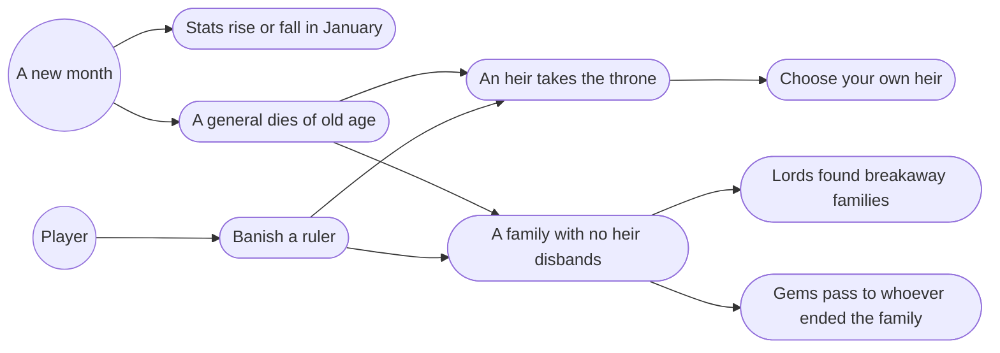
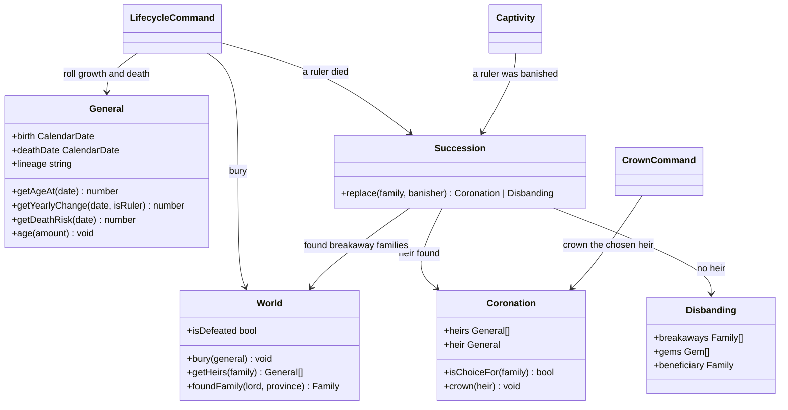
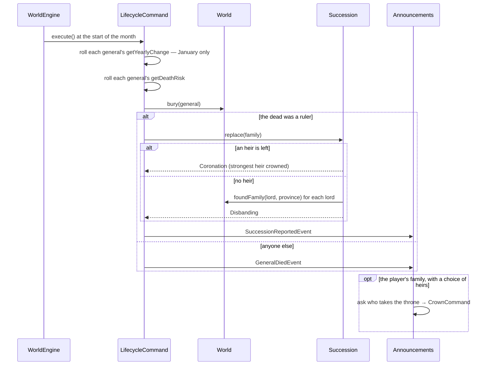

# Character lifecycle — Design

## Description

Generals are mortal. Every January each general's stats may move: up while he is young, down once he passes 60. At about 75 he dies. When the one who dies, or is banished, is a family's ruler, the family looks for an heir among the ruler's blood relatives. With an heir it carries on under a new ruler. Without one it disbands: each lord keeps his province and founds a family of his own, the provinces the ruler governed directly become unclaimed, and the gems go to whoever brought the family down.

Most of this already has a place to land. `General` has a `birth` date, and the family overview already shows each general's age. `General.lineage` (feature 10) records each general's family line, which is exactly what makes someone an heir. Feature 9 left this step open on purpose: there, a family falls the moment its ruler is banished. This feature puts succession in front of that, and corrects the fall itself to what the sources describe.

## Glossary

- **Heir** — a member of a family who shares its family line (`lineage`), shown in the original by the family-tree icon on his card. Only an heir can become the family's ruler. The ruler's kin who serve another family are not heirs of this one, and neither is a kinsman held captive by another family.
- **Succession** — an heir taking the throne when the ruler dies or is banished. The family keeps everything it had: provinces, members, gems, ally and fame.
- **Disbanding** — the end of a family that loses its ruler with no heir left. Unlike a family that falls in war (feature 9), it leaves pieces behind: new families, and unclaimed land.
- **Breakaway family** — a family founded when a family disbands, by one of its lords together with the province he governs. It takes one of the canonical family names not in use, and that name's crest.
- **Old age** — the death a general meets at about 75. It is the only way a general dies.

## Functionality

- raise every general's stats a little most Januaries until 60, and lower them most Januaries after
- let rulers grow and decline twice as fast as other generals
- have every general die of old age at about 75, a few months either way
- crown an heir when a ruler dies or is banished, and let the player choose the heir for their own family
- disband a family that has no heir: its lords found breakaway families, its vassals without a province join the strongest of them, its directly ruled provinces become unclaimed, and its gems pass on
- announce the deaths that matter to the player, and every succession and disbanding

## Use cases



## UI

**Growth and decline need no screen.** The family overview already shows each general's age and stats, and the change is a point or two a year. Announcing it every January for dozens of generals would bury the news that matters.

**Deaths are announced, through the queue features 6, 7 and 10 built.** The player hears about every death in their own family and the death of every ruler anywhere, because a ruler's death can change the map. A rival vassal dying of old age is not news.

```text
┌─ over the map ───────────────────────────────┐
│  ▒▒  Garth of Chrysalis has died of old age. │
│      Elgis takes the throne.                 │
│                                 [ Continue ] │
└──────────────────────────────────────────────┘
```

**Your own succession asks a question.** The original asks the player to "select a new leader from its list of successors", so the announcement offers the heirs in the same picker the artifact grant uses (feature 7). Continue is withheld until one is chosen, and the strongest is preselected, so the fast path is one click.

```text
┌─ over the map ───────────────────────────────┐
│  ▒▒  Erin is banished from Ishmeria.         │
│      Who takes the throne of Blanche?        │
│  [ Karl     age 21   ▾ ]          [ Crown ]  │
└──────────────────────────────────────────────┘
```

**A disbanding is one line, followed by a map redraw**. In scenario 1, banishing Lars leaves Coryll with no heir: _Coryll has no heir and is no more. Erven now rules Penzan as Divas. Empyron passes to Lyle._ Ashlan, which Lars ruled himself, turns neutral on the map.

## Research

**The rules come from the FAQ's section 7.2, "Death", and from DragonAtma's table.** Where the sources state a rule, the implementation follows it exactly:

- "When a character reaches the ripe old age of 75, they die. Sometimes they die a few months sooner, sometimes a few months later." Death is not a random event; it is scheduled.
- "When a character is scheduled to die, there is a small chance they won't die that particular month, but the likelihood of death does not decrease on a monthly basis." Once a general is due, every month gives the same high chance of death.
- "Character stats will increase slightly each year until the age of 60. After 60, a character's stats will start to decrease until they die." Spec §5.9 records the same thresholds as player-tested.
- "Most officers receive either +1 to all three stats each January or no boost at all, whereas force leaders receive either +2 to all stats or no boost at all" (DragonAtma). Growth is all-or-nothing, it comes in January, and rulers move twice as far.
- Heirs are "related by blood to the ruler", marked by the family-tree icon (FAQ §8.3). That is `General.lineage` matching the family's name. Checked against the FAQ's list of heirs for scenario 1 (Wolfen; Pender, Anselm, Karl; Elgis, Sarthe), every one is kin in the extract. The extract also marks three the list leaves out: Lankshire's Adryl and Karla (the list covers only families a player can pick) and Fuster, whom the FAQ lists as Molbrew's heir from scenario 2. The extract is the data source, so they are heirs.
- When a family's ruler is banished, "one of his heirs will assume the throne", and the player "will then be asked to select a new leader from its list of successors" (FAQ §5.5, §8.3).
- A family with no heir disbands: "that family's Gem(s) will transfer to whomever banished the ruler. Any lords that were in charge of one of the family's remaining territories will declare supreme rule of that territory and start their own family. Any territories that were controlled remotely by the Home territory will become unclaimed" (FAQ §5.5). Spec §7.7 repeats the gem rule.
- A family whose ruler dies of old age with no heir follows "the same rules as if all the heirs had been Banished" (FAQ §7.2).

**The scenario tables are not the growth rule.** Comparing one general across DragonAtma's four scenarios shows changes no yearly rule could produce. Pender's WAR rises while his CHA falls; Roland's WAR drops at 44; Geolug declines in everything at 37. Like gem ownership (feature 7), each scenario's stats are authored, so the game's own growth rule (DragonAtma's January observation) is what runs during play, and nothing tries to reproduce the tables.

**What the sources leave open, behind named constants:**

- **How often growth happens.** DragonAtma says that after the first January "about a third of the officers were either a point or two higher", so the yearly odds of growing are one in three (`GROWTH_ODDS`). He also notes that "Scenario 4 Seth almost never gets that boost". Seth is 62 there, past the turn, which fits age deciding direction rather than a per-person rate.
- **How decline happens.** No source gives its size, so it mirrors growth: one in three Januaries, −1 to all three stats, −2 for rulers. A stat never drops below 0; `Stat` already clamps it.
- **How far "a few months" is.** Each general's death is scheduled when the world is built, at his 75th birthday moved by up to three months either way (`DEATH_SPREAD_MONTHS`). From that month on he dies with odds of 0.9 (`DEATH_ODDS`), the FAQ's "small chance they won't die that particular month". So almost every general dies within a month or two of his date, and a rare one lingers.
- **Which heir an AI family crowns.** The sources only describe the player's choice, but DragonAtma's table of who rules where shows one succession: Chrysalis is ruled by Garth in scenario 1 and by Elgis in scenario 2. Elgis is the younger of Garth's two kinsmen and by far the stronger (184 total stats against Sarthe's 149). So an AI family crowns its strongest heir, by INT + WAR + CHA. Age alone would have picked Sarthe. The player's picker preselects the same heir.
- **What becomes of a disbanded family's vassals who hold no province.** No source says. Lords leave with their land, and the scenario tables only show authored moves (Coryll's Eustace turns up in Tate). They join the strongest breakaway family, the one with the most troops, which is the same family that inherits gems when nobody banished the ruler. If no lord founds a family, they leave Ishmeria like exiles. A general with no family has nowhere to stand in this model.
- **Where an heirless family's gems go when nobody banished its ruler.** The FAQ admits "I am not sure where the Gems would go." The design keeps them in play: they pass to the breakaway family founded at the largest garrison (most troops), the strongest of the successors. If no lord founds a family, the gems go with the land: nobody holds them, and they stay out of play. A gem is power, and the rule should neither hand it to a bystander nor quietly delete a guardian without a reason.

**Where the new ruler sits.** An heir who was a lord leaves his province and takes the home seat, so the home province is never without its ruler. His old province passes to remote rule by the new ruler, as if Change Lord had sent him home. The original's behaviour here is not recorded. Keeping the ruler at home preserves the existing rule that `homeProvince` is governed by the ruler, which Change Lord, Ally and the turn order all rely on.

**What a breakaway family is called.** "Start their own family" says nothing about the name, and DragonAtma notes that an unattached general's family name "can (and often will) vary from game to game". The game has eleven canonical family names, every one with a crest in `public/crests/`, and only seven are in play in scenario 1. DragonAtma's table of who rules where shows the same thing four times over: all four names unused in scenario 1 later belong to former lords. Terian, Eselred's lord in Province 11, rules it as Tate in scenario 2; Loryn, Eselred's lord in Province 17, rules it as Divas in scenario 4; Gweyn founds Tordin and Eadric founds Tudoria. So a breakaway family takes the first canonical name not in use, in alphabetical order, crest included; in scenario 1 that is Divas, then Tate, Tordin and Tudoria. If every name is taken, the lord founds nothing and his province is unclaimed like the rest. That would need four families disbanding with lords in a single game, which the FAQ calls nearly impossible ("the game would have to go on for almost 30 years").

**Banishing a ruler changes behaviour from feature 9.** Today `Captivity.banish` unclaims every province and hands the gems to the captor. That skips succession and ignores the lords. With this feature, banishing goes through `Succession` like a death does: an heir is crowned if there is one, and otherwise the family disbands by the rules above, with the gems going to the banisher. Recruiting a ruler is unchanged: "successfully Recruiting a family leader immediately puts all of his territories, vassals, and armies under the player's control" (FAQ), so it is still an absorption, not a succession.

**Where the work lives.** How a general ages and when he is due to die are facts about one general, so they live on `General`, the way `HiredUnit.getDesertionRisk` does for a hired unit: `getYearlyChange` says how far his stats move this year, and `getDeathRisk` says how likely he is to die this month. What happens to a family without its ruler spans the family, its provinces and the world, so it is a domain service, `Succession`. `LifecycleCommand` rolls the dice and runs succession at the start of the month, from `WorldEngine`, before tax, so a province's governor is already settled when it acts. Removing a general from the world goes on `World.bury`, next to `World.exile`: a buried general leaves his family, any captivity and any governorship, and his province falls back to remote rule by his ruler. A captive stays a member of his family until he is disposed of (feature 9), so `World.getHeirs` takes the world's captives into account: a kinsman in chains cannot be crowned.

**What waits for later features.** Feature 13 shows defeat. Here the player's family can disband too, which is defeat: this feature announces it (_Your house is no more._) and stops the game, since no month should start for a player with nothing left; 13 gives it its screen. Feature 14 adds the banshee's wail when a ruler dies; this feature only publishes the death, which is what the wail will listen for.

## Overview

Two rules on the general, one service, two outcomes and one choice. **`General`** knows how far he ages this year and how likely he is to die this month. **`Succession`** crowns an heir or disbands the family, and returns a **`Coronation`** or a **`Disbanding`** that says what happened. **`LifecycleCommand`** rolls for growth every January and for death every month, runs succession, and reports the news. **`CrownCommand`** lets the player overrule the preselected heir from the announcement.

## Domain model



| Class              | Responsibility                                                                                   |
| ------------------ | ------------------------------------------------------------------------------------------------ |
| `General`          | Knows how far his stats move this year and how likely he is to die this month.                   |
| `Succession`       | Crowns the strongest heir of a family without a ruler, or disbands it.                           |
| `Coronation`       | A crowning: the heirs there were, who wears the crown, and the seats that went with it.          |
| `Disbanding`       | A family's end: the breakaway families it left, and where its gems went.                         |
| `World`            | Buries the dead everywhere they appear, lists a family's heirs, and founds breakaway families.   |
| `LifecycleCommand` | Rolls for growth and death, runs succession, and publishes the news.                             |

`deathDate` is scheduled by `WorldFactory`, which already rolls each general's birth month. The breakaway names are config, `BREAKAWAY_NAMES`: the canonical family names except Lankshire, since the royal line cannot be refounded by a vassal. `LifecycleCommand` publishes `GeneralDiedEvent` for a general who was not a ruler, and `SuccessionReportedEvent` (with the coronation or disbanding, and whether it came from a death or a banishment) for a ruler; banishing a ruler from the captive dialog publishes the same event. The game stops when `World.isDefeated`: the engine no longer ends turns once the player's family is gone.

## Flow



## Persistence

A save carries each general's `deathDate`, since it is rolled once and must not be rerolled on load, along with his stats as they now stand. Breakaway families are saved like any other family; nothing records that they broke away. The dead leave no record.

## Tests

- **Growth follows age and rank** — with the roll pinned, a 40-year-old vassal gains 1 in every stat, a 40-year-old ruler gains 2, and a 61-year-old loses 1; outside January nothing moves.
- **Death is scheduled** — a general is not taken before his death date, and is taken on it with the roll pinned under the odds; a survivor stays due and can die the next month.
- **The dead leave the world** — a buried lord leaves his family and the generals, and his province falls back to remote rule by his ruler.
- **An heir carries the family on** — when a ruler dies, his strongest kinsman becomes ruler and takes the home seat, and the family keeps its provinces, gems and ally.
- **A captive cannot inherit** — a kinsman held by another family is passed over for the next heir, and with no other heir the family disbands.
- **Only kin inherit** — a sworn vassal never takes the throne, however senior.
- **A family with no heir disbands** — each lord founds a breakaway family under a free canonical name, with his province and its contents; vassals without a province join the breakaway family with the most troops; directly ruled provinces become unclaimed; the family leaves the world.
- **Gems follow the rules** — a banished heirless ruler's gems go to the banisher; a dead heirless ruler's gems go to the breakaway family with the most troops.
- **Banish now goes through succession** — banishing a ruler with an heir crowns the heir instead of ending the family.
- **The player chooses their own heir** — the announcement of the player's ruler's death offers only the family's heirs, preselects the strongest, and crowning another makes that general ruler.
