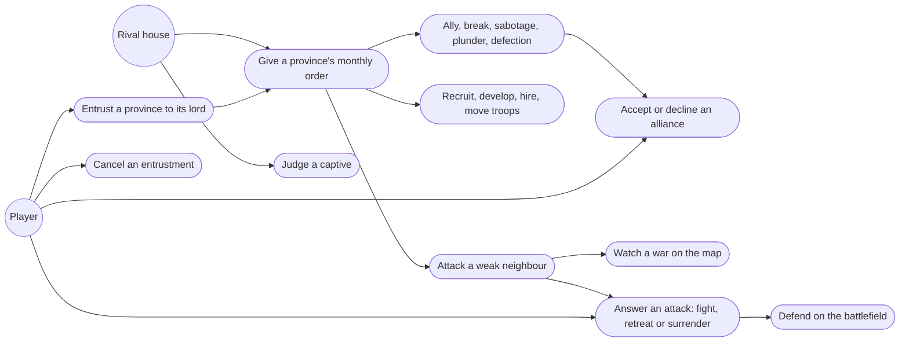
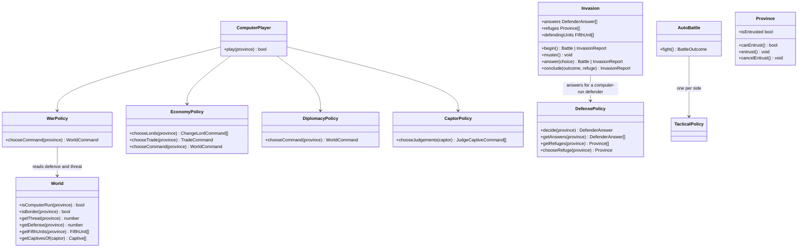
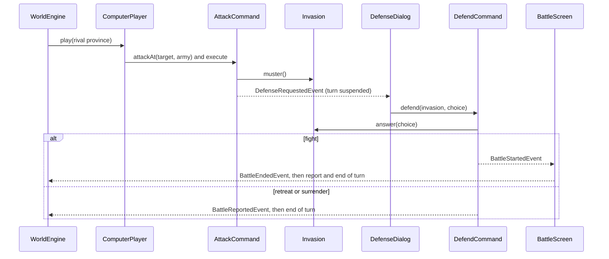
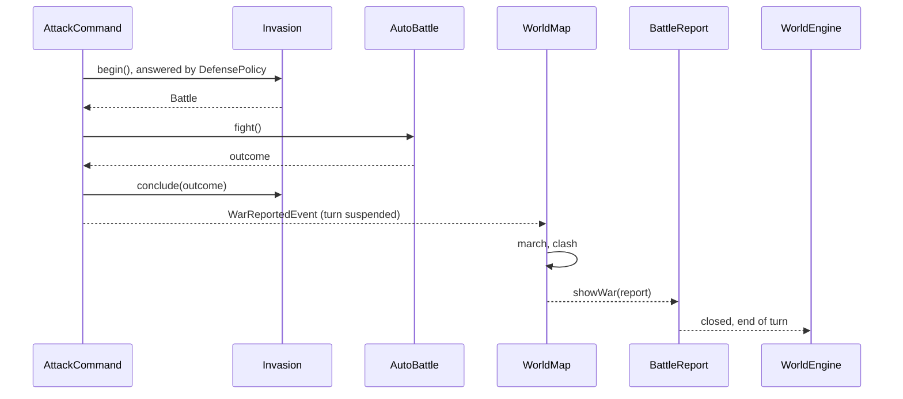

# Strategic AI — Design

## Description

So far only the player acts. A rival province's turn comes up in the monthly queue and is skipped, so Ishmeria stands still around the player. This feature gives every province the computer runs a monthly order of its own: rival houses develop, recruit, shift troops to their borders, hire monsters, make and break alliances, and attack weak neighbours, including the player. When an attack lands on the player's land, the player answers it: fight, retreat or surrender. And the player can hand a province to its lord with Entrust, so the computer gives that province's orders too.

The sources are clear that the original AI is a handful of simple, opportunistic rules, not a planner: "Generally, the computer is an idiot" (FAQ), "the computer will not impress you with how it chooses to govern your provinces" (Hartman). Its job is to keep the map moving and to punish weak borders (spec §13). That is the bar here too. Much of the work already exists: every order is a command with its own rules and costs, `DefensePolicy` already answers attacks for houses the player does not control (feature 8.1), and `TacticalPolicy` can fight a battle with nobody at the controls (feature 8.5).

## Glossary

- **Computer-run province** — a province whose monthly order the computer gives: every province of a rival house, plus the player's entrusted provinces. The player gives the orders for every other province of their own.
- **Entrusted province** — a province of the player's handed to its lord, who then gives its orders every month until the player cancels. The original marks it with a tower.
- **Border province** — a province with at least one hostile neighbour: a province of another house that is not its ally. A province with none is an interior province.
- **Threat** — the strongest army a hostile neighbour could send against a border province: its troops plus its strongest Fifth Unit.
- **Map battle** — a battle in which neither army is the player's to command: between two rival houses, or on the player's entrusted province. The tactical AI fights it to the end on both sides without opening the battlefield. The player watches it as a clash on the map, then reads its result.
- **Refuge** — where a defender flees: a neighbouring province of its own house, or its home province.

## Functionality

- on a computer-run province's turn, give it one order with the same commands, costs and rules the player has; no hidden income or free troops (spec §13.8)
- claim an unclaimed neighbour by marching troops into it
- attack the weakest hostile neighbour when the army it can send has a clear edge over the army that would defend it, leaving a garrison behind and taking its strongest ready Fifth Unit when it can pay for it
- recruit on a border province whose troops fall short of its threat
- send troops from interior provinces toward the border
- hire a Fifth Unit for a border province that has none and gold to spare
- give food to a province whose loyalty runs low, and otherwise develop it
- buy food when a province is short of it and sell surplus food when it is short of gold, as free actions before the order
- seat free vassals as lords of the house's provinces that have none
- from a rival's home province, now and then break an alliance, propose one (to the player too, who accepts or declines), or try sabotage, plunder or defection against a hostile neighbour
- judge captives a rival house takes: try to recruit them, otherwise release them, and only rarely banish them
- when a rival attacks one of the player's provinces, ask the player to fight, retreat or surrender, letting them pick the Fifth Unit to fight with or the refuge to retreat to, neighbouring or home
- fight the battle on the battlefield with the player as the defender
- let a defender who withdraws mid-battle lead its survivors and food to a refuge, chosen by the player for their own army
- carry the province's gold along too when the refuge is the home province
- word the battle report from the player's side, whichever side they fought on
- fight map battles to the end without opening the battlefield, show each rival war on the map as an army marching and clashing, then announce its result
- entrust any of the player's lorded provinces to its lord, and cancel it at any time; the lord also answers attacks on it, and its battles are map battles
- tell the player about whatever a rival does to them: a battle on their land, a mission against their province, an alliance broken with them, a general who defected from them, the fate of their captured general

## Use cases



## UI

**An attack on the player's land** stops the month and asks. The question shows what the player can see for themselves: who comes, from where, with how many troops, and what the province has to meet them with. It never guesses the outcome. Only the answers the province can give are enabled (Research: the defender's answer). The Fifth Unit list holds the province's hired units and the house's rested Guardians, strongest first.

```text
┌─ Hyland is attacked ───────────────────────┐
│  Zendor of Lyle marches from Petaria       │
│  with 300 troops.                          │
│                                            │
│  Hyland      132 troops    80 food         │
│  Fifth Unit  [ Pluvius            ▾ ]      │
│                                            │
│  [ Fight ]    [ Retreat ]    [ Surrender ] │
└────────────────────────────────────────────┘
```

Fight opens the battlefield with the player's army on the right, as defender. Retreat with one refuge goes there at once. With more than one, the map highlights them (the house's neighbouring provinces and its home province) and the player picks one, the way the manual describes: "If there is more than one neighboring province, you will have to choose a path of retreat on the map." Either way the battle report follows, as it does after the player's own attacks.

**Entrust** sits in the Vassal group. Like Change Lord, it is issued from the home province, costs no turn, and targets a province on the map: only the house's lorded provinces can be picked. One dialog both entrusts and cancels, with a toggle, as Hire/Dismiss and Buy/Sell do.

```text
┌─ Entrust ──────────────────────────────────┐
│  Carveti — Lord Pender                     │
│                                            │
│  ( ● Entrust )  (   Cancel )               │
│                                            │
│                 [ Cancel ]   [ Confirm ]   │
└────────────────────────────────────────────┘
```

An entrusted province shows a tower marker on the map. In the family overview's Land tab its status reads "entrusted", the fourth beside capital, lorded and ruled remotely, matching Hartman's four symbols: shield, crossed swords, flag, tower.

**A rival's war is shown on the map, then announced.** Every invasion a rival launches, wherever it lands, plays on the map: the attacker's crest marches from its province to the target, and when the defender fights, the two clash there for a moment. Then an event dialog gives the result, and the month goes on when the player dismisses it. Nothing in the dialog is a prediction; it is all past.

```text
┌─ War ──────────────────────────────────────┐
│  Lyle attacks Hyland, held by Coryll.      │
│                                            │
│  Zendor   300 troops   Pluvius             │
│  Lars     132 troops   —                   │
│                                            │
│  Hyland falls to Lyle on the second day.   │
│  Zendor holds it with 212 troops.          │
│                                [ Continue ]│
└────────────────────────────────────────────┘
```

A retreat or a surrender marches without a clash, and the dialog says so: `Lars flees to Carveti with 132 troops. Hyland falls to Lyle.` A war on the player's entrusted province plays the same way.

**A rival's alliance offer asks the player.** It stops the month like an attack does:

```text
┌─ An envoy from Lyle ───────────────────────┐
│  Ander of Lyle proposes an alliance.       │
│                                            │
│                 [ Decline ]    [ Accept ]  │
└────────────────────────────────────────────┘
```

**Everything else a rival does is announced only when it touches the player.** Rival turns with no war in them run back to back, and the map redraws as provinces change hands. The player is told:

- `Lyle has broken the alliance with you.`
- `Agents from Lyle sabotaged Carveti.` / `Agents from Lyle plundered 40 gold from Carveti.`
- `Pender has defected to Lyle, taking Carveti with him.`
- `Lyle recruited Pender.` / `Lyle released Pender.` (banishment already has its own announcement, feature 11)
- the battle report for an attack the player answered, as after the player's own attacks

## Research

**One order per province, from simple rules in a fixed order.** The spec reconstructs the AI as province-level heuristics: "AI operates through province activations... each province can make a local decision" (§13.9). Its likely priorities are "If Troops are low → Recruit / If economy is weak → Develop / If Food / Gold is low → Trade or wait / If border opportunity exists → attack" (§13.4), and its target choice is weak adjacent provinces, after checking "Is local strength favourable?" (§13.3). The exact priority order is unresolved (D.6 #17, #19). So each computer-run province works down one list and gives the first order that applies:

1. **Claim** an unclaimed neighbour by moving troops into it (feature 5), sending all but the garrison. The FAQ shows rivals racing for empty land: Terian "can double his empire's size on the first turn, although on some play-throughs, other empires will move first", and "Eselred will also inevitably expand into the unclaimed territory directly south of him".
2. **Attack** the hostile neighbour whose defending army is weakest, when the army it can send has at least `ATTACK_ADVANTAGE` times that army's strength. It sends all its troops except a `GARRISON_SHARE` and food for the full five days (or all it has), and only if it can pay the deployment. It takes its strongest ready Fifth Unit, hired or Guardian, when it can also pay that unit's deployment.
3. **Recruit**, on a border province whose troops are below its threat, with all its gold above a `GOLD_RESERVE` kept for upkeep.
4. **Move troops**, from an interior province, all but the garrison, to the neighbour of its own house that lies nearest the border.
5. **Hire** the strongest Fifth Unit it can afford, on a border province with no hired unit and gold above the reserve after paying.
6. **Give food**, when loyalty is below `LOW_LOYALTY` and the province has food beyond its five-day supply.
7. **Develop** whichever of cultivation and protection is lower.
8. Otherwise end the turn.

Trade is a free action, so it runs before the list: buy food to keep a five-day supply for the province's troops, or sell what is beyond twice that when gold is below the cost of a Develop. Seating free vassals is a free action too, from the home province: §13.9 says the AI "can assign governors", and a lordless province rules at half strength.

**The attack threshold is measured, not guessed.** Thirty map battles per ratio, one per battlefield, both sides with equal commanders: at even troops the attacker already wins 19 of 30, because the flag rush favours whoever moves first. At 1.25× it wins 28, at 1.5× 29, and at 2× all 30. The sources' "favourable" reads as the point where the outcome stops being a coin toss, so `ATTACK_ADVANTAGE = 1.25`. Strength is `Army.strength`, troops plus Fifth Unit, the same figure the battlefield uses. The defending army is the one `Invasion` would muster: the target's troops plus its strongest ready Fifth Unit. That gives the AI the hidden Fifth Units the player can only see by searching. It is the one piece of knowledge it gets for free, and it keeps the AI from walking into a Guardian it could not see.

**The AI's diplomacy is thin because the sources' is.** "The computer is prone to breaking alliances whenever they feel like it" (FAQ) and "The computer AI doesn't seem to use Sabotage very often" (FAQ); the spec lists alliances as confirmed and sabotage, plunder and defection as possible (§13.5). Surrender as an AI move is "not confirmed", so it is left out. Ally is a home-province order, so diplomacy goes ahead of the list on a rival's home province only, and only on a roll:

- with an ally: break the alliance on a `BREAK_ODDS` roll;
- with no ally and a hostile neighbour family stronger than its own: propose an alliance to the strongest of them, the player included;
- otherwise, on a `COVERT_ODDS` roll, one of three covert orders against a hostile neighbour: plunder or sabotage the one with the most gold, or try to turn the lord of the one with the most troops, whose province comes with him.

Every one of these goes through the command the player uses, so the same costs, the same Envoy and Infiltration rolls, and the same fame loss for breaking apply. The one exception is an offer to the player. There the Envoy's roll, which stands in for a computer house's judgement, gives way to the player's own answer, and the rival's turn waits for it. Defection has no rule behind it in the guides, but scenario 4's opening has the AI doing exactly that: "The Lankshire Family bribed Pender to desert his own brother, Erin." With the spec's "may" (§13.5), that is enough to include it, at the same low rate as the other covert orders.

**Captives are almost never banished.** A rival house that takes a commander has the same three choices the player has (feature 9). "The computer almost never banishes people they capture" (FAQ §8.3), and the same section shows rival rulers being recruited. So the captor tries Recruit, except for a `BANISH_ODDS` chance that it banishes him instead. A captive who refuses walks free, as he does when the player's own Recruit fails. Judging is one `JudgeCaptiveCommand`, shared by the captor's turn and the player's captive dialog, so both carry out a verdict and announce it the same way. Without this, rival houses would keep their captives forever, as they do today.

**The defender's answer is already a rule. The question is now the player's.** The FAQ gives the menu: "The person being invaded will have the option to Fight, Retreat, or Surrender. Surrender isn't an option unless the person being attacked has no men or food and doesn't have somewhere to retreat." The manual agrees: "If you still have soldiers or food, you will be forced to fight or flee." Feature 8.1 wrote that as `DefensePolicy`: Fight needs troops, Retreat needs a refuge, and Surrender is there only when neither is. The same gates now enable the player's buttons, and `DefensePolicy` still answers for every computer-run province. The manual says the defender "calls up a Fifth Unit", and the FAQ says "both sides get to pick a 5th Unit of their choosing", so the player picks their own instead of the strongest being picked for him.

That splits `Invasion.begin` into two steps: mustering, and the answer. The one constraint is the turn: the attacker's turn waits for the answer, then for the battle, and ends when the report is in, as the player's own attacks already do.

**A defender who withdraws mid-battle flees with what is left.** Today a defender's mid-battle retreat loses its survivors with the province, which went unnoticed while only computer houses defended. The manual's battle menu says otherwise: "Retreat: Pull out of war and flee to your home or a neighboring province. You must choose the province by number." So a withdrawal by the defender moves its surviving troops and food to a refuge, picked on the map by the player, or by `DefensePolicy` for a computer-run province, exactly like a Retreat answered before the battle. The same line goes on: "In retreating, some you can take gold, food and soldiers, but the lord or lady will return to their own province. In retreating to any other province, you can only take food and soldiers." The scan is garbled, but the contrast is clear: fleeing home also carries the province's gold, and fleeing to a neighbour does not. Both kinds of retreat, before and during the battle, follow that rule. The capture roll on a retreating commander stays as it is (feature 9).

**The battle report is written from the player's side.** Its lines assume the player attacked: "Hyland is yours". Defending, it reads from the other end: `Hyland falls to Lyle. Zendor holds it with 212 troops.`, `Hyland holds. Zendor's army goes home with 140 troops.`, `Seth flees to Carveti with 132 troops. Hyland falls to Lyle.` The same report, with a line naming who attacked whom (`Lyle attacks Hyland, held by Coryll.`), is the event dialog that follows a rival's war on the map. Closing it ends that rival's turn.

**Captives are judged on the captor's next turn.** The captor's ruler decides, like any other order, so the first time one of the captor house's provinces takes its turn, it judges every captive it holds before it gives its order. The ransom has already been tried at capture (feature 9), so this changes nothing for a captive who could pay.

**The home province is always a refuge.** The manual says it twice, once for the answer ("Flee to the home province or a neighboring province") and once for the battle menu ("flee to your home or a neighboring province"). The FAQ and Hartman only describe the neighbour case, which is the common one rather than a contradiction. So the refuges are the house's provinces next to the attacked one, plus its home province when the attacked province is not the home itself. `DefensePolicy` chooses among the same refuges for a computer-run province, still preferring the one with the most troops. Being cornered, which makes capture almost certain (feature 9), still means having no neighbouring province of one's own: the FAQ ties it to "no neighboring provinces to retreat to", so a distant home does not save a commander from capture.

**The battlefield is the same screen with the sides swapped.** The battle screen fixes the player as the attacker today (`PLAYER_SIDE`). It takes the player's side from the battle instead: whichever army belongs to the player's house. The attacker still moves first, and the enemy's tactical AI keeps the shipped depth of four, because a human is watching.

**Map battles run at depth one.** Feature 8.5 suggested depth three for battles nobody watches. Measured on a full battle with both sides played by the policy, depth three takes 1.4–7 s, depth two about 0.5 s, and depth one about 50 ms. A month can hold several rival wars. The march on the map can cover the search, but not seconds of it, so only depth one is affordable. Both sides play at the same depth, so the outcome still follows strength, and the ratio sweep above was measured at depth one for the same reason. The fight is a domain loop over the calls the battle screen already makes. There is no second formula, which is the reason `AutoResolver` was deleted in 8.2.

**Where the decisions live.** The AI is a peer of the UI: the UI configures a command from a dialog, the AI configures it from a rule, and the command enforces the rule either way. That rules out a parallel "AI order" type that would map one-to-one onto the commands. Each spec layer becomes one policy that hands back a configured command or nothing: `WarPolicy`, `EconomyPolicy` and `DiplomacyPolicy` (§13.3–13.5), plus `CaptorPolicy` for judging captives. `ComputerPlayer` asks them in order on a computer-run province's turn. Facts the rules read go on the entity that owns them: `World.isBorder`, `World.getThreat`, `World.getDefense` and `World.getFifthUnits` (the last now also feeds the player's Attack dialog, strongest first), `Province.isEntrusted`, `Army.measureDailyFood`.

**Entrust is a free order for the ruler.** Appendix D files it as a setup command that costs no turn, beside Change Lord, and the manual pitches it as freeing "the ruler from monthly commands". Change Lord is a home-province order (feature 4), and Entrust gives a lord the same kind of charge, so it follows the same rule. "Entrust a province in the hands of the lord or lady" means a manor or the capital cannot be entrusted: nobody is there to hand it to. The entrustment ends when the lord leaves the province (Change Lord, defection, death) or the province changes hands. The FAQ's "simply Cancel the Entrust at any time" is the toggle's second side. The sources do not say who answers an attack on an entrusted province. "An entrusted province solely in the hands of a lord or lady" (manual) says the lord does, and Entrust exists to spare the player that province's decisions. So its defence follows `DefensePolicy` and its battles are map battles. A player who wants to defend a border province themselves cancels its entrustment first, which is also the FAQ's advice: entrusting "is not a good idea if that territory is on the border of enemy territory".

**Pacing.** A rival turn without a war runs at once. A turn with one waits for its march, clash and dialog, then the next province goes. A message speed is feature 18's subject. The march is the map's own animation, separate from the battle screen: it plays in the time the map battle takes to compute, and the result is computed before the dialog opens, so the screen decides when the result is shown, never what it is.

**Every dialog holds the month.** A war report, a defence prompt, an announcement or a captive to judge can open while the computer is playing, and the next province must not move underneath it. Each such dialog holds the turn while it is open (`TurnHold`), and the engine starts no turn while anything holds it. The engine also starts each turn through a queued event of its own, so a hold that the same chain of events raises always lands before the next turn begins. A turn end that does not belong to the turn in progress is ignored, so a stray click can never end a rival's turn. While the computer plays, the command rail is hidden.

## Overview

- **`ComputerPlayer`** (core) — on a computer-run province's turn: free actions first, then one order from the policies, then the end of the turn unless the order suspends it.
- **Policies** (core/ai) — `WarPolicy`, `EconomyPolicy`, `DiplomacyPolicy`, `CaptorPolicy`. Each one reads the world and hands back a configured command, or nothing.
- **`AutoBattle`** (domain/battle-ai) — fights a battle to its outcome with a `TacticalPolicy` on each side.
- **`Invasion`** — split into `muster` (deploy and raise the defence) and `answer` (fight, retreat or surrender); `begin` does both for a computer-run defender.
- **`DefendCommand`** — carries the player's answer into the invasion, the way `CrownCommand` carries the choice of heir.
- **`EntrustCommand`** — entrusts or cancels; the body of today's empty stub.
- **`AllianceAnswerCommand`** — carries the player's answer to a rival's alliance offer.
- **`JudgeCaptiveCommand`** — recruits, releases or banishes a captive and announces it; used by the captor's turn and the captive dialog alike.
- **`TurnHold`** (ui) — what a dialog uses to hold the next turn while it is open.
- **UI** — `DefenseDialog`, the alliance offer, the Entrust dialog, a battle screen that takes the player's side from the battle, the war march on the map followed by the battle report as its event dialog, the tower marker, and announcements for rival actions against the player.

## Domain model



## Flow

A rival attacks the player:



A rival's war elsewhere settles inside the attack command, and its turn waits for the map to show it:



## Persistence

The entrusted flag joins each province's save (feature 17). Everything else the AI uses is read from the world each turn and never stored.

## Tests

- **Computer-run provinces (unit):** a rival province and an entrusted province act on their own turns, and the player's other provinces still wait for the player.
- **War policy (unit):** attacks at the threshold but not just below it; picks the weakest target; leaves the garrison behind; never attacks an ally; counts the defender's strongest Fifth Unit.
- **Economy policy (unit):** recruits only when below threat; interior troops move toward the border; gold reserve kept; develops the lower of cultivation and protection; buys food when short, sells when gold is short.
- **Diplomacy policy (unit):** only from the home province; breaks on the roll; proposes to the strongest stronger neighbour; covert orders aim at the richest hostile neighbour. Rolls pinned.
- **Captor policy (unit):** recruits on a successful roll; releases on a failed one; banishes only on the rare roll.
- **Mid-battle withdrawal (unit):** a defender that withdraws takes its survivors and food to the refuge; an attacker that withdraws brings them home, as now.
- **Claim (unit):** a computer-run province with an unclaimed neighbour claims it before anything else.
- **Defender's answer (unit):** the player is asked instead of `DefensePolicy`; the offered answers follow the gates; the chosen Fifth Unit and refuge are the ones used; the attacker's turn ends only after the report.
- **Rival war (jsdom):** the war report reads from the winner's side and names who attacked whom, and closing it ends the rival's turn. The march itself is visual and checked by hand.
- **Turn hold (unit):** no turn starts while a dialog holds it, and a turn end for a turn not in progress is ignored.
- **Alliance offer (unit + jsdom):** the player's answer decides, not the Envoy roll; the rival's turn waits for it and goes on once the player answers.
- **Refuges (unit):** the home province is a refuge from anywhere; fleeing home carries the gold, fleeing to a neighbour does not.
- **Auto battle (unit):** always reaches an outcome, and a decisively stronger side wins; node cost counted, not timed.
- **Entrust (unit):** only lorded provinces; free; lapses when the lord leaves or the province is lost; an attack on it is answered by its lord without asking the player, and fought as a map battle.
- **UI (jsdom):** the defense dialog enables only allowed answers and sends the choice; the battle screen plays the player as defender; announcements appear only for actions against the player.
