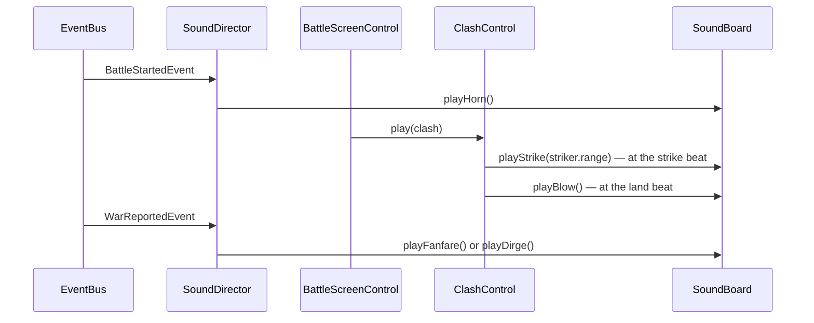

# Audio — Design

## Description

The game is silent. This feature gives it a voice: a melody for the strategic map and another for battle, and short sound effects for the player's actions and for combat — mostly recorded samples, with a few cues synthesized in the browser through the Web Audio API. It covers the roadmap's "hear music over the map and in battle" and "hear sound effects for actions and combat"; the title theme waits for the title screen in feature 16.

## Functionality

- hear a click from every button and every province picked on the map
- hear one melody over the strategic map and another over a battle
- hear the war horn when a battle opens
- hear units march and a blow land on the losers
- hear each strike in the voice of its range: steel for melee, a loosed shot for ranged, a burst for magic
- hear fence work: the knock of building, the crack of breaking
- hear a fanfare for a war you win and a dirge for one you lose
- hear a bell toll when a death is announced
- hear a glitter when a search turns up an artifact
- hear the alarm when your land must answer an attack

## Research

**The original's audio cannot ship, and the spec records almost none of it.** The ROM's score and effects are copyrighted work the remake does not reproduce, and the reverse-engineered spec mentions sound exactly once: the banshee's wail heard across Ishmeria when a ruler dies of old age (§11). So unlike the mechanics, the sounds are not reconstructed — they are designed fresh, in the remake's own voice.

**The ear test picks an engine per cue.** Three ways to get sounds live behind the one seam: hand-rolled Web Audio recipes, the ZzFX micro-synth (the 1KB `zzfx` package — each sound a parameter array tunable in the ZzFX playground; it creates an `AudioContext` at import, so the board loads it lazily on unlock), and recorded samples. Six cues chose recordings from Kenney's CC0 packs (RPG Audio, Impact Sounds, Interface Sounds; credit optional): the click, grass footsteps, plank and wood for the fence work, a real bell, and coins for the artifact find. The war horn, the clash's strikes and the blow that lands on the losers are sets authored for the game, four takes each, trimmed of leading silence so each lands on its beat. Every sample lives in `public/sounds/` as `<cue>-<n>.ogg`; a cue picks one of its takes at random, most with a slight playback-rate wobble, so the hundredth footstep still sounds fresh. The fanfare, dirge and alarm have no recording yet and play the recipes, with `?zzfx` swapping them to ZzFX for comparison; a sample still loading falls back the same way, to ZzFX for the strike and blow and to the recipe for the rest. The samples are Ogg Vorbis, which Safari cannot decode; the adopted recordings get converted to m4a before the game ships broadly.

**The browser gates audio behind a gesture.** An `AudioContext` starts suspended until the user interacts with the page. The board creates its context lazily and unlocks it on the first button press; a cue asked for while still locked is dropped, never queued — stale sounds firing in a burst after the first click would be worse than silence. The first audible thing in a session is the click of the first button pressed, which is also the gesture that unlocks everything after it.

**Cues hook to news or to beats, and the two need different wiring.** News crosses the global `EventBus` as core events — `BattleStartedEvent`, `WarReportedEvent`, `GeneralDiedEvent`, `SuccessionReportedEvent`, `ArtifactFoundEvent`, `DefenseRequestedEvent` — so one listener, `SoundDirector`, maps each to its cue and no existing component changes. Beats live inside animations — the clash's strike and land, each marching step, fence work — and must land in sync, so the control that runs the animation plays the cue at the beat: `ClashControl`, `BattleBoardControl`, `BattleScreenControl`. A beat that is skipped is a beat not sounded: the skip path and the reduced-motion path never reach the beat code, so fast-forwarded battles stay quiet while the news cues still speak. A clash gets one impact instant: the striker's lunge peaks at 40% of its 900ms, so the strike rings 360ms into the beat, and the target's flinch is delayed 250ms so its flash — peaking 114ms in — lands on the same frame; a cue scheduled on the beat chain is also cancelled with it when the clash is skipped mid-swing.

**A strike sounds like its weapon.** Every kind of unit shares one clash scene, and a single steel ring made archers and wizards sound like knights. The unit's range pattern already separates them, and it is a fact the board has at the impact beat, so `playStrike` takes the striker's range: `short` rings steel (Horsemen, Knights and most hired units), `long` is a loosed shot (Archers and the ranged hired units), and `circular` and `largest` are a burst of magic (the Guardians Pluvius, Zendor, Skulryk and the Dragon, and the hired Fachan). The range is the right key rather than the unit's name because it is how the battle already classes a unit, and a new Fifth Unit sounds right with no audio work.

**One device, carried in the context.** The page has one audio output, so `main.ts` builds one `SoundBoard` and it travels in the context beside `world` and `events`, a stable dependency like the map. `BattleScreenControl` hands it to its clash and board children through their contexts. No module singleton: the dependency stays visible in every signature, and tests spy on the instance.

**Which moments stay silent.** `ProvinceUpdatedEvent` fires on every order — a sound there would nag. Months turning, desertions and missions already reach the player through the announcement queue, and a cue per banner is noise, not news. The roadmap item names actions and combat, so the cues beyond those are the four interruptions that already hold the turn for the player: a death, a discovery, an alliance offered, and the call to defend. The bell mirrors the announcements: it tolls for a death in the player's family and for a ruler's passing anywhere, and stays quiet for a stranger's death the player never hears of. A banished ruler gets no bell — exile is not death. More cues are added by ear, not upfront.

**Wars sound where the player sees them.** The player's own battles reach the UI as `BattleReportedEvent` and rival wars as `WarReportedEvent` after their march across the map; both roads end in the battle report dialog, so the fanfare or the dirge plays as that dialog opens — `report.hasSide(player)` picks out the player's wars, and the report's side with `isTaken` picks the piece. A rival war is no longer silent: when its march reaches the clash burst on the map, `WorldMapControl` plays a distant skirmish — two muffled strikes from the general strike set at the animation's own beat, and none when the defender gave in without a fight.

**Loudness discipline.** Every cue is short — nothing outlasts a bell's two-second tail — and all of them mix under one master gain kept low, with per-cue peaks below it. A sound must never demand attention the screen isn't already demanding.

**Music.** Two authored tracks ship with the game: _Contemplative Cadence_ plays over the strategic map and _Untitled_ over a battle, role-named `strategic-map.mp3` and `battle.mp3` in `public/music/`. The board streams them through one looping `HTMLAudioElement`, routed into the shared master gain by a `MediaElementAudioSourceNode` so the one knob governs music and effects alike. The map theme starts on the first unlocking click; the battle theme takes over on `BattleStartedEvent` and hands back on `BattleEndedEvent`, each switch a 0.6-second fade through silence. Menus have no music yet: the title theme belongs to feature 16, which builds the title screen it plays on.

**What waits for later features.** Feature 18's sound toggle flips the master gain — the board already has the one knob. Feature 15's banshee becomes one more recipe when events land; until then a ruler's death of old age tolls the bell like any other.

## Overview

Two classes. **`SoundBoard`** is the device: it owns the `AudioContext` and master gain, unlocks on the first gesture, streams the music, loads the sample bank, and carries one method per cue — each plays a random take of its sample, or falls back to ZzFX or a short recipe of oscillator and noise envelopes scheduled on the audio clock. **`SoundDirector`** is the listener: it subscribes to the global bus, picks the cue for each piece of news and the melody for each screen, and installs the page-wide listener that clicks for every button and map-province press and unlocks the board. Animation beats call the board directly from their controls.

| Cue           | Sounds like                             | Fires on                                              |
| ------------- | --------------------------------------- | ----------------------------------------------------- |
| `playClick`   | a short dry blip                        | any button or map-province press (delegated listener) |
| `playHorn`    | a war horn sounding the muster          | `BattleStartedEvent`                                  |
| `playStep`    | a muffled footfall                      | each cell of a walked path (`BattleBoardControl`)     |
| `playStrike(range)` | steel, a loosed shot, or magic, by the striker's range | the clash's impact beat (`ClashControl`) |
| `playBlow`    | a hit landing on the losers             | the clash's land beat (`ClashControl`)                |
| `playKnock`   | two wooden knocks                       | a fence built (`BattleScreenControl`)                 |
| `playCrack`   | a splintering snap                      | a fence broken (`BattleScreenControl`)                |
| `playFanfare` | a rising major arpeggio                 | the battle report of the player's won war             |
| `playDirge`   | two falling minor tones                 | the battle report of the player's lost war            |
| `playSkirmish`| two distant muffled strikes             | the war march's clash on the map (`WorldMapControl`)  |
| `playHerald`  | a questioning chime                     | `AllianceOfferedEvent`                                |
| `playBell`    | a tolling bell with a long tail         | a player-family death; a succession born of a death   |
| `playGlitter` | a quick rising shimmer                  | `ArtifactFoundEvent`                                  |
| `playAlarm`   | two urgent horn blasts                  | `DefenseRequestedEvent`                               |

## Flow

## Tests

How a cue sounds is judged by ear, like visual fidelity — jsdom has no `AudioContext`, the board no-ops without one, and no test asserts on audio graphs. What the tests protect is which cue fires when:

- **News picks the right cue** — with the board spied: a battle starting sounds the horn; the player's won war the fanfare and the lost one the dirge, while a rival war passes silent; a death the player is told of tolls the bell, while a stranger's death and a banishment do not; a found artifact glitters; a defense request alarms.
- **Beats follow the animation** — the clash plays the strike, in the striker's range, and the blow at its two beats and neither when reduced motion skips it; the board plays a step per walked cell and none when the walk is skipped.
- **Every button clicks** — a button press anywhere, and a press on a map province, plays the click through the delegated listener.
