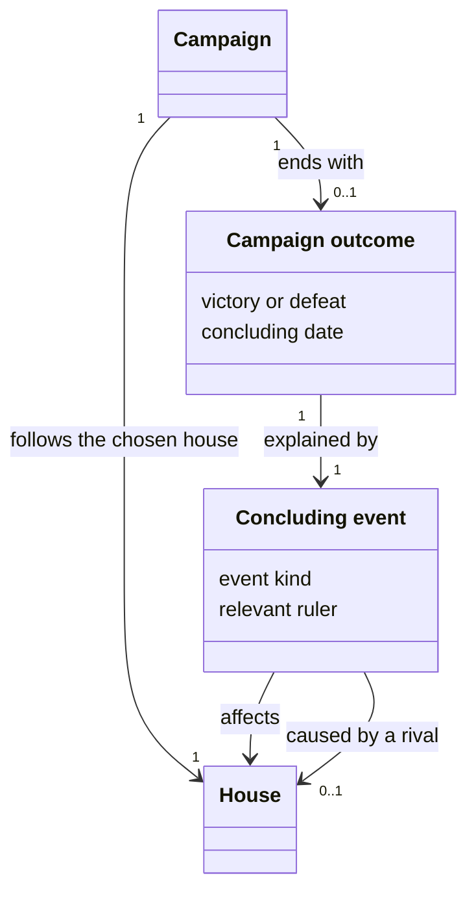
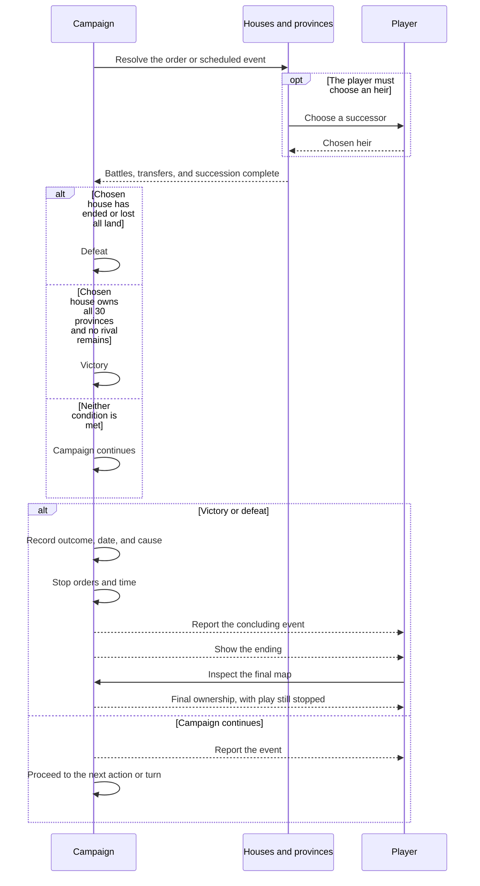

# 14. Victory & defeat

**Status:** IMPLEMENTED

## Description

A campaign ends in victory when the player's house unifies Ishmeria, or in defeat when it loses its last province or ceases to exist. The ending explains the outcome and leaves the final map available for inspection.

## Glossary

| Term | Meaning |
| --- | --- |
| Campaign | One playthrough from the perspective of the player's chosen house. It continues through changes of ruler, but ends when that house wins or is defeated. |
| Campaign outcome | The final victory or defeat of the player's house, with its date and reason. A battle result concerns one encounter; it becomes a campaign outcome only when its consequences end the campaign. |
| Concluding event | The conquest, absorption, or succession that ends the campaign, or the claim of the last unowned province. It explains how the outcome was reached and who was involved. |

## Functionality

- win by owning all 30 provinces with no independent rival house remaining, following the [victory condition](../spec/01-high-concept.md#16-victory-conditions) shared by [all scenarios](../spec/12-scenarios.md#122-shared-map-and-victory-condition);
- count only the player's own land toward victory; alliances and Gem ownership do not satisfy or add to the requirement;
- lose when the player's house loses its last province, is absorbed, or disbands;
- continue under an eligible heir after the ruler's death or banishment;
- assess the outcome after each event that changes territory or a house's existence;
- stop orders and campaign time once the decisive event has settled;
- explain the result and let the player inspect the final map.

## Use cases

### Conquer the last rival province

The player owns 29 provinces and wins an invasion of the remaining rival province. The invasion settles its losses and spoils, ownership transfers, and the landless rival house falls. The battle report is followed by the victory ending, with no turn between them.

### Win through absorption

Only the player and one rival own land, with no unclaimed provinces. The rival surrenders or its captive ruler accepts recruitment. Its provinces, members, and Gems transfer to the player's house. The surrender or recruitment result is followed by the victory ending.

### Claim the last unclaimed province

The player's house is the only one left and owns 29 provinces. An eligible movement order claims the remaining province. The move completes and the campaign ends in victory.

### Lose the final province

A rival takes the player's last province through battle or a conceded defence. The conquest completes and the campaign ends in defeat, even if the player's ruler survives. This also applies when the province was entrusted and its defence resolved automatically.

### Lose the house through absorption

The player's captured ruler joins the capturing house. The player's provinces and members are absorbed, and the campaign ends in defeat. The ending attributes the loss to absorption, even though the ruler survives as a member of another house.

### Resolve the player's succession

The player's ruler dies or is banished while the house still owns land. With an eligible heir, succession completes and play continues under the new ruler. Without one, the house disbands under the [character lifecycle rules](./11-character-lifecycle.md). Breakaway houses and unclaimed provinces are settled before the defeat ending explains that the house had no heir.

## UI

A shared victory ending names the victorious house and its current ruler and announces the unification of Ishmeria. It may claim that all seven Gems have been recovered only if that is true of the final world.

The defeat ending names the player's house and explains its loss: the last province was taken, the house was absorbed, or the ruler left no eligible heir. It names the relevant ruler and credits a rival only when one caused the defeat. For disbanding, the relevant ruler is the one whose loss ended the house.

Both endings give the concluding date and follow the report of the decisive event. Optional captive decisions are skipped once the campaign has ended. Battle audio stays attached to battle reports; a diplomatic victory uses its diplomatic result.

The final map preserves the campaign's actual ownership, including breakaway houses and unclaimed land. It remains available for inspection with play stopped.

## Research

### When does the campaign end?

An absorption or succession can change several provinces and houses. Ending the campaign as soon as the last rival disappears could award victory before its lords establish breakaway houses. Waiting until the end of the month avoids that interruption, but allows further events to change an already decisive result.

Finish the event and its required choices, then decide the outcome before anything unrelated happens. A battle includes its losses and transfers; a ruler's death includes succession or disbanding. Optional decisions about an already defeated rival's captives do not prolong the campaign.

### Who does the player continue as after disbanding?

An heirless house may leave several breakaway houses. Letting the player choose one would preserve some of their territory and characters, but would make the campaign follow a succession of houses rather than the house chosen at the start.

Keep the campaign tied to the chosen house. An heir preserves that house and play continues; disbanding ends its campaign. A breakaway house does not inherit the player's role, even if it later adopts the same name.

## Domain model

## Flow

## Tests

- **Victory conditions:** Owning 29 provinces does not win, even with every Gem. Taking the thirtieth with no rival remaining wins even if a Gem is out of play. Unclaimed and allied provinces do not count as the player's land.
- **Final transfers:** Conquest, conceded defence, surrender, ruler recruitment, defection, and claiming unowned land each trigger victory when they complete unification.
- **Loss of territory:** Losing the last province ends the campaign in both player-led and automatically resolved defence, even if the ruler survives.
- **Capture and absorption:** Capture alone does not defeat a house that retains land; absorption does.
- **Succession:** An eligible heir preserves the campaign. Heirless disbanding ends it even when breakaway houses receive the old territory or reuse its name.
- **Event completion:** A final conquest retains all losses, spoils, and transfers. An heirless rival's removal does not trigger victory before its breakaway houses and unclaimed provinces are settled.
- **Finality:** Pending player and rival orders cannot change an ended campaign. Acknowledging the ending or revisiting the map neither resumes play nor produces another ending.
- **Calendar:** Victory on the month's last province turn does not advance the month. An heirless death at month start prevents subsequent income and ordinary turns.
- **Ending:** The decisive report precedes the ending. Absorption names the absorbing house; heirless death names the deceased ruler without crediting a rival. A diplomatic win requires no battle report.
