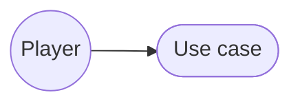
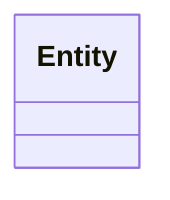
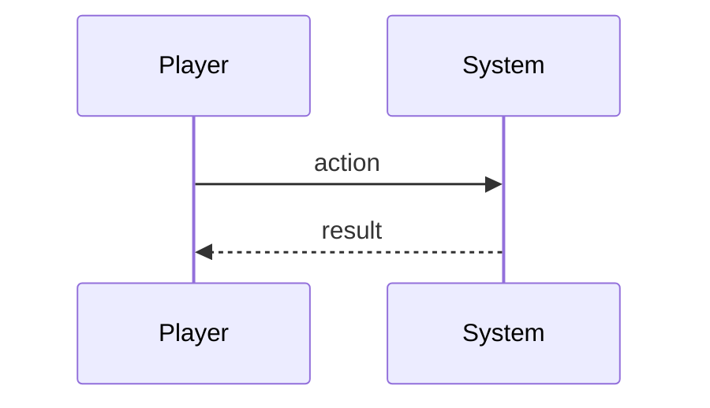

# <Feature> — Design

_One design doc per roadmap feature, numbered to match it (e.g. `01-global-map.md`). All sections are optional — keep one only if it earns its place for this feature, and delete the rest._

## Description

_What we're building and what we want to achieve._

## Glossary

_The entities involved and what each one means._

## Functionality

_A plain list of what we want to implement._

## Use cases

_Detailed use cases, with use-case diagrams._



## UI

_The screens and components needed — mocks in pseudocode._

```text
+-----------------------------+
|  screen mock                |
+-----------------------------+
```

## Research

_The implementation options considered, their trade-offs and risks — and which we chose, and why._

## Overview

_The high-level components we need._

## Domain model

_The classes we need — class diagram._



## Flow

_How entities and modules interact at runtime — sequence diagram._



## Persistence

_What this feature contributes to a save, and how it's versioned._

## Tests

_The kinds of tests needed, and what exactly to test._
