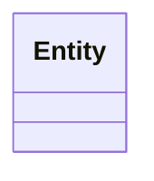
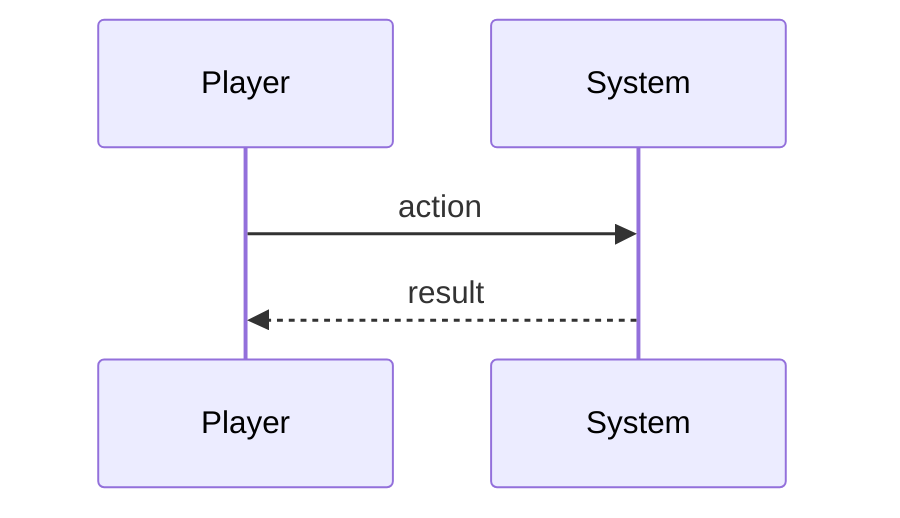

# <Feature>

_One design doc per roadmap feature, numbered to match it (e.g. `01-global-map.md`). All sections are optional — keep one only if it earns its place for this feature, and delete the rest._

## Description

_What we're building and what we want to achieve._

## Glossary

_The domain entities the feature works in — what each one is in the domain, not the class that will implement it (a class exists because the entity does, never the other way round). Define each so a reader can tell it apart from the entity beside it without opening the code, and name a class only where the term does not already carry it._

## Functionality

_A plain list of what we want to implement._

## Use cases

_Detailed use cases, with use-case diagrams._


## UI

_The screens and components needed — mocks in pseudocode._

_Draw frames with box-drawing characters and fill a grid cell rather than lettering it, so the mock is read at a glance instead of decoded against its legend. Keep to box-drawing, block, geometric and arrow glyphs: every default monospace font has them, and none of them is double-width, which is what shears a grid. No emoji inside a mock — they render double-width in some hosts and misalign. Where a mock shows real data, derive it from the data file and check it back against it — a hand-drawn grid drifts, and a mock that contradicts the data teaches the wrong thing._

```text
┌─ Screen ────────────────────┐
│  Title - state              │
├─────────────────────────────┤
│   ·  empty     █ blocked    │
│                             │
│  Prompt?          [ Done ]  │
└─────────────────────────────┘
```

## Research

_The implementation options considered, their trade-offs and risks — and which we chose, and why._

## Overview

_The high-level components we need._

## Domain model

_The classes we need — class diagram._



## Flow

_How entities and modules interact at runtime — sequence diagram._



## Persistence

_What this feature contributes to a save, and how it's versioned._

## Tests

_The kinds of tests needed, and what exactly to test._
