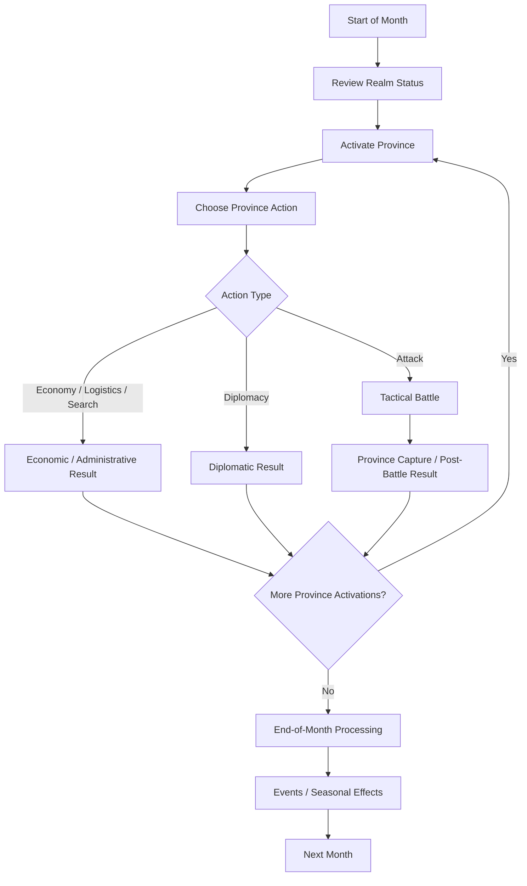

# 1. High Concept

## Purpose

This document is part of the reverse-engineering spec for the original **Gemfire**.

The purpose of this chapter is to define the game at the highest level: its core premise, player role, campaign goal, major systems, and overall strategic structure.

This chapter focuses on the original game and does not introduce remake-specific design changes.

---

## 1.1 Game Overview

Gemfire is a turn-based fantasy strategy game about noble houses fighting to unify the island kingdom of Ishmeria.

The player controls one ruling house and expands through:

- province management;
- economic development;
- military recruitment;
- strategic invasions;
- tactical battles;
- diplomacy;
- character recruitment;
- control of magical Gems.

The game combines a fixed strategic map with compact tactical battles and a character-driven political system.

---

## 1.2 Player Role

The player acts as the ruler of one noble house.

The player is responsible for:

- managing provinces;
- assigning and using generals;
- developing local economies;
- recruiting troops;
- moving resources and armies;
- attacking neighbouring provinces;
- recruiting captured or defecting characters;
- using diplomacy;
- acquiring Gems;
- ultimately unifying Ishmeria.

The player does not control a generic empire. Power is mediated through provinces, rulers, vassals, armies, and Gems.

---

## 1.3 Core Game Structure

Gemfire is built around several connected layers:

```text
Strategic Map
├── Provinces
├── Houses
├── Generals
├── Economy
├── Armies
├── Diplomacy
├── Events
└── Gems

Tactical Battle
├── Standard Units
├── Fifth Unit
├── Commander Influence
├── Flags
├── Food Timer
└── Terrain / Obstacles
```

The strategic layer determines where wars happen, which resources are available, which generals command armies, and which Fifth Units can be used.

The tactical layer resolves individual invasions through small grid-based battles.

---

## 1.4 Core Loop

Gemfire’s core loop is province-centered.

The player reviews the current state of the realm, issues actions through individual provinces, resolves battles or diplomatic outcomes when they occur, and advances through the monthly calendar.



---

## 1.5 Major Systems

| System            | Role                                                                                      |
| ----------------- | ----------------------------------------------------------------------------------------- |
| World Map         | Fixed map of Ishmeria divided into numbered provinces.                                    |
| Provinces         | Main territorial, economic, military, and administrative units.                           |
| Houses            | Political factions competing to unify Ishmeria.                                           |
| Generals          | Characters used as rulers, governors, commanders, and diplomatic actors.                  |
| Economy           | Local province economy based on Gold, Food, Troops, Loyalty, Cultivation, and Protection. |
| Military          | Strategic troop management and province invasion.                                         |
| Tactical Battle   | Small grid-based battles between two armies.                                              |
| Gems              | House-level magical assets that provide Gem Guardians as Fifth Units.                     |
| Hired Fifth Units | Province-based special units hired with Gold and maintained through upkeep.               |
| Diplomacy         | Active commands such as Ally, Defection, Surrender, Sabotage, and Plunder.                |
| Events            | Good events, bad events, seasonal disasters, and hidden goodwill checks.                  |
| Scenarios         | Four political time slices of the same war for Ishmeria.                                  |
| AI                | Simple strategic, economic, diplomatic, and tactical heuristics.                          |

---

## 1.6 Victory Conditions

The main campaign goal is:

> Unify Ishmeria under the player’s house.

Victory is achieved by eliminating or absorbing all rival houses and gaining control of the entire map.

This can happen through a combination of:

- military conquest;
- ruler recruitment;
- surrender;
- family absorption;
- Gem acquisition;
- political collapse of rival houses.

---

## 1.7 Defeat Conditions

The player is defeated when their house can no longer continue as a political entity.

This usually means losing the last controlled province or otherwise being absorbed or eliminated.

---

## 1.8 Scenario Structure

Gemfire contains four scenarios.

All scenarios share:

- the same map;
- the same province structure;
- the same core rules;
- the same ultimate goal.

They differ in:

- province ownership;
- active houses;
- playable houses;
- rulers and vassals;
- Gem ownership;
- starting resources;
- political balance.

Scenarios are best understood as different time slices of the same long war.

---

## 1.9 Design Summary

Gemfire can be summarized as:

> A turn-based fantasy strategy game about noble houses competing to unify Ishmeria through province management, character leadership, strategic warfare, tactical battles, diplomacy, events, and magical Gems.

The game’s identity comes from the combination of:

- fixed authored geography;
- province-based administration;
- character-driven politics;
- compact tactical battles;
- magical strategic assets;
- asymmetric scenario starts.

Gemfire is not a conventional large-scale wargame. Most decisions happen on the strategic map, while tactical battles resolve the consequences of those strategic choices.

---

## Open Questions

The following high-level questions remain partially unresolved:

1. Exact internal province activation order.
2. Exact timing of some end-of-month checks.
3. Exact defeat handling in edge cases involving ruler capture, banishment, surrender, or family absorption.
4. Exact version differences between SNES, Genesis, NES, PC, and Royal Blood.
