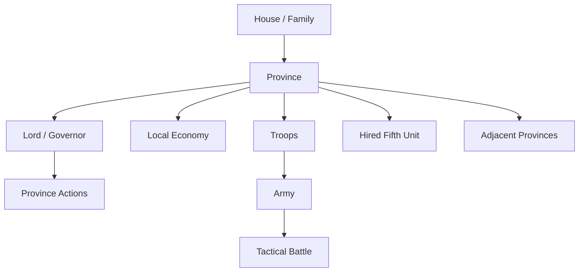
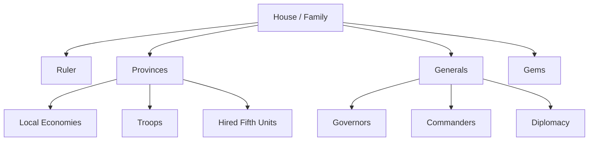
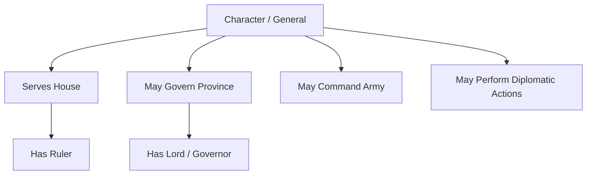
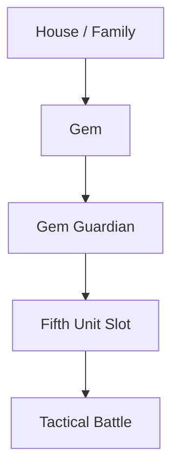
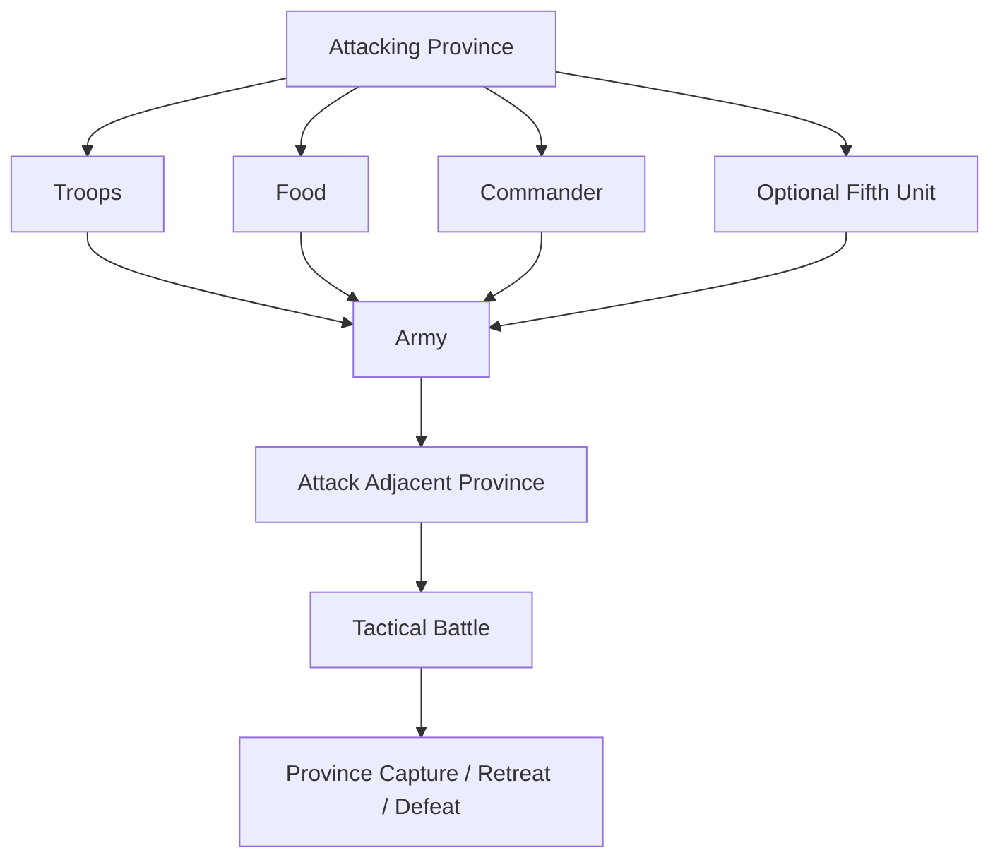
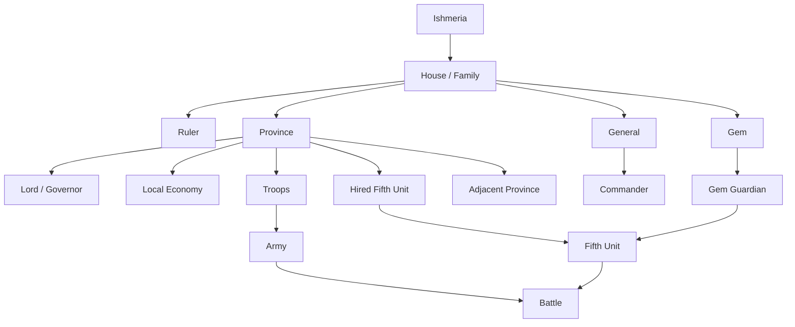

# 2. World Model

## Purpose

This chapter describes the strategic world model of **Gemfire**.

It defines the main world-level entities used by the game:

- Ishmeria;
- provinces;
- houses / families;
- rulers and generals;
- local province economies;
- armies;
- Gems.

Detailed province lists, adjacency data, and scenario ownership tables are maintained in the data appendices.

---

# 2.1 Ishmeria

## Confirmed Facts

Gemfire takes place in **Ishmeria**, a fixed island kingdom.

The map is not randomly generated.

All scenarios use the same geography.

The map contains 30 numbered provinces (province list in Appendix A §A.2).

Scenario selection changes the political state of the world, but not the physical map.

Scenario-specific changes include:

- province ownership;
- active houses;
- playable houses;
- rulers;
- vassals;
- Gems;
- starting armies;
- starting resources.

The geography of Ishmeria remains stable across all scenarios.

---

## Design Observation

The fixed map is one of Gemfire’s defining features.

Because the geography does not change, the player can gradually learn:

- invasion routes;
- chokepoints;
- safe interior provinces;
- vulnerable border provinces;
- strategic hubs;
- regional risk patterns.

The map is not just a backdrop. It is a stable strategic system.

---

# 2.2 Provinces

## Confirmed Facts

The province is the primary territorial unit in Gemfire.

Each province can:

- belong to one house;
- store local resources;
- contain troops;
- be governed by a lord / general;
- contain or host generals;
- provide a base for military action;
- be attacked from adjacent provinces;
- be captured by another house.

Control over provinces is the main way a house expands its power.

---

## Province Roles

A province has several roles at the same time:

| Role           | Description                                                           |
| -------------- | --------------------------------------------------------------------- |
| Territorial    | Defines map control and borders.                                      |
| Economic       | Stores and produces local resources.                                  |
| Military       | Holds troops and supports invasions.                                  |
| Administrative | Can be governed by a lord / general.                                  |
| Strategic      | Serves as a route, chokepoint, staging ground, or defensive position. |

---

## Province Attributes

Confirmed or strongly supported province-level data includes:

| Attribute                     | Gameplay Role                                                         |
| ----------------------------- | --------------------------------------------------------------------- |
| Owner                         | Determines which house controls the province.                         |
| Gold                          | Local economic resource.                                              |
| Food                          | Local supply resource for population support, loyalty, and campaigns. |
| Troops                        | Local military manpower.                                              |
| Loyalty                       | Public support for the current ruler.                                 |
| Cultivation                   | Agricultural development and harvest strength.                        |
| Protection                    | Resistance to disasters and bad events.                               |
| Lord / Governor               | Character responsible for province administration.                    |
| Adjacency                     | Determines movement and invasion routes.                              |
| Hired Fifth Unit availability | Determines which special units can be hired locally.                  |

Population is not currently confirmed as a province stat in Gemfire.

---

## Province Relationships



---

## Design Observation

Gemfire is province-centered.

A house does not operate through a single centralized economy or a single global army pool. Instead, power is distributed across controlled provinces.

This makes local geography, resource placement, governors, and border pressure central to the strategic game.

---

# 2.3 Province Adjacency

## Confirmed Facts

Province adjacency determines which provinces can be attacked directly.

A province can only be invaded from a neighbouring province.

Adjacency also defines:

- invasion routes;
- border pressure;
- defensive chokepoints;
- expansion paths;
- logistics and troop movement options.

The full adjacency table is canonical in Appendix A §A.3; strategic geography including major hub and bridge provinces is in §A.4, and geographic region groupings in §A.5.

---

## Strategic Implications

High-connectivity provinces are strategically valuable but difficult to defend.

Low-connectivity provinces are easier to defend but offer fewer expansion routes.

Dead-end provinces can function as safer rear territories, while central hubs can expose a house to many simultaneous threats. Lisle connects only to Norwood, and Penzan connects only to Ashlan; both therefore work as safe rear / stockpile territories.

---

## Design Observation

Adjacency is one of the main ways Gemfire turns a fixed map into a strategic puzzle.

The same province can be valuable for several different reasons:

- it connects regions;
- it blocks access to a core territory;
- it opens a new front;
- it protects a rear economy;
- it allows or prevents multi-province campaigns.

---

# 2.4 Houses / Families

## Confirmed Facts

Ishmeria is divided between noble houses / families.

Each house can control:

- provinces;
- generals;
- troops;
- Gems;
- hired units located in its provinces.

The number and identity of active houses depend on the selected scenario. The canonical list of active families is in Appendix A §A.6.

---

## House Responsibilities

A house is the main political actor in Gemfire.

Each house:

- has a ruler;
- controls provinces;
- commands generals;
- manages local economies through provinces;
- uses diplomacy;
- wages war;
- may own one or more Gems;
- competes to unify Ishmeria.

---

## House Components



---

## House-Level Attributes

Confirmed or strongly supported house-level data includes:

| Attribute          | Gameplay Role                                                         |
| ------------------ | --------------------------------------------------------------------- |
| Ruler              | Political head of the house.                                          |
| Provinces          | Territorial and economic base.                                        |
| Generals / Vassals | Character pool for governance, command, and diplomacy.                |
| Gems               | House-level magical assets.                                           |
| Fame               | Ruler-level political reputation affecting diplomacy and recruitment. |
| Alliance           | Diplomatic relationship; limited to one ally.                         |

Gold, Food, Troops, Loyalty, Cultivation, and Protection are province-level values rather than a single centralized house treasury.

---

# 2.5 Rulers and Generals

## Confirmed Facts

Characters are persistent strategic entities.

A character can function as:

- ruler;
- vassal;
- province lord / governor;
- army commander;
- diplomatic actor.

Characters are not separate tactical units on the battlefield.

In battle, the commander influences the army, while the tactical units are generated from troops and the selected Fifth Unit.

---

## Character Relationship to the World



---

## Design Observation

The world model is character-driven.

Provinces matter, but their value depends heavily on who governs or commands them. A strong general can improve development, command better armies, or change the political balance through recruitment and defection.

---

# 2.6 Gems

## Confirmed Facts

Gems are not owned by individual provinces.

A Gem is a house-level asset.

A house that owns a Gem can use its associated Gem Guardian as a Fifth Unit when the Gem is available.

Gems are tied to political survival and family absorption. Capturing a province does not automatically transfer the enemy house’s Gem if that house still exists.

---

## Gem Ownership Model



---

## Design Observation

Gems give the world model a magical-political layer.

They are not just battle assets. They also represent dynastic power, family survival, and the long-term strategic reward for absorbing rival houses.

---

# 2.7 Armies and Warfare

## Confirmed Facts

Strategic warfare is province-based.

Armies are formed from:

- troops located in a province;
- a chosen commander;
- food allocated for the campaign;
- an optional Fifth Unit.

A province can attack only adjacent enemy provinces.

When an invasion begins, the game transitions from the strategic map to a tactical battle.

---

## Strategic-to-Tactical Flow



---

# 2.8 Events and Geography

## Confirmed Facts

The world model includes both political geography and environmental risk.

Events can affect provinces through:

- good events;
- bad events;
- seasonal disasters;
- hired unit events.

Seasonal disasters are geographically patterned, with each disaster type tied to a region: snow in the north, fire in the west, flooding in the east/southeast, earthquakes in the southwest, and plague anywhere. The full disaster table with regions, months, and province ranges is owned by the events chapter (§11.6).

Exact province-by-province disaster mapping remains unresolved.

---

## Design Observation

The fixed map matters not only for war, but also for long-term risk.

Different regions are exposed to different environmental threats, which gives geography economic and strategic meaning beyond adjacency.

---

# 2.9 World Hierarchy



---

# 2.10 World Model Summary

Gemfire’s world model is built around a fixed map of Ishmeria divided into 30 provinces.

The most important structural principles are:

- the map is fixed across all scenarios;
- provinces are the primary territorial and economic units;
- houses are political actors competing to unify Ishmeria;
- generals connect politics, economy, diplomacy, and war;
- Gems are house-level magical assets;
- warfare is constrained by province adjacency;
- events and disasters make geography matter over time.

The world model is compact, but highly interconnected.

Most major systems in Gemfire pass through the province layer:

```text
House
↓
Province
↓
Economy / Army / Governor / Event / Invasion
```
