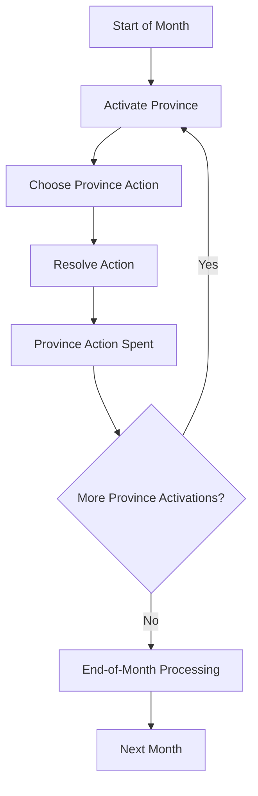
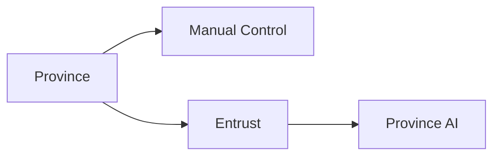

# 3. Turn Structure

## Purpose

This chapter describes Gemfire’s strategic time structure.

It defines:

- the monthly calendar;
- province-based activation;
- monthly province actions;
- free / administrative actions;
- Entrust;
- activation order uncertainty;
- end-of-month processing.

---

# 3.1 Calendar

## Confirmed Facts

Game time is divided into months.

One strategic cycle represents one month of in-game time.

Most strategic decisions are made within the monthly cycle:

- province development;
- recruitment;
- troop movement;
- diplomacy;
- search;
- invasion.

After the month is processed, the calendar advances to the next month.

---

## Seasonal Cycle

Gemfire includes seasonal economic and event timing.

September is especially important because it is associated with harvest and major resource gains.

Some disasters and special events are also tied to specific months or seasonal checks.

---

## Design Observation

Gemfire uses a large strategic time scale.

A single month is not a single battlefield action. It represents administrative, economic, diplomatic, and military activity across the realm.

This makes long-term planning more important than short tactical optimization on the strategic map.

---

# 3.2 Province-Based Activation

## Core Model

Gemfire is primarily organized around province actions rather than a single global “kingdom turn.”

Each controlled province can usually perform one significant action during the monthly cycle.

This makes the province the main unit of strategic activation.

---

## Monthly Province Action

A province’s monthly action can be used for systems such as:

- economic development;
- recruitment;
- troop or resource movement;
- diplomacy;
- search;
- invasion;
- hiring a Fifth Unit.

After most significant actions, the province’s monthly action is spent.

---

## Conceptual Model



---

## Design Observation

The province-based model creates one of Gemfire’s key strategic constraints:

> One province usually gets one meaningful action per month.

This forces tradeoffs between development, recruitment, diplomacy, logistics, and war.

---

# 3.3 Turn-Consuming Commands

## Overview

Most important strategic commands consume the province’s monthly action.

The exact behaviour of some commands may vary by version or still requires verification, but the general structure is clear: major strategic actions are costly because they use the province’s action for the month.

---

## Command Table

The major strategic commands (Develop, Give Food, Recruit, Attack, Transport, Hire Monster, the Diplomacy commands, and Search) each consume the province's monthly action; the full command-by-category breakdown and which commands consume the monthly action are canonical in Appendix D §D.1–D.2 and §D.4.

---

## Notes

`Hire Monster` is the original command name, but the command can provide both monsters and elite human units.

`Transport / Move` terminology can vary depending on context and version.

---

# 3.4 Non-Turn-Consuming and Administrative Commands

## Overview

Some commands do not appear to consume the province’s main monthly action.

These are mostly informational or administrative actions.

---

## Known or Strongly Supported Examples

Commands such as Trade (buy or sell Food), View / Enquiry, Change Lord, and Entrust are mostly informational or administrative and do not end the province's main action; which commands consume the monthly action is canonical in Appendix D §D.4.

---

## Design Observation

Free or administrative commands reduce friction.

For example, Trade being non-turn-consuming lets the player adjust resources before choosing the province’s main action.

---

# 3.5 Entrust

## Confirmed Facts

Entrust allows the player to delegate a province to AI control.

An entrusted province is managed automatically by the computer.

Entrust operates at the province level, not at the whole-house level.

---

## Conceptual Model



---

## Design Observation

Entrust confirms the province-centered structure of Gemfire.

The player can automate individual provinces rather than handing over the entire realm.

This is mainly a convenience system for reducing micromanagement.

---

# 3.6 Province Activation Order

## Current Understanding

The exact province activation order is not fully confirmed.

Observed behaviour suggests that the monthly sequence is not simply:

```text
Player takes all actions
↓
AI takes all actions
```

Instead, province actions appear to be processed through a broader province activation sequence.

A captured province may be able to act later in the same month if its activation has not yet occurred.

---

## Working Model

The current working model is:

1. At the start of the month, the game determines or follows a province activation order.
2. Provinces receive opportunities to act according to that order.
3. Ownership changes during the month may affect later activations.
4. After all relevant province activations are complete, end-of-month processing occurs.

---

## Confidence Level

The province-based model is strongly supported, but the exact internal ordering rules remain unresolved.

---

# 3.7 End-of-Month Processing

## Overview

After province activations are complete, the game performs systemic processing.

Known or strongly supported processing includes:

- calendar advancement;
- economic updates;
- seasonal checks;
- event checks;
- disaster checks;
- Gem cooldown progression;
- hired Fifth Unit upkeep checks;
- victory / defeat checks.

The exact order of these operations is not fully verified.

---

## Seasonal Processing

Some systems are tied to specific months.

Examples include:

| Month / Timing              | Known or Likely Processing                                            |
| --------------------------- | --------------------------------------------------------------------- |
| September                   | Harvest and major resource gains.                                     |
| Quarterly / seasonal months | Disasters, plague checks, some event processing.                      |
| Every month                 | Calendar advancement, cooldown progression, AI / province processing. |

---

# 3.8 Turn Structure Summary

Gemfire’s turn structure is one of its most distinctive systems.

The game is not structured only around whole-faction turns. Instead, it relies heavily on province-level activation and province-level monthly actions.

This creates a strategic rhythm where each province must choose between:

- development;
- recruitment;
- logistics;
- diplomacy;
- search;
- attack;
- hiring or maintaining military assets.

The result is a compact but demanding strategic system where local decisions accumulate into realm-wide momentum.

---

# Open Questions

The following turn-structure details remain unresolved:

1. Exact internal province activation order.
2. Whether activation order is fixed, randomized, province-number based, or scenario-dependent.
3. Exact timing of event checks relative to end-of-month processing.
4. Exact order of harvest, disasters, upkeep, cooldowns, and victory checks.
5. Whether any rare cases allow a province to act more than once in the same month.
6. Version differences in command action costs.
