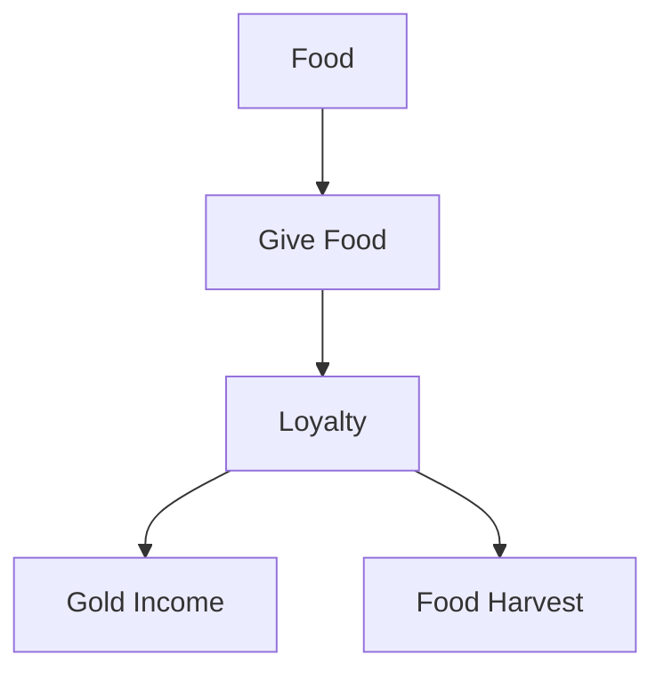
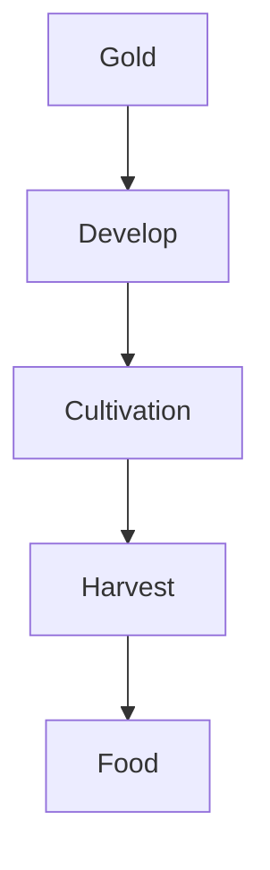
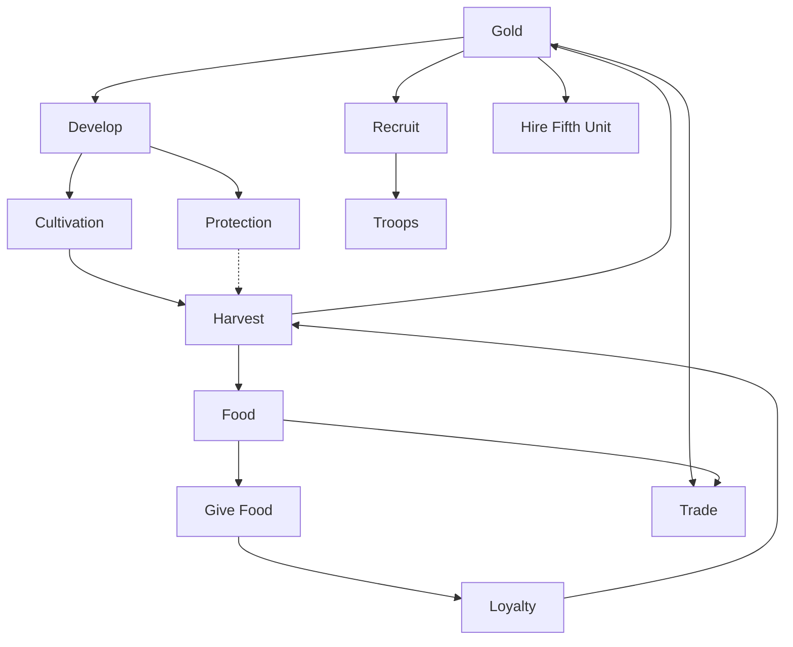

# 4. Economy System

## Purpose

This chapter describes Gemfire’s province economy.

The economy connects province development, public loyalty, military recruitment, army supply, and long-term strategic expansion.

Gemfire’s economy is not a separate victory system. Its main role is to support stable rule, military campaigns, and province growth.

---

# 4.1 Economic Model

## Confirmed Facts

Each province stores its own resources.

Gemfire does not use a single fully centralized national treasury for the core province economy.

Each province tracks local values such as:

- Gold;
- Food;
- Troops;
- Loyalty;
- Cultivation;
- Protection.

Gold, Food, and Troops each cap at 999 per province.

---

## Province-Local Economy

Most economic decisions are local.

A province’s resources are used for that province’s actions unless moved or traded through the appropriate commands.

This means a rich rear province does not automatically solve the needs of a poor frontier province.

---

## Design Observation

Gemfire’s economy is intentionally compact.

It uses a small number of values, but those values are tightly connected:

```text
Gold funds development and recruitment.
Food supports loyalty and campaigns.
Loyalty affects income and harvest.
Cultivation improves food production.
Protection reduces long-term risk.
Troops provide military power.
```

The result is a local economy that constantly forces tradeoffs between short-term military needs and long-term stability.

---

# 4.2 Core Economic Resources

## Resource Overview

| Resource    | Role                                                  |
| ----------- | ----------------------------------------------------- |
| Gold        | Used for development, recruitment, hiring, and trade. |
| Food        | Used for loyalty, army supply, and trade.             |
| Troops      | Province-level military manpower.                     |
| Loyalty     | Public support for the current ruler.                 |
| Cultivation | Agricultural development and harvest strength.        |
| Protection  | Resistance to disasters and harmful events.           |

---

## Not Confirmed: Population

Population is not currently confirmed as a province stat in Gemfire.

Recruitment should not be described as converting population into soldiers unless later evidence confirms it.

The confirmed model is simpler:

```text
Gold
↓
Recruit
↓
Troops
```

---

# 4.3 Gold

## Confirmed Facts

Gold is the main local spending resource.

Gold is used for:

- developing Cultivation;
- developing Protection;
- recruiting Troops;
- hiring Hired Fifth Units;
- trading for Food.

---

## Income

Major Gold income is associated with the yearly September processing.

Gold income is influenced by province conditions, especially Loyalty.

The exact tax formula remains unresolved.

---

## Spending

Recruiting costs 2 Gold per soldier, and each Develop action (Cultivation or Protection) costs 10 Gold. Hired Fifth Unit prices vary by unit and are listed in Appendix C §C.4.

---

## Design Observation

Gold is the main limiter of military growth.

A province may have Food and good development, but it cannot recruit or hire effectively without enough Gold.

---

# 4.4 Food

## Confirmed Facts

Food is a fundamental economic and military resource.

Food is used for:

- Give Food;
- army supply during campaigns;
- trade;
- long-term province stability.

---

## Harvest

Major Food gain is associated with September harvest processing.

Food harvest is influenced by Cultivation and Loyalty, and possibly Protection. A working, player-derived formula is:

```text
Food Harvest = Loyalty + (Cultivation × 2) + Protection
```

Confidence: Medium. Whether Protection truly contributes is unconfirmed.

---

## Trade

Food can be bought or sold through Trade.

Trade does not consume the province’s main monthly action.

Trade uses the current market rate:

| Market State | Exchange Rate   |
| ------------ | --------------- |
| Low          | 1 Gold = 2 Food |
| Average      | 1 Gold = 1 Food |
| High         | 2 Gold = 1 Food |

The exact timing of market rate changes remains unresolved.

---

## Design Observation

Food is both an economic and military resource.

It can be converted into Loyalty through Give Food, used to supply armies, or traded for Gold.

This makes Food one of the most strategically flexible resources in the game.

---

# 4.5 Troops

## Confirmed Facts

Troops represent the province’s local military manpower.

Troops are stored at the province level.

On the strategic map, Troops are not divided into unit types.

When a battle begins, Troops are converted into standard tactical units.

---

## Recruitment

Recruiting costs 2 Gold per soldier.

Recruitment consumes the province’s monthly action and carries negative goodwill in the event system.

No confirmed population cost has been found.

---

## Design Observation

Troops are the bridge between economy and war.

Gold becomes Troops through Recruit, and Troops become battlefield power through the military system.

---

# 4.6 Loyalty

## Confirmed Facts

Loyalty represents the population’s support for the current ruler of the province.

Loyalty affects economic output.

High Loyalty improves:

- Gold income;
- Food harvest.

Low Loyalty reduces province efficiency.

---

## Give Food

The main known way to increase Loyalty is the Give Food command. Loyalty gain scales with the acting lord’s Charm and the amount of Food given:

```text
Loyalty Gain = floor(CHA × Food Given / 300)
```

For example, Charm 29 giving 100 Food yields floor(9.66) = +9 Loyalty. (Confidence: Medium-High.)

Give Food consumes the province’s monthly action and has positive goodwill in the event system.

---

## Economic Role



---

## Design Observation

Loyalty links public support to economic power.

Food can be spent now to improve Loyalty, which can improve future income and harvest.

This creates a recurring strategic tradeoff:

```text
Use Food for immediate needs
or
invest Food into long-term province loyalty
```

---

# 4.7 Cultivation

## Confirmed Facts

Cultivation represents the agricultural development of a province.

Higher Cultivation improves Food harvest.

Cultivation can be increased through Develop.

---

## Develop: Cultivation

Develop: Cultivation costs 10 Gold and consumes the province’s monthly action. It raises the stat by +2 to +5 per use, scaling with the acting character’s INT / Domestic ability (minimum +2; exact thresholds unverified).

---

## Degradation

Cultivation can be reduced by:

- disasters;
- bad events;
- sabotage;
- war-related damage.

Exact reduction formulas remain unresolved.

---

## Economic Role



---

## Design Observation

Cultivation is a long-term investment.

The player spends Gold and a province action now to increase future Food production.

---

# 4.8 Protection

## Confirmed Facts

Protection represents a province’s resilience against harmful outcomes.

Protection can be increased through Develop.

---

## Develop: Protection

Develop: Protection costs 10 Gold and consumes the province’s monthly action. Like Cultivation, the result scales with the acting character’s INT / Domestic ability.

---

## Effects

High Protection helps reduce or resist:

- bad events;
- disaster damage;
- long-term province degradation.

There is evidence that Protection may also influence harvest, but this is not fully confirmed.

---

## Protection and Goodwill

The Protection stat and the Protect / Develop action should not be confused.

Using the Protection development command contributes positive goodwill to the event system.

The Protection stat itself is primarily understood as defensive mitigation against bad outcomes.

---

## Degradation

Protection can be reduced by:

- disasters;
- bad events;
- sabotage;
- war-related damage.

Exact reduction formulas remain unresolved.

---

## Design Observation

Protection is a defensive investment.

It does not primarily create immediate wealth. Instead, it helps preserve province value against disasters and harmful events.

---

# 4.9 Trade

## Confirmed Facts

Trade allows the player to buy or sell Food.

Trade uses the current market rate (see §4.4).

Trade does not consume the province’s main monthly action.

---

## Strategic Role

Trade lets the player correct local resource imbalances before choosing a major province action.

Examples:

```text
A province with Gold but no Food can buy Food before launching a campaign.
A province with surplus Food can sell some to fund development or recruitment.
```

---

## Design Observation

Because Trade is not turn-consuming, it acts as an economic adjustment tool rather than a major strategic commitment.

The major commitment comes from what the province does after trading.

---

# 4.10 Transport

## Confirmed Facts

Two distinct commands move things between provinces:

- **Move Troops** (Military) — moves troops, food, gold, and hired Fifth Units to
  a **bordering** friendly province; also used to claim an empty territory.
- **Transport** (Domestic) — moves **gold and food** to **any** province in the
  realm, however distant (even physically separated territories).

Both consume the province's monthly action.

---

## Strategic Role

Transport connects the local province economies into a wider logistical network.

Rear provinces can support frontier provinces by sending:

- Gold;
- Food;
- Troops;
- possibly hired Fifth Units when moved with troops.

---

## Design Observation

Because resources are local, logistics matters.

A strong economy in the wrong province is not automatically useful unless resources can be moved where they are needed.

---

# 4.11 Economic Loop

## Reconstructed Economic Loop



The dashed Protection → Harvest relationship is supported by some evidence but not fully verified.

---

# 4.12 Economy Summary

Gemfire’s economy is based on local province values rather than a single centralized national economy.

The core economic loop is:

```text
Gold develops provinces and recruits troops.
Food supports loyalty and campaigns.
Loyalty improves future income.
Cultivation increases harvest.
Protection reduces damage and risk.
Troops convert economy into military power.
```

The economy’s main purpose is to create sustainable military and political strength.

A well-managed province can support expansion, survive disasters, maintain loyalty, and provide troops for future campaigns.

---

# Open Questions

The following economy details remain unresolved:

1. Exact September Gold income (tax) formula.
2. Exact September Food harvest formula.
3. Whether Protection directly contributes to harvest or only mitigates losses.
4. Exact market rate timing.
5. Exact reduction formulas for Cultivation and Protection damage.
6. Exact economic effects of all good and bad events.
7. Version differences in Trade, Transport, and monthly economic processing.
