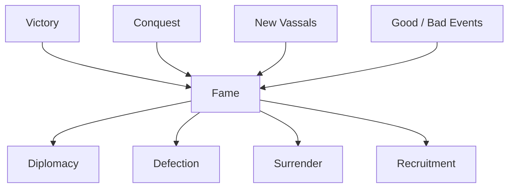
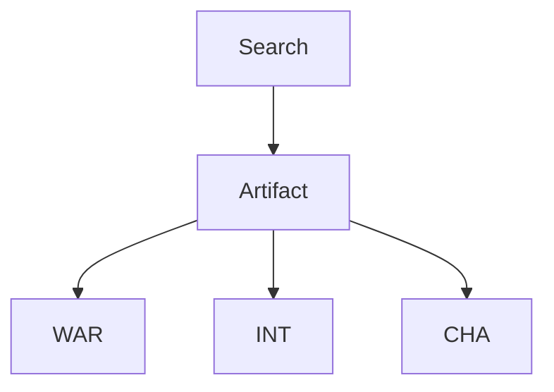
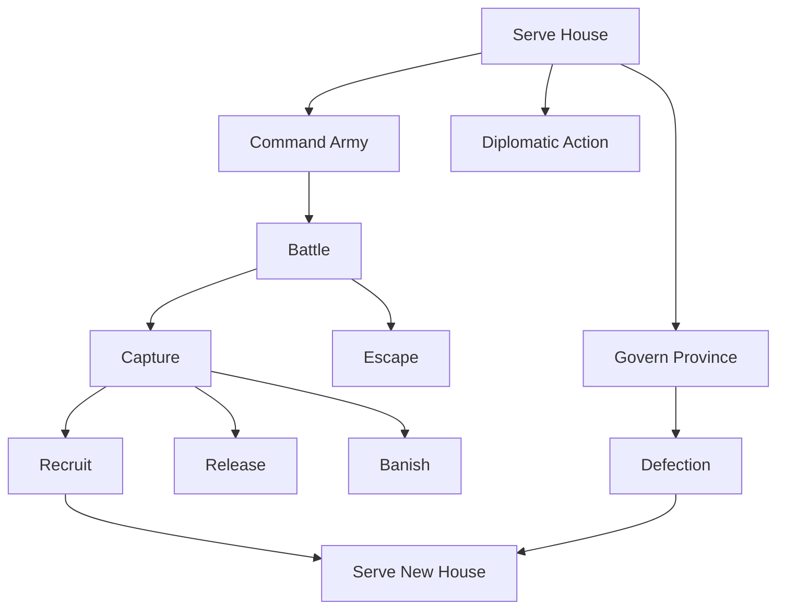

# 5. Characters

## Purpose

This chapter describes Gemfire’s character system.

Characters are one of the central strategic resources in the game. They participate in:

- province governance;
- economic development;
- diplomacy;
- army command;
- capture and recruitment;
- ruler identity;
- house survival.

Gemfire is not only a game about territories. A house’s power depends heavily on the quality, loyalty, and availability of its generals.

---

# 5.1 Character Model

## Overview

Each character is a named general associated with one of the houses of Ishmeria.

Characters are persistent campaign entities.

A character can:

- serve a house;
- govern a province;
- command an army;
- perform or influence diplomatic actions;
- be captured;
- be recruited;
- be released;
- be banished;
- change allegiance.

---

## Roles

A character may perform different roles depending on context.

| Role             | Description                                                          |
| ---------------- | -------------------------------------------------------------------- |
| Ruler            | Political head of a house.                                           |
| Vassal           | Character serving a ruler.                                           |
| Lord / Governor  | Character assigned to govern a province.                             |
| Commander        | Character chosen to lead an army in battle.                          |
| Diplomatic Actor | Character involved in persuasion, recruitment, or political actions. |

---

## Design Observation

A character is not a tactical military unit.

In battle, the commander does not occupy a battlefield cell and does not replace the Fifth Unit slot.

Instead, the commander influences the army through character stats and command ability.

Characters are best understood as strategic agents who connect governance, diplomacy, and warfare.

---

# 5.2 Character Attributes

## Core Attributes

Gemfire characters use three primary attributes:

| Attribute       | Meaning                                                                          |
| --------------- | -------------------------------------------------------------------------------- |
| INT / Domestic  | Administrative & political ability (Develop, governance, sabotage resistance).   |
| WAR / Military  | Combat ability and command.                                                      |
| CHA / Charm     | Personal influence (Give Food, persuasion, recruitment).                         |

The full 64-general roster and record format is canonical in Appendix B §B.2.

---

## WAR / Military

WAR represents a character’s military ability.

High WAR improves the character’s effectiveness as a commander.

Known or strongly supported effects include:

- better battle performance;
- improved army effectiveness;
- stronger results in tactical combat.

Exact damage formulas and WAR modifiers remain unresolved.

---

## INT / Domestic

INT represents a character’s administrative and organizational ability.

High INT improves province development.

Confirmed or strongly supported effects include:

- better Develop results;
- faster improvement of Cultivation;
- faster improvement of Protection.

INT may also be involved in resisting sabotage or other hostile actions, but exact formulas are unresolved.

---

## CHA / Charm

CHA represents personal influence and ability to inspire or persuade.

For the Give Food command, Charm drives the Loyalty gain; the full formula is in the economy chapter §4.6.

CHA is also likely relevant to some diplomatic and recruitment-related systems, but exact formulas are unresolved.

---

# 5.3 Lords and Governors

## Overview

A province may be governed by a lord / governor.

The governing character affects the quality of province administration.

---

## Responsibilities

A lord / governor is relevant to:

- developing Cultivation;
- developing Protection;
- raising Loyalty through Give Food;
- governing the local province economy;
- possibly resisting hostile actions.

---

## Development Efficiency

The Develop command depends on the acting character’s INT / Domestic ability: INT / Domestic drives Develop's result. See the economy chapter §4.7.

---

## Design Observation

A province cannot be evaluated only by its resources.

The character governing it can strongly affect how quickly it develops and how effectively it supports the house.

---

# 5.4 Rulers

## Overview

Rulers occupy a special position in the character system.

A ruler is the political center of a house.

The ruler is associated with:

- house identity;
- Fame;
- diplomatic strength;
- survival of the house;
- possible family absorption outcomes.

---

## Ruler Capture and Recruitment

Capturing or recruiting a ruler has special strategic importance.

If a ruler is recruited, banished, or otherwise removed under certain conditions, the entire rival house may collapse or be absorbed.

This can transfer:

- provinces;
- vassals;
- Gems.

Exact conditions and edge cases remain unresolved.

---

## Design Observation

Capturing or recruiting the right ruler can be more powerful than conquering provinces one by one.

This makes rulers high-value political targets, not just stronger generals.

---

# 5.5 Fame

## Overview

Fame is associated with the ruler of a house.

Ordinary generals do not appear to have Fame in the same way.

---

## Sources of Fame

Known or strongly supported sources of Fame include:

- victories;
- conquest;
- territorial expansion;
- gaining vassals;
- some positive events.

Known or likely losses include:

- defeat;
- losing territory;
- negative events;
- political failure.

Exact Fame gain and loss formulas remain unresolved.

---

## Effects

Fame belongs to the ruler. It is raised by victories, conquest, new vassals, and good events; it is lowered by defeats, lost territory, and negative events. Fame affects Ally, Defection, and Surrender; the exact formula is unknown.

---

## Conceptual Model



---

## Design Observation

Fame turns battlefield success into political power.

A successful ruler becomes more persuasive, which can lead to more vassals, more provinces, and stronger diplomatic pressure.

---

# 5.6 Hidden General Loyalty

## Overview

General Loyalty is separate from province Loyalty.

Province Loyalty represents public support in a territory.

General Loyalty represents a character’s loyalty to their current ruler or house.

---

## Confirmed / Reconstructed Facts

General Loyalty is hidden from the player.

It is a hidden value affecting resistance to Recruit, Defection, and Surrender. No confirmed player command changes it directly; it is most likely scenario- or character-defined. The exact scale is unknown.

---

## Design Observation

Hidden General Loyalty creates uncertainty.

The player may know a general’s public stats, but not how willing that character is to betray, resist recruitment, or remain loyal after capture.

---

# 5.7 Capture, Recruitment, Release, and Banishment

## Capture

After defeat in battle, a commander may:

- escape;
- be captured.

Exact capture probability is unresolved.

---

## Captured Generals

A captured general can be handled in several ways:

| Option  | Effect                                                                    |
| ------- | ------------------------------------------------------------------------- |
| Recruit | Attempts to convince the character to join the player’s house.            |
| Release | Lets the character go.                                                    |
| Banish  | Removes or expels the character; exact consequences require verification. |

---

## Recruit

A successful Recruit transfers the general to the player’s house.

Recruit success is influenced by several factors, likely including:

- ruler Fame;
- hidden General Loyalty;
- character relationships or scenario data;
- possibly CHA / Charm.

Exact formula remains unresolved.

---

## Strategic Importance

Recruitment is one of the most important non-territorial expansion tools in Gemfire.

A strong recruited general can immediately improve:

- governance;
- command quality;
- diplomacy;
- future recruitment options.

---

# 5.8 Defection and Character Transfer

## Overview

Defection is a diplomatic attempt to convert an enemy vassal.

Unlike battlefield recruitment, Defection targets a character while they are still serving another house.

---

## Effects

If the target governs a province, successful Defection may transfer both:

- the character;
- the province they govern.

This makes character loyalty directly connected to map control.

---

## Design Observation

Gemfire’s political map can change because people change sides.

This is one of the reasons characters are central to the game’s strategic structure.

---

# 5.9 Character Growth

## Annual Growth

Characters improve over time. Ordinary officers gain small yearly stat increases, while rulers and force leaders gain larger ones. Later in life stats decline, and characters eventually die of old age. The exact per-year magnitude is unquantified.

This is why a character's INT / WAR / CHA differ between scenarios (which are five years apart) — the per-scenario stat tables reflect it.

---

## Effects

The following attributes can increase:

- WAR;
- INT;
- CHA.

---

## Design Observation

Character growth creates continuity between scenarios and across long campaigns.

A valuable character can remain relevant as the war progresses.

---

# 5.10 Artifacts

## Overview

Artifacts are special items that improve character attributes.

Most artifacts are found through the Search command.

---

## Known Artifact Categories

| Artifact               | Effect   |
| ---------------------- | -------- |
| Silver Sword           | WAR +25  |
| Sword of Fire          | WAR +30  |
| Sword of Victory       | WAR +40  |
| Scroll of the Planets  | INT +25  |
| Scroll of Knowledge    | INT +30  |
| Scroll of the Sages    | INT +40  |
| Moonstone              | CHA +30  |
| Dragon Jewel           | CHA +40  |

Artifacts are found via the Search command; the exact success rate is unknown.

---

## Conceptual Model



---

## Design Observation

Artifacts make Search strategically relevant.

They can turn a good character into an exceptional one and strengthen the long-term identity of a house.

---

# 5.11 Relationship Between Characters and Gems

## Confirmed Facts

Gems are not owned by individual generals.

A Gem belongs to a house / family.

A house that owns a Gem can use the associated Gem Guardian as a Fifth Unit when available.

If a house is absorbed or dissolved, its Gems may transfer to the victor.

---

## Design Observation

Characters and Gems are connected politically, not as personal equipment.

A ruler does not simply “carry” a Gem as an item. Instead, Gem ownership reflects house-level magical authority.

---

# 5.12 Character Lifecycle

## Reconstructed Lifecycle



---

# 5.13 Character System Summary

Characters are one of the core systems of Gemfire.

They connect several layers of the game:

```text
Province governance
+
Economic development
+
Army command
+
Diplomacy
+
Capture and recruitment
+
House survival
```

The player’s power is not determined only by territory. It also depends on the strength, loyalty, and placement of generals.

A small house with excellent characters can be more dangerous than its map position suggests, while a large house with weak leadership may be vulnerable to political collapse.

---

# Open Questions

The following character-system details remain unresolved:

1. Exact Recruit formula.
2. Exact Defection formula.
3. Exact capture probability after battle.
4. Internal scale and initialization of hidden General Loyalty.
5. Exact influence of CHA on systems other than Give Food.
6. Exact Fame gain and loss formulas.
7. Exact annual character growth formula.
8. Exact effects of Banish.
9. Exact aging thresholds and the per-year magnitude of stat growth and decline.
