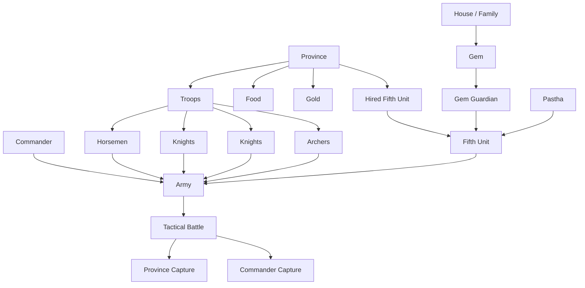

# 6. Military System

## Purpose

This chapter describes Gemfire’s strategic military system.

The military system connects the strategic map with tactical battles. On the strategic map, the player manages troops through provinces, chooses commanders, allocates food, moves forces, and invades adjacent territories. When an invasion begins, the army is converted into a small set of tactical units for battle.

The main purpose of the military system is territorial expansion through the capture of enemy provinces.

---

## 6.1 Strategic Military Resources

### Troops

Troops are the main military resource of a province.

On the strategic map, Troops are stored as a single province-level value.

Troop types are not managed separately on the strategic map.

Standard tactical unit types only appear when an army enters battle.

---

### Food

Food is required to supply an army during a campaign.

An army can lose a battle through starvation even if its units have not been destroyed.

Food therefore functions as both an economic resource and a military timer.

---

### Gold

Gold supports military activity through:

- recruiting Troops;
- hiring Hired Fifth Units;
- paying Hired Fifth Unit upkeep;
- paying deployment costs for attacks.

Attacks require a deployment cost of Troops / 8 + 10 Gold.

---

### Design Observation

On the strategic map, military power is abstract.

The player does not build separate cavalry, infantry, or archer units. Instead, the player manages Troops, commanders, Food, and Fifth Units. The fixed tactical unit structure appears only when battle begins.

---

## 6.2 Commanders

### Overview

Each army has one commander.

The commander may be:

- the ruler;
- a vassal / general;
- the lord / governor of a province.

---

### Commander Role

The commander:

- leads the army;
- influences battle performance through WAR / Military;
- can be captured after defeat;
- does not occupy a battlefield cell;
- does not count as one of the tactical units.

---

### WAR / Military

WAR represents the commander’s military ability.

High WAR improves army effectiveness in battle.

Known or strongly supported effects include:

- stronger tactical performance;
- improved attack results;
- reduced disadvantage in combat.

Exact damage formulas and WAR modifiers remain unresolved.

---

### Design Observation

A general is a commander, not a tactical unit.

The army always consists of its standard tactical units plus an optional Fifth Unit. The commander influences those units rather than appearing as a separate battlefield piece.

---

## 6.3 Strategic Warfare

### Attack

An Attack targets an adjacent enemy province.

Before launching an attack, the player chooses or allocates:

- attacking province;
- target province;
- commander;
- number of Troops;
- amount of Food;
- optional Fifth Unit;
- required Gold for deployment.

A province can only directly attack neighbouring provinces.

---

### Campaign Logistics

An army requires Food to remain in the field; it consumes Food each day in proportion to its size (the daily formula is given under Supply, §6.9).

---

### Territory Conquest

When the attacker wins, the target province may transfer to the attacker’s house.

Province capture can also lead to:

- resource transfer;
- troop losses;
- commander capture;
- changes in border pressure;
- possible follow-up actions if the captured province can still activate later in the month.

Exact post-battle edge cases remain unresolved.

---

## 6.4 Army Composition

### Battlefield Army

During tactical battle, a strategic army is represented by up to five battlefield units:

```text
Horsemen
Knights
Knights
Archers
Fifth Unit
```

The commander is separate from these units.

---

### Standard Troop Distribution

Strategic Troops are automatically distributed across the four standard units:

```text
Horsemen
Knights
Knights
Archers
```

On entering battle, Troops are split roughly equally into Horsemen, Knights, Knights, and Archers, with the remainder going to Horsemen.

---

### Fifth Unit Slot

The fifth slot can be occupied by one special unit:

- Gem Guardian;
- Hired Fifth Unit;
- Pastha.

An army can have only one Fifth Unit at a time.

---

### Design Observation

The player does not customize the standard troop lineup.

Military variety comes from:

- commander choice;
- troop count;
- Food supply;
- Fifth Unit selection;
- terrain and battlefield layout;
- tactical positioning;
- strategic timing.

---

## 6.5 Standard Tactical Units

### Overview

The four standard tactical units are fixed: Horsemen, two Knights units, and Archers. Their Move, Range, and roles are canonical in Appendix C §C.1.

---

### Horsemen

Horsemen are the fastest standard unit.

They are useful for:

- flanking;
- rapid advances;
- flag pressure;
- finishing weakened units;
- exploiting openings.

---

### Knights

Knights are standard frontline melee units.

They are useful for:

- holding positions;
- blocking enemy movement;
- protecting the flag;
- building fences.

Both Knight units appear to be mechanically similar.

---

### Archers

Archers provide ranged support.

Known properties:

- Long-range attack;
- cannot attack adjacent cells;
- cannot attack diagonally;
- can attack without backlash / counter-damage.

Archers are tactically important because they can deal safer damage than melee units.

---

## 6.6 Fifth Unit System

### Overview

A Fifth Unit is a special unit that occupies the army’s fifth battlefield slot.

Fifth Units are the main source of asymmetry between armies.

They use Strength instead of normal troop count.

---

### Fifth Unit Categories

| Category         | Description                                             |
| ---------------- | ------------------------------------------------------- |
| Gem Guardian     | Magical unit tied to a Gem owned by a house.            |
| Hired Fifth Unit | Province-based special unit hired through Hire Monster. |
| Pastha           | Event-based special Fifth Unit.                         |

---

### Gem Guardians

Gem Guardians are tied to Gems. The seven confirmed Gem Guardians, with their Strength, Move, Range, and associated owners, are canonical in Appendix C §C.3.

Pastha is not a Gem Guardian. It is a special event-based Fifth Unit.

---

### Hired Fifth Units

Hired Fifth Units are obtained through the Hire Monster command.

The command name is misleading because the category includes both monsters and elite human units. The confirmed Hired Fifth Units, with their types and stats, are canonical in Appendix C §C.4.

---

### Strength

Fifth Units use Strength instead of ordinary troop count.

Strength represents the special unit’s combat power and durability.

Exact Strength loss rules differ by category and remain partially unresolved.

---

### Design Observation

Fifth Units are the military system’s main asymmetry lever.

Standard units are predictable and fixed. Fifth Units create meaningful differences between armies, houses, provinces, and scenarios.

---

## 6.7 Gem Guardians

### Strategic Role

Gem Guardians are powerful Fifth Units granted by house-level Gem ownership.

They are not hired locally and do not require upkeep.

A Gem Guardian can be used when:

- the house owns the associated Gem;
- the Gem is not on cooldown;
- the army has an available Fifth Unit slot.

---

### Known Rules

A Gem Guardian uses the Fifth Unit slot, requires no hiring cost or upkeep, and cannot permanently die. It is reusable but limited by a cooldown after use or defeat and weakens as it attacks; the exact cooldown and strength-loss rules are in the Gems chapter §7.

---

### Design Observation

Gem Guardians create strategic timing decisions.

Because Gems enter cooldown after use or defeat, the player must decide when a battle is important enough to commit a Gem Guardian.

---

## 6.8 Hired Fifth Units

### Strategic Role

Hired Fifth Units give a province access to special military power without requiring a Gem.

They are strong but risky assets.

---

### Known Rules

Hired Fifth Units come from the Hire Monster command, are province-based, can be destroyed, and can be moved through Move Troops / Transport. They carry a hiring cost, quarterly upkeep, and desertion risk. Their stats are canonical in Appendix C §C.4.

---

### Strategic Risk

Hired Fifth Units create ongoing obligations.

A house that hires many special units gains military flexibility, but also increases Gold pressure and exposure to desertion or harmful events.

---

## 6.9 Supply System

### Food Consumption

Food determines how long an army can remain in battle.

Food needed per day is (Troops + Hired Fifth Unit Strength) / 10 + 1.

Gem Guardians do not count toward this food requirement.

---

### Starvation

If an army runs out of Food, it can lose the battle regardless of remaining unit strength.

---

### Strategic Importance

Supply is one of the main constraints on aggression.

A strong army without enough Food may be unable to finish a battle, while a weaker defender can sometimes win by holding out long enough.

---

## 6.10 Post-Battle Resolution

### Victory Conditions

A tactical battle can be won through:

- capturing the enemy flag;
- destroying all enemy units;
- causing the enemy army to run out of Food;
- forcing or receiving enemy retreat;
- defending the flag long enough.

Exact victory conditions and battle timing remain partially unresolved.

---

### Territory Capture

If the attacker wins, the defending province may be captured.

If the defender wins, the province remains under its current owner.

---

### Commander Capture

After defeat, the losing commander may be captured.

Captured commanders enter the character interaction system:

- Recruit;
- Release;
- Banish.

Exact capture probability remains unresolved.

---

### Fifth Unit Outcome

Fifth Unit outcomes depend on category.

| Fifth Unit Type  | Defeat Outcome                                            |
| ---------------- | --------------------------------------------------------- |
| Gem Guardian     | Cannot permanently die; enters cooldown if defeated.      |
| Hired Fifth Unit | Can be destroyed; exact destruction threshold unresolved. |
| Pastha           | One-use event unit; disappears after use.                 |

---

## 6.11 Military Progression

### Overview

Gemfire does not use a technology tree for military advancement.

Military power grows through:

- more Troops;
- better commanders;
- stronger province economies;
- control of Gems;
- access to Hired Fifth Units;
- successful recruitment of enemy generals;
- better strategic positioning;
- better tactical play.

---

### Design Observation

Military progression is political and logistical rather than technological.

A house becomes stronger by gaining land, people, resources, Gems, and better positions on the map.

---

## 6.12 Military System Summary

### Reconstructed Military Model



---

## Open Questions

The following military-system details remain unresolved:

1. Exact battle damage formula.
2. Exact WAR contribution to attack, defense, and casualties.
3. Exact terrain modifiers, if any.
4. Exact rounding for deployment cost.
5. Exact rounding for Food needed per day.
6. Exact Strength loss rules for non-Gem Fifth Units.
7. Exact destruction threshold for Hired Fifth Units.
8. Exact capture probability for defeated commanders.
9. Exact post-battle handling in rare edge cases.
10. Version differences in unit data and supply rules.

---

## Summary

Gemfire’s military system connects local province resources, commanders, Fifth Units, and tactical battles.

The standard army structure is fixed:

```text
Horsemen
Knights
Knights
Archers
Fifth Unit
```

The player’s strategic military decisions are about:

- where to attack;
- which commander to use;
- how many Troops to commit;
- how much Food to allocate;
- whether to use a Gem Guardian;
- whether to hire or move a Hired Fifth Unit;
- how to manage post-battle risk.

The system is compact, but strategically rich because military strength depends on province economy, geography, characters, Gems, and supply.
