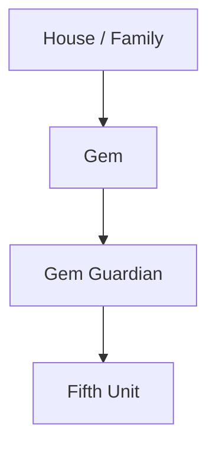
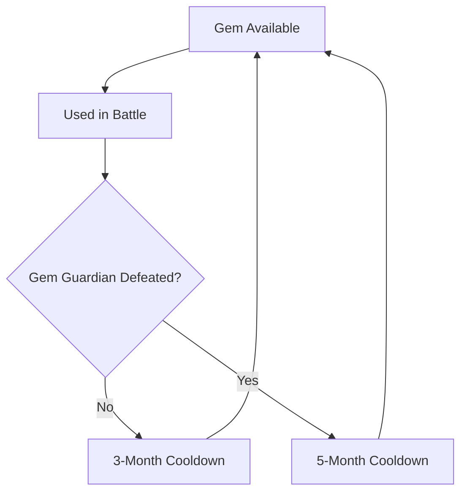
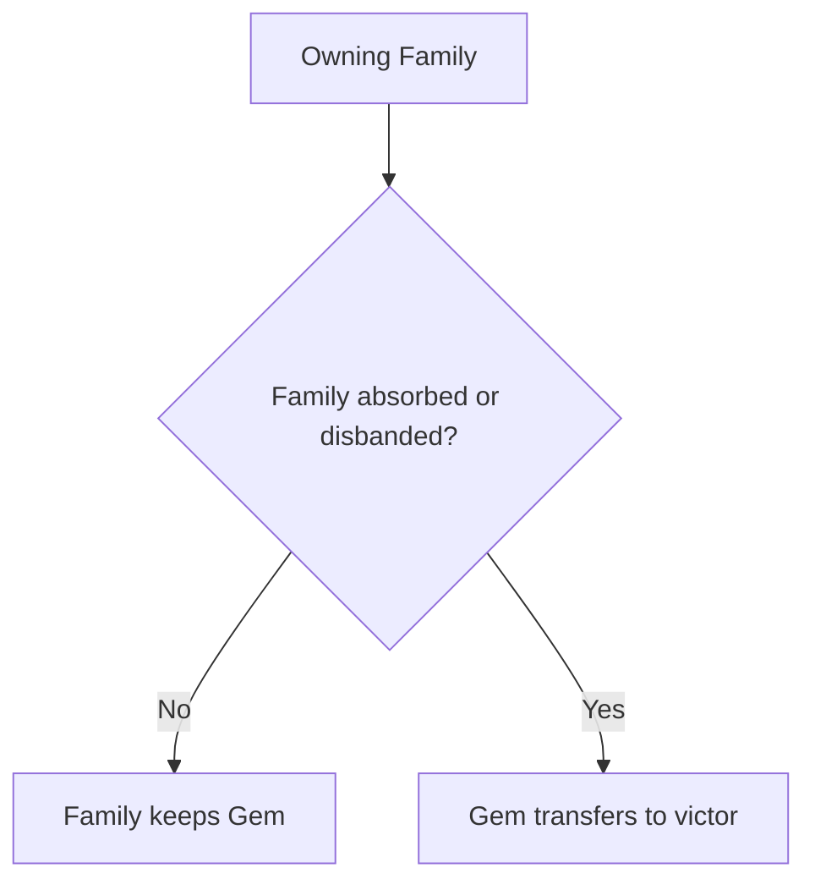
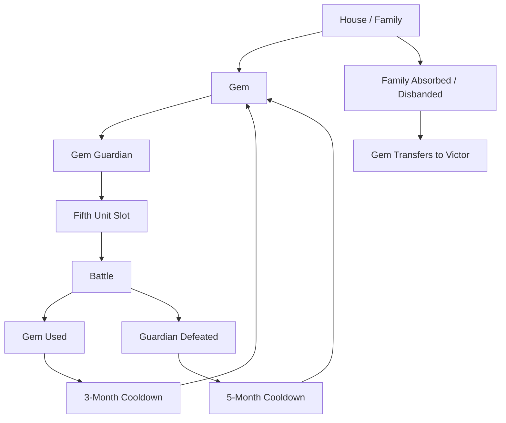

# 7. Gem System

## Purpose

This chapter describes the Gem system in Gemfire.

Gems are unique magical artifacts associated with noble houses of Ishmeria. In gameplay, they function as strategic house-level assets that allow a house to use powerful Gem Guardians as Fifth Units during tactical battles.

The Gem system connects:

- the story premise;
- noble house rivalry;
- Fifth Units;
- family absorption;
- ruler survival;
- long-term military power.

---

## 7.1 Gemfire and Gems

### Overview

Gemfire is a magical crown in which the king inlaid seven Gems:

- six wizard Gems;
- the Dragon Gem.

Only six of them are loose in Ishmeria. Princess Robyn "worked the magical gems out of the crown and hurled them into the midnight sky", and her father caught her as she struggled with "the very last stone, the red ruby of the dragon", which never left the crown (manual, The Legend of Gemfire).

The six scattered across Ishmeria and came into the possession of noble houses.

The Dragon is therefore the crown itself, still in Eselred's hands at Lankshire — not a seventh scattered stone.

---

### Narrative Role

Gems are both magical artifacts and symbols of political authority.

Control over a Gem gives a house military power through its Guardian, but it also reinforces the house’s claim to rule Ishmeria.

---

### Design Observation

Gems are one of the main ways Gemfire ties lore to mechanics.

The same object matters in three layers:

```text
Narrative authority
+
House-level political power
+
Battlefield Fifth Unit access
```

---

## 7.2 Gem Ownership

### Confirmed Facts

A Gem is not owned by an individual general.

A Gem is not owned by a province.

A Gem is a house / family-level asset.

```text
House / Family
↓
Gem
↓
Gem Guardian
```

---

### Ownership Model



---

### Design Observation

A Gem is more flexible than a hired Fifth Unit.

A hired Fifth Unit is tied to a province and must be moved through logistics. A Gem belongs to the house, so its Guardian can be selected when the Gem is available and the battle allows a Fifth Unit.

---

## 7.3 Gem Guardians

### Overview

Each Gem allows the owning house to use its associated Gem Guardian.

A Gem Guardian occupies the army’s Fifth Unit slot.

Gem Guardians use Strength instead of normal troop count.

---

### Confirmed Gem Guardians

There are seven Gem Guardians, including the royal Dragon retained by Lankshire / Eselred; their full stats (Strength, Move, Range) and owning house are canonical in Appendix C §C.3, with per-scenario ownership in Appendix B §B.3 and each guardian's gemstone and element in Appendix E §E.6.

---

### Battlefield Role

Gem Guardians are among the strongest Fifth Units in the game.

They can give a house a major battle advantage, especially against armies that rely only on standard units or weaker hired Fifth Units.

Exact Guardian statistics, movement values, and range patterns are maintained in the military data appendix.

---

## 7.4 Gem Guardians as Fifth Units

### Usage

If a house owns a Gem and the Gem is available, its Guardian may be selected as the army’s Fifth Unit.

```text
Available Gem
↓
Select Guardian as Fifth Unit
↓
Use in Battle
↓
Gem enters cooldown
```

---

### Difference from Hired Fifth Units

| Aspect          | Gem Guardian           | Hired Fifth Unit                  |
| --------------- | ---------------------- | --------------------------------- |
| Ownership       | House / Family         | Province                          |
| Cost            | No hiring cost         | Requires hiring cost              |
| Upkeep          | None                   | Requires upkeep                   |
| Death           | Cannot permanently die | Can be destroyed or desert        |
| Availability    | Controlled by cooldown | Controlled by location and upkeep |
| Strategic value | High and reusable      | Variable and local                |

---

### Design Observation

Gem Guardians are reusable elite Fifth Units.

They are powerful and reliable, but limited by cooldown and Strength attrition.

---

## 7.5 Cooldown System

### Confirmed Facts

A Gem cannot be used continuously.

After being used in battle, a Gem becomes unavailable for a period of time.

---

### Cooldown Rules

A Gem enters cooldown for 3 months after being used in battle, or 5 months after being defeated.

---

### Conceptual Flow



---

### Design Observation

Cooldown prevents Gem Guardians from dominating every battle.

The player must decide when a Gem is worth committing:

```text
Use the Gem now
or
save it for a more important battle
```

---

## 7.6 Strength and Battle Limits

### Strength

Gem Guardians use Strength instead of troop count.

Strength represents the Guardian’s combat power and durability.

---

### Strength Loss

Gem Guardians lose Strength when attacking.

A Gem Guardian loses 10% Strength per attack (this applies when it attacks), even if the target is weak.

---

### Death Immunity

A Gem Guardian cannot permanently die.

If defeated, it enters the longer cooldown instead of being destroyed.

---

### Design Observation

Gem Guardians combine high power with built-in attrition.

They are not disposable units, but they also cannot be used carelessly. A Gem Guardian can win a critical battle, but repeated attacks reduce its effective strength during that battle.

---

## 7.7 Gem Transfer

### Province Capture

Capturing a single province does not automatically transfer the enemy house’s Gem.

Gem ownership belongs to the family, not to the province.

```text
Capture province
↓
Gain territory and local resources
↓
Enemy family keeps Gem if the family still exists
```

---

### Family Absorption

A Gem transfers with the family. If a family surrenders, the victor gains its Gems. If a ruler is recruited and the family absorbed, the victor gains its Gems. If a ruler is banished with no heirs, the banisher gains its Gems. Capturing a single province does not transfer Gem ownership while the family still exists. Exact edge cases remain unresolved.

> **Note:** these rules describe the *mechanic*. Cross-scenario Gem placements
> (Appendix B.3) are authored and do not always follow the conqueror — e.g.,
> Flax defeats Coryll, yet Empyron passes to Tate, not Flax.

Per the manuals, the Search command can also look for Gems: Search reveals which families hold them but never transfers one. Acquisition is solely through family absorption above.

---

### Transfer Model



---

### Design Observation

Gem transfer reinforces the importance of rulers and family survival.

The fastest path to acquiring a Gem is not necessarily conquering every province. It may be eliminating, absorbing, or forcing the surrender of the family that owns it.

---

## 7.8 Multiple Gems

### Overview

A house can control more than one Gem.

This can happen through:

- family surrender;
- ruler recruitment;
- family collapse;
- absorption of rival houses.

---

### Strategic Effect

Multiple Gems give a house several advantages:

- access to different Guardian abilities;
- ability to rotate Gems around cooldowns;
- reduced dependence on hired Fifth Units;
- stronger offensive and defensive flexibility.

---

### Design Observation

Gem accumulation acts as a strategic snowball mechanic.

A successful house becomes more dangerous not only because it controls more provinces, but because it gains access to more magical assets.

---

## 7.9 Pastha Exception

### Overview

Pastha is a special Fifth Unit, but it is not a Gem Guardian and not a hired Fifth Unit.

Pastha is obtained through a favourable event.

---

### Key Differences

| Aspect      | Pastha                 |
| ----------- | ---------------------- |
| Source      | Good event             |
| Cost        | Free                   |
| Upkeep      | None                   |
| Reusability | One battle only        |
| Category    | Event-based Fifth Unit |

---

### Design Observation

Pastha is useful as a comparison point because it also occupies the Fifth Unit slot.

However, Pastha is not part of Gem ownership. It belongs to the event system and should not be treated as a Gem Guardian.

---

## 7.10 Strategic Role of Gems

### Military Role

Gem Guardians provide powerful Fifth Units for tactical battles.

They can help a house win battles that would be difficult with standard troops alone.

---

### Political Role

Gems are tied to family survival and absorption.

Acquiring an enemy Gem is part of consolidating power over Ishmeria.

---

### Economic Role

Gem Guardians reduce dependence on hired Fifth Units.

Because they do not require upkeep, they are more reliable than mercenary or monster units.

---

### Strategic Tradeoff

Gem Guardians are powerful but limited by:

- cooldown;
- Strength loss from attacking;
- the single Fifth Unit slot;
- risk of a longer cooldown if defeated.

The player must decide:

- when to deploy a Gem Guardian;
- when to save it;
- whether to use hired units while Gems recover;
- which Gem is most appropriate for a battle.

---

## 7.11 Gem System Summary

### Reconstructed Gem System



---

## Open Questions

The following Gem-system details remain unresolved:

1. (Resolved) Range tile diagrams are in Appendix C §C.6.
2. Exact edge cases for Gem transfer when a family dissolves without a clear banisher.
3. Whether any ruler stat, Fame value, or hidden condition affects Gem acquisition or retention.
4. Version differences in Gem names, Guardian stats, and range labels.
5. Exact handling of Gem availability in rare post-battle edge cases.

---

## Summary

The Gem system is one of Gemfire’s central systems.

Gems are house-level magical assets that allow a house to use powerful Gem Guardians as Fifth Units.

Unlike hired Fifth Units, Gems:

- belong to a family rather than a province;
- require no upkeep;
- cannot permanently die;
- are limited by cooldown;
- transfer through family absorption rather than ordinary province capture.

The Gem system connects battlefield power, political consolidation, family survival, and the game’s core story premise.
