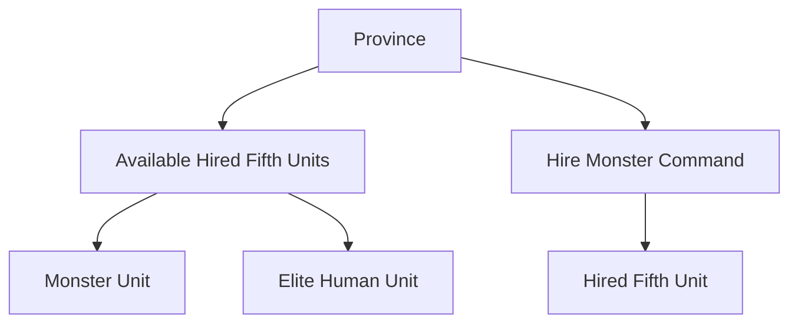
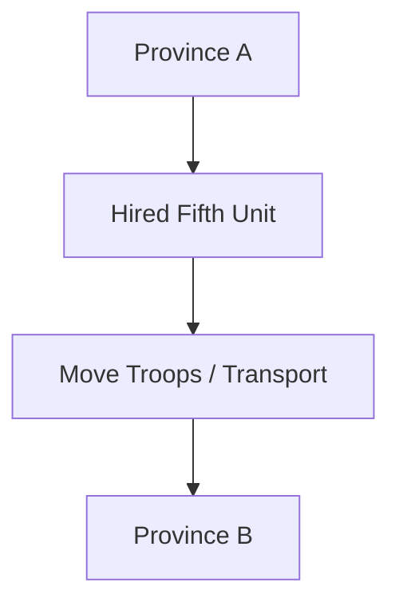
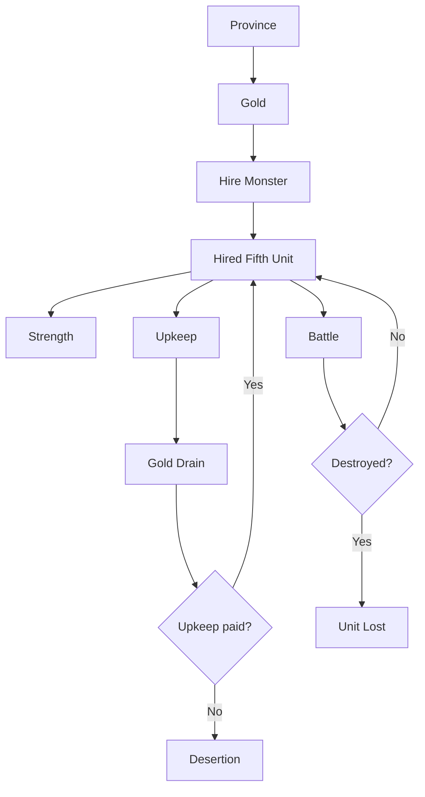

# 8. Monsters and Hired Fifth Units

## Purpose

This chapter describes Hired Fifth Units in Gemfire.

The in-game command is called **Hire Monster**, but the system is not limited to monsters. It gives access to special Fifth Units, including:

- monsters;
- mercenaries;
- elite human units.

Hired Fifth Units are local province-based military assets. They serve as paid, risky alternatives to Gem Guardians.

---

## 8.1 System Overview

### Definition

A Hired Fifth Unit is a special battlefield unit that occupies the fifth slot in an army.

```text
Army
├── Horsemen
├── Knights
├── Knights
├── Archers
└── Fifth Unit
```

A Fifth Unit can be:

- Gem Guardian;
- Hired Fifth Unit;
- Pastha.

This chapter describes Hired Fifth Units only.

---

### Core Difference from Gem Guardians

| Aspect       | Hired Fifth Unit  | Gem Guardian                     |
| ------------ | ----------------- | -------------------------------- |
| Ownership    | Province          | House / Family                   |
| Hiring cost  | Yes               | No                               |
| Upkeep       | Yes               | No                               |
| Availability | Local             | House-level, limited by cooldown |
| Death        | Can be destroyed  | Cannot permanently die           |
| Desertion    | Possible          | No                               |
| Cooldown     | No                | Yes                              |
| Movement     | Moved with troops | Not province-bound               |

---

### Design Observation

Hired Fifth Units are local, paid, and risky alternatives to Gem Guardians.

They allow a house without an available Gem Guardian to field a powerful special unit, but they require Gold, upkeep, and positioning.

---

## 8.2 Categories

### Monster Units

Monster units are non-human Hired Fifth Units.

Confirmed monster units include:

- Bugbear;
- Fachan;
- Gargoyles;
- Lizards;
- Ogre;
- Olog-Hai;
- Orks;
- Skeletons;
- Wyverns.

---

### Elite Human Units

Some Hired Fifth Units are not monsters.

They are elite human or mercenary formations.

Confirmed elite human units include:

- Gunners;
- Lancers;
- Pikemen;
- Shooters;
- Spearmen;
- Warriors.

---

### Design Observation

The command name **Hire Monster** is misleading.

Mechanically, the system is closer to:

```text
Hire Fifth Unit
```

because it includes both monsters and elite human forces.

---

## 8.3 Province-Based Availability

### Confirmed Facts

Hired Fifth Units are tied to provinces.

Each province has its own available hire pool.

Starting availability appears to be predefined by scenario and province data.

---

### Availability Model



---

### Dynamic Availability

There is evidence that Hired Fifth Units may appear, disappear, or change availability over time.

The exact rules are not fully confirmed.

---

### Design Observation

Hired Fifth Units are part of the strategic geography of the map.

Some provinces are more valuable because they provide access to stronger or rarer special units.

---

## 8.4 Hiring

### Hire Monster Command

The player hires Hired Fifth Units through the **Hire Monster** command.

When hiring, the player can inspect available units and their properties.

Known displayed information includes:

- unit name;
- Strength / size;
- cost;
- attack range.

---

### Hiring Cost

Each Hired Fifth Unit has an initial Gold cost.

This cost is paid by the province performing the hire.

---

### Example

For instance, a Bugbear has Strength 100 and costs 30 Gold to hire; full per-unit Strength and cost values are canonical in Appendix C §C.4.

---

### Design Observation

Hiring converts local Gold into immediate tactical power.


---

## 8.5 Upkeep

### Confirmed Facts

Hired Fifth Units require recurring upkeep.

Upkeep is paid every three months.

The upkeep amount matches the unit’s hiring cost.

---

### Upkeep Model

A Hired Fifth Unit's quarterly upkeep cost equals its hiring cost, paid every three months. If upkeep is not paid, the unit deserts. For example, a Bugbear costs 30 Gold to hire and 30 Gold per quarter to maintain.

---

### Failure to Pay

If upkeep is not paid, the Hired Fifth Unit deserts.

---

### Design Observation

Hired Fifth Units are not permanent upgrades.

They create a continuing economic burden. The player must decide whether a powerful Fifth Unit is worth maintaining over time.

---

## 8.6 Movement

### Confirmed Facts

Hired Fifth Units are attached to provinces, but can be moved.

They are moved through **Move Troops / Transport**.

---

### Movement Model



---

### Strategic Implication

Because Hired Fifth Units are local, they must be positioned before a campaign.

A powerful unit in the wrong province may be strategically useless until moved to the front.

---

## 8.7 Strength

### Overview

Hired Fifth Units use **Strength** instead of troop count.

Strength represents the unit’s effective size, combat power, and durability.

---

### Effects

Higher Strength generally means:

- stronger attacks;
- higher durability;
- greater battlefield impact.

---

### Loss of Strength

Hired Fifth Units can lose Strength during battle.

If sufficiently damaged, they can be destroyed.

The exact destruction threshold is not confirmed.

---

### Design Observation

Strength makes Hired Fifth Units different from regular troops.

They are not armies of soldiers split into formations. They are single special battlefield assets.

---

## 8.8 Combat Role

### Fifth Unit Slot

A Hired Fifth Unit occupies the same battlefield slot that could otherwise be used by:

- Gem Guardian;
- Pastha.

Only one Fifth Unit can participate in an army.

---

### Combat Properties

Hired Fifth Units have individual combat properties:

- Strength;
- movement;
- attack range;
- special movement traits.

---

### Range Types

Known attack range categories include:

- Short / Close;
- Long;
- Circular;
- Largest.

The exact range patterns and tile diagrams are canonical in Appendix C §C.6.

---

### Flying Units

Some Hired Fifth Units can fly.

Confirmed flying examples include Gargoyles and Wyverns, which can pass over fences, trees, and rivers; the movement traits, flying units, and fence rules are canonical in Appendix C §C.7.

---

## 8.9 Known Hired Fifth Units

### Unit Table

The full per-unit table — Strength, Cost/Upkeep, Move, and Range for every Hired Fifth Unit (Bugbear, Orks, Lancers, Wyverns, and the rest) — is canonical in Appendix C §C.4, with movement traits and flying movement detailed in Appendix C §C.7.

---

### Design Observation

The strongest Hired Fifth Units are not necessarily monsters.

Elite human units such as Lancers and Warriors can be among the most powerful special units in the game.

---

## 8.10 Desertion, Destruction, and Rampage

### Desertion

If upkeep is not paid, Hired Fifth Units desert.

---

### Destruction in Battle

Hired Fifth Units can be destroyed in battle.

Unlike Gem Guardians, they do not return after a cooldown.

---

### Rampage / Loss of Faith

Beyond unpaid upkeep, the two categories fail in different ways: mercenaries lose faith and desert, monsters stay but rampage.

Loss of faith is gated on the hiring family's Fame.

The player guide is explicit that a low-Fame family cannot hold mercenaries at all: Lancers "early in the game when your ruler's fame is low they will probably desert you immediately after you hire them"; Pikemen "will desert you just as easily as any other mercenary group … until late in the game when your family has more fame"; Warriors are "costly and eager to desert you", qualified by "if you have high fame"; Spearmen are recommended "if you have the fame to keep them".

Player testing puts the threshold at roughly 20 Fame for the Strength-150 mercenaries (Spearmen, Pikemen) and roughly 50 Fame for the Strength-180 mercenaries (Lancers, Warriors), with the two ranged Strength-150 units (Gunners, Shooters) untested.

These numbers are observed, not verified against the ROM; the correlation with Strength rather than cost is the most defensible reading of the tested points.

Monsters have no Fame requirement but can turn on their owner: Orks are "most likely to go on a rampage (damaging your state)" and Olog-Hai are "quite likely to terrorize your state by rampaging".

Rampage surfaces as a bad event — "X went on a rampage, ravaging the land" — that lowers all developmental values of the province, and the guide describes such events as random rather than triggered.

The Fame-gated desertion is modelled; the per-monster rampage chance is not, since no observed rate exists for it.

---

### Design Observation

Hired Fifth Units are powerful but unreliable.

Their risks distinguish them from Gem Guardians:

```text
Gem Guardian = reliable but cooldown-limited
Hired Fifth Unit = flexible but expensive and risky
```

---

## 8.11 Dismiss

### Overview

The player can dismiss a currently hired Fifth Unit.

Dismiss removes the unit from the province.

---

### Refund

No confirmed evidence has been found that Dismiss refunds any part of the hiring cost.

---

### Design Use

Dismiss may be useful when:

- the unit is no longer worth its upkeep;
- the player wants to replace it;
- the province no longer needs a Fifth Unit;
- the player wants to avoid future maintenance costs.

---

## 8.12 Strategic Role

### Backup for Gem Cooldown

Hired Fifth Units are especially valuable when Gem Guardians are unavailable due to cooldown.

---

### Local Power Projection

Because they are province-based, Hired Fifth Units increase the military value of specific territories.

---

### Alternative to Gems

A house without an available Gem Guardian can still compete militarily by hiring powerful special units.

---

### Economic Pressure

Because Hired Fifth Units require upkeep, they create an ongoing Gold drain.

This connects the Hired Fifth Unit system directly to the province economy.

---

## 8.13 System Summary

### Reconstructed Hired Fifth Unit System



---

## Open Questions

The following Hired Fifth Unit details remain unresolved:

1. Exact logic for changes in province-level Hired Fifth Unit availability.
2. Exact Fame thresholds per mercenary, and whether the check is a hard cutoff or a probability that softens as Fame rises.
3. Exact Strength threshold at which a Hired Fifth Unit is destroyed.
4. Per-monster rampage chance, and whether Fame or length of possession feeds into it.
5. Whether Dismiss refunds any resources in any version.
6. Version differences in Hired Fifth Unit names, stats, and availability.

---

## Summary

Hired Fifth Units are local special military assets.

They occupy the Fifth Unit slot like Gem Guardians, but differ from them economically and strategically:

- they are hired with Gold;
- they belong to provinces;
- they require upkeep;
- they can desert;
- they can be destroyed in battle;
- they can be moved between provinces.

This system makes military power depend not only on generals and Gems, but also on local access to special creatures and elite mercenaries.
