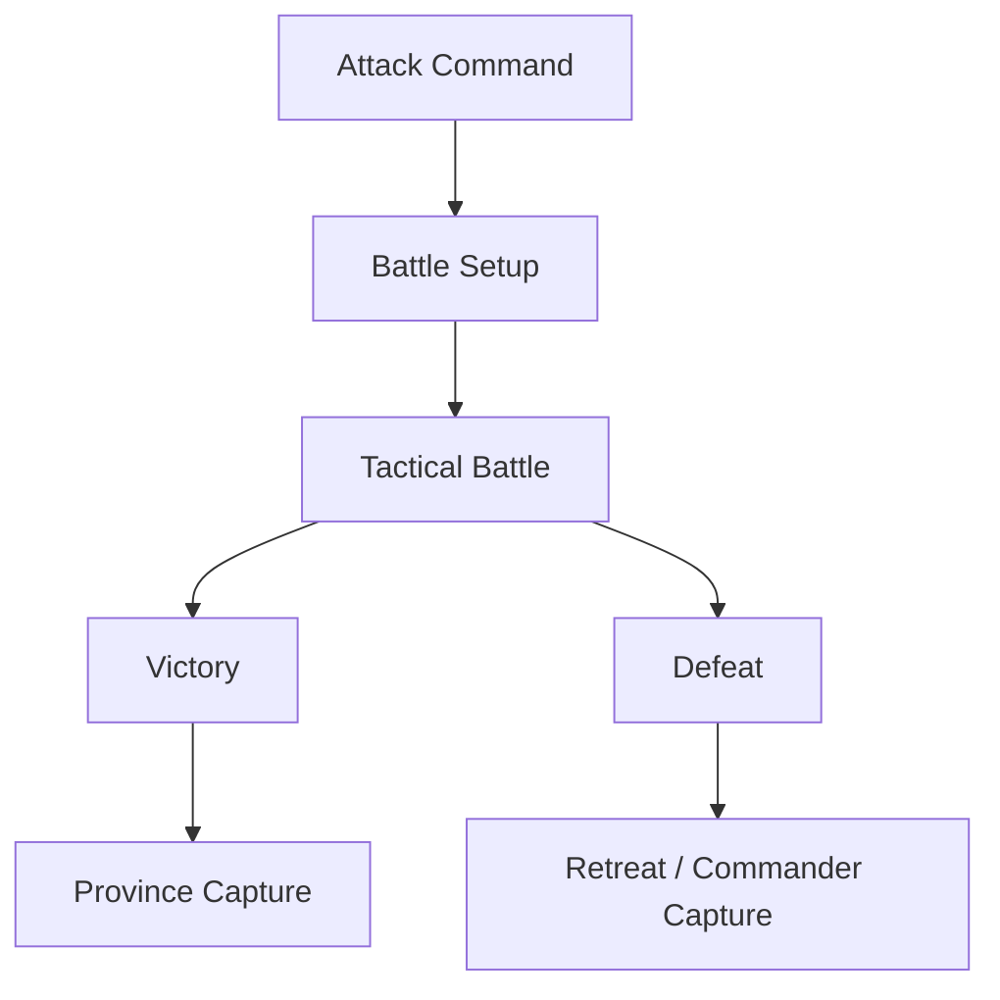
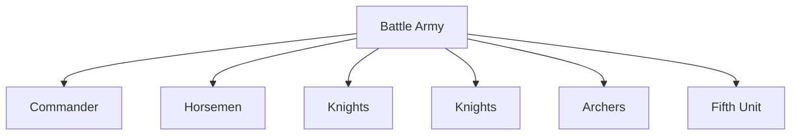
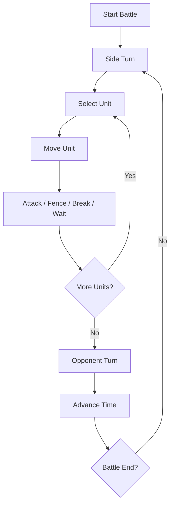
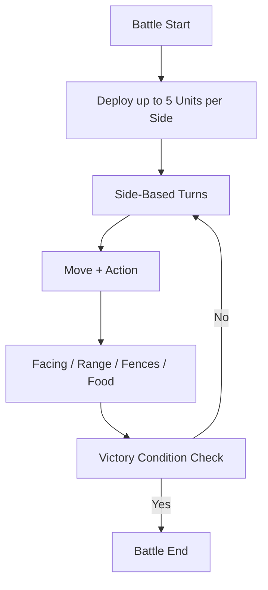

# 9. Tactical Battle System

## Purpose

This chapter describes Gemfire’s tactical battle system.

Tactical battle is a separate turn-based phase that starts when one province invades another.

The tactical system resolves conflict between two armies through:

- unit positioning;
- flag capture;
- unit destruction;
- food supply;
- Fifth Units;
- movement;
- fences;
- flanking and rear attacks.

---

# 9.1 Battle Overview

## Confirmed Facts

Tactical battle takes place on a separate grid-based battlefield.

Each side fields up to five battlefield units:

```text
Horsemen
Knights
Knights
Archers
Fifth Unit
```

The commander does not occupy a battlefield cell and is not a separate unit.

The commander influences army effectiveness through character stats.

---

## Battle Model



---

## Design Observation

Gemfire’s battles are compact tactical encounters, not large-scale wargame simulations.

The system creates tactical depth through a small number of strong rules:

- flags;
- food supply;
- facing;
- fences;
- Fifth Units;
- range patterns;
- commander influence.

---

# 9.2 Battlefield Layout

## Grid

The battlefield uses a fixed-size grid:

```text
10 × 8 cells
```

---

## Deployment

Known starting layout:

| Side     | Starting Area                 |
| -------- | ----------------------------- |
| Attacker | Left side of the battlefield  |
| Defender | Right side of the battlefield |

---

## Flags

Each side has its own flag.

The enemy flag is a primary tactical objective.

Capturing the enemy flag is one way to win the battle immediately.

---

## Province-Specific Battlefields

Battlefield layout depends on the province, and all thirty layouts are known: each is
eighty tiles, ten columns by eight rows, canonical in `data/battlefields.json`.

The tile kinds are the manual's own two lists — Plains, Woods, River, Boulder as terrain,
and Fence, Bridge, Castle Wall as the features that obstruct and protect — plus one flag
tile per side. Fences appear pre-placed on the field as well as being buildable in battle
(§9.13), and the castle wall encloses the defending flag on three sides, leaving one
approach. The attacker's flag stands in column 0 on every board; the defender's in
columns 6 to 9.

Layouts follow the regional character §11 uses for seasonal disasters: the woodland
region's fields average 12.2 woods cells and no water or stone, the wetland region's
10.4 river cells, the volcanic region's 12.5 boulders, and the northern region's are open
plains — against whole-map averages of 5.6 woods, 2.8 river and 1.7 boulder.

---

## Design Observation

The tactical map acts like a compact capture-the-flag arena.

The player can win not only by destroying the enemy, but also by manoeuvring toward the flag.

---

# 9.3 Battle Participants

## Standard Units

Before battle, strategic Troops are automatically converted into four standard units:

```text
Horsemen
Knights
Knights
Archers
```

If Troops do not divide evenly, the remainder is assigned to Horsemen.

---

## Fifth Unit

The fifth slot is occupied by one special unit:

- Gem Guardian;
- Hired Fifth Unit;
- Pastha.

An army can have only one Fifth Unit.

---

## Commander

The commander:

- does not occupy a cell;
- is not one of the five units;
- influences army effectiveness;
- may be captured after defeat.

---

## Battle Composition



---

# 9.4 Battle Setup

## Inputs

Before battle, the system uses:

- attacking province;
- defending province;
- commander;
- number of Troops;
- allocated Food;
- selected Fifth Unit;
- Gem availability;
- hired Fifth Unit availability;
- deployment cost.

---

## Deployment Cost

An attack requires Gold to deploy; the deployment cost is set on the strategic side (military chapter §6).

---

## Food Requirement

Food determines how many days the army can remain in battle; the daily consumption rate is set on the strategic side (military chapter §6), and Gem Guardians do not count toward it.

---

## Design Observation

Supply is part of the tactical battle system, not only strategic logistics.

The player must plan both army strength and battle duration.

---

# 9.5 Battle Time and Food

## Days

Battle is measured in days. One battle day is 4 turns per side.

---

## Time of Day

Battle phases visually correspond to time of day. The day cycles sunrise → noon → sunset → night.

---

## Food Timer

During battle, the interface tracks:

- remaining Food;
- number of supply days.

If an army runs out of Food, it can lose the battle.

---

## Design Observation

Food works as a pressure timer.

The attacker cannot fight indefinitely and must achieve victory before supply runs out.

---

# 9.6 Turn Structure

## Side-Based Turns

Tactical battle uses side-based turns.

On its turn, a side activates its units.

---

## Unit Activation

A typical unit activation follows this pattern:

```text
Select Unit
↓
Move
↓
Action
```

After acting, the unit ends its activation for the current turn.

---

## Battle Turn Flow



---

# 9.7 Battle Commands

## Unit Commands

| Command | Availability                       | Effect                      |
| ------- | ---------------------------------- | --------------------------- |
| Move    | All units                          | Move across the grid.       |
| Attack  | Units with a valid target in range | Attack an enemy unit.       |
| Fence   | Knights only                       | Build a fence obstacle.     |
| Break   | All units                          | Attempt to destroy a fence. |
| Wait    | All units                          | End the unit’s action.      |

---

## Army-Level Commands

| Command | Effect                              |
| ------- | ----------------------------------- |
| Retreat | Attempt to withdraw from battle.    |
| Auto    | Let AI control the tactical battle. |

---

## Non-Mechanical Options

Battle may include interface options, such as animation settings.

These options do not change battle mechanics.

---

# 9.8 Standard Unit Rules

## Horsemen

### Role

Fast melee unit.

### Properties

Movement 3, Short/Close range; canonical stats in Appendix C §C.1.

### Design Role

Horsemen are useful for:

- rapid advance;
- flanking;
- rear attacks;
- flag pressure;
- exploiting openings.

---

## Knights

### Role

Frontline melee unit.

### Properties

Movement 2, Short/Close range; canonical stats in Appendix C §C.1.

### Special Ability

Knights can build fences.

---

## Knights 2

The second Knights unit appears to be mechanically identical to the first.

### Design Role

Having two Knights units creates a stable frontline and gives the player more control over space.

---

## Archers

### Role

Ranged support unit.

### Properties

Movement 2, Long range; canonical stats in Appendix C §C.1.

### Restrictions

Archers:

- cannot attack adjacent cells;
- cannot attack diagonally.

### Advantages

Archers:

- attack at range;
- can shoot over units and obstacles;
- do not suffer backlash / counter-damage when attacking.

---

# 9.9 Fifth Unit Rules

## Overview

A Fifth Unit is a special battlefield unit.

It may have unique values for:

- Strength;
- movement;
- attack range;
- special movement traits;
- special attack pattern.

---

## Categories

A Fifth Unit can be:

- Gem Guardian;
- Hired Fifth Unit;
- Pastha.

---

## Strength

Fifth Units use Strength instead of ordinary troop count.

Strength represents combat effectiveness and durability.

---

## Range Patterns

The four range categories (Short/Close, Long, Circular, Largest) and their tile diagrams are canonical in Appendix C §C.6. "Outer" is not a distinct range — Skulryk's range is Circular.

---

# 9.10 Movement Rules

## Movement Points

Each unit has a movement value.

Movement determines how many cells a unit can move during activation.

---

## Obstacles

Movement may be blocked by:

- fences;
- trees;
- rivers;
- other battlefield obstacles.

---

## Flying Units

Some Fifth Units can fly.

Confirmed flying units:

- Gargoyles;
- Wyverns.

Flying units can pass over:

- fences;
- trees;
- rivers.

---

## Design Observation

Movement rules make Fifth Units tactically distinct.

Even with similar Strength, a flying unit can be more valuable because it ignores key obstacles.

---

# 9.11 Attack Resolution

## Attack Types

Attacks differ by range pattern (Short/Close melee, Long ranged, Circular and Largest area attacks); the canonical patterns are in Appendix C §C.6.

---

## Backlash / Counter-Damage

Melee attacks may cause backlash / counter-damage to the attacker.

Long-range attacks do not cause backlash.

---

## Commander Influence

The commander’s WAR / Military rating affects combat results.

High WAR improves the effectiveness of subordinate troops.

Exact damage formulas remain unresolved.

---

## Design Observation

Even on a small grid, the battle system creates meaningful tactical choices:

```text
Safe ranged attack
vs
risky melee attack with stronger positional potential
```

---

# 9.12 Facing System

## Attack Direction

Attack effectiveness depends on direction: front is the worst attack direction, flank is better, and rear is best. Exact numeric modifiers are unknown.

---

## Rear Attack

Rear attacks produce the strongest results and reduce retaliation risk.

Exact numeric modifiers remain unresolved.

---

## Design Observation

Facing is one of the main sources of positional depth.

A well-executed manoeuvre can decide the battle even when unit strength is similar.

---

# 9.13 Fences

## Overview

Fences are temporary battlefield obstacles.

They are used to:

- protect the flag;
- delay enemies;
- block paths;
- create temporary defensive lines.

---

## Building Fences

Only Knights can build fences.

Command:

```text
Fence
```

---

## Breaking Fences

Any unit can attempt to destroy a fence.

Command:

```text
Break
```

---

## Failure Chance

Fence construction and destruction can fail.

Success probably depends on the unit’s strength or troop count.

The exact formula is not confirmed.

---

## Flying Units

Flying units can ignore fences.

---

## Design Observation

Fences turn battle into a space-control problem.

They are especially important for defenders because they help protect access to the flag.

---

# 9.14 Victory Conditions

## Confirmed Victory Conditions

A side wins by:

1. capturing the enemy flag;
2. destroying all enemy units;
3. the enemy running out of Food;
4. the enemy retreating;
5. the defender holding the flag for 5 days.

---

## Flag Capture

Capturing the enemy flag is an immediate victory condition.

There is no confirmed requirement to hold the flag for multiple turns.

---

## Defender Endurance

The defender can win by preventing flag capture for long enough — holding the flag for 5 days.

---

## Starvation

If an army runs out of Food, it can lose regardless of remaining units.

---

## Design Observation

The victory system creates several valid battle plans:

| Strategy  | Goal                        |
| --------- | --------------------------- |
| Assault   | Destroy enemy units.        |
| Raid      | Reach and capture the flag. |
| Defense   | Hold the flag for 5 days.   |
| Attrition | Exhaust enemy Food.         |
| Pressure  | Force retreat.              |

---

# 9.15 Retreat

## Overview

An army can attempt to retreat from battle.

---

## Effects

Retreat ends the battle and preserves part of the army.

---

## Commander Risk

The commander may still be captured after retreat.

Exact risk is unresolved.

---

## Restrictions

Retreat may be unavailable if there is no suitable neighbouring territory to retreat into.

Exact retreat availability rules require further verification.

---

# 9.16 Tactical AI

## Observed Behaviour

Battle AI appears to consider relative strength and supply.

Observed patterns include:

- if the player has a strong advantage, AI often defends the flag;
- if AI has parity or advantage, it may attack;
- if AI can outlast the player’s Food supply, it may defend;
- AI may retreat when threatened with destruction;
- AI is less likely to retreat when its flag is under immediate threat.

Exact AI rules remain unresolved.

---

# 9.17 Tactical Battle Summary

## Reconstructed Battle System



---

# Open Questions

The following tactical battle details remain unresolved:

1. Exact damage formulas.
2. (Resolved) Tile patterns for all four ranges are in Appendix C §C.6.
3. Exact terrain modifiers, if any.
4. Exact retreat availability rules.
5. Exact build / break fence formula.
6. Exact rounding for deployment cost and Food per day.
7. Exact influence of commander WAR on damage and casualties.
8. (Resolved) All thirty battlefield layouts are in `data/battlefields.json`; see §9.2.
9. Exact tactical AI decision rules.

---

# Summary

Gemfire’s tactical battle is a compact turn-based system on a 10×8 grid.

Despite the small number of units, battle has meaningful depth through:

- fixed army composition;
- Fifth Units;
- flags;
- supply;
- time pressure;
- facing;
- fences;
- limited movement;
- different range patterns.

Battle is not only a contest of army strength. It is also a positional problem: the player can win through destruction, manoeuvre, defense, attrition, or forced retreat.
