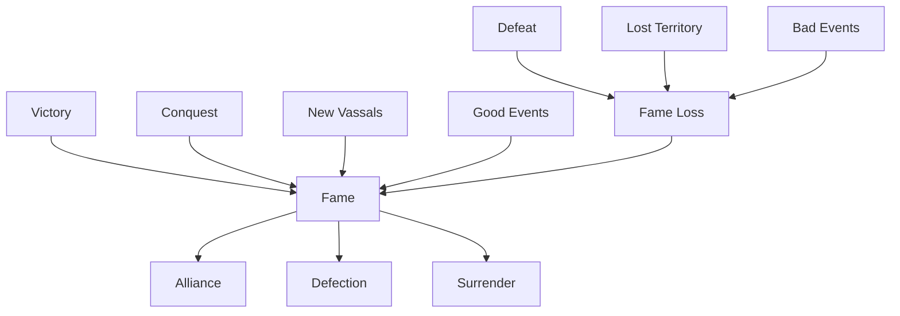
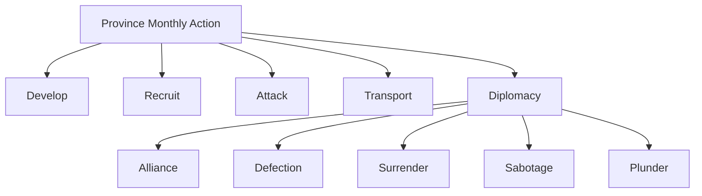
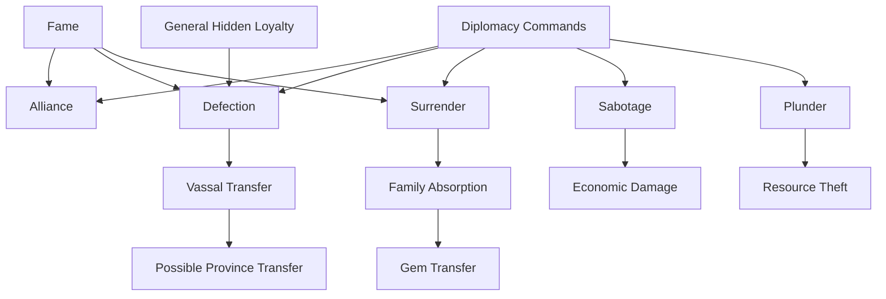

# 10. Diplomacy

## Purpose

This chapter describes Gemfire’s diplomacy system.

Diplomacy in Gemfire is not a passive relationship screen between houses. It is a set of active province commands that compete with other monthly actions:

- development;
- recruitment;
- attack;
- transport;
- search;
- administration.

Diplomatic commands allow the player to create alliances, recruit enemy vassals, force rival houses to surrender, weaken enemy provinces, and steal resources.

---

## 10.1 System Overview

### Diplomacy as Province Action

Diplomatic actions are performed through provinces.

Most diplomatic commands consume the province’s monthly action.

This gives diplomacy a direct opportunity cost:

```text
Use Diplomacy
or
Develop Province
or
Recruit Troops
or
Attack
or
Transport Resources
```

---

### Diplomatic Commands

Core diplomatic commands:

| Command   | Purpose                                             |
| --------- | --------------------------------------------------- |
| Ally      | Create or break an alliance.                        |
| Defection | Recruit an enemy vassal.                            |
| Surrender | Force an enemy house to surrender.                  |
| Sabotage  | Damage an enemy province or reputation.             |
| Plunder   | Steal resources from a neighbouring enemy province. |

---

### Design Observation

Diplomacy in Gemfire is an active tool of political conflict.

It can directly:

- transfer characters;
- transfer provinces;
- transfer Gems;
- weaken enemy economies;
- change the balance of power.

---

## 10.2 Alliance

### Overview

Alliance is a peace agreement between two houses.

Functionally, it is closer to a non-aggression pact than to a full military alliance.

---

### Confirmed Rules

A house may have at most one ally at a time. The Ally command is available only from the home province. An alliance is a mutual non-aggression agreement and can be broken. An alliance with Lankshire is not allowed.

---

### No Confirmed Military Assistance

There is no confirmed evidence that allies:

- help in wars;
- send reinforcements;
- join attacks;
- pay tribute;
- coordinate strategy.

Alliance should therefore be treated as a non-aggression agreement.

---

### Break Alliance

An alliance can be broken through the same command.

After the alliance is broken, both sides return to normal relations and can attack each other again.

No confirmed direct Fame or reputation penalty for breaking an alliance has been found.

---

### Design Observation

Alliance temporarily stabilizes one front.

Because a house can have only one ally, diplomacy cannot make the player fully safe.

---

## 10.3 Defection

### Overview

Defection is an attempt to recruit an enemy vassal.

It is one of the strongest political mechanics in Gemfire because a successful Defection can transfer not only the character, but also the province they govern.

---

### Target

Defection targets an enemy vassal, not a province directly.

Possible targets include:

- a vassal governing a province;
- a vassal without their own province.

---

### Effects

If the target is the lord / governor of an enemy province, successful Defection can transfer:

- the vassal;
- the province;
- province resources;
- province troops.

---

### Map Range

Defection does not require province adjacency.

A successful Defection can transfer a province in any part of the map.

```text
Target enemy vassal
↓
Defection succeeds
↓
Vassal joins player
↓
If vassal governs a province, that province transfers too
```

---

### Influencing Factors

Known or likely success factors:

| Factor                       | Role                              |
| ---------------------------- | --------------------------------- |
| Ruler Fame                   | Increases diplomatic pressure.    |
| Target General Loyalty       | Resists recruitment.              |
| CHA / Charm                  | Possibly affects persuasion.      |
| Relative political situation | May affect willingness to defect. |

Exact formula remains unresolved.

---

### Design Observation

Defection is not a replacement for war. It converts political pressure into map control.

The player can gain territory without direct invasion, but the system still depends on characters, Fame, hidden loyalty, and the broader political situation.

---

## 10.4 Surrender

### Overview

Surrender is an attempt to make an entire enemy house submit.

It is the diplomatic equivalent of absorbing a rival political entity.

---

### Effects

Successful Surrender can transfer:

- provinces;
- Gems;
- possibly vassals and military assets.

---

### Requirements

Surrender has a low chance of success and is usually viable only against a significantly weakened family.

Known or likely success factors:

| Factor                  | Role                                         |
| ----------------------- | -------------------------------------------- |
| Relative house strength | Target must usually be much weaker.          |
| Ruler Fame              | Increases pressure to submit.                |
| Target ruler identity   | Some rulers may resist more strongly.        |
| Scenario context        | Some scenario-specific conditions may apply. |

Exact formula remains unresolved.

---

### Ruler Resistance

Some rulers may be highly resistant to Surrender.

In some cases, a house may become more willing to surrender only after its ruler changes or is removed.

Exact ruler-specific rules remain unresolved.

---

### Strategic Effect

Surrender can create a result comparable to several military conquests:

```text
Successful Surrender
↓
Absorb house
↓
Gain provinces
↓
Gain Gems
```

---

### Design Observation

Surrender converts accumulated military, economic, and reputational pressure into political absorption.

The mechanic reinforces the importance of Fame and the weakening of rival houses.

---

## 10.5 Sabotage

### Overview

Sabotage is a hostile operation against an enemy province.

Its purpose is to weaken enemy territory before war or reduce the enemy’s economic effectiveness.

---

### Effects

Sabotage destroys about one fifth (1/5) of one of the target's Troops, Loyalty, or Protection, and is resisted by the target lord's Domestic / INT.

(Some sources instead say Sabotage damages fields and weakens the ruler; the
exact effect is not fully settled.)

---

### Target

Sabotage targets an enemy province.

Exact range restrictions require further verification.

---

### Defense

Exact defense rules against Sabotage are unresolved.

Possible defensive factors include:

- province Protection;
- governor INT / Domestic;
- ruler Fame;
- hidden checks.

---

### Design Observation

Sabotage attacks enemy economic strength without direct invasion.

It is especially useful against strong provinces that are difficult to conquer immediately.

---

## 10.6 Plunder

### Overview

Plunder is a raid or hostile operation against a neighbouring enemy province.

Its purpose is to steal resources and weaken the enemy economy.

---

### Target

Plunder targets a neighbouring enemy province.

Unlike Defection, Plunder is local and depends on geography.

---

### Effects

Plunder targets a neighbouring enemy province and steals about one fifth (1/5) of its Gold and one fifth (1/5) of its Food. It is resisted by the target lord's Domestic / INT and can damage the enemy ruler's reputation / Fame.

---

### Strategic Use

Plunder can be used to:

- prepare an invasion;
- reduce enemy supply;
- weaken a frontier province;
- gain resources without open conquest.

---

### Defense

Exact defense rules against Plunder are unresolved.

Possible defensive factors include:

- Protection;
- governor INT / Domestic;
- troop strength;
- hidden checks.

---

### Design Observation

Plunder connects diplomacy, economy, and military geography.

It is a form of economic warfare between neighbouring provinces.

---

## 10.7 Fame and Diplomatic Power

### Overview

Fame is associated with the ruler of a house.

It represents political prestige and affects diplomatic effectiveness.

---

### Sources of Fame

Fame can increase through:

- victories;
- conquests;
- gaining new vassals;
- territorial expansion;
- positive events.

Fame can decrease through:

- defeats;
- lost territories;
- negative events;
- political failures.

Exact Fame gain and loss formulas remain unresolved.

---

### Effects

Fame is a ruler stat (detailed in the characters chapter §5) that strongly affects Ally, Defection, and Surrender.

---

### Fame Model



---

### Design Observation

Fame turns success into political leverage.

A successful ruler becomes more persuasive, which can lead to more vassals, more provinces, and stronger diplomatic pressure.

This creates a snowball effect:

```text
Win battles
↓
Gain Fame
↓
Improve diplomacy
↓
Gain vassals / provinces
↓
Become stronger
```

---

## 10.8 Diplomacy and Characters

### Defection and Generals

Defection is directly tied to the character system.

The target is not an abstract province, but a specific vassal.

If that vassal governs a province, the province may transfer with them.

---

### Hidden Loyalty

Hidden General Loyalty affects resistance to Defection.

More loyal vassals are harder to convert.

Exact loyalty scale and formula remain unresolved.

---

### CHA / Charm

CHA may affect Defection or other diplomatic checks.

The exact formula is unknown.

The confirmed CHA formula is for Give Food, not Defection.

---

### Design Observation

Gemfire diplomacy works through people.

The political map changes not only because armies move, but because specific characters change allegiance.

---

## 10.9 Diplomacy and Gems

### Surrender and Gems

When Surrender succeeds, the victor can gain the surrendering house’s Gems.

This makes Surrender one of the fastest ways to increase magical power.

---

### Family Absorption

Surrender and ruler recruitment overlap with the family absorption system.

Both can lead to:

- province transfer;
- vassal transfer;
- Gem transfer.

---

### Design Observation

Diplomacy can be one of the fastest ways to gain a Gem, but only after the political conditions make the target vulnerable.

The player does not gain a Gem simply by taking one province. Gem transfer is tied to the fate of the owning house.

---

## 10.10 Strategic Role of Diplomacy

### Diplomatic Paths to Power

Diplomacy converts pressure into strategic gains.

| Diplomatic Path | Result                                  |
| --------------- | --------------------------------------- |
| Alliance        | Stabilizes one front.                   |
| Defection       | Gains a vassal and possibly a province. |
| Surrender       | Absorbs a weakened house.               |
| Sabotage        | Weakens an enemy province.              |
| Plunder         | Steals resources from a neighbour.      |

---

### Opportunity Cost

Because diplomacy consumes a province’s monthly action, each diplomatic move competes with development and war.



---

### Design Observation

Diplomacy in Gemfire has high cost and high potential.

One successful Defection or Surrender can change the map more than a normal attack, but these outcomes require the right political conditions and are not a guaranteed substitute for warfare.

---

## 10.11 Diplomacy System Summary

### Reconstructed Diplomacy System



---

## Open Questions

The following diplomacy details remain unresolved:

1. Exact Defection success formula.
2. Exact Surrender success formula.
3. Exact Alliance success formula.
4. Whether Protection defends against Sabotage and Plunder.
5. Whether governor INT / Domestic defends against Sabotage and Plunder.
6. Whether breaking an alliance has a hidden penalty.
7. Full targeting rules for Sabotage.
8. Exact Fame gain and loss from diplomatic actions.
9. Version differences in diplomacy command effects.

---

## Summary

Diplomacy in Gemfire is a set of active political commands, not a passive relationship system.

It allows the player to:

- stabilize one front through Alliance;
- recruit enemy vassals through Defection;
- absorb weakened houses through Surrender;
- weaken enemy provinces through Sabotage;
- steal resources through Plunder.

Its defining feature is that it connects characters, Fame, Gems, economy, and geography.

Diplomatic success can change the campaign as strongly as a major military victory, but it works best as pressure conversion rather than a full replacement for war.
