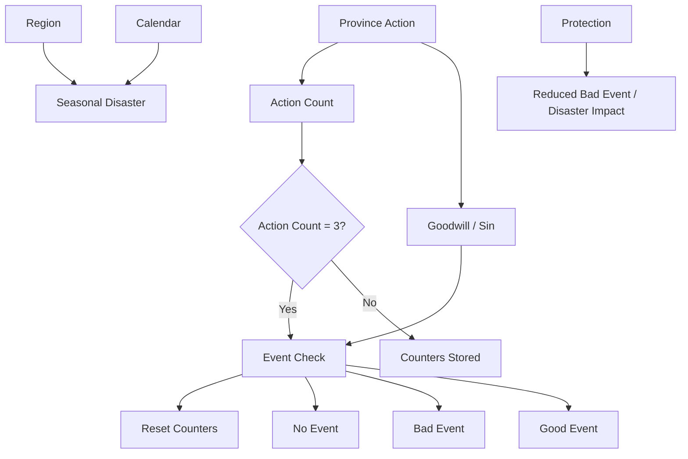
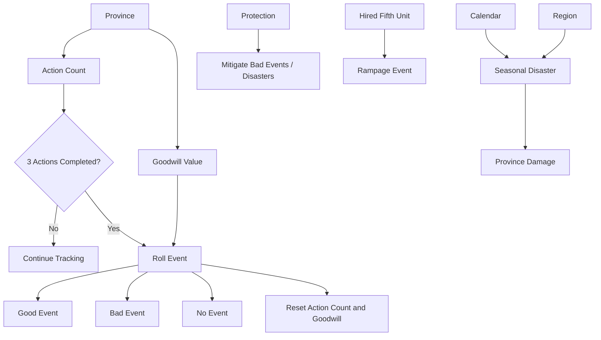

# 11. Events

## Purpose

This chapter describes Gemfire’s event system.

Events in Gemfire are not only random incidents. They consist of several different subsystems:

- good and bad events tied to province actions;
- seasonal disasters tied to calendar and geography;
- hired unit events;
- special reward events, including Pastha.

The key feature of the event system is hidden province-level moral accounting. The game tracks the types of actions performed in each province and can reward or punish the player based on accumulated goodwill.

---

# 11.1 Event System Overview

## Event Categories

Events can be divided into several groups:

| Category              | Description                                                    |
| --------------------- | -------------------------------------------------------------- |
| Good Events           | Positive events that can follow good province management.      |
| Bad Events            | Negative events that can follow aggressive or harmful actions. |
| Seasonal Disasters    | Natural disasters tied to calendar and geography.              |
| Hired Unit Events     | Events related to Hired Fifth Units.                           |
| Special Reward Events | Rare rewards, including Pastha and ruler stat increases.       |

---

## Core Model



---

## Design Observation

Events create hidden feedback between province management style and long-term stability.

A player who develops and protects a province increases the chance of favourable outcomes.

A player who repeatedly attacks, recruits, sabotages, or plunders increases the risk of harmful outcomes.

---

# 11.2 Province Action Count

## Overview

Each province has a hidden action counter.

The counter increases when the province performs turn-based actions.

After three counted actions, the game performs an event check.

---

## Core Rules

Each province has a hidden action counter, which increases only from turn-based actions that consume the province's monthly action. An event check occurs after 3 turn-based actions, after which the counter and goodwill reset. The system can look calendar-quarter based but is actually action-count based.

---

## Example

```text
January:
    Province A uses Cultivation

February:
    Province A uses Protection

March:
    Province A uses Cultivation

April:
    Event check occurs for Province A
```

If a province performs fewer than three counted actions, the event check does not occur.

---

## Design Observation

In normal play, events may appear quarterly because a province usually performs one significant action per month.

The underlying logic is based on action count rather than a fixed calendar quarter.

---

# 11.3 Goodwill Value

## Overview

In addition to Action Count, each province tracks a hidden goodwill / sin value.

Each counted action can modify this value.

Goodwill influences the chance and level of good or bad events after an event check.

---

## Action Goodwill Values

Each command contributes a goodwill modifier: development, protection, feeding the people, and alliances add goodwill, while attacks, recruitment, sabotage, and plunder subtract it, with many commands neutral. The full per-command goodwill values table is canonical in Appendix D §D.5.

---

## Goodwill Outcomes

```text
Positive Goodwill
↓
Higher chance of Good Event

Negative Goodwill
↓
Higher chance of Bad Event

Neutral Goodwill
↓
Lower or neutral event chance
```

---

## Design Observation

Gemfire implicitly judges the player’s style of rule.

Development, protection, feeding the people, and alliances are treated as good governance.

Aggression, recruitment, sabotage, and plunder are treated as harmful or violent actions.

---

# 11.4 Good Events

## Overview

Good Events are positive outcomes triggered by favourable province management.

They can improve province stats, grant resources, strengthen rulers, or provide special Fifth Units.

---

## Known Good Events

| Event                          | Effect                                    |
| ------------------------------ | ----------------------------------------- |
| Kind Redcaps cast good spells  | Cultivation increases.                    |
| Unicorn empowered the ruler    | Lord gains Domestic and Military bonuses. |
| Pastha offered to fight        | Pastha becomes available as a Fifth Unit. |
| Elvish troubadour sang praises | Loyalty increases.                        |
| Leprechaun left a pot of gold  | Gold increases.                           |
| Far Gorta gathered food        | Food increases.                           |
| Fairy rounded up troops        | Troops increase.                          |
| Gwraig brought a charm         | Lord gains Charm bonus.                   |
| Airial calmed stormy winds     | Protection increases.                     |

---

## Event Levels

Good Events appear to have different strength levels.

Higher goodwill increases the chance of stronger events.

Examples of high-level rewards include:

- Pastha;
- ruler stat improvements;
- Charm increase;
- significant province bonuses.

Exact thresholds and probabilities remain unresolved.

---

## Ruler Empowerment

Some events affect the lord of the territory.

If the province is directly ruled by the family ruler, the ruler receives the bonus.

This creates a strategic reason to keep some territories under direct ruler control instead of assigning a vassal.

---

## Design Observation

Good Events reward long-term peaceful development.

They make economic and protective actions valuable beyond their direct mechanical effects.

---

# 11.5 Bad Events

## Overview

Bad Events are negative outcomes associated with harmful or aggressive province actions.

They can damage province stats, reduce resources, frighten troops, or harm stability.

---

## Known Bad Events

| Event                                               | Effect                                         |
| --------------------------------------------------- | ---------------------------------------------- |
| Durahan rode through territory with Shadow of Death | Protection decreases.                          |
| Black Annis frightened the people                   | Loyalty decreases.                             |
| Banshee brought an evil omen                        | Protection decreases.                          |
| Mischievous pixies dug up the fields                | Cultivation decreases.                         |
| Hired Fifth Unit went on a rampage                  | Loyalty, Cultivation, and Protection decrease. |
| Hobgoblins stole from territory                     | Gold decreases.                                |
| Auguskiegies gobbled up food                        | Food decreases.                                |
| Shrieker scared troops                              | Troops decrease.                               |

---

## Bad Event Sources

Bad Events can be encouraged by:

- repeated attacks;
- recruitment;
- sabotage;
- plunder;
- negative goodwill accumulation.

---

## Design Observation

Bad Events serve as a hidden cost for militaristic or exploitative play.

Even if the player wins wars, repeated aggressive actions may destabilize provinces over time.

---

# 11.6 Seasonal and Natural Disasters

## Overview

Seasonal disasters are separate from the goodwill event system.

They are tied to:

- calendar month;
- region;
- geography.

They are not triggered by province Action Count.

---

## Known Seasonal Disasters

| Disaster   | Region (provinces)                  | Month(s)                         |
| ---------- | ----------------------------------- | -------------------------------- |
| Heavy Snow | Northern (1–5)                      | December                         |
| Fire       | Western / woodland (7–9, 11, 14–15) | September                        |
| Flooding   | Eastern / SE wetland (17–22, 28, 29)| June                             |
| Earthquake | Southwestern volcanic (24–27)       | March                            |
| Plague     | Any                                 | December, March, June, September |

Disasters are keyed to calendar month and region, independent of the goodwill system.

---

## Independence from Goodwill

Seasonal disasters are independent from the province goodwill system.

A well-managed province can still suffer from regional disaster risk.

---

## Design Observation

Disasters give geography mechanical meaning.

Different regions of Ishmeria face different environmental risks, making the fixed map more strategically important.

---

# 11.7 Protection and Events

## Overview

Protection is the main province stat connected to event resistance.

---

## Effects of Protection

High Protection reduces the frequency and severity of bad events and reduces disaster damage:

- reduce frequency of bad events;
- reduce severity of bad events;
- reduce disaster damage.

---

## Protection vs Goodwill

Protection and goodwill are related but not identical.

| System     | Role                                                                            |
| ---------- | ------------------------------------------------------------------------------- |
| Goodwill   | Tracks whether province actions are trending toward good or bad event outcomes. |
| Protection | Mitigates harmful events and disaster effects.                                  |

---

## Important Distinction

High Protection does not appear to be the primary driver of good event chance.

Instead:

```text
Develop: Protection
↓
+1 Goodwill
↓
Higher chance of Good Event after event check
```

The Protection stat itself mainly helps resist harmful outcomes.

---

## Design Observation

Protection has two roles:

1. Direct defensive role against disasters and bad events.
2. Indirect event role because using the Protection development command contributes to goodwill.

---

# 11.8 Hired Unit Events

## Overview

Some events are tied to Hired Fifth Units.

These events overlap with the monster / hired unit system but are recorded here because they appear as event outcomes.

---

## Rampage

A Hired Fifth Unit can go on a rampage.

Known effect:

- Loyalty decreases;
- Cultivation decreases;
- Protection decreases.

---

## Desertion

Desertion from unpaid upkeep is primarily part of Hired Fifth Unit maintenance.

However, from the player’s perspective it behaves like a negative event tied to unstable military assets.

---

## Design Observation

Hired Fifth Units are powerful but risky.

Their risks are not limited to upkeep and battle death; they can also destabilize the province.

---

# 11.9 Pastha Event

## Overview

Pastha is a special Fifth Unit obtained through a good event.

It is neither a Gem Guardian nor a hired unit.

---

## Properties

| Property | Value                  |
| -------- | ---------------------- |
| Source   | Good Event             |
| Cost     | Free                   |
| Upkeep   | None                   |
| Use      | One battle             |
| Category | Event-based Fifth Unit |

---

## Strategic Role

Pastha gives the player temporary military power as a reward for good province management.

---

## Design Observation

Pastha connects the event system to the military system.

Peaceful development can unexpectedly produce a major tactical advantage.

---

# 11.10 Events and Player Behaviour

## Rewarded Behaviour

The game rewards:

- Cultivation;
- Protection;
- Give Food;
- Ally;
- stable province management.

---

## Punished or Risky Behaviour

The game punishes or creates risk for:

- repeated attacks;
- recruitment;
- sabotage;
- plunder;
- unstable Hired Fifth Unit use.

---

## Strategic Consequence

The event system pushes the player to balance:

```text
War
vs
Development

Expansion
vs
Stability

Short-term conquest
vs
Long-term province health
```

---

## Design Observation

Events create a soft moral economy.

The player is not forbidden from conquest and aggression, but those actions carry hidden long-term risks.

---

# 11.11 Event System Summary

## Reconstructed Event Model



---

# Open Questions

The following event-system details remain unresolved:

1. Exact probabilities for good / bad event checks.
2. Exact thresholds for event levels.
3. Exact numerical effects of each event.
4. Full province-by-province regional disaster mapping.
5. Exact formula for Protection impact on bad event frequency and severity.
6. Whether ruler Fame affects some event outcomes.
7. Whether all versions use the same event list and effects.
8. Exact handling of Hired Fifth Unit rampage and related triggers.

---

# Summary

Gemfire’s event system has two main layers:

1. Province-level goodwill system.
2. Calendar / region-based disaster system.

The goodwill system tracks each province’s actions and creates hidden moral feedback.

Seasonal disasters make geography and calendar timing meaningful.

Together, these systems make Ishmeria feel more reactive and connect the player’s management style to long-term consequences.
