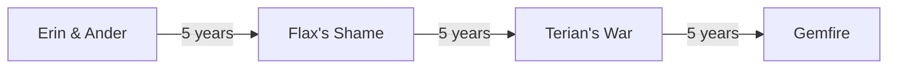
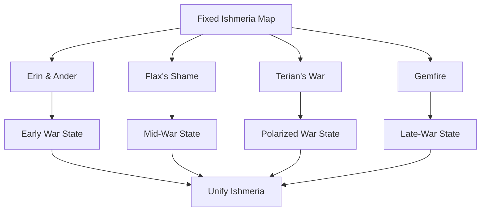

# 12. Scenarios

## Purpose

This chapter describes the scenario system in Gemfire.

Scenarios are not separate campaigns with different rules. They are time slices of the same war for Ishmeria.

All scenarios share:

- the same map;
- the same core rules;
- the same global objective;
- the same major game systems.

They differ in:

- starting province ownership;
- active houses;
- playable houses;
- starting rulers;
- starting vassals;
- Gem ownership;
- strategic situation.

---

## 12.1 Scenario System Overview

### Core Concept

Each scenario defines an initial political state of Ishmeria.

```text
Same:
- map
- rules
- victory goal
- core systems

Different:
- province ownership
- family strength
- rulers
- vassals
- Gems
- strategic pressure
```

---

### Design Observation

Scenarios function as historical snapshots of one civil war.

The player can start the campaign at different points in the conflict and experience different political maps, power balances, and strategic problems.

---

## 12.2 Shared Map and Victory Condition

### Map

All scenarios use the same map of Ishmeria.

The map consists of:

```text
30 numbered provinces
```

---

### Victory Condition

The global objective is the same in all scenarios:

```text
Unify Ishmeria
```

The player wins by gaining control over the whole map and eliminating or absorbing rival houses.

---

### Design Observation

Scenarios change the path to victory, not the goal.

The same world feels different because province ownership, house strength, and Gem distribution change over time.

---

## 12.3 Scenario Timeline

### Timeline

Gemfire contains four main scenarios set at five-year intervals:

| # | Scenario     | Relative Time |
| - | ------------ | ------------- |
| 1 | Erin & Ander | Year 0        |
| 2 | Flax’s Shame | +5 years      |
| 3 | Terian’s War | +10 years     |
| 4 | Gemfire      | +15 years     |

All four scenarios use the same fixed 30-province map; only the political state changes.

---

### Timeline Model



---

### Design Observation

The scenarios are best understood as later states of the same conflict rather than alternate histories.

This creates a sense of historical continuity without requiring separate campaigns.

---

## 12.4 Scenario Data Fields

### Overview

A complete scenario definition requires several data layers:

| Field              | Description                                         |
| ------------------ | --------------------------------------------------- |
| Scenario Name      | Name of the scenario.                               |
| Time Position      | Position in the scenario timeline.                  |
| Narrative Premise  | Short story setup.                                  |
| Active Families    | Houses present in the scenario.                     |
| Playable Families  | Houses available to the player.                     |
| Province Ownership | Initial owner of each province.                     |
| Rulers             | Starting ruler of each active house.                |
| Vassals            | Starting character roster.                          |
| Gems               | Starting Gem ownership.                             |
| Strategic Role     | Type of campaign situation created by the scenario. |
| Difficulty Notes   | Why some starts are easier or harder.               |

---

### Data Boundary

This chapter describes scenarios at the level of structure, timeline, political context, and strategic role.

Full tabular data should be kept in structured reference data:

- province ownership by scenario;
- rulers by scenario;
- vassals by scenario;
- Gem ownership by scenario;
- starting resources;
- starting Fifth Units;
- hire pools.

---

## 12.5 Active Families

### Overview

Gemfire includes more active houses than only the main early rebel families. The full list of active families is canonical in Appendix A §A.6 (and per-scenario in Appendix B §B.3).

---

### General Roles

| Family    | General Role                                                 |
| --------- | ------------------------------------------------------------ |
| Lankshire | Royal house and central antagonist of the premise.           |
| Blanche   | One of the major rebel houses.                               |
| Lyle      | One of the major rebel houses.                               |
| Flax      | Southwestern power important in early and mid-war scenarios. |
| Coryll    | Early-war house.                                             |
| Chrysalis | Early house that declines during the war.                    |
| Molbrew   | Early / mid-war house that later declines.                   |
| Tate      | New house formed after Terian breaks from the king.          |
| Tordin    | Scenario-dependent minor house.                              |
| Tudoria   | Late-war southern house.                                     |
| Divas     | Late-war challenge house.                                    |

---

### Design Observation

Scenarios use houses to show the evolution of the war.

Some houses disappear, new ones appear, and older houses shift in political weight.

---

## 12.6 Erin & Ander

### Time Position

First scenario, at Year 0.

---

### Narrative Premise

The noble uprising against Lankshire begins.

Erin of Blanche and Ander of Lyle are presented as key figures among the anti-Lankshire nobles.

Lankshire remains a powerful royal house.

---

### Strategic Situation

The war is still in an early state.

Most original houses remain independent.

The political map is less polarized than in later scenarios.

---

### Strategic Role

Erin & Ander is the most open and long-form scenario.

It lets the player shape the war from its earliest playable state.

---

### Key Strategic Features

- Lankshire is still strong.
- Multiple noble houses remain active.
- The player has more room for long-term development.
- The political map is less consolidated than in later scenarios.
- Several vacant or weakly held areas may create early expansion opportunities.

---

### Design Observation

Erin & Ander functions as the classic start.

It is the best scenario for understanding the game’s baseline political structure because most early-war powers are still present.

---

## 12.7 Flax’s Shame

### Time Position

Second scenario, at Year +5.

---

### Narrative Premise

The scenario takes place five years after the beginning of the war.

The political map has already changed significantly.

Coryll has fallen.

Flax has achieved military success but is in a difficult strategic position.

Terian has broken from the king and formed Tate as a new political force.

---

### Known Political Changes

Known changes between the first and second scenario include:

- Coryll has disappeared;
- Flax has defeated Coryll;
- Flax has lost Linden;
- Molbrew has gained Erewood;
- Chrysalis has lost Garth;
- Blanche and Lyle have continued fighting;
- Blanche has gained Hyland;
- Blanche has lost Cobrige;
- Lyle has taken Dunmoor;
- Tate has emerged as a new family.

---

### Strategic Role

Flax’s Shame is a mid-war scenario.

The war has already reshaped the map, but the conflict is not yet fully consolidated around only a few dominant houses.

---

### Design Observation

This scenario shows Ishmeria after the first major upheavals.

Some houses have already collapsed or shifted position, while others remain capable of changing the course of the war.

---

## 12.8 Terian’s War

### Time Position

Third scenario, at Year +10.

---

### Narrative Premise

The scenario takes place ten years after the beginning of the war.

Terian and Tate remain important, but the war has become more polarized.

Molbrew and Chrysalis have declined or disappeared from the major political picture.

Larger blocs become more important than the smaller early-war houses.

---

### Known Political Situation

Known high-level changes include:

- Tate is reduced compared with its initial emergence;
- Molbrew has declined or disappeared;
- Chrysalis has declined or disappeared;
- Blanche and Lyle have become stronger;
- Tordin appears as a new minor power;
- the war is increasingly polarized.

---

### Strategic Role

Terian’s War represents a harsher, more consolidated phase of the conflict.

The player starts in a world where several early factions have already failed, and the remaining powers are more clearly defined.

---

### Design Observation

This scenario has less early-war openness.

It is better suited for campaigns with established power centers and fewer surviving minor houses.

---

## 12.9 Gemfire

### Time Position

Fourth scenario, at Year +15.

---

### Narrative Premise

This is the late-war scenario.

Lankshire is weakened compared with the beginning of the war.

Blanche and Lyle are among the strongest remaining powers.

The political map has already been heavily reshaped by years of conflict.

---

### Known Political Situation

Known high-level data includes:

- Blanche has gained strength in the north;
- Lankshire influence has declined;
- Lyle controls a strong opening position;
- Blanche and Lyle are among the strongest starts;
- Tudoria appears as a late-war southern power;
- Divas exists as a difficult no-Gem challenge start.

---

### Divas Challenge Start

Divas is one of the hardest starts in the late scenario.

Known features:

- no Gem;
- pressure from stronger neighbours;
- limited strategic position;
- some useful characters;
- difficult expansion path.

---

### Strategic Role

Gemfire is a late-war scenario with larger blocs and more obvious strong and weak starts.

It creates a shorter, more pressured campaign because some houses are already close to dominance while others are fighting from weak positions.

---

### Design Observation

This scenario shows the war near its final state.

The player does not begin with a relatively open early conflict, but with the accumulated results of many earlier victories, defeats, betrayals, and collapses.

---

## 12.10 Scenario Difficulty

### Difficulty Factors

Scenario difficulty depends on several starting conditions:

| Factor                  | Impact                                                          |
| ----------------------- | --------------------------------------------------------------- |
| Number of provinces     | More provinces usually means more resources and more actions.   |
| Gems                    | Access to Gem Guardians increases military flexibility.         |
| Ruler quality           | Strong rulers improve diplomacy, war, and development.          |
| Vassal roster           | Better governors and commanders create stronger starts.         |
| Geography               | Chokepoints, exposure, borders, and safe rear provinces matter. |
| Fifth Unit availability | Strong hired units can compensate for other weaknesses.         |
| Neighbours              | Strong neighbours increase early danger.                        |
| Home province defense   | Vulnerable home regions make a start harder.                    |

---

### Strong Starts

Strong starts usually have:

- multiple provinces;
- strong Gems;
- strong generals;
- good geography;
- manageable borders.

Examples include:

- Blanche in later scenarios;
- Lyle in later scenarios;
- Lankshire in early scenarios, despite Eselred’s weakness, because of territory and vassals.

---

### Challenge Starts

Difficult starts usually have:

- few provinces;
- no Gem;
- weaker roster;
- exposed geography;
- strong neighbours.

Example:

- Divas in the Gemfire scenario.

---

### Design Observation

Scenario difficulty is created mostly by initial world state, not by explicit difficulty modifiers.

Gemfire uses asymmetric starts: different houses present different strategic problems.

---

## 12.11 Scenario Design Role

### Fixed Map, Changing Politics

All scenarios use the same map.

This lets the player learn Ishmeria’s geography while experiencing different political situations.

---

### Historical Continuity

Scenarios show the consequences of earlier phases of war:

- houses disappear;
- new houses appear;
- Gems transfer between families;
- strong houses become stronger;
- weak houses become challenge starts;
- the map becomes more polarized over time.

---

### Replayability

Scenarios increase replayability through:

- different starting positions;
- different political maps;
- different Gem ownership;
- different strong and weak houses;
- different phases of the war.

---

### Design Observation

Gemfire uses scenarios to create replayability without random map generation.

The world remains fixed, but its political state changes.

---

## 12.12 Scenario System Summary

### Reconstructed Scenario System



---

## Open Questions

The following scenario details remain unresolved or require final structured extraction:

1. Exact playable families for Flax’s Shame.
2. Full starting resource tables for all provinces and scenarios.
3. Full starting Fifth Unit / hire pool data by province.
4. Formal difficulty ratings for each playable house.
5. Version differences between Gemfire and Royal Blood scenario data.
6. Exact narrative differences between localized Gemfire and Royal Blood prologues.

---

## Summary

Gemfire’s scenarios are time slices of one war for Ishmeria.

They use the same map and the same goal, but change the political state of the world.

Each scenario creates a different strategic context:

- Erin & Ander — early rebellion;
- Flax’s Shame — mid-war after the first major changes;
- Terian’s War — more polarized war;
- Gemfire — late conflict state.

Scenarios allow the game to keep a fixed authored map while still offering different campaigns, difficulty profiles, and historical states of the world.
