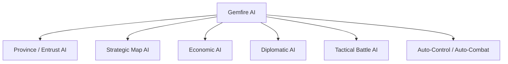
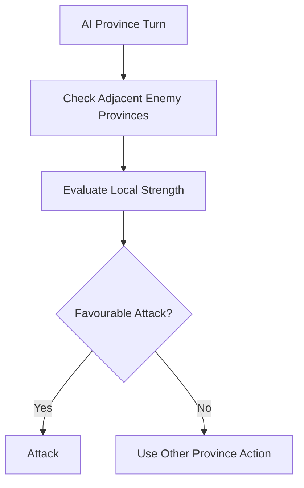
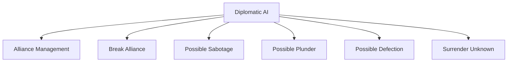
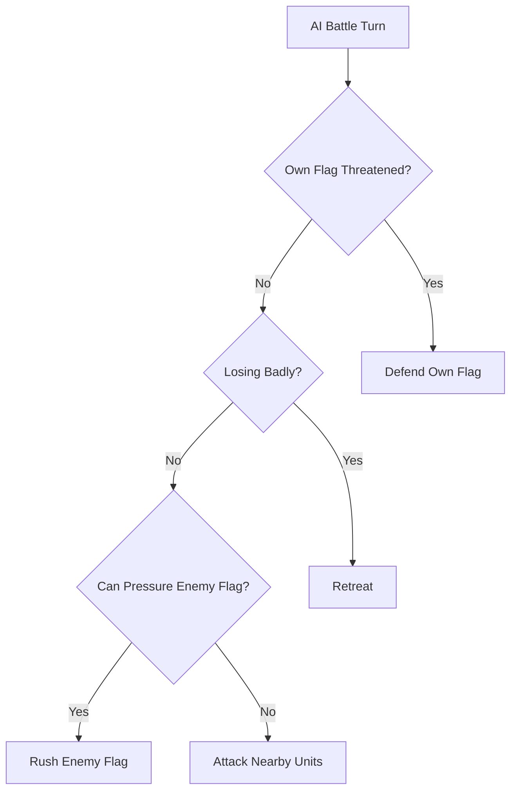
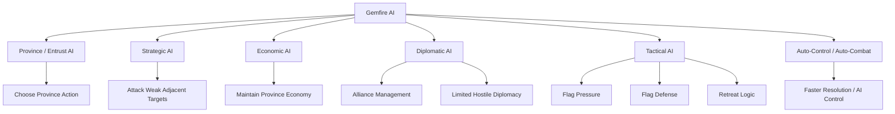

# 13. AI Specification

## Purpose

This chapter describes Gemfire’s artificial intelligence.

Gemfire’s AI does not appear to be a deep strategic planner that builds long-term plans at a human level. It is better understood as a set of simple heuristics that keep the campaign active:

- managing provinces;
- maintaining basic economies;
- attacking weak borders;
- automating provinces through Entrust;
- controlling armies in tactical battles;
- using limited diplomacy.

The main role of the AI is not to outthink the player through complex planning. Its role is to keep Ishmeria active, reactive, and dangerous enough for the player to face constant pressure.

---

# 13.1 AI Layers

## Overview

Gemfire’s AI can be divided into several layers:

```text
AI
├── Province / Entrust AI
├── Strategic Map AI
├── Economic AI
├── Diplomatic AI
├── Tactical Battle AI
└── Auto-Control / Auto-Combat
```

---

## Layer Model



---

## Design Observation

AI operates on the same major layers as the player:

- provinces;
- economy;
- warfare;
- diplomacy;
- tactical battle.

Available evidence suggests that the AI relies on simple rules rather than deep long-term planning.

---

# 13.2 Province / Entrust AI

## Overview

Entrust allows the player to delegate control of a specific province to the computer.

Entrust does not hand over the whole house.

It operates at the province level.

---

## Function

An entrusted province:

- receives automated management;
- can perform commands without manual player input;
- may also do nothing;
- reduces micromanagement in the late game.

---

## Known Use Cases

Entrust is most useful:

- in the late game;
- when the player controls many provinces;
- for rear or secondary territories;
- when the player does not want to manually order every province.

---

## Limitations

Entrust AI is not considered optimal.

It should not be relied on for:

- important border provinces;
- provinces preparing invasions;
- territories with critical economic tasks;
- situations requiring precise timing or logistics.

---

## Current Understanding

The exact priority order of Entrust AI is unknown.

It is not confirmed how the AI chooses between:

- Develop;
- Recruit;
- Attack;
- Transport;
- Hire Monster;
- Diplomacy;
- no action.

---

## Design Observation

Entrust AI is a convenience system.

Its purpose is to reduce management burden, not to play optimally for the player.

---

# 13.3 Strategic Map AI

## Overview

Strategic AI controls houses on the global map.

It chooses:

- which provinces to develop;
- where to recruit troops;
- which neighbouring territories to attack;
- how to react to weak borders;
- when to expand.

---

## Target Selection

AI appears inclined to attack weak neighbouring provinces.

Common targets include:

- adjacent enemy provinces;
- provinces with low Troops;
- recently captured and poorly defended territories;
- border provinces where local strength comparison is favourable.

---

## Local Strength Comparison

AI likely uses simple local strength evaluation.

```text
Can attack?
↓
Is target adjacent?
↓
Is local strength favourable?
↓
Attack or wait
```

Exact formula remains unresolved.

---

## Strategic Model



---

## Design Observation

Strategic AI appears opportunistic.

It does not necessarily conduct deep campaigns, but it can punish weak defence and overextension.

---

# 13.4 Economic AI

## Overview

Economic AI maintains provinces at a basic level.

Exact priorities are not confirmed, but observed behaviour and advisor hints suggest that the system values:

- Cultivation;
- Protection;
- Loyalty;
- Gold;
- Food;
- Troops;
- Hired Fifth Units;
- weak targets for attack.

---

## Likely Priorities

AI likely uses simple province-maintenance heuristics:

```text
If Troops are low → Recruit
If economy is weak → Develop
If Food / Gold is low → Trade or wait
If border opportunity exists → attack
```

Exact logic remains unknown.

---

## Important Resources

AI must manage the same basic resources as the player:

| Resource / Stat | AI Relevance                    |
| --------------- | ------------------------------- |
| Gold            | Recruit, Develop, Hire, upkeep. |
| Food            | Supply, Give Food, trade.       |
| Troops          | Defence and attack.             |
| Cultivation     | Future harvest.                 |
| Protection      | Resistance to bad events.       |
| Loyalty         | Tax and harvest efficiency.     |

---

## Design Observation

Economic AI does not appear to deeply optimize long-term development.

Its role is to keep provinces active and prevent the world from becoming static.

---

# 13.5 Diplomatic AI

## Overview

Diplomatic AI handles political actions for computer-controlled houses.

It is confirmed that AI can interact with alliances.

There are also observations suggesting that AI may use some hostile diplomatic actions.

---

## Alliance Management

Known behaviour:

- AI can create alliances;
- AI can break alliances;
- AI may break alliances unpredictably.

---

## Other Diplomacy

AI may use or attempt to use:

- Sabotage;
- Plunder;
- Defection.

The frequency and exact targeting rules are not confirmed.

---

## Surrender

It is not confirmed that AI actively uses Surrender as a strategic tool in the same way as the player.

---

## Diplomatic AI Model



---

## Design Observation

Diplomatic AI is present but limited.

It supports instability on the political map, but it does not appear to function as a deep long-term relationship system.

---

# 13.6 Tactical Battle AI

## Overview

Tactical AI controls an army in battle when the side is computer-controlled or when the player enables Auto.

This is one of the most visible parts of Gemfire’s AI.

---

## Core Behaviour

Tactical AI appears objective-driven.

Observed priorities include:

- moving toward the enemy flag;
- defending its own flag when exposed;
- attacking when it has parity or advantage;
- defending when the player is stronger;
- retreating when threatened with destruction.

---

## Flag Rush

AI often moves aggressively toward the player’s flag.

This creates pressure, but also makes the AI vulnerable to:

- flanking;
- rear attacks;
- traps;
- space control.

---

## Flag Defense Response

If the AI’s own flag is threatened, it can redirect units to protect it.

```text
Own flag exposed
↓
AI redirects units to cover flag
```

---

## Retreat Behaviour

AI may retreat if it considers the battle lost.

Possible factors include:

- strong player advantage;
- threat of complete destruction;
- loss of combat power;
- no realistic path to the enemy flag.

Exact rules remain unresolved.

---

## Tactical AI Weaknesses

AI struggles with positional nuance:

- it often exposes flanks;
- it can be vulnerable to rear attacks;
- it does not always use facing well;
- it does not always use fences effectively;
- it can make poor decisions around flags.

---

## Tactical AI Model



---

## Design Observation

Tactical AI is not a sophisticated tactical opponent.

It creates pressure through objectives, but skilled positioning can exploit its weaknesses.

---

# 13.7 Auto-Control and Auto-Combat

## Auto in Tactical Battle

The player can use Auto to let the computer control the tactical battle.

This delegates tactical unit decisions to AI.

---

## Auto-Control Weakness

Auto is generally unreliable for important battles.

Because tactical AI is positionally weak, Auto may:

- expose units;
- miss flanking opportunities;
- rush poorly;
- fail to protect key units;
- waste advantages.

---

## Map-Level Automated Resolution

AI-controlled or entrusted battles may resolve without the player manually controlling the tactical battlefield.

This creates a distinction:

```text
Manual Battle
=
Player controls tactical units

Auto / AI-Controlled Battle
=
Computer resolves or controls battle
```

---

## Unknowns

It is not confirmed whether map-level auto-combat uses:

- the same tactical simulation internally;
- a simplified strength formula;
- a hybrid approach.

---

## Design Observation

Auto systems exist primarily to reduce friction and speed up play.

They are not a replacement for careful manual control in important battles.

---

# 13.8 AI and Difficulty

## No Confirmed Resource Cheats

No confirmed evidence has been found that the AI receives special economic bonuses.

There is no confirmed evidence that AI receives:

- free Gold;
- free Food;
- hidden income;
- special recruitment rules;
- special upkeep exemptions.

---

## AI Weakness as Balance

AI is often described as weak or simplistic.

The challenge of Gemfire comes less from AI brilliance and more from:

- starting conditions;
- geography;
- multiple enemy houses;
- Gems;
- strong vassals;
- events;
- resource pressure;
- player overextension.

---

## Design Observation

Gemfire uses systemic pressure more than AI intelligence.

Even simple AI can be dangerous when the player is surrounded, under-supplied, or overextended.

---

# 13.9 AI Interaction with Other Systems

## AI and Turn Structure

Because the game is province-based, AI operates through province activations.

This means AI does not need to plan one large national turn in the modern 4X sense.

Instead, each province can make a local decision.

---

## AI and Economy

AI uses the same economic resources as the player:

- Gold;
- Food;
- Troops;
- Cultivation;
- Protection;
- Loyalty.

---

## AI and Characters

AI controls rulers and vassals.

It can:

- assign governors;
- command armies;
- lose generals to capture;
- possibly attempt Defection;
- suffer Surrender or ruler recruitment.

---

## AI and Gems

AI can use Gems as Fifth Units when available.

Gem cooldown rules appear to apply normally.

No confirmed evidence has been found that AI ignores Gem cooldown.

---

## AI and Events

AI-controlled provinces appear subject to normal event systems.

No confirmed evidence has been found that AI is immune to disasters, bad events, or Hired Fifth Unit risks.

---

# 13.10 Reconstructed AI System

## Full Model



---

# 13.11 Design Summary

## AI Role

AI in Gemfire exists to:

- keep enemy houses active;
- automate player-controlled provinces through Entrust;
- punish weak borders;
- create tactical opposition;
- manage background conflicts;
- reduce late-game micromanagement.

---

## AI Limitations

AI is limited by:

- simple local heuristics;
- weak tactical positioning;
- unclear long-term planning;
- unreliable Auto behaviour;
- likely shallow diplomatic planning.

---

## Strategic Consequence

The player is not challenged primarily by a brilliant opponent.

The player is challenged by:

```text
Many provinces
+
Multiple houses
+
Resource pressure
+
Gems
+
Events
+
Geography
+
Simple but persistent AI
```

---

# Open Questions

The following AI details remain unresolved:

1. Exact Entrust AI command priority order.
2. Full list of diplomatic commands actively used by AI.
3. Exact strategic attack decision formula.
4. Exact auto-combat resolution formula.
5. Whether any version-specific AI bonuses exist.
6. Exact tactical retreat conditions.
7. Exact AI handling of Gem cooldown and Hired Fifth Unit upkeep.
8. Whether AI evaluates long-term economy or only local province state.

---

# Summary

Gemfire’s AI is not a deep strategic planner.

It is a set of simple heuristics operating on different layers of the game:

- province automation;
- strategic attacks;
- economic maintenance;
- limited diplomacy;
- tactical flag-based behaviour;
- auto-control.

Its main function is to keep the world active, create pressure on the player, and reduce the burden of managing many provinces.

Gemfire relies less on complex AI and more on systemic depth: map structure, resources, characters, Gems, events, and asymmetric scenario starts.
