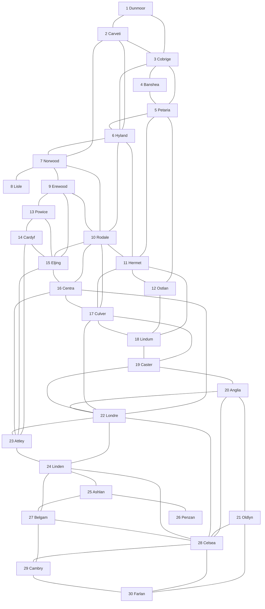
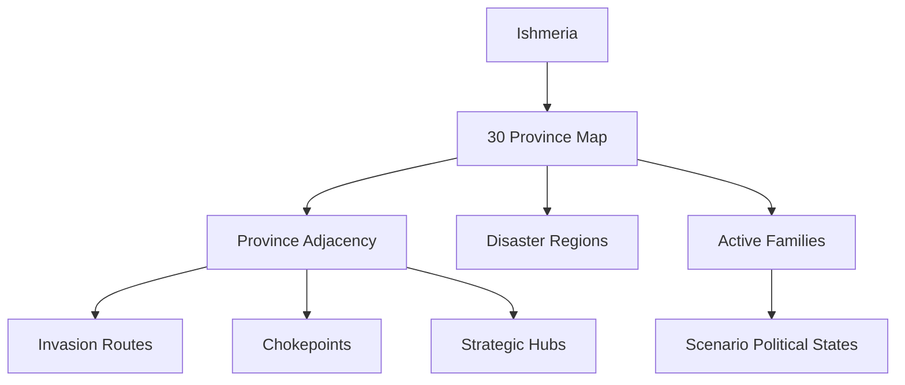

# Appendix A — World Data

## Purpose

Appendix A contains reference data for the world map of Gemfire.

This appendix covers:

- province numbers;
- province names;
- province adjacency;
- strategic geography;
- approximate regions;
- active families.

Scenario ownership, rulers, vassals, Gems, starting resources, and scenario-specific political states are covered separately in scenario data.

---

## A.1 Map Overview

### Fixed Map

Gemfire uses a fixed world map of Ishmeria.

The map does not change between scenarios.

All scenarios use the same set of numbered provinces.

What changes between scenarios is the political state:

- province ownership;
- active families;
- playable families;
- rulers;
- vassals;
- Gems;
- starting armies;
- starting resources.

The geography itself remains stable.

---

### Province Count

The map contains:

```text
30 numbered provinces
```

Province numbers are stable across scenarios.

---

### Map Reference

The numbered province map is the primary spatial reference for Ishmeria.

```text
Province 1  = Dunmoor
Province 30 = Farlan
```

The player interacts with the world primarily through these numbered provinces.

---

### Visual References

The printed Ishmeria map is useful for:

- province name verification;
- province number verification;
- regional geography;
- broad terrain interpretation.

The Spriters Resource asset sheet is useful for:

- visual map reference;
- sprite reference;
- unit and interface visual checks.

---

## A.2 Province List

|   # | Province |
| --: | -------- |
|   1 | Dunmoor  |
|   2 | Carveti  |
|   3 | Cobrige  |
|   4 | Banshea  |
|   5 | Petaria  |
|   6 | Hyland   |
|   7 | Norwood  |
|   8 | Lisle    |
|   9 | Erewood  |
|  10 | Rodale   |
|  11 | Hermet   |
|  12 | Ostlan   |
|  13 | Powice   |
|  14 | Cardyf   |
|  15 | Eljing   |
|  16 | Centra   |
|  17 | Culver   |
|  18 | Lindum   |
|  19 | Caster   |
|  20 | Anglia   |
|  21 | Oldlyn   |
|  22 | Londre   |
|  23 | Attley   |
|  24 | Linden   |
|  25 | Ashlan   |
|  26 | Penzan   |
|  27 | Belgam   |
|  28 | Celsea   |
|  29 | Cambry   |
|  30 | Farlan   |

---

## A.3 Province Adjacency

### Source Note

The adjacency table is primarily reconstructed from Andrew Que’s Gemfire Complete Guide land pages.

Each province has a dedicated land page:

```text
https://gemfire.drque.net/Lands.php?Province=1
...
https://gemfire.drque.net/Lands.php?Province=30
```

These pages list province connections / neighbouring lands.

The printed Ishmeria map and screenshots are used as visual cross-checks for province numbering and geography, but the connection list itself is based primarily on the land pages.

Confidence: High.

---

### Overview

Province adjacency determines:

- possible invasion routes;
- movement routes;
- border pressure;
- defensive chokepoints;
- political contact between houses.

A province can only be directly attacked from an adjacent province.

---

### Adjacency Table

|   # | Province | Adjacent Provinces                                                          |
| --: | -------- | --------------------------------------------------------------------------- |
|   1 | Dunmoor  | 2 Carveti, 3 Cobrige                                                        |
|   2 | Carveti  | 1 Dunmoor, 3 Cobrige, 6 Hyland, 7 Norwood                                   |
|   3 | Cobrige  | 1 Dunmoor, 2 Carveti, 4 Banshea, 5 Petaria, 6 Hyland                        |
|   4 | Banshea  | 3 Cobrige, 5 Petaria                                                        |
|   5 | Petaria  | 3 Cobrige, 4 Banshea, 6 Hyland, 11 Hermet, 12 Ostlan                        |
|   6 | Hyland   | 2 Carveti, 3 Cobrige, 5 Petaria, 7 Norwood, 10 Rodale, 11 Hermet            |
|   7 | Norwood  | 2 Carveti, 6 Hyland, 8 Lisle, 9 Erewood, 10 Rodale                          |
|   8 | Lisle    | 7 Norwood                                                                   |
|   9 | Erewood  | 7 Norwood, 10 Rodale, 13 Powice, 15 Eljing                                  |
|  10 | Rodale   | 6 Hyland, 7 Norwood, 9 Erewood, 11 Hermet, 15 Eljing, 16 Centra, 17 Culver  |
|  11 | Hermet   | 5 Petaria, 6 Hyland, 10 Rodale, 12 Ostlan, 17 Culver, 18 Lindum             |
|  12 | Ostlan   | 5 Petaria, 11 Hermet, 18 Lindum                                             |
|  13 | Powice   | 9 Erewood, 14 Cardyf, 15 Eljing                                             |
|  14 | Cardyf   | 13 Powice, 15 Eljing, 23 Attley                                             |
|  15 | Eljing   | 9 Erewood, 10 Rodale, 13 Powice, 14 Cardyf, 16 Centra, 23 Attley            |
|  16 | Centra   | 10 Rodale, 15 Eljing, 17 Culver, 22 Londre, 23 Attley                       |
|  17 | Culver   | 10 Rodale, 11 Hermet, 16 Centra, 18 Lindum, 19 Caster, 22 Londre            |
|  18 | Lindum   | 11 Hermet, 12 Ostlan, 17 Culver, 19 Caster                                  |
|  19 | Caster   | 17 Culver, 18 Lindum, 20 Anglia, 22 Londre                                  |
|  20 | Anglia   | 19 Caster, 21 Oldlyn, 22 Londre, 28 Celsea                                  |
|  21 | Oldlyn   | 20 Anglia, 28 Celsea, 30 Farlan                                             |
|  22 | Londre   | 16 Centra, 17 Culver, 19 Caster, 20 Anglia, 23 Attley, 24 Linden, 28 Celsea |
|  23 | Attley   | 14 Cardyf, 15 Eljing, 16 Centra, 22 Londre, 24 Linden                       |
|  24 | Linden   | 22 Londre, 23 Attley, 25 Ashlan, 27 Belgam, 28 Celsea                       |
|  25 | Ashlan   | 24 Linden, 26 Penzan, 27 Belgam                                             |
|  26 | Penzan   | 25 Ashlan                                                                   |
|  27 | Belgam   | 24 Linden, 25 Ashlan, 28 Celsea, 29 Cambry                                  |
|  28 | Celsea   | 20 Anglia, 21 Oldlyn, 22 Londre, 24 Linden, 27 Belgam, 29 Cambry, 30 Farlan |
|  29 | Cambry   | 27 Belgam, 28 Celsea, 30 Farlan                                             |
|  30 | Farlan   | 21 Oldlyn, 28 Celsea, 29 Cambry                                             |

---

### Adjacency Graph



---

## A.4 Strategic Geography

### Connection Count

The number of adjacent provinces strongly affects strategic value.

|   # | Province | Connections | Strategic Type              |
| --: | -------- | ----------: | --------------------------- |
|   1 | Dunmoor  |           2 | Edge province               |
|   2 | Carveti  |           4 | Regional connector          |
|   3 | Cobrige  |           5 | Northern hub                |
|   4 | Banshea  |           2 | Edge province               |
|   5 | Petaria  |           5 | Northern-eastern connector  |
|   6 | Hyland   |           6 | Major northern hub          |
|   7 | Norwood  |           5 | Northwestern hub            |
|   8 | Lisle    |           1 | Dead-end province           |
|   9 | Erewood  |           4 | Western connector           |
|  10 | Rodale   |           7 | Major central-northern hub  |
|  11 | Hermet   |           6 | Major northeastern hub      |
|  12 | Ostlan   |           3 | Eastern edge connector      |
|  13 | Powice   |           3 | Western edge connector      |
|  14 | Cardyf   |           3 | Western-southern connector  |
|  15 | Eljing   |           6 | Major western-central hub   |
|  16 | Centra   |           5 | Central bridge province     |
|  17 | Culver   |           6 | Major eastern-central hub   |
|  18 | Lindum   |           4 | Eastern connector           |
|  19 | Caster   |           4 | Eastern connector           |
|  20 | Anglia   |           4 | Southeastern connector      |
|  21 | Oldlyn   |           3 | Southern edge connector     |
|  22 | Londre   |           7 | Major central-eastern hub   |
|  23 | Attley   |           5 | Central-southwestern bridge |
|  24 | Linden   |           5 | Southwestern gateway        |
|  25 | Ashlan   |           3 | Southwestern connector      |
|  26 | Penzan   |           1 | Dead-end province           |
|  27 | Belgam   |           4 | Southwestern connector      |
|  28 | Celsea   |           7 | Major southern hub          |
|  29 | Cambry   |           3 | Southern connector          |
|  30 | Farlan   |           3 | Southeastern edge connector |

---

### Major Hub Provinces

The highest-connectivity provinces are:

| Province  | Connections | Notes                                           |
| --------- | ----------: | ----------------------------------------------- |
| 10 Rodale |           7 | Northern-central hub.                           |
| 22 Londre |           7 | Central-eastern hub and major strategic center. |
| 28 Celsea |           7 | Southern hub.                                   |
| 6 Hyland  |           6 | Northern hub.                                   |
| 11 Hermet |           6 | Northeastern hub.                               |
| 15 Eljing |           6 | Western-central hub.                            |
| 17 Culver |           6 | Eastern-central hub.                            |

---

### Bridge Provinces

Some provinces connect major regions and are strategically important even if they are not the largest hubs.

| Province  | Role                                                            |
| --------- | --------------------------------------------------------------- |
| 16 Centra | Connects northern-central, eastern-central, and Londre regions. |
| 23 Attley | Connects the western center to Londre and Linden.               |
| 24 Linden | Gateway between the central map and the southwest.              |
| 20 Anglia | Links the east coast, Londre, and southeast.                    |
| 27 Belgam | Connects the southwest to the southern hub.                     |

---

### Strategic Notes

The map is not evenly connected.

Several provinces act as strategic control points. Losing a hub can expose many borders at once, while dead-end provinces can function as relatively safe storage or recovery territories.

---

## A.5 Geographic Regions

### Approximate Regional Grouping

The following grouping is based on map position and adjacency.

These regions are descriptive, not confirmed internal game regions.

| Region            | Provinces                       | Notes                                      |
| ----------------- | ------------------------------- | ------------------------------------------ |
| Northwest         | 1, 2, 3, 7, 8, 9                | Northern and northwestern route network.   |
| Northeast         | 4, 5, 6, 10, 11, 12, 17, 18, 19 | Dense northern and eastern corridor.       |
| West / Southwest  | 13, 14, 15, 23, 24, 25, 26, 27  | Western coast and southwest peninsula.     |
| Center            | 10, 15, 16, 17, 22, 23          | Main strategic crossroads.                 |
| Southeast / South | 20, 21, 28, 29, 30              | Southern hub and eastern / southern coast. |

---

## A.6 Active Families

### Overview

Gemfire contains more active families than the seven major houses often discussed in summaries.

Confirmed active families include:

| Family    | Role / Notes                                                            |
| --------- | ----------------------------------------------------------------------- |
| Lankshire | Royal house / central antagonist; associated with the crown and Dragon. |
| Blanche   | Major rebel house; associated with Erin.                                |
| Lyle      | Major rebel house; associated with Ander.                               |
| Coryll    | Important early-war house.                                              |
| Chrysalis | Important early / mid-war house.                                        |
| Flax      | Southwestern power; important in early and mid-war scenarios.           |
| Molbrew   | Active house that declines over time.                                   |
| Tate      | Later house created after Terian separates from the king.               |
| Tordin    | Minor or scenario-dependent house.                                      |
| Tudoria   | Minor or scenario-dependent house.                                      |
| Divas     | Late scenario / challenge family.                                       |

---

### Boundary Note

This appendix lists families only at world level.

Scenario-specific family data includes:

- starting ruler;
- starting provinces;
- starting vassals;
- starting Gems;
- starting resources.

---

## A.7 World Data Summary

### Core Facts

```text
World: Ishmeria
Map Type: Fixed
Province Count: 30
Scenario Geography: Same across all scenarios
Scenario Variation: Political state only
Primary Map Unit: Province
Movement / Attack: Based on province adjacency
```

---

### Strategic Model



---

## Open Data Questions

The following data remains to be fully verified:

1. (Resolved) Province-by-province disaster ranges are documented in the events chapter (§11.6).
2. Whether disaster regions differ between game versions.
3. Full internal region classification, if any exists.
4. Exact world-data differences between Gemfire and Royal Blood.
5. Full confirmation of province names across all localized versions.
6. Whether any province has hidden strategic properties beyond adjacency, disaster risk, and available Hired Fifth Units.

---

## Summary

Appendix A defines Ishmeria as a fixed 30-province map.

The most important world-data structures are:

- province numbers;
- province names;
- adjacency;
- regional geography;
- strategic hubs;
- active families.

The fixed map allows Gemfire to create replayability through changing political states rather than random generation.

Scenarios alter who owns the world, but not the shape of the world itself.
