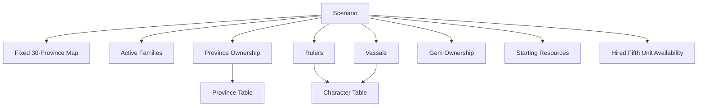

# Appendix B — Character and Scenario Data

## Purpose

Appendix B contains reference data for Gemfire characters and scenarios.

This appendix covers:

- scenario structure;
- active families by scenario;
- Gems by scenario;
- province ownership by scenario;
- playable families and difficulty notes;
- known ruler / lord data;
- character stat format;
- unresolved scenario data.

World geography belongs to Appendix A.

Military unit data belongs to Appendix C.

Commands and goodwill values belong to Appendix D.

Lore and narrative facts belong to Appendix E.

---

# B.1 Source Notes

## Main Data Sources

Scenario and character data is reconstructed primarily from:

- GameFAQs general / stats data;
- Andrew Que’s Gemfire Complete Guide;
- official manual scenario references;
- cross-checks against scenario pages and map data.

## Confidence Notes

The following data is high-confidence:

- four-scenario structure;
- 30-province map;
- province ownership table;
- major families by scenario;
- Gem ownership by scenario;
- most key rulers.

The following data still requires final verification:

- full lord / governor tables for Scenarios 2–4;
- version differences between Gemfire and Royal Blood.

Resolved since: the 64-general roster and stats, the Flax's Shame playable list
(Lyle / Blanche / Flax / Molbrew), and Tordin's Scenario-3 ruler (Gweyn) are now
established. Per-province starting stats and hire pools remain to be tabulated.

---

# B.2 Character Data Format

## Character Count

Gemfire contains 64 generals (confirmed). Each has INT / WAR / CHA, a birth year,
and an associated family; stats vary by scenario and with age.

Character data includes:

- name;
- family or associated house;
- birth year;
- INT / Domestic;
- WAR / Military;
- CHA / Charm;
- service status by scenario;
- province assignment by scenario.

---

## Recommended Character Record Format

| Field            | Description                                                  |
| ---------------- | ------------------------------------------------------------ |
| Name             | Character name.                                              |
| Family           | Original or associated family.                               |
| Birth            | Birth year.                                                  |
| INT              | Administrative / Domestic ability.                           |
| WAR              | Military ability.                                            |
| CHA              | Charm / Charisma.                                            |
| Scenario Service | Which family the character serves in each scenario.          |
| Province         | Province governed, if any.                                   |
| Notes            | Ruler, vassal, late arrival, family change, data issue, etc. |

---

## Recommended Full 64-General Table Format

The full character table should be maintained as structured data.

| Field  | Description                                           |
| ------ | ----------------------------------------------------- |
| Name   | Character name.                                       |
| Family | Associated family.                                    |
| Birth  | Birth year.                                           |
| S1 INT | Scenario 1 INT.                                       |
| S1 WAR | Scenario 1 WAR.                                       |
| S1 CHA | Scenario 1 CHA.                                       |
| S2 INT | Scenario 2 INT.                                       |
| S2 WAR | Scenario 2 WAR.                                       |
| S2 CHA | Scenario 2 CHA.                                       |
| S3 INT | Scenario 3 INT.                                       |
| S3 WAR | Scenario 3 WAR.                                       |
| S3 CHA | Scenario 3 CHA.                                       |
| S4 INT | Scenario 4 INT.                                       |
| S4 WAR | Scenario 4 WAR.                                       |
| S4 CHA | Scenario 4 CHA.                                       |
| Notes  | Ruler, vassal, late arrival, version difference, etc. |

---

# B.3 Families and Gems by Scenario

## Scenario 1 — Erin & Ander

| Family    | Head    | Gems    |
| --------- | ------- | ------- |
| Lankshire | Eselred | Dragon  |
| Blanche   | Erin    | Zendor  |
| Lyle      | Ander   | Pluvius |
| Coryll    | Lars    | Empyron |
| Chrysalis | Garth   | Chylla  |
| Flax      | Erik    | Scylla  |
| Molbrew   | Leander | Skulryk |

---

## Scenario 2 — Flax’s Shame

| Family    | Head    | Gems    |
| --------- | ------- | ------- |
| Lankshire | Eselred | Dragon  |
| Blanche   | Erin    | Zendor  |
| Lyle      | Ander   | Pluvius |
| Chrysalis | Elgis   | Chylla  |
| Flax      | Erik    | Scylla  |
| Molbrew   | Leander | Skulryk |
| Tate      | Terian  | Empyron |

---

## Scenario 3 — Terian’s War

| Family    | Head          | Gems            |
| --------- | ------------- | --------------- |
| Lankshire | Eselred       | Dragon          |
| Blanche   | Erin          | Zendor, Skulryk |
| Lyle      | Ander         | Pluvius, Chylla |
| Flax      | Erik          | Scylla          |
| Tate      | Terian        | Empyron         |
| Tordin    | Gweyn         | None            |

### Data Note

Tordin's Scenario-3 ruler is **Gweyn** (Princess Gweyn of Tordin). Erven is an
unrelated free officer (Family: None); the earlier "Erven / Gweyn" ambiguity is
resolved.

---

## Scenario 4 — Gemfire

| Family    | Head    | Gems            |
| --------- | ------- | --------------- |
| Lankshire | Eselred | Dragon          |
| Blanche   | Erin    | Zendor, Skulryk |
| Lyle      | Ander   | Pluvius, Chylla |
| Tate      | Terian  | Empyron         |
| Tudoria   | Eadric  | Scylla          |
| Divas     | Loryn   | None            |

---

# B.4 Playable Families and Difficulty Notes

## Scenario 1 — Erin & Ander

| Family    | Playable | Difficulty Notes        |
| --------- | -------- | ----------------------- |
| Blanche   | Yes      | Strong rebel start.     |
| Lyle      | Yes      | Strong rebel start.     |
| Coryll    | Yes      | Medium start.           |
| Chrysalis | Yes      | Difficult start.        |
| Lankshire | No       | Major royal antagonist. |
| Flax      | No       | Active family.          |
| Molbrew   | No       | Active family.          |

---

## Scenario 2 — Flax’s Shame

| Family    | Status | Notes                                       |
| --------- | ------ | ------------------------------------------- |
| Lankshire | Active | Royal house remains strong.                 |
| Blanche   | Active | Holds Zendor.                               |
| Lyle      | Active | Holds Pluvius.                              |
| Chrysalis | Active | Led by Elgis.                               |
| Flax      | Active | Defeated Coryll but has strategic pressure. |
| Molbrew   | Active | Still active in the mid-war map.            |
| Tate      | Active | New family created by Terian.               |

Playable families: Lyle, Blanche, Flax, Molbrew.

---

## Scenario 3 — Terian’s War

| Family    | Playable | Notes                            |
| --------- | -------- | -------------------------------- |
| Lyle      | Yes      | Strong northern / western bloc.  |
| Blanche   | Yes      | Strong rebel bloc.               |
| Tate      | Yes      | Reduced after earlier expansion. |
| Tordin    | Yes      | Minor / challenge-style start.   |
| Lankshire | Active   | Still central power.             |
| Flax      | Active   | Southwestern power.              |

---

## Scenario 4 — Gemfire

| Family    | Playable | Notes                    |
| --------- | -------- | ------------------------ |
| Lyle      | Yes      | Strong late-war start.   |
| Blanche   | Yes      | Strong late-war start.   |
| Tudoria   | Yes      | Holds Scylla.            |
| Divas     | Yes      | Challenge start, no Gem. |
| Lankshire | Active   | Weakened royal house.    |
| Tate      | Active   | Holds Empyron.           |

---

# B.5 Province Ownership by Scenario

|   # | Province | Erin & Ander | Flax’s Shame | Terian’s War | Gemfire   |
| --: | -------- | ------------ | ------------ | ------------ | --------- |
|   1 | Dunmoor  | Vacant       | Lyle         | Lyle         | Lyle      |
|   2 | Carveti  | Lyle         | Lyle         | Lyle         | Lyle      |
|   3 | Cobrige  | Blanche      | Lyle         | Blanche      | Blanche   |
|   4 | Banshea  | Blanche      | Blanche      | Blanche      | Blanche   |
|   5 | Petaria  | Blanche      | Blanche      | Blanche      | Blanche   |
|   6 | Hyland   | Lyle         | Blanche      | Blanche      | Blanche   |
|   7 | Norwood  | Lyle         | Lyle         | Lyle         | Lyle      |
|   8 | Lisle    | Chrysalis    | Chrysalis    | Lyle         | Lyle      |
|   9 | Erewood  | Vacant       | Molbrew      | Lyle         | Lyle      |
|  10 | Rodale   | Vacant       | Tate         | Lyle         | Blanche   |
|  11 | Hermet   | Lankshire    | Tate         | Blanche      | Blanche   |
|  12 | Ostlan   | Lankshire    | Blanche      | Blanche      | Blanche   |
|  13 | Powice   | Molbrew      | Molbrew      | Tate         | Lyle      |
|  14 | Cardyf   | Molbrew      | Molbrew      | Tate         | Tate      |
|  15 | Eljing   | Lankshire    | Lankshire    | Vacant       | Vacant    |
|  16 | Centra   | Lankshire    | Lankshire    | Lankshire    | Vacant    |
|  17 | Culver   | Lankshire    | Lankshire    | Lankshire    | Divas     |
|  18 | Lindum   | Lankshire    | Lankshire    | Lankshire    | Divas     |
|  19 | Caster   | Lankshire    | Lankshire    | Lankshire    | Lankshire |
|  20 | Anglia   | Lankshire    | Lankshire    | Lankshire    | Lankshire |
|  21 | Oldlyn   | Lankshire    | Lankshire    | Lankshire    | Vacant    |
|  22 | Londre   | Lankshire    | Lankshire    | Lankshire    | Lankshire |
|  23 | Attley   | Lankshire    | Lankshire    | Vacant       | Tate      |
|  24 | Linden   | Flax         | Lankshire    | Flax         | Tate      |
|  25 | Ashlan   | Coryll       | Flax         | Flax         | Tudoria   |
|  26 | Penzan   | Coryll       | Flax         | Flax         | Tudoria   |
|  27 | Belgam   | Flax         | Flax         | Flax         | Tudoria   |
|  28 | Celsea   | Lankshire    | Lankshire    | Lankshire    | Lankshire |
|  29 | Cambry   | Lankshire    | Lankshire    | Tordin       | Vacant    |
|  30 | Farlan   | Lankshire    | Lankshire    | Tordin       | Vacant    |

---

# B.6 Known Lord Tables

## Scenario 1 — Erin & Ander

| Province  | Family    | Lord        |
| --------- | --------- | ----------- |
| 2 Carveti | Lyle      | Ander       |
| 3 Cobrige | Blanche   | Roland      |
| 4 Banshea | Blanche   | Karl        |
| 5 Petaria | Blanche   | Erin        |
| 6 Hyland  | Lyle      | Seth        |
| 7 Norwood | Lyle      | Wolfen      |
| 8 Lisle   | Chrysalis | Garth       |
| 11 Hermet | Lankshire | Terian      |
| 12 Ostlan | Lankshire | Regis       |
| 13 Powice | Molbrew   | Leander     |
| 14 Cardyf | Molbrew   | Fuster      |
| 15 Eljing | Lankshire | Adryl       |
| 17 Culver | Lankshire | Loryn       |
| 19 Caster | Lankshire | Colin       |
| 22 Londre | Lankshire | Eselred     |
| 23 Attley | Lankshire | Carlyle     |
| 24 Linden | Flax      | Direct Rule |
| 25 Ashlan | Coryll    | Lars        |
| 26 Penzan | Coryll    | Erven       |
| 27 Belgam | Flax      | Erik        |
| 28 Celsea | Lankshire | Direct Rule |
| 29 Cambry | Lankshire | Shabard     |

---

## Scenario 2 — Flax’s Shame

Known lords:

| Province  | Family  | Lord        |
| --------- | ------- | ----------- |
| 1 Dunmoor | Lyle    | Direct Rule |
| 2 Carveti | Lyle    | Ander       |
| 3 Cobrige | Lyle    | Wolfen      |
| 4 Banshea | Blanche | Karl        |
| 5 Petaria | Blanche | Erin        |
| 6 Hyland  | Blanche | Pender      |
| 7 Norwood | Lyle    | Kneulf      |
| 12 Ostlan | Blanche | Direct Rule |

Additional lord data requires full scenario extraction.

---

## Scenario 3 — Terian’s War

Known ownership blocks:

| Family    | Provinces                      |
| --------- | ------------------------------ |
| Blanche   | 3, 4, 5, 6, 11, 12             |
| Lyle      | 1, 2, 7, 8, 9, 10              |
| Tate      | 13, 14                         |
| Flax      | 24, 25, 26, 27                 |
| Lankshire | 16, 17, 18, 19, 20, 21, 22, 28 |
| Tordin    | 29, 30                         |

Lord-level table requires full extraction.

---

## Scenario 4 — Gemfire

Known ownership blocks:

| Family    | Provinces              |
| --------- | ---------------------- |
| Blanche   | 3, 4, 5, 6, 10, 11, 12 |
| Lyle      | 1, 2, 7, 8, 9, 13      |
| Tate      | 14, 23, 24             |
| Tudoria   | 25, 26, 27             |
| Divas     | 17, 18                 |
| Lankshire | 19, 20, 22, 28         |

Lord-level table requires full extraction.

---

# B.7 Rulers by Scenario

| Scenario     | Family    | Ruler         |
| ------------ | --------- | ------------- |
| Erin & Ander | Lankshire | Eselred       |
| Erin & Ander | Blanche   | Erin          |
| Erin & Ander | Lyle      | Ander         |
| Erin & Ander | Coryll    | Lars          |
| Erin & Ander | Chrysalis | Garth         |
| Erin & Ander | Flax      | Erik          |
| Erin & Ander | Molbrew   | Leander       |
| Flax’s Shame | Lankshire | Eselred       |
| Flax’s Shame | Blanche   | Erin          |
| Flax’s Shame | Lyle      | Ander         |
| Flax’s Shame | Chrysalis | Elgis         |
| Flax’s Shame | Flax      | Erik          |
| Flax’s Shame | Molbrew   | Leander       |
| Flax’s Shame | Tate      | Terian        |
| Terian’s War | Lankshire | Eselred       |
| Terian’s War | Blanche   | Erin          |
| Terian’s War | Lyle      | Ander         |
| Terian’s War | Flax      | Erik          |
| Terian’s War | Tate      | Terian        |
| Terian’s War | Tordin    | Gweyn         |
| Gemfire      | Lankshire | Eselred       |
| Gemfire      | Blanche   | Erin          |
| Gemfire      | Lyle      | Ander         |
| Gemfire      | Tate      | Terian        |
| Gemfire      | Tudoria   | Eadric        |
| Gemfire      | Divas     | Loryn         |

---

# B.8 Character Continuity Notes

This section records only data-relevant continuity cases.

It should not be expanded into personality or ideology notes unless supported by explicit narrative sources.

| Character | Data Note                                                                           |
| --------- | ----------------------------------------------------------------------------------- |
| Erin      | Ruler of Blanche across all scenarios.                                              |
| Ander     | Ruler of Lyle across all scenarios.                                                 |
| Eselred   | Ruler of Lankshire across all scenarios.                                            |
| Terian    | Lankshire-associated in early data; later ruler of Tate.                            |
| Loryn     | Lankshire-associated in early data; later ruler of Divas.                           |
| Erven     | Coryll lord in Scenario 1; a free officer (Family: None) afterward — not Tordin's ruler (that is Gweyn). |
| Eadric    | Ruler of Tudoria in Scenario 4.                                                     |
| Pender    | Blanche-associated in earlier data; later involved in Scenario 4 political changes. |

---

# B.9 Extended Scenario State Tables

## Not Included in This Version

The following data is not included in this version of Appendix B:

- starting Gold per province;
- starting Food per province;
- starting Troops per province;
- starting Loyalty;
- starting Cultivation;
- starting Protection;
- starting Hired Fifth Units;
- province-specific hire pools.

These per-province, per-scenario values remain to be tabulated in a future
revision.

---

## Recommended Future Format

| Scenario | Province | Owner | Lord | Gold | Food | Troops | Loyalty | Cultivation | Protection | Fifth Unit |
| -------- | -------- | ----- | ---- | ---: | ---: | -----: | ------: | ----------: | ---------: | ---------- |

This table should be maintained separately or generated from structured data.

---

# B.10 Scenario Data Summary

## Scenario Data Model

---

## Key Data Facts

The most important confirmed scenario data includes:

- active families and rulers by scenario (scenario structure and timeline: see §12.3);
- Gems held by each family;
- full province ownership by scenario;
- key character continuity cases;
- the existence of 64 generals with scenario-specific stats and service data.

---

# Open Data Questions

The following data requires final verification or extraction:

1. (Resolved) Flax's Shame playables: Lyle, Blanche, Flax, Molbrew.
2. (Resolved) 64-general roster and stats established; full per-scenario table to be tabulated.
3. Full lord / governor table for Scenarios 2–4.
4. Full starting resource tables for all provinces and scenarios.
5. Full starting province stats for all provinces and scenarios.
6. Full starting Hired Fifth Unit availability by province.
7. Version differences between SNES, Genesis, NES, PC, and Royal Blood.
8. Exact handling of characters with changing family affiliation across scenarios.
9. (Resolved) Tordin's Scenario-3 ruler is Gweyn.

---

# Summary

Appendix B defines Gemfire’s political and character data structure.

It currently includes:

- active families and rulers by scenario;
- Gem ownership by scenario;
- province ownership by scenario;
- known lord data;
- recommended full character table format;
- scenario data gaps.

This appendix should eventually become the central reference for all scenario and character tables.
