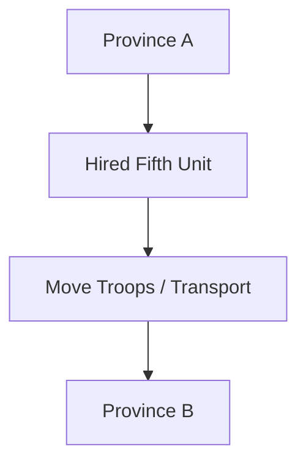
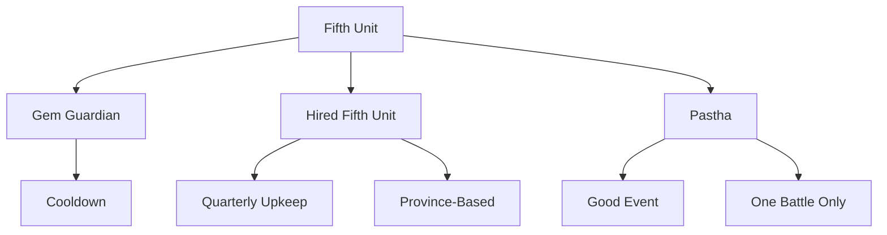

# Appendix C — Military Data

## Purpose

Appendix C contains reference data for Gemfire military units and battlefield assets.

This appendix covers:

- standard battle units;
- Fifth Unit categories;
- Gem Guardians;
- Hired Fifth Units;
- Pastha;
- movement traits;
- range categories;
- naming and version notes.

Strategic military rules are covered in the military system chapter.

Detailed tactical procedures are covered in the tactical battle chapter.

Commands and goodwill values belong to Appendix D.

---

## C.1 Standard Battle Units

### Overview

In tactical battle, regular troops are automatically divided into four standard units:

```text
Horsemen
Knights
Knights
Archers
```

These units are generated from the province’s strategic `Troops` value.

The player does not recruit these unit types separately.

---

### Standard Unit Table

| Unit      | Move | Range         | Notes                                      |
| --------- | ---: | ------------- | ------------------------------------------ |
| Horsemen  |    3 | Short / Close | Fast melee unit.                           |
| Knights   |    2 | Short / Close | Melee unit; can build fences.              |
| Knights 2 |    2 | Short / Close | Second Knights unit; mechanically similar. |
| Archers   |    2 | Long          | Ranged unit; cannot attack adjacent cells. |

---

### Standard Unit Roles

| Unit      | Battlefield Role                                    |
| --------- | --------------------------------------------------- |
| Horsemen  | Mobility, flanking, rear attacks, flag pressure.    |
| Knights   | Frontline combat, fence construction, blocking.     |
| Knights 2 | Secondary frontline unit.                           |
| Archers   | Ranged support, safe damage, firing over obstacles. |

---

### Archer Notes

Archers are tactically distinct from melee units:

- they attack at range;
- they cannot attack adjacent cells;
- they cannot attack diagonally;
- they do not receive backlash / counter-damage when attacking.

---

## C.2 Fifth Unit Categories

### Overview

Each army may include one Fifth Unit.

The Fifth Unit is the main source of military asymmetry between armies.

```text
Army
├── Horsemen
├── Knights
├── Knights
├── Archers
└── Fifth Unit
```

---

### Fifth Unit Types

| Category         | Description                                  |
| ---------------- | -------------------------------------------- |
| Gem Guardian     | Magical unit tied to a Gem owned by a house. |
| Hired Fifth Unit | Local special unit hired by a province.      |
| Pastha           | Event-based special Fifth Unit.              |

---

### Category Comparison

| Aspect                     | Gem Guardian           | Hired Fifth Unit         | Pastha         |
| -------------------------- | ---------------------- | ------------------------ | -------------- |
| Source                     | Gem ownership          | Hire Monster command     | Good event     |
| Ownership                  | House / Family         | Province                 | Event reward   |
| Cost                       | None                   | Hiring cost              | None           |
| Upkeep                     | None                   | Quarterly upkeep         | None           |
| Death                      | Cannot permanently die | Can be destroyed         | One-use        |
| Cooldown                   | Yes                    | No                       | No             |
| Movement between provinces | Not province-bound     | Move Troops / Transport  | Not persistent |
| Availability               | Gem cooldown           | Local hire pool / upkeep | Event only     |

---

## C.3 Gem Guardians

### Overview

Gem Guardians are powerful Fifth Units associated with Gems.

They are owned by houses / families, not by individual provinces.

They do not require upkeep and cannot permanently die.

After use, they enter cooldown.

---

### Gem Guardian Table

| Guardian | Strength | Move | Range            | Ownership Notes                   |
| -------- | -------: | ---: | ---------------- | --------------------------------- |
| Dragon   |      160 |    2 | Largest          | Lankshire.                        |
| Pluvius  |      160 |    2 | Circular         | Lyle.                             |
| Zendor   |      150 |    3 | Circular         | Blanche.                          |
| Empyron  |      140 |    2 | Short / Close    | Coryll in Scenario 1; Tate later. |
| Scylla   |      130 |    2 | Short / Close    | Flax early; Tudoria later.        |
| Chylla   |      120 |    3 | Short / Close    | Chrysalis early; Lyle later.      |
| Skulryk  |      110 |    3 | Circular         | Molbrew early; Blanche later.     |

---

### Notes

Skulryk's range is **Circular** (some sources label it "Round" or "Outer").
Gemfire has exactly four ranges (Short / Close, Long, Circular, Largest).
See §C.6 for the tile diagrams.

---

## C.4 Hired Fifth Units

### Overview

Hired Fifth Units are special province-based units obtained through the **Hire Monster** command.

Despite the command name, this category includes both monsters and elite human units.

---

### Hired Fifth Unit Table

| Unit      | Category    | Strength | Cost / Upkeep | Move | Range         | Notes                    |
| --------- | ----------- | -------: | ------------: | ---: | ------------- | ------------------------ |
| Bugbear   | Monster     |      100 |            30 |    3 | Short / Close | Basic monster unit.      |
| Fachan    | Monster     |      100 |            40 |    3 | Largest       | Wide attack pattern.     |
| Gargoyles | Monster     |      120 |            40 |  3\* | Short / Close | Flying.                  |
| Gunners   | Elite Human |      150 |            40 |    3 | Long          | Ranged unit.             |
| Lancers   | Elite Human |      180 |            50 |    3 | Short / Close | Strong melee unit.       |
| Orks      | Monster     |      100 |            20 |    2 | Short / Close | Cheap monster unit.      |
| Skeletons | Monster     |      100 |            20 |    2 | Short / Close | Cheap monster unit.      |
| Shooters  | Elite Human |      150 |            35 |    3 | Long          | Ranged unit.             |
| Spearmen  | Elite Human |      150 |            20 |    3 | Long          | Cheap ranged elite unit. |
| Warriors  | Elite Human |      180 |            60 |    3 | Short / Close | Strong melee unit.       |
| Wyverns   | Monster     |      150 |            60 |  3\* | Short / Close | Flying.                  |
| Ogre      | Monster     |      100 |            50 |    2 | Short / Close | Club-swinging giant.     |
| Lizards   | Monster     |      110 |            60 |    3 | Short / Close | Fire-breathing beasts.   |
| Olog-Hai  | Monster     |      110 |            30 |    2 | Short / Close | Sharp-clawed savages.    |
| Pikemen   | Elite Human |      150 |            40 |    3 | Short / Close | Zealous crusaders.       |

`3*` means Move 3 with flying movement.

---

### Province Ownership

Hired Fifth Units belong to provinces.

They can be moved between provinces with **Move Troops / Transport**.



---

## C.5 Pastha

### Overview

Pastha is a special event-based Fifth Unit.

It is neither a Gem Guardian nor a hired unit.

---

### Pastha Data

| Unit   | Strength | Cost | Upkeep | Move | Range         | Notes                            |
| ------ | -------: | ---: | -----: | ---: | ------------- | -------------------------------- |
| Pastha |      160 |    0 |      0 |    2 | Short / Close | Event-based, one-use, no upkeep. |

---

### Pastha Notes

Pastha:

- appears through a good event;
- is free;
- requires no upkeep;
- can be used for one battle;
- disappears after use;
- occupies the Fifth Unit slot.

---

## C.6 Range Patterns

### Overview

Units use named attack range patterns.

Some range patterns are understood at a high level, but exact tile diagrams still require verification.

---

### Range Pattern Table

| Range Pattern    | Meaning                                                         | Example Units                         |
| ---------------- | --------------------------------------------------------------- | ------------------------------------- |
| Short / Close    | Melee-range attack.                                             | Horsemen, Knights, Lancers, Warriors. |
| Long             | Ranged attack similar to Archers.                               | Archers, Gunners, Shooters, Spearmen. |
| Circular         | Ring of cells at distance 2 around the unit (see diagrams).     | Pluvius, Zendor, Skulryk.             |
| Largest          | Widest known attack pattern.                                    | Dragon, Fachan.                       |

---

### Short / Close

Used by melee units.

Typical units:

- Horsemen;
- Knights;
- many monsters;
- many melee elite units;
- some Gem Guardians.

---

### Long

Used by ranged units.

Typical units:

- Archers;
- Gunners;
- Shooters;
- Spearmen.

Long-range attacks do not cause backlash / counter-damage to the attacker.

---

### Circular

Used by some magical or special units.

Typical units:

- Pluvius;
- Zendor;
- Skulryk.

---

### Largest

Used by the widest attack-pattern units.

Typical units:

- Dragon;
- Fachan.

### Range tile diagrams

Attack ranges (`.` = attacking unit, `X` = a cell it can hit):

```text
Short            Long             Circular         Largest
o o o o o        o o X o o        X X X X X        X X X X X
o o X o o        o o o o o        X o o o X        X X X X X
o X . X o        X o . o X        X o . o X        X X . X X
o o X o o        o o o o o        X o o o X        X X X X X
o o o o o        o o X o o        X X X X X        X X X X X
```

Long-range attacks deal less damage but take no counter-damage. There are
exactly four ranges; "Outer" is not a distinct pattern.

---

## C.7 Movement Traits

### Movement Values

Movement value determines how many cells a unit can move during its activation.

| Move Value | Meaning                 |
| ---------: | ----------------------- |
|          2 | Standard slow movement. |
|          3 | Fast movement.          |
|        3\* | Fast flying movement.   |

---

### Flying

Flying units can move over certain obstacles.

Confirmed flying units:

| Unit      | Type             |
| --------- | ---------------- |
| Gargoyles | Hired Fifth Unit |
| Wyverns   | Hired Fifth Unit |

---

### Flying Movement Effects

Flying units can pass over:

- fences;
- trees;
- rivers.

---

### Fence Builder

Only Knights can build fences.

| Unit        | Can Build Fences      |
| ----------- | --------------------- |
| Knights     | Yes                   |
| Knights 2   | Yes                   |
| Horsemen    | No                    |
| Archers     | No                    |
| Fifth Units | No confirmed evidence |

---

## C.8 Strength

### Overview

Fifth Units use **Strength** instead of troop count.

Strength represents:

- combat power;
- durability;
- effective unit size.

---

### Strength Users

| Unit Type         | Uses Strength       |
| ----------------- | ------------------- |
| Gem Guardians     | Yes                 |
| Hired Fifth Units | Yes                 |
| Pastha            | Yes                 |
| Standard Units    | No, use troop count |

---

### Strength Notes

For Hired Fifth Units:

- Strength can be reduced in battle;
- the unit can be destroyed;
- the unit can desert if upkeep is unpaid.

For Gem Guardians:

- Strength decreases when attacking;
- they cannot permanently die;
- defeat triggers a longer cooldown.

---

## C.9 Naming and Version Notes

### Orks

This document uses:

```text
Orks
```

rather than:

```text
Orcs
```

because `Orks` is the spelling found in referenced game data and guides.

---

### Short vs Close

Some sources use:

```text
Short
```

Others use:

```text
Close
```

This appendix writes:

```text
Short / Close
```

to indicate the same melee-range category.

---

### Circular vs Outer — resolved

Gemfire has exactly four ranges: Short / Close, Long, Circular, Largest.
"Outer" is not a separate pattern. Skulryk's range is **Circular** (some sources
label it "Round"). See §C.6 for the tile diagrams.

---

### Gargoyles / Wyverns Movement

Movement written as:

```text
3*
```

means:

```text
Move 3 with flying trait
```

---

### Chylla and Scylla

Chylla and Scylla are different Gem Guardians.

They should not be merged:

| Guardian | Notes                                                    |
| -------- | -------------------------------------------------------- |
| Scylla   | Associated with Scylla Gem; Flax early, Tudoria later.   |
| Chylla   | Associated with Chylla Gem; Chrysalis early, Lyle later. |

---

## C.10 Data Summary

### Standard Army Data

```text
Standard Army
├── Horsemen
├── Knights
├── Knights
├── Archers
└── Fifth Unit
```

---

### Fifth Unit Data Model



---

### Key Military Data Principles

1. Standard troops become fixed battlefield units.
2. Fifth Units are the primary source of military asymmetry.
3. Gem Guardians are reusable but cooldown-limited.
4. Hired Fifth Units are powerful but expensive and risky.
5. Pastha is a rare event-based temporary Fifth Unit.
6. Range patterns and movement traits strongly affect tactical value.

---

## Open Data Questions

The following data remains to be fully verified:

1. (Resolved) Range tile diagrams for all four ranges are in §C.6.
2. (Resolved) Largest range diagram is in §C.6.
3. Exact destruction threshold for Hired Fifth Units.
4. Exact Strength loss rules for all non-Gem Fifth Units.
5. Whether any Fifth Units have hidden combat modifiers beyond Strength, Move, and Range.
6. Whether Fifth Unit data differs between SNES, Genesis, NES, PC, and Royal Blood versions.
7. (Resolved) "Outer" is not a distinct range; Skulryk is Circular.
8. Whether Pastha’s combat behaviour differs from Gem Guardians beyond one-use availability.

---

## Summary

Appendix C defines Gemfire’s military unit data.

The key military structure is:

```text
Commander
+
4 Standard Units
+
1 Fifth Unit
```

Standard units are fixed and predictable.

Fifth Units provide most of the tactical variety:

- Gem Guardians provide reusable magical power;
- Hired Fifth Units provide local paid military power;
- Pastha provides rare event-based temporary power.

This appendix should be treated as the central reference for unit statistics, movement, range, and Fifth Unit categories.
