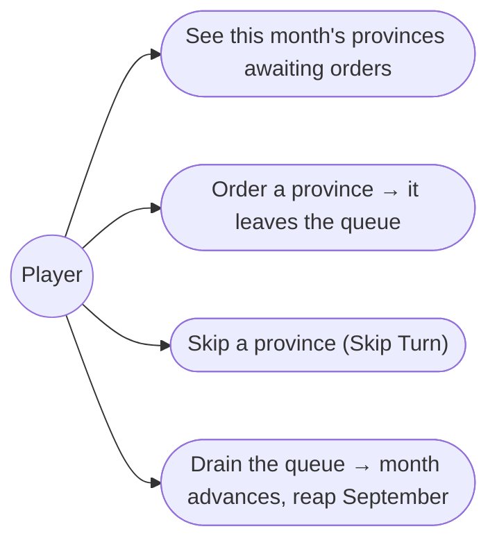
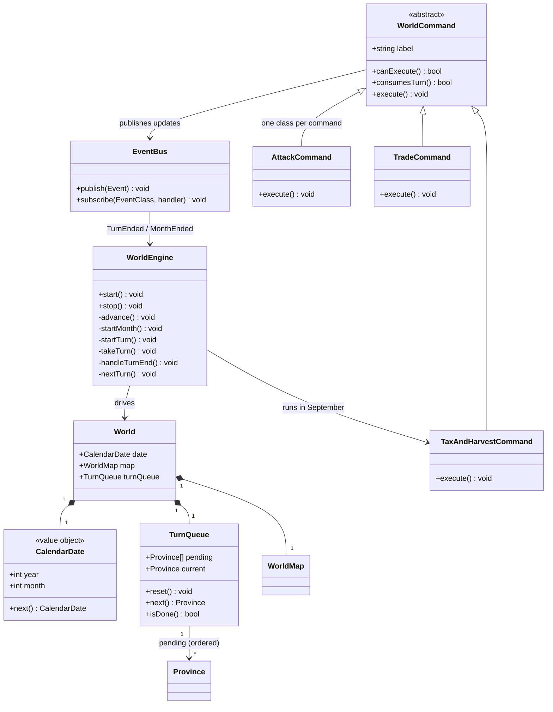

# 2. The monthly turn

## Description

Each month every province takes its turn: you order yours, rival turns resolve automatically, and when the queue drains the calendar advances and the next month begins.

This feature owns the turn machinery — the month's single global turn queue, the calendar advance, the month-start effects — and establishes the **command pattern** every order goes through. Command _behaviours_ belong to their features (economy → 3, military → 5/9, …) and start as inert placeholders. The first month-start effect — the September tax and harvest — lands here; events, rival turns, Gem cooldowns, upkeep, and victory are seams later features fill.

## Glossary

| Term                   | Meaning                                                                                                                                                                                                                                         |
| ---------------------- | ----------------------------------------------------------------------------------------------------------------------------------------------------------------------------------------------------------------------------------------------- |
| Month / calendar       | Strategic time advances one month per cycle; `CalendarDate` is (year, month 1–12).                                                                                                                                                              |
| Turn queue             | The month's single global queue of every province in turn order. A province leaves it when its turn resolves; when it empties, the month advances. Unowned provinces are skipped without a turn; rival and Entrusted turns are played by the computer (feature 12). |
| Command                | An order (Develop, Recruit, …) — one `WorldCommand` class per command carrying its label and an `execute`. It declares `consumesTurn()`; the issuing layer (the command menu or the computer player) ends the turn after a turn-consuming command. |
| Command group          | One of the four in-game command menus — Military, Domestic, Diplomacy, Vassal (from feature 1). Grouping is catalog data, not a command field.                                                                                                  |
| Command context        | What a command is constructed with: the `World` (state) and the `EventBus` (commands publish their updates on it); `execute()` takes no arguments. A province command's target is the queue's current province.                    |
| Turn-consuming command | Develop, Give Food, Recruit, Attack, Transport / Move, Diplomacy, Search, Hire Monster — ends the province's turn, removing it from the queue (appendix-d §D.4).                                                                                |
| Free command           | Trade, View, Change Lord, Entrust — informational or administrative; leaves the province pending (appendix-d §D.4). Exception: a Change Lord that moves the ruler ends the turn (feature 4).                                                    |
| End-of-month           | Once the queue empties the calendar ticks and the next month begins. The engine then runs the month-start phases in a fixed order before the first turn.                                                                                       |
| Tax & harvest          | The yearly September gain per owned province: one calculation from Cultivation, Loyalty, and the governor's Charm, with Gold worth half and Food getting a 0–30 bonus. See [September Harvest](../spec/04-economy-system.md#detailed-rules-september-harvest). |

## Functionality

- Build the month's queue at its start: every province, in random order.
- Provinces activate in queue order: only the queue's current province takes orders. A turn-consuming command ends its turn and advances the queue; a free command leaves it current.
- Skip the current province (Skip Turn): forfeit its action and advance the queue without a command.
- Skip unowned provinces without a turn: no `TurnStarted` is announced for them.
- Announce every owned province's turn start (`TurnStarted`, carrying the province), then report the province's incidents from this month's events. A province the player does not run (a rival's, or one of the player's Entrusted provinces) is played by the computer (feature 12).
- Advance the calendar the moment the queue empties — no separate end-month action — then build the next month's queue.
- Run month-start phases as each month begins, in a fixed engine order: September harvest, January lifecycle, quarterly upkeep, monthly events, Fifth Unit recovery, market change, hire pools. Then the first turn starts.

## Use cases



## UI

The header carries the date and whose turn it is right now — the queue's current province. That province selects itself: ordering or skipping moves the selection (and the header) to the next turn, so a month plays without touching the map. Clicking the map is for inspecting other provinces.

```text
+-----------------------------------------------------+
|  AURETH            Month 4, 1186                  |
|  Turn: Alderpass                                       |
+-----------------------------------------------------+
| Selected: 10 Alderpass (yours)          Owner: Alderwyn |
| ...province facts...                                |
+-----------------------------------------------------+
| Military   Domestic    Diplomacy   Vassal           |
|  Attack     Develop      Ally        View           |
|  ...                                  [ Skip Turn ] |
+-----------------------------------------------------+
```

When your last province acts, the date rolls forward and the header presents the new month's first turn; a September advance shows up as the tax and harvest landing in the province stats.

## Research

**Command pattern for orders.** Orders are `Command` objects, not menu strings, so issuing is uniform across every feature's commands: the issuing layer just calls `execute`, never branching on what the command does. One concrete class per command (`commands/province` — `AttackCommand`, `DevelopCommand`, …) extends `WorldCommand` (a label plus a no-argument `execute`, with the `{ world, events }` context injected at construction — the same base the engine-run `TaxAndHarvestCommand` adopts); the four-menu grouping is catalog data, and the catalog is a factory (`createCommandGroups(context)`) called at the composition root once the world exists. A command reports whether it consumes the turn (`consumesTurn()`, true by default; Trade, View, Entrust, and most Change Lord choices return false). The issuing layer — the command menu for the player, the engine for computer turns — publishes `TurnEnded` after a turn-consuming command; a command's target is the queue's current province. Commands never know the engine exists — decoupling is one-way through the bus. Each feature fills in its commands' real `execute`. This refactors feature 1's string-button menu to render `Command`s.

**One global turn queue; ordering lives in its `reset`.** The source confirms per-province turns interleaved across families — Hartman: _"eventually, your own turn will come about"_, _"upon your turn you will be presented with your particular state's info"_; a turn-consuming command _"ends the player's turn"_ (FAQ) — but leaves the exact order open (spec §3.6: fixed / randomized / province-number / scenario-dependent). So `TurnQueue` is global and built once over the province list; each month `reset()` shuffles the provinces afresh, and a `currentIndex` walks the order. The spec now gives the original's roll ([Province order](../spec/03-turn-structure.md#detailed-rules-the-month)): each province takes a random position, stepping forward past taken ones, which is not a uniform shuffle. We keep the plain shuffle on purpose. Unowned provinces are skipped; rival turns are played by the computer through the same queue (feature 12) — the loop is built once. The month ends only when the queue drains, matching the original's walk-through.

**Where the action lives.** "Still to act?" is membership in the queue, not province state — a `Province` stays identity, ownership (`isOwner` / `isNeutral`), and economy; the two compose at the command layer.

**Month-start phases.** The engine runs month-start work as an explicit phase sequence, not as loose `MonthStarted` subscribers, so the order is fixed and each phase can finish (and publish its reports) before the next. `TaxAndHarvestCommand` is the September phase. There is no separate tax: Gold and Food come from one calculation ([September Harvest](../spec/04-economy-system.md#detailed-rules-september-harvest)). Known deviation: a province without a general uses Charm 0 rather than the ruler's Charm halved. The phase order follows [Start-of-month processing](../spec/03-turn-structure.md#detailed-rules-the-month).

## Domain model



_`World` is pure global state; the `WorldEngine` is a phase machine driven by events on the `EventBus`. The command menu publishes `TurnEnded` after a turn-consuming command or a skip (commands never reference the engine); the engine's `TurnEnded` handler advances the queue and starts the next turn — or publishes `MonthEnded` when drained, then rolls the date via `CalendarDate.next` and starts the next month. Unowned provinces are skipped without a `TurnStarted`. For a province the player does not run (a rival's, or an Entrusted one), the engine asks the computer player to play it and ends the turn itself, so the loop self-runs until a player turn surfaces. Every month starts the same way (re-shuffle via `reset()`, announce `MonthStarted` carrying the new date, run the month-start phases in order, then start the first turn), including the first at `start()` (no date roll). The bus dispatches run-to-completion: an event published during dispatch is queued FIFO, so long reaction chains run flat and cannot overflow the stack. The queue walks a `currentIndex` — `current` is the active province, `next()` advances past it. `Province` keeps no turn state._

## Flow

```mermaid
sequenceDiagram
  participant Player
  participant WorldCommand
  participant WorldEngine
  participant TurnQueue
  participant World
  Player->>WorldCommand: execute() (order a province)
  Player->>WorldEngine: publish TurnEnded (turn-consuming commands or a skip)
  Note over WorldEngine: a free command ends nothing
  WorldEngine->>TurnQueue: next(), start the next turn
  Note over WorldEngine: unowned skipped; rival and Entrusted turns played by the computer — the loop self-runs
  WorldEngine->>World: drained → publish MonthEnded → advance the month
  Note over World: date = date.next() — next month's queue — month-start phases
  WorldEngine-->>Player: new month
```

## Tests

- **Calendar advance (unit):** `CalendarDate.next` is pure and rolls month 1→12, then to month 1 of the next year.
- **Turn queue (unit):** a new month's queue holds every province; assert membership/count, not the random order.
- **Issuing (unit):** executing a turn-consuming command on the current province advances the queue; a free command leaves it current; a skip advances it.
- **Advance gate (unit):** the month advances automatically when the queue drains, and not before.
- **Unowned skip (unit):** an unowned province in the queue gets no `TurnStarted` and is passed over.
- **September tax & harvest (unit):** advancing into September adds Gold and Food per [September Harvest](../spec/04-economy-system.md#detailed-rules-september-harvest) to each owned province (Protection plays no part); other months add nothing, and neutral provinces are untouched.
