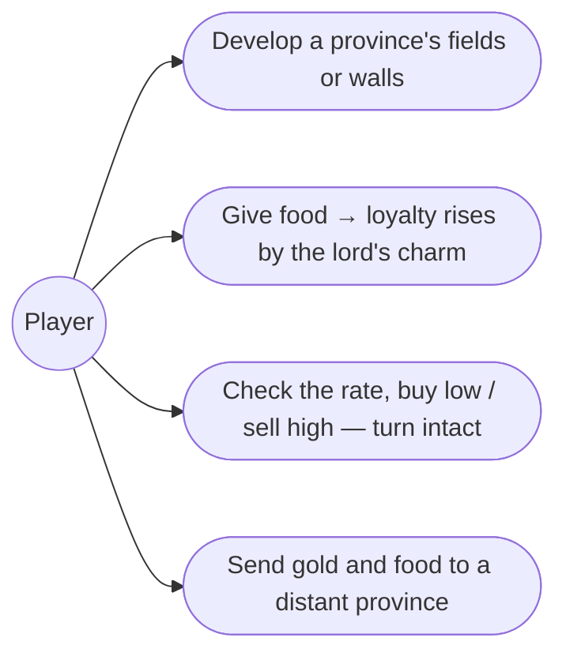
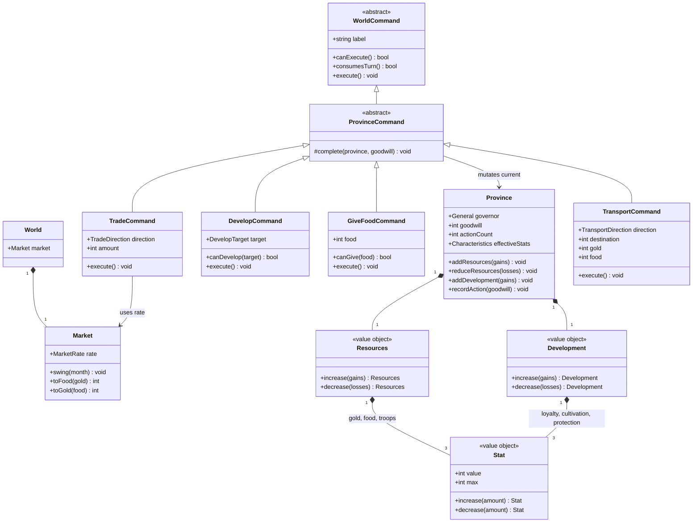
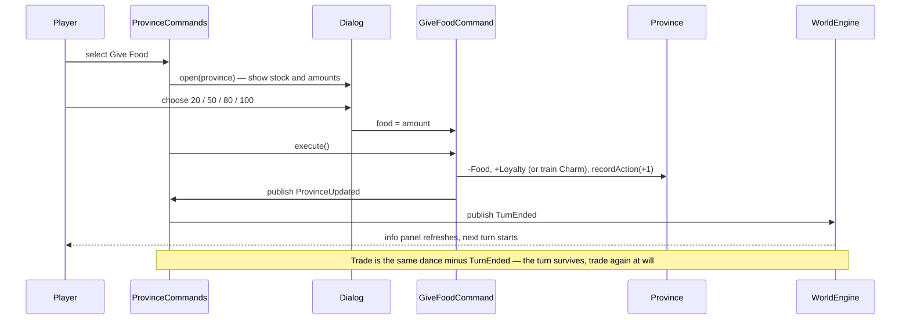

# 3. Province economy

## Description

The Domestic orders that grow a province month over month: develop its fields and walls, feed its people, trade at the market, and move resources around the realm.

This feature fills in the real `execute` bodies of the four Domestic commands (Develop, Give Food, Trade, Transport), gives orders **parameters** for the first time (a Develop target, amounts, and a target province), and lands the **goodwill bookkeeping** every turn-consuming order feeds — the hidden per-province counters that feature 15's event checks will consume. Out of scope: the events that spend goodwill (15), disasters that degrade stats (15), Recruit (5), and rival AI (12).

## Glossary

| Term         | Meaning                                                                                                                                                              |
| ------------ | --------------------------------------------------------------------------------------------------------------------------------------------------------------------- |
| Develop      | Pay 10 Gold to raise Cultivation or Protection by `1 + floor(INT / 30)`, up to 100. No randomness. Refused below 10 Gold or at 100. Turn-consuming, goodwill +1. See [Develop](../spec/04-economy-system.md#detailed-rules-develop). |
| Give Food    | Hand 20, 50, 80, or 100 Food to the people: Loyalty + `floor(Charm × Food / 300)`, capped at 100. At Loyalty 100 it trains the governor's Charm instead. Turn-consuming, goodwill +1. See [Give Food](../spec/04-economy-system.md#detailed-rules-give-food). |
| Trade        | Buy or sell Food with the merchant at the current market rate. **Free** — does not consume the turn, carries no goodwill.                                             |
| Transport    | Send Gold and Food to, or receive them from, **any** province you own, however distant (Move Troops, feature 5, is the bordering-only military sibling). Turn-consuming, goodwill 0. |
| Market rate  | The realm-wide exchange rate — low (1 Gold = 2 Food), average (1 = 1), or high (2 Gold = 1 Food). At the start of February, May, August, and November it always changes to one of the other two. |
| Goodwill     | A hidden per-province score: each turn-consuming order adds its modifier (appendix-d §D.5), clamped to ±15. Feature 15's event check reads and resets it.          |
| Action count | A hidden per-province counter of turn-consuming orders taken. At exactly 3, a month start rolls a 40% event chance, and both counters reset either way (feature 15). Skip Turn and free orders don't count. Both reset when the province changes owner. |
| Governor     | The general running the province — their Intelligence scales Develop gains, their Charm scales Give Food and the harvest.                                             |

## Functionality

- Develop: choose Cultivation or Protection, spend 10 Gold, and raise it by `1 + floor(INT / 30)`, never past 100. A target already at 100 can't be chosen; the order disables while Gold < 10 or both targets are at 100.
- Give Food: choose 20, 50, 80, or 100 Food (no more than the stock); Loyalty rises by `floor(Charm × Food / 300)`. At Loyalty 100 the food instead trains the governor's Charm +1 (90% chance), and the dialog asks for confirmation first.
- Trade: see the month's market rate, then buy or sell a chosen amount of Food at it — without spending the turn, any number of times.
- Transport: choose any other owned province, then send it Gold and/or Food or receive them from it.
- The market rate changes at the start of February, May, August, and November, always to one of the other two rates ([Trade](../spec/04-economy-system.md#detailed-rules-trade)).
- Every turn-consuming order records its goodwill and bumps the province's action count; feature 15's event check consumes them.
- Resource caps hold everywhere: Gold/Food/Troops 0–999, Loyalty 0–100. Develop stops Cultivation and Protection at 100.

## Use cases



## UI

The Domestic menu holds one `Develop` command; its dialog asks "Invest 10 gold in what?" and offers Cultivation and Protection, leaving out a target already at 100. Give Food, Trade, and Transport also open a small **dialog** in the commands panel to collect their parameters. Give Food offers the four fixed amounts the stock allows, and asks for confirmation when Loyalty is already 100. Dialogs cap inputs at what the province (and the receiver's 999 ceiling) allows, so no order can overdraw or silently lose resources — but they never preview the outcome: the merchant only says how the prices stand, and guessing what your lord's charm or the rate will yield is part of the game. Develop grays out while the province can't pay the 10 Gold or both targets are at 100 — a click that does nothing would read as a bug — and re-checks whenever the province updates, since a Trade can make it affordable mid-turn.

```text
+------------------------------+   +------------------------------+   +------------------------------+
| Give Food — Alderpass           |   | Trade — Alderpass               |   | Transport — Alderpass           |
| Food in store: 240           |   | "The prices are low."        |   | (o) Send  ( ) Receive        |
| [ 20 ] [ 50 ] [ 80 ] [ 100 ] |   | (o) Buy   ( ) Sell           |   | To: [ 12 Kashmir         v ] |
|                              |   | Amount: [ 150 ] food         |   | Gold: [ 50 ]   (max 130)     |
|                              |   |                              |   | Food: [ 200 ]  (max 240)     |
| [ Confirm ]       [ Cancel ] |   | [ Confirm ]       [ Cancel ] |   | [ Confirm ]       [ Cancel ] |
+------------------------------+   +------------------------------+   +------------------------------+
```

After any order resolves, the province info panel refreshes — development, gold, and food visibly move, which is the whole feedback loop of this feature.

## Research

**Parameterized commands.** `execute()` stays no-arg, so every order is still dispatched uniformly. A command carries its parameters as typed public fields (`DevelopCommand.target`, `GiveFoodCommand.food`, `TradeCommand.direction` / `amount`, `TransportCommand.direction` / `destination` / `gold` / `food`). Its dialog control fills them in and then the command runs. The command also exposes the queries its dialog needs (`canDevelop`, `canGive`, `getMaximumAmount`, `getMaximum`), so the dialog never re-implements a rule.

**Where the market lives.** One realm-wide `Market` lives on `World`. The engine's market phase calls `swing(month)`: in February, May, August, and November the rate always moves to one of the other two rates, with equal chance; other months leave it alone ([Trade](../spec/04-economy-system.md#detailed-rules-trade)). The rate shows only inside the Trade dialog, preserving the original's check-by-opening-Trade rhythm.

**Goodwill is part of the order's mutation.** "Every order carries goodwill" — and recording it is just another province write, like spending gold or raising loyalty: `ProvinceCommand` offers a protected `complete(province, goodwill = 0)` that publishes `ProvinceUpdated` and, if the command consumes the turn, records the action with its §D.5 modifier (`this.complete(province, 1)` from Develop, plain `this.complete(province)` from Transport) — no field on the base, the value lives where the order's effects live. Ending the turn is the issuing layer's job, not the command's (feature 2). No event in between — the bus is for flow, not for sibling state writes. Skip Turn records no action, so a skipped month leaves the counters untouched (spec §11.2: only turn-based actions count). The counters live on `Province`: goodwill is clamped to ±15, the action count stops at 3, and both reset when the province changes owner. Feature 15 reads and resets them ([Policy Events](../spec/11-events.md#detailed-rules-policy-events)).

**Formulas follow the spec.** Develop and Give Food use the spec's detailed rules ([Develop](../spec/04-economy-system.md#detailed-rules-develop), [Give Food](../spec/04-economy-system.md#detailed-rules-give-food)), reading the governor's stats through `Province.effectiveStats` (halved for a remotely ruled province, feature 4). Give Food with no general in the province uses the ruler's Charm halved, as the spec says. Known deviation: Develop with no general uses INT 0 (gain +1) rather than the ruler's INT halved.

**Caps live in a `Stat` value object.** Every capped number — Gold/Food/Troops (999), Loyalty (100), Cultivation/Protection (200) — becomes a `Stat`: a value with its max, whose `increase` / `decrease` clamp to 0…max. `Resources` and `Development` turn into groups of `Stat`s whose `increase(gains)` / `decrease(losses)` mass-update their members, so clamping is written once and no caller ever checks a cap by hand. Develop applies its own lower ceiling of 100 on top. The same VO backs generals' stats (Intelligence/War/Charm, cap 200). Dialogs additionally cap inputs (stock, affordability, receiver headroom) so the player can't *ask* for a lossy order; the domain clamp is the backstop, not the UX.

**Unaffordable orders disable.** `WorldCommand` gets `canExecute()` (default true); Develop overrides it with "10 Gold on hand and a target below 100", and the menu disables any command whose `canExecute` is false — re-evaluated on `ProvinceUpdated`. The `execute` guard stays as the domain backstop.

**Refreshing the UI.** Orders now mutate visible state outside the turn cycle (Trade ends no turn). Commands publish `ProvinceUpdated(province)` after mutating; `StrategyScreenControl` refreshes the info panel when the updated province is the selected one. `TaxAndHarvestCommand` adopts the same event, fixing September's silent stat change.

## Domain model



_Every capped number is a `Stat` — value plus max, `increase` / `decrease` clamp to 0…max. `Resources` (gold, food, troops — max 999) and `Development` (loyalty 100, cultivation/protection 200) mass-update their stats; all three stay immutable value objects. Develop stops Cultivation and Protection at 100. `ProvinceCommand.complete(province, goodwill = 0)` publishes `ProvinceUpdated` and, for a turn-consuming command, writes the hidden counters on the current province; Trade's `consumesTurn()` is false, so it records nothing. `Market.swing(month)` changes the rate in February, May, August, and November; the engine calls it in its market phase._

## Flow



## Tests

- **Market (unit):** the three rates convert both directions (low 1g=2f, average 1=1, high 2g=1f), rounding down; `swing` changes the rate only in February, May, August, and November, and always to a different rate.
- **Stat (unit):** `increase` / `decrease` clamp to 0…max; `Resources`/`Development` mass-update their stats under their caps (999 / 100 / 200).
- **Develop (unit):** spends 10 Gold, raises the chosen stat by `1 + floor(INT / 30)` without passing 100, records +1 goodwill and one action; with Gold < 10, or the target at 100, it refuses.
- **Give Food (unit):** accepts only 20, 50, 80, or 100 within the stock; deducts the Food, raises Loyalty by `floor(CHA × Food / 300)`, records +1 goodwill; at Loyalty 100 it may raise the governor's Charm by 1 instead.
- **Trade (unit):** converts at the current rate in both directions, never past 999, and does **not** consume the turn or touch the counters.
- **Transport (unit):** sends Gold and Food to, or receives them from, any other owned province and counts the action at goodwill 0.
- **Skip leaves no trace (unit):** skipping a turn changes neither goodwill nor action count.
