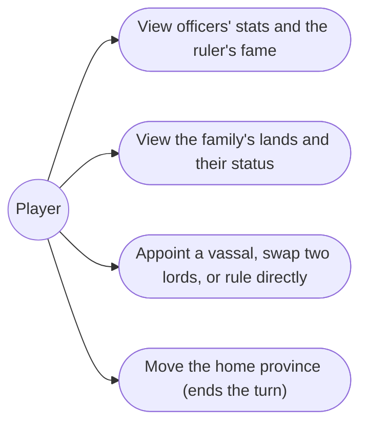
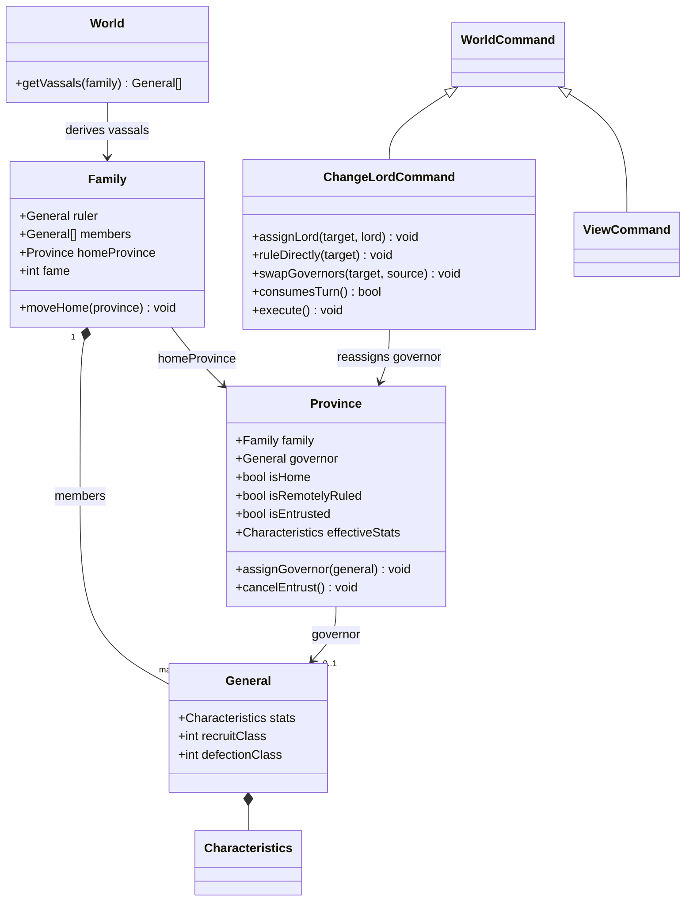
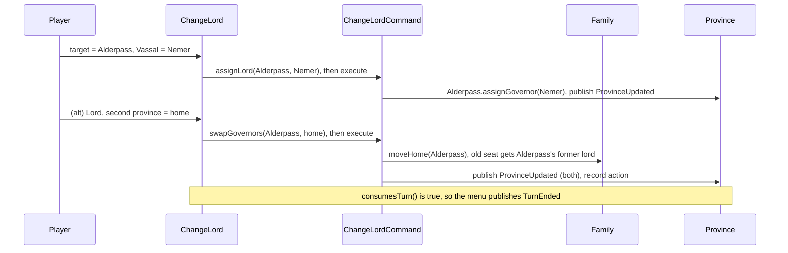

# 4. Generals & lords

## Description

Manage the family: see your generals and their stats, choose who lords each province — or rule it yourself from afar at half strength — and move your seat of power. `General`, `Family` (ruler, members, home, fame), and `Province.governor` already exist and are seeded; this feature reads and reassigns them and adds the UI.

In scope: view generals' stats and the ruler's fame; appoint, move, and promote lords; rule a province directly; move the home province.

Out of scope: gaining generals (Defection, recruiting prisoners, and wandering generals who offer service — features 10, 9, 11) and rewarding generals (no sourced mechanic; hidden loyalty is fixed per general, see [General Loyalty](../spec/05-characters.md#detailed-rules-general-loyalty)). We only seed the vassal pool those fill.

## Glossary

| Term          | Meaning                                                                                           |
| ------------- | ------------------------------------------------------------------------------------------------- |
| Ruler         | The family head. The only member with **Fame** and the only one who can issue Change Lord.        |
| Lord          | The general governing a province — resident, full strength. A general lords at most one province. |
| Vassal        | A member governing no province — the pool Change Lord promotes from (and Defection/capture fill). |
| Home province | The ruler's seat: governed by the ruler at **full** strength, and where Change Lord issues. Never Entrusted. |
| Rule directly | The ruler governs a non-home province remotely, at **half** its stats. No resident lord.          |
| Fame          | A ruler-only score, 0–100 (`Family.fame`). Gates hired Fifth Unit control and prisoner recruitment; not an input to Ally, Defection, or Surrender. Shown here; changed by other features. |

## Functionality

- Open **View** — a free, tabbed info overlay over the map (no turn, per appendix-d). **General** is a table whose first cell is an officer card (portrait, title — ruler / lord / vassal — name, and age) followed by Intelligence / War / Charisma, the ruler's Fame, and posting. **Land** lists the family's provinces: status (capital / lorded / ruled remotely / Entrusted), governor, and development. View can target any of the 30 provinces, so a rival family's generals and lands are shown the same way ([View and Hidden Information](../spec/02-world-model.md#detailed-rules-view-and-hidden-information)). (**Age** = scenario year − birth year; birth years come from the AshwingAtma stat guide in its year-201 epoch, which scenario 1 now uses, with the unknown birth month randomized at world creation. **Gems** comes with feature 7, **5th Unit** with feature 6.)
- Change a province's lord: promote a **vassal** (the target's old lord, if any, returns to the pool), pick a **Lord** to **swap** the governors of the target and a second own province, or choose **You** to recall the target's lord to court (the ruler then rules it remotely at half strength, and its Entrust is cleared; it does nothing if the target has no lord).
- Move the home province: the Lord swap with the home province as the second province. The ruler relocates, the new seat becomes full-strength and loses its Entrust, and the old seat receives the target's former lord (or is ruled remotely if there was none). This alone among the feature's orders ends the turn. See [Change Lord](../spec/03-turn-structure.md#detailed-rules-change-lord-and-entrust).
- Develop, Give Food, and the harvest read the province's **effective** stats, so a remotely-ruled province yields half.

## Use cases



## UI

`View` is a free overlay drawn over the map (not the command rail), with **General** and **Land** tabs and a Close button — no turn, per appendix-d. Each tab is a table: General lists officers (rank, name, posting, INT/WAR/CHA, the ruler's Fame); Land lists provinces (status — capital / lorded / ruled remotely / Entrusted — name, governor, development). The province info panel keeps only the governor's portrait and name — a general's stats and the ruler's Fame live in View's General tab. `Change Lord` is its own dialog in the command rail, offered only from the home province (where the ruler is); the target province is **picked on the map** (the family's non-home provinces highlight as selectable, like Transport's destination). The dialog then offers **You**, **Vassal** (pick a court vassal), or **Lord** (pick a second own province to swap with). Picking the home province as the second province moves the ruler and ends the turn; every other choice is free, so several lords can be reassigned in one visit.

```text
+--- map overlay: View ----------------------+   +--------------------------------+
| [General] [Land]                     Close |   | Change Lord                    |
|  +----+ Ruler        INT WAR CHA Fame Post |   | Province 7: Alderpass  (pick map) |
|  |pic | Avar          82  87  76   9  Card |   | New lord:                      |
|  +----+ (Age)                              |   |  [ You ]  (recall to court)    |
|  +----+ Lord                               |   |  [ Vassal ] → Nemer, ...       |
|  |pic | Nemer        76  52  75   —  Roda |   |  [ Lord ]   → swap with a      |
|  +----+ (Age)                              |   |     province (home = move      |
+--------------------------------------------+   |     the ruler here, ends turn) |
                                                 | [ Confirm ]        [ Cancel ]  |
                                                 +--------------------------------+
```

## Research

**The half-strength ruler is the one real rule.** Sources are explicit: the ruler governs at half strength anywhere but home (FAQ: "half"; Hartman: "lowered greatly"). We model it as derived state, not a stored modifier — a province is remotely ruled when its governor is the family's ruler and it is not the home province (`Province.isRemotelyRuled`); `Province.effectiveStats` halves the governor's stats there and returns them in full otherwise. Develop, Give Food, and the harvest read `effectiveStats`, so the penalty lives in one place. A province with no general at all is rare; there Give Food uses the ruler's Charm halved, as the spec's [acting character](../spec/02-world-model.md#detailed-rules-foundations) rule says. Known deviation: Develop and the harvest read 0 for a province with no general instead of the ruler's stats halved.

**Lordship is reassignment, not new structure.** `Province.governor` already runs end to end. Change Lord rewrites it in one of three ways: appoint a vassal (`assignLord`), swap the governors of two own provinces (`swapGovernors`), or recall the lord so the ruler governs remotely (`ruleDirectly`). The vassal pool is derived — `members` minus the ruler minus current governors (`World.getVassals`) — so there is no assignment field to sync. Change Lord is home-only and consumes no turn (appendix-d), with one exception: a swap whose second province is home moves the ruler, relocates the home seat (`Family.moveHome`), and **ends the turn** with a policy value of 0 ([Change Lord](../spec/03-turn-structure.md#detailed-rules-change-lord-and-entrust)). The spec's "You" leaves the target without a general; we keep the ruler as its remote governor instead, which gives the same half-strength result.

**Fame is shown here, changed elsewhere.** Fame is the ruler's alone (`Family.fame`, 0–100). Other features change it — claiming a province, battles, defection, surrender, succession ([Fame](../spec/05-characters.md#detailed-rules-fame)) — so this feature only reads it.

## Domain model



## Flow



## Tests

- **Effective stats (unit):** full for a resident lord and the ruler at home, `floor(stat/2)` for the ruler on a non-home province — and Develop/Give Food/harvest consume `effectiveStats`, so a remotely-ruled province develops at half.
- **Change Lord (unit):** appointing a vassal returns the target's old lord to the pool; swapping exchanges the two provinces' governors; "You" recalls the lord, leaves the ruler governing remotely, and clears Entrust; `canExecute` is false off the home province; none of these consume the turn.
- **Move home (unit):** a swap with the home province relocates `homeProvince`, makes the ruler the new seat's full-strength governor, clears its Entrust, gives the old seat the target's former lord, and consumes the turn.
