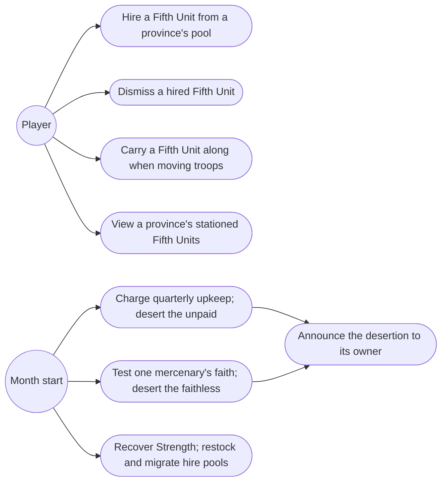
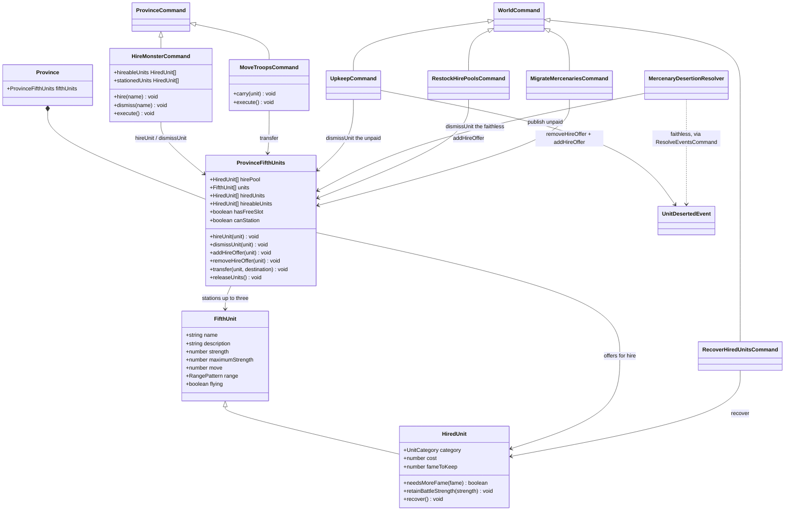
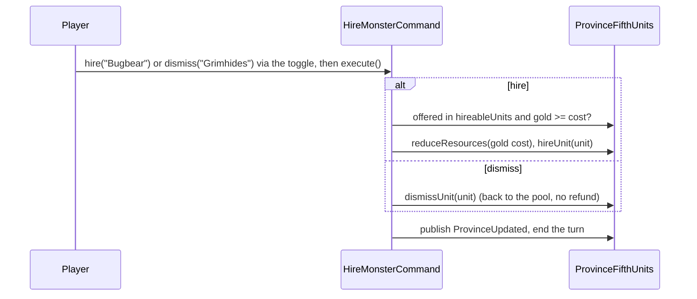
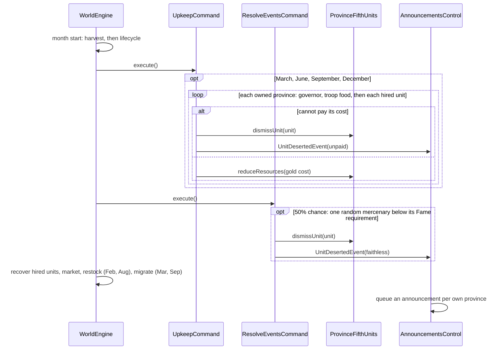

# 6. Fifth Units

## Description

The hiring economy for the special units that fill an army's fifth slot: hire province-based monsters or elite mercenaries with Gold, keep them by paying quarterly upkeep and staying famous enough to hold them, and dismiss any no longer worth the cost.

`HireMonsterCommand` already exists as a turn-burning stub. This feature gives it behaviour — the one command both hires and dismisses (FAQ §6.3) — introduces the `HiredUnit` domain entity, its catalogue, and the province's `ProvinceFifthUnits` roster, and adds month-start ticks to the turn engine: quarterly upkeep, monthly recovery and mercenary desertion, and hire pool restock and migration.

In scope: hire available Fifth Units for Gold (up to three per province); pay their upkeep every quarter or lose them to desertion; lose a mercenary a family is not famous enough to hold, and be told when one leaves; dismiss a stationed unit; watch the hire pools refill and mercenaries drift between provinces; carry one stationed unit along when moving troops into a neighbour (§8.6); keep or lose units after a battle; and see a province's stationed units through View. Moving and viewing reach back into feature 5's Move Troops and the View command, which had nothing to carry or show until Fifth Units existed.

Out of scope: the battle itself and the fifth army slot it fills (feature 8); Gem Guardians (feature 7) and Nerith (feature 15), the other two things that can fill the fifth slot; and monster rampage, which is resolved with the province events (feature 15). The full rules are in [Recruit, Hire, and the Hire Pool](../spec/08-monsters.md#detailed-rules-recruit-hire-and-the-hire-pool), [Upkeep, Rampage, Desertion, and Disasters](../spec/11-events.md#detailed-rules-upkeep-rampage-desertion-and-disasters), and [Fifth Units After Battle](../spec/06-military-system.md#detailed-rules-fifth-units-after-battle).

## Glossary

| Term         | Meaning                                                                                                                  |
| ------------ | ------------------------------------------------------------------------------------------------------------------------ |
| Fifth Unit   | The single special unit in an army's fifth slot; can be a Hired Fifth Unit, a Gem Guardian, or Nerith (§6.4).            |
| Hired Fifth Unit | A province-owned special unit hired through Hire Monster — a monster or an elite mercenary. Modelled as `HiredUnit`. |
| Strength     | A Fifth Unit's combat value, used instead of a troop count (§8.7). Full at hire; battle losses persist and recover monthly. |
| Hire pool    | The units a province offers for hire, seeded per scenario from `mercenaries` data, restocked with monsters and changed by mercenary migration. |
| Slot         | One of a province's five places for Fifth Units, holding either a stationed unit or an offer in the hire pool.          |
| Cost         | A unit's Gold price — paid once to hire, and again as upkeep each quarter (they are the same number, §8.5).              |
| Upkeep       | The recurring Gold charge per hired unit, every quarter; non-payment causes desertion.                                   |
| Desertion    | Loss of a hired unit back to the hire pool — unpaid at upkeep, or a mercenary whose family's Fame is too low.            |
| Fame to keep | A unit's control requirement, compared with the family Fame. A mercenary short of it may desert; a monster short of it may rampage. |
| Announcement | A message shown over the map telling the player something happened in their domain — a unit deserting, for now.               |
| Dismiss      | Voluntarily releasing a hired unit back to the hire pool; no Gold is refunded (§8.11).                                   |

## Functionality

- Hire: at a province you control, pick an offer from its hire pool and pay its Gold cost; the offer leaves the pool and the unit is stationed at full Strength. Hiring ends the province's turn (the modal closes and the turn advances), like the other gold-spending orders — one hire per visit. The player may hire below a unit's Fame requirement; the computer only hires units its ruler's Fame meets.
- Up to three per province: a province stations at most three Fifth Units, and Hire lists nothing once it holds three. A type already stationed is not offered again; a same-type duplicate can still arrive by Move Troops.
- Upkeep: at the start of March, June, September, and December, each owned province pays its governor and feeds its troops, then pays each hired unit's cost in Gold. A unit the remaining Gold cannot cover deserts back to the hire pool.
- Loss of faith: every month there is a 50% chance that one random hired mercenary, anywhere on the map, is tested. It deserts back to the hire pool if its family's Fame is below its requirement. The requirement is a hard threshold; the chance is only in which unit is tested. Monsters never desert this way — a monster short of its requirement rampages instead (feature 15).
- Recovery: every month each hired unit below full Strength regains one sixth of its maximum.
- Restock: at the start of February and August, a province with no offer and a free slot gains one monster offer, one of two chosen for its region. Mercenaries are never restocked.
- Migration: at the start of March and September, each unhired mercenary offer may move to a random neighbour with a free slot, with a 60% chance. At most one offer of each kind moves per pass. Monsters never migrate.
- Be told: when a unit leaves one of the player's own provinces, an announcement over the map says which unit, from where, and why — unpaid or faithless. Announcements queue, one at a time, and wait for the player rather than fading; a rival's losses go unreported, since the player has no window into another house's payroll.
- Dismiss: release a stationed unit back to the province's hire pool, dropping its upkeep; no refund. The same Hire Monster screen switched to its Dismiss mode — it lists the roster a province already holds instead of the hire pool (FAQ §6.3: one order both hires and fires).
- Move a unit: a Move Troops order into an adjacent province may carry one of the source's stationed units along; it relocates from the source to the destination (which may be a freshly claimed neutral). The destination must have room for it. It rides the same order — no extra turn, no goodwill change. Units move only via Move Troops, not Transport.
- After battle: a destroyed unit is removed, and a surviving hired unit keeps the Strength it ended with. If the defender holds, both units stay where they were. If the attacker wins, its unit moves into the conquered province if a slot is free, otherwise it stays at home. The defender's surviving battle unit follows its owner to a refuge the family owns if it fits there; every other hired unit in the conquered province goes up for hire there. A Nerith is spent by battle and removed from a lost province. A province that becomes unowned also returns its hired units to the hire pool.
- View units: the View command gains a Fifth Units tab (beside General and Land) listing the viewed province's hired units with their Strength, and the family's Gem Guardians. Only your own house's units are shown. Free — View consumes no turn.

## Use cases



## UI

The Military tile's Hire Monster command opens a **modal over the map** (like the View family overview), not a sidebar dialog — inspecting a unit before paying for it wants room. A **Hire/Dismiss toggle** sits at the top (like Trade's Buy/Sell): **Hire** lists the province's hireable offers (its pool minus the types it already stations, and nothing once it holds three); **Dismiss** lists the roster it already holds. Below the selector is a prominent **detail** of the selected unit — portrait, name, category, Strength, cost, flavour description, and the attack range drawn as a 5×5 tile grid (spec §C.6), with a battlefield picture to follow. The first unit is selected by default, so there is no empty "pick something" state; the action button reads **Hire** or **Dismiss** by mode — Hire is disabled when the province can't afford it, Dismiss is always available. The Hire Monster command tile stays selected while the modal is open (cleared when it closes), like the View overview.

```text
+--- Hire Monster ------------------------------------------- [Close] -+
|  ( Hire ) ( Dismiss )                                                |
|  [ Grimhides 20g ]  [ Bugbear 30g ]  [ Warriors 60g ]                     |
|                                                                      |
|  +---------+   Grimhides                          Attack range            |
|  |portrait |   Monster                        · · · · ·              |
|  |         |   Strength 100    20 gold        · · + · ·              |
|  +---------+   "Axe-wielding brutes"          · + O + ·              |
|                                               · · + · ·              |
|  [ Hire ]                                     · · · · ·              |
+----------------------------------------------------------------------+
```

Confirming (Hire or Dismiss) closes the modal and ends the province's turn (one action per visit); it publishes a province update so the sidebar gold reflects any spend — the modal shows no gold of its own. Close dismisses the modal without acting or ending the turn. Dismiss mode shows the stationed roster and returns a chosen unit to the hire pool with no refund; View's overview also lists a province's units, read-only.

`Move Troops` gains a Fifth-Unit picker below its Troops / Food / Gold fields: the source's stationed units, plus "none" — pick one to send along. Carrying a unit is refused when the destination has no room for it.

```text
+--- Move Troops (excerpt) ----+
| ...Troops / Food / Gold...   |
| Bring a 5th unit?            |
|   (•) none                   |
|   ( ) Ogre     str 100       |
|   ( ) Bugbear  str 100       |
+------------------------------+
```

`View` gains a third tab, **Fifth Units**, beside General and Land — a table of the viewed province's hired units (portrait, category, name, Strength) and the family's Gem Guardians. It stays empty for another house's provinces.

A desertion in the player's own domain raises an **announcement** over the map — the deserter's portrait, one line of news, and a Continue button. It sits centred over the map, where the eye already is, and it holds until dismissed; when several land together, Continue walks through them and a note counts what is still waiting.

```text
+--- over the map -----------------------------+
|  +-------+  The Spearmen of Lorraine lost    |
|  | pic   |  faith in your house and          |
|  +-------+  deserted.                        |
|  1 more to come                 [ Continue ] |
+----------------------------------------------+
```

## Research

**`HiredUnit` is one kind of `FifthUnit`.** Gem Guardians (7) and Nerith (15) also fill the fifth slot. `FifthUnit` holds what they share — description and current and maximum Strength — and `HiredUnit` adds category, cost, the Fame requirement, food use, and recovery.

**A province's roster has its own model.** `Province.fifthUnits` is a `ProvinceFifthUnits`: the stationed units and the hire pool's offers, which together share five slots, with at most three stationed. The Hire menu is the pool minus the types already stationed, and empty at three units. Hiring moves an offer into the stationed list; dismissal and desertion move it back. The single fifth *army* slot (§6.4) is a battle-time constraint, separate from what a province may station. Move Troops can still bring in a same-type duplicate, so the holdings are a list, not a set keyed by type. (The `mercenaries` data only seeds the start state: each entry's `available` flag → an offer in the pool, its `hired` flag → a unit already stationed there at scenario start.)

**Catalogue in config, full unit data.** The fifteen units are canonical in appendix-c §C.4 (Strength, Cost, Move, Range) and §C.7 (flying), with their flavour descriptions in the manual's Fifth Units table (e.g. Orks: "Axe-wielding brutes"). The catalogue records all of it — name, category, description, attack, defence, strength, cost, move, range, flying, and the Fame requirement from the [control requirement table](../spec/08-monsters.md#control-requirement). `HIRED_UNITS` rows are literally `HiredUnitParams`, so an offer is `HiredUnit.ofName(name)`. `range` is one of Gemfire's four canonical patterns (§C.6: short, long, circular, largest); the hired units use only short/long/largest, with circular reserved for the magician Gem Guardians (feature 7), so `RangePattern` models all four.

**The hire pool changes over the campaign.** Each province's pool starts from the scenario's `mercenaries[].available` flags. `RestockHirePoolsCommand` refills empty pools with a regional monster in February and August (`MONSTER_OFFER_REGIONS` in config), and `MigrateMercenariesCommand` lets unhired mercenaries drift to neighbours in March and September. Mercenaries are never restocked, so the starting dozen are all there will ever be. See [Recruit, Hire, and the Hire Pool](../spec/08-monsters.md#detailed-rules-recruit-hire-and-the-hire-pool).

**Upkeep is a month-start sweep.** All periodic processing happens at the start of a month, before any province acts ([The Month](../spec/03-turn-structure.md#detailed-rules-the-month)). `UpkeepCommand` runs after the yearly lifecycle and before province events, in March, June, September, and December, for every owned province. It pays the governor, feeds the troops, then charges each hired unit in turn; each one the remaining Gold cannot cover deserts. Gem Guardians and Nerith cost nothing.

**Fame requirement: desertion for mercenaries, rampage for monsters.** The two categories fail differently. Mercenaries desert a family below their requirement, while monsters stay and damage the province (feature 15). Both use the same monthly test: a 50% chance that one random unit of that category, anywhere on the map, is checked against its family's Fame. The requirement is a hard threshold — `HiredUnit.needsMoreFame(fame)` — and the randomness is only in which unit is tested. So at most one mercenary deserts and one monster rampages per month. `HiredUnitSelector` picks the unit, and `MercenaryDesertionResolver` and `RampageEventResolver` act on it from `ResolveEventsCommand`. See [Upkeep, Rampage, Desertion, and Disasters](../spec/11-events.md#detailed-rules-upkeep-rampage-desertion-and-disasters).

**Strength is persistent.** A hired unit keeps the Strength it ended a battle with and regains one sixth of its maximum each month (`RecoverHiredUnitsCommand`). After a battle, `Invasion` removes destroyed units and settles the rest as described in [Fifth Units After Battle](../spec/06-military-system.md#detailed-rules-fifth-units-after-battle). `ProvinceFifthUnits.transfer` moves a unit only when the destination can station it, and `releaseUnits` puts every hired unit up for hire and drops anything else, such as a Nerith.

**Desertion is reported through an announcement, not a silent removal.** A unit vanishing from a roster the player only sees on request is a mechanic they cannot learn, so the domain publishes a `UnitDesertedEvent` (province, unit, and whether it went unpaid or faithless) and the UI turns it into a message over the map. The event is the general shape future news will take — the engine states what happened, the UI decides who is told and how it reads. The control queues the events and filters them to the player's own provinces (no visibility into a rival's payroll); the view turns one into a sentence from a copy table keyed by reason, the way the overview labels province status. Announcements queue and wait for a click instead of fading on a timer: turns resolve in a burst, several quarters' news can land at once, and a message that ends the game's only feedback on a rule should not be missable. Unpaid desertion is published by `UpkeepCommand`, and faithless desertion by `ResolveEventsCommand`.

**Hire and dismiss are one order; it ends the turn.** The FAQ notes Hire Monster "allows the player to both hire and fire 5th Units" (§6.3) — so they are two directions of one transaction, like Trade's Buy/Sell, sharing one command, one tile, and one modal with a **Hire/Dismiss toggle** (appendix-d's separate "Dismiss Fifth Unit" entry is the same screen reached through the toggle). Hire works over the province's hire *pool*; Dismiss over the roster it already *holds*; the toggle swaps which list the modal shows and what the action button does (Hire is disabled when unaffordable; Dismiss is always available). Either direction **ends the turn** — it commits a Gold spend or a release, like Recruit (appendix-d marks the turn cost "needs version check"). So Hire Monster is an ordinary command dialog (`consumesTurn()` is `true`); it merely renders as an overlay over the map instead of inline in the sidebar, because inspecting a unit before paying wants room. It runs the *identical* lifecycle as the sidebar dialogs: selecting the tile opens the dialog (free — browsing costs nothing, since a dialog command does not execute until confirmed), the action button confirms, `HireMonsterCommand.execute()` performs the hire or release, and the shared command framework ends the turn with the usual pacing and clears the tile. Placement (sidebar vs. map overlay) is the only thing that differs from a command like Develop — the mechanics are one path, with no bespoke open/close events. To make that work, `ProvinceCommandsControl` drives the lifecycle while the overlay dialog is hosted in the map area by `StrategyScreen` (where an overlay can cover the map yet leave the sidebar tile visible); the commands control is handed the overlay dialog and registers it alongside the sidebar dialogs.

**Hireable categories: Monsters and Skilled Fighters.** The manual's Fifth Units roster has three groups — Monsters, Skilled Fighters, and Magicians — but only the first two are hired through Hire Monster. The Magicians (Skulryk, Chylla, Scylla, Empyron, Zendor, Pluvius) are the six wizard Gem Guardians (feature 7), granted by gem ownership rather than hired — so this feature offers only Monsters and Skilled Fighters. The category modelled here is `'monster' | 'mercenary'` (the manual's "Skilled Fighter", spec §8.2's "Elite Human").

## Domain model



The catalogue (`HIRED_UNITS` in config) holds each unit's full data; `HiredUnit.ofName(name)` builds an offer from it. `ProvinceFifthUnits` owns both lists: `hirePool` (offers) and `units` (stationed, of which `hiredUnits` are the hired ones). `hireableUnits` is the pool minus stationed types, and empty at three stationed units. `hasFreeSlot` counts offers and stationed units against five slots; `canStation` also checks the three-unit cap. `hireUnit` moves an offer into the stationed list and `dismissUnit` moves it back, so a dismissal and both kinds of desertion return the unit to the pool. `HireMonsterCommand` both hires and dismisses (FAQ §6.3): `hire(name)` and `dismiss(name)` record the chosen unit and direction, and `execute()` either pays the cost and calls `hireUnit`, or calls `dismissUnit` with no Gold refunded (§8.11). `MoveTroopsCommand.carry(unit)` sends one stationed unit along, and the order needs `canStation` at the destination. View reads `hiredUnits` for display and mutates nothing.

## Flow





## Persistence

Each province contributes its stationed units (each unit's name plus current Strength, since Strength persists between battles and recovers monthly) and its hire pool's offers. Nothing else is new; the charge and desertion mutate the same `Province.resources.gold` already saved. (Save/load is feature 17.)

## Tests

- **Hire (unit):** spends the unit's cost in Gold, takes the offer out of the pool, and stations the unit at full Strength; lets a province hold several different types; refuses when the province lacks the Gold, when the unit is not offered, when it already stations that type, or when it already holds three units.
- **Upkeep (unit):** on a quarter month, after the governor and troop food, charges each hired unit's cost against its province; returns a unit the province cannot pay to the pool; charges nothing on a non-quarter month.
- **Loss of faith (unit):** when tested, a mercenary whose family's Fame is below its requirement deserts to the pool; one whose family meets it stays; a monster never deserts. At most one mercenary is tested per month. Each desertion reports why it happened — unpaid or faithless.
- **Recovery (unit):** a damaged hired unit regains one sixth of its maximum each month, capped at its maximum.
- **Hire pools (unit):** in February and August an empty pool with a free slot gains one of its region's two monsters; in March and September an unhired mercenary may move to a neighbour with room; monsters never migrate.
- **Announcements (control):** a desertion in the player's own province shows a message naming the unit and the province; one in a rival's province shows nothing; several desertions queue, Continue advances through them, and the panel hides after the last.
- **Dismiss (unit):** Hire Monster in Dismiss mode returns a chosen stationed unit to the pool, leaves the rest, and refunds no Gold.
- **Carry a unit (unit):** a Move Troops order carrying a stationed unit relocates it — gone from the source, stationed at the destination (including a freshly claimed neutral) — and leaves the source's other units in place; it is refused when the destination has no room.
- **After battle (unit):** a destroyed unit is removed; a survivor keeps its battle Strength; a winning attacker's unit moves in only if a slot is free; the defender's survivor follows its owner to a refuge with room; other hired units in a conquered province go up for hire there, and a Nerith is removed.
