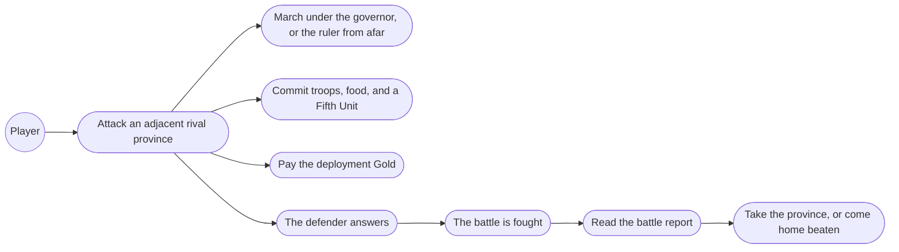
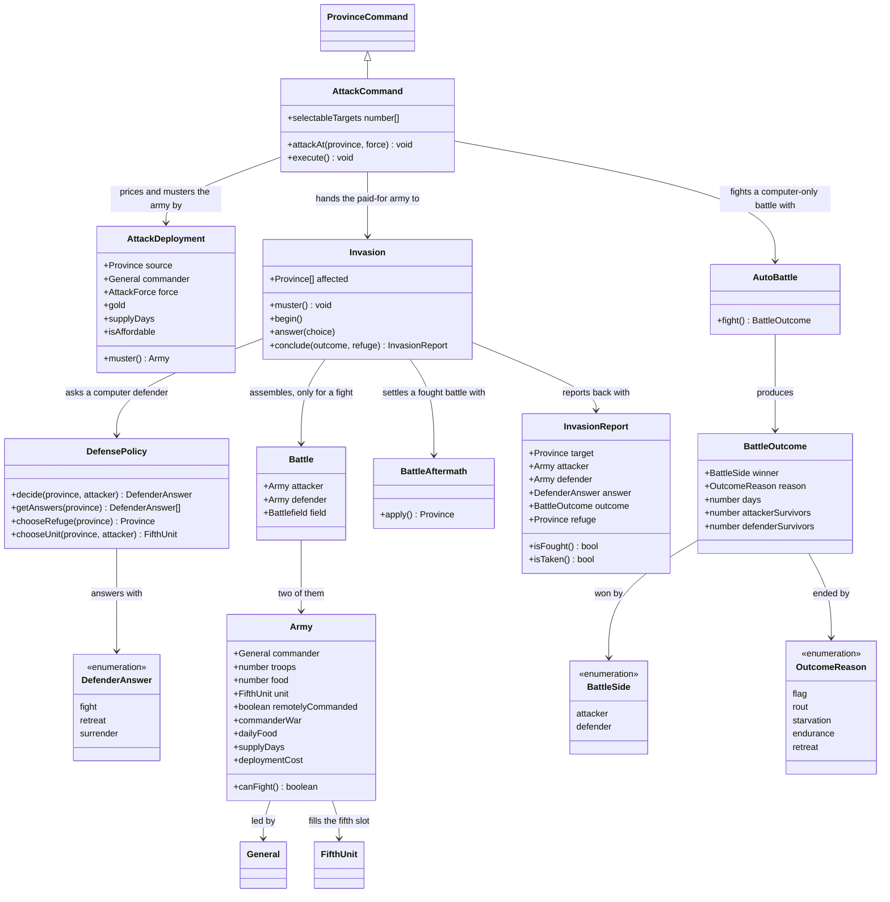
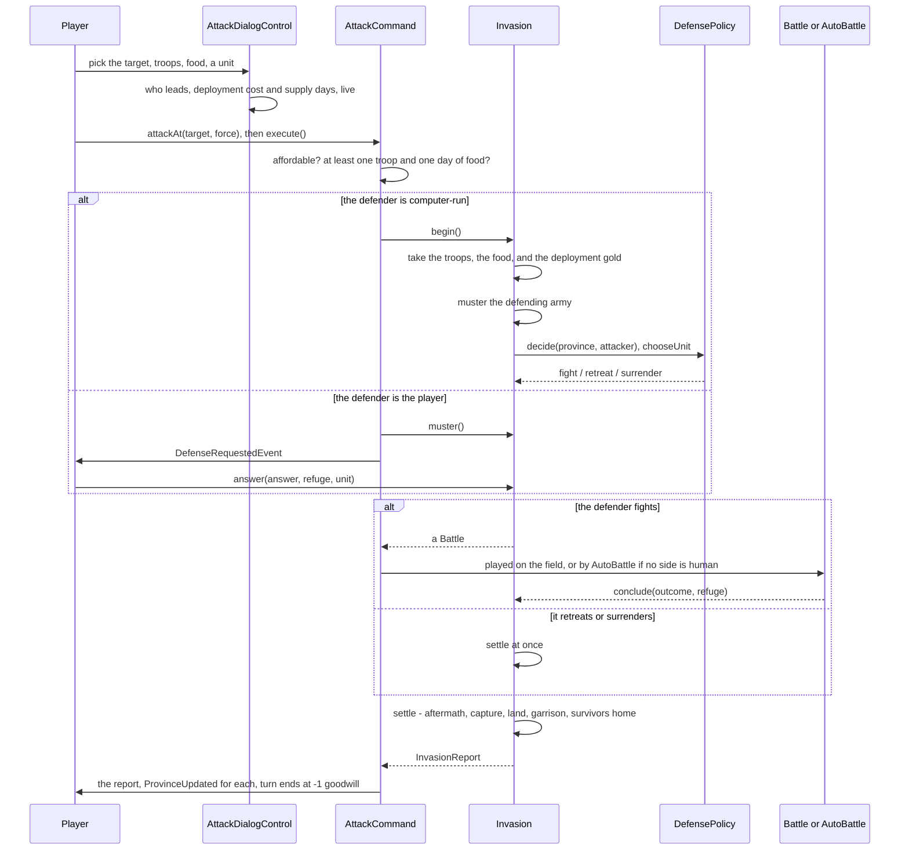

# 8.1 Launching a War

## Description

The strategic half of war: the Attack order that sends an army into a neighbour another house holds, the answer the defender gives, and the settling that hands over the land.

First of feature 8's five stages, and it stops at the edge of the battlefield — a commander, troops, food, a Fifth Unit and the deployment Gold go out, and a verdict comes back, but there is no field, no cells, no facing. In this stage the verdict came from a day-by-day **auto-resolution** on supply and strength. That arithmetic is gone: 8.2 put every battle with a human side on the field, and a battle between two computer houses is now played headlessly by `AutoBattle`, the tactical AI of 8.5 ordering both sides. The seam stayed where this stage put it.

`AttackCommand` already exists as a turn-burning stub, already recording the −1 goodwill the sources specify. This feature gives it a target, a dialog, an army, and a consequence.

## Glossary

| Term | Meaning |
| --- | --- |
| Invasion | One province sending its army into a neighbour another house holds, from the moment the army marches to the moment the land settles in one pair of hands. The whole event the Attack order sets off, in three parts: the defender's answer, the battle if the defender fights, and what it leaves on the map — the province in the winner's hands with the surviving army garrisoning it, or the beaten attacker's survivors back where they came from. One invasion per order, and it is over inside the month that started it. |
| Battle | Two armies in the field, fighting until a flag falls, a side is routed, starves or retreats, or the fifth day passes. Only a defender who answers Fight raises one, so an invasion has at most one battle and often none — the battle decides who wins, never who ends up holding the province. |
| Army | What a province puts into an invasion: a commander, troops, food, and at most one Fifth Unit (§9.3). The attacker's marches out of its province and is gone from it until the invasion ends; the defender's is whatever the invaded province can field where it stands. |
| Commander | The general who leads an army. Never a unit on the field; his WAR sharpens the troops he leads (§6.2). Not chosen: it is the province's governor, or the family ruler commanding from afar at half WAR when the province has none. |
| Defender's answer | What the invaded province does when the army arrives: Fight, Retreat, or Surrender, the last only when it cannot fight ([Defender's choice before battle](../spec/13-ai-specification.md#defenders-choice-before-battle)). Two of the three end the invasion without a battle. |
| Deployment | The Gold sending an army costs, `troops / 8 + 10` (§6.1) — paid by the attacking province the moment it marches, kept whatever happens after. |
| Supply | The food an army eats each day in the field, `(troops + hired Fifth Unit strength) / 10 + 1` (§6.9), and so the days it can stay there. An army out of food loses however strong it still is. |
| Auto-resolution | Fighting a battle without anyone ordering it by hand (§D.3). A battle between two computer houses is resolved this way: `AutoBattle` plays the tactical AI for both sides over the same field rules a player fights under. |
| Report | What an invasion is remembered by: both armies, the answer, and the battle's outcome when there was a battle. The player reads it over the map; nothing keeps it afterwards. |
| Outcome | How a battle ended and which side won: a flag reached, a rout with nothing left standing, a starvation, a retreat, or the defender enduring all five days. Belongs to the battle, not to the invasion — a surrender hands over a province with no outcome at all. |
| Guardian | The Fifth Unit a Gem lets its house summon (§C.3). Belongs to the house rather than to a province, and eats nothing (§6.9) — the two ways it differs from a hired unit. |

## Functionality

- Attack an adjacent province held by another house — never your own land, never neutral land (Move Troops claims that), never an ally's.
- March under the acting province's governor, or under the ruler from afar when it has none.
- Commit troops and food out of the acting province's own stores; a computer attacker always takes exactly five days of food.
- Fill the fifth slot: a hired Fifth Unit stationed in the province, or a Guardian summoned from one of the house's gems that is not resting.
- Watch the deployment cost and the supply days move as you set the numbers, and be refused the order until the province can pay for what you have asked for.
- Have the defender answer: Fight with the province's own troops, food and Fifth Unit, Retreat to a neighbour or the ruler's home, or Surrender when it cannot fight.
- Have the fight played out: on the battlefield when a human side is in it, headlessly by `AutoBattle` when neither side is.
- Read a report of what happened: who led each side, what each committed, and the verdict.
- See the province change hands when the attacker wins, garrisoned by the surviving army under its commander.
- See the beaten attacker's survivors come home — the share his commander's WAR saves, and only to an adjacent origin — and the province stay where it was.

## Use cases



## UI

**The order is a targeting command** like Move Troops: selecting the Attack tile lights every neighbouring province another house holds, and picking one opens the commitment form. The form is the busiest in the game so far — three decisions, the commander who leads, and two derived figures — but every part of it already exists: the amount fields with their quarter/half/all fractions from Move Troops, and the Fifth Unit dropdown from carrying a unit along.

The two derived figures are what make the form readable. Deployment Gold and supply days both move with the troop count, in opposite directions, and both are the reason an attack fails before it starts — so they sit together on one line under the fields, and Yea stays disabled until the province can pay the Gold and the army carries at least one day of food.

```text
+--- Attack -----------------------------------+
|  Attack where?                               |
|  6: Pineward (Stormmere)                            |
|                                              |
|  Led by Avar (WAR 87)                        |
|                                              |
|  How many troops (1-156)?                    |
|  [ 156 ]  (1/4) (1/2) (3/4) (all)            |
|                                              |
|  How much food (16-189)?                     |
|  [ 120 ]  (1/4) (1/2) (3/4) (all)            |
|                                              |
|  Bring a 5th unit?                           |
|  [ Voltryn      str 150     v ]               |
|                                              |
|  Deployment 29 gold - supply 7 days          |
|                                              |
|            [ Yea ]      [ Nay ]              |
+----------------------------------------------+
```

**The verdict is a report over the map**, on the machinery the spy report already built: it wants room, and the player must read it before the turn moves on. It names both commanders, what each committed, and what each has left, because those are the facts that shape next month. The heading carries the verdict and the day it fell on — the day count being the visible face of the food timer this stage is built around. There is no day-by-day ledger: the original never showed one, the player cannot act on it, and the arithmetic it would expose is provisional anyway.

```text
+--- Pineward holds out for five days ----- [Close] -+
|              Avar  (you)           Marven          |
|  troops              156            132          |
|  5th unit         Voltryn        Asterion          |
|  left                 31             18          |
|                                                  |
|  Pineward holds. Avar comes home with 31 troops.   |
+--------------------------------------------------+
```

A won attack reads the same way with the verdict reversed — `Pineward falls on the second day` — and the closing line says who garrisons it. A defender who retreats or surrenders produces a report with no day count and no losses, just the answer and its consequence: `Marven flees to Rimewatch with 132 troops. Pineward is yours.`

The Attack tile itself needs no new art — `attack.webp` has been sitting in the icon set since the military icons landed.

## Research

**The order targets an adjacent province held by another house, and nothing else.** Every source says adjacent, spec §6.3 most plainly: "A province can only directly attack neighbouring provinces." Every source also says another house's: the FAQ has battle begin "when one territory uses the Attack command to invade another territory", with a *person being invaded* who answers. Neutral land is excluded because feature 5 already took that job — you claim empty land by walking into it with Move Troops, and there is nobody there to answer an invasion. An ally's land is excluded by the manual's own rule: "The ruler must break an alliance before allying with another family, or before attacking an ally." `Family.ally` already exists as a field, so the guard is written now and starts mattering when feature 10 makes alliances real.

**The deployment cost formula is corroborated to the gold.** Spec §6.1 gives `Troops / 8 + 10`, and Hartman independently reports "roughly 22 gold per 100 soldiers you are going to deploy" — the formula returns 22.5 at exactly 100 troops. His figure is a rule of thumb rather than a rate, though — the formula charges 35 for 200 troops, not 44. Rounding is an open question in spec §6.13, so we floor it and flag the constant.

**Supply is the second price of an attack, and the sources agree on it exactly.** Spec §6.9 and the FAQ give the same formula — `Food needed per day = 1/10 × (troops + 5th Unit strength) + 1` — and both make the same exemption: Gem Guardians eat nothing, hired Fifth Units eat. The FAQ also describes the interface we are copying: "The food rations remaining on each side are represented by the number below each side's commander's name. The number in the parentheses is how many days' worth of food that number is." So supply days are a *displayed* quantity in the original, not an internal one, which is why they belong on the commitment form rather than only in the resolver.

**Five days is both the ceiling and the defender's victory.** The manual lists "When attacked, defend your flag for 5 days" among the ways to win, and Hartman reports from play that "battles rarely, if ever, exceed five days in length". Those are the same fact from two sides: the battle is time-boxed, and the box closes in the defender's favour. That single rule is what makes the auto-resolution honest without a battlefield — the day count is not an invention of this stage, it is the shape the sources describe.

**Troops come from one province, and not all of them need to go.** The FAQ is explicit: "In the event of attacking another area, troops will be gathered from just one territory's pool, although not all of them have to be used." So the commitment is bounded by the acting province's own stores, exactly like Move Troops, with no pooling across the house. The FAQ's own advice — "Make sure there are enough troops built up to defend the territory they're coming from and the territory they're going to" — is advice, not a rule, so the form lets the player empty a province and does not warn him.

**Nobody fights without troops.** "Even if there's a healthy 5th Unit available, one side cannot enter combat without actual troops available" (FAQ §5.1). For the attacker that settles it: he must commit at least one troop. The detailed rules are softer on the defender. A province with food and a Fifth Unit that stands alone — a Guardian or a Pastha — may answer Fight with no soldiers at all; a hired band cannot (`DefensePolicy.canFight`). A defender with no food, or with neither soldiers nor such a unit, cannot fight, and that is the reason Surrender exists as an answer at all.

**The commander is not a choice.** The manual's one-line description of the order ("Select a province to attack and ready war supplies: food and gold") names no commander, and the detailed rules agree: the whole leadership of the attacking province marches with the army — its lord, or the ruler with his court — and no commander is chosen ([Generals After an Attack](../spec/06-military-system.md#detailed-rules-generals-after-an-attack)). So the army is led by the acting province's governor. A province with no governor is led by the family ruler from afar, at half his WAR (`Army.commanderWar`). The form shows who leads and his WAR, because that is the only stat that will matter.

**Both occupants of the fifth slot are in, and only the cooldown waits.** The manual's answer menu reads "Fight: Call up a Fifth Unit and defend your castle", and the FAQ says "both sides get to pick a 5th Unit of their choosing" — and in scenario 1 all seven families hold exactly one gem each, so a Guardian is not an exotic case but the normal contents of the slot. Both occupants are ready to field: feature 6 stationed the hired units, feature 7 seeded every gem with its Guardian's canonical Strength, Move and Range, and the `FifthUnit` base it extracted for the second occupant is exactly the type the slot needs. What 8.4 still owes is the *limit* on summoning — a three-month rest for the Gem after every battle its Guardian joins (§7.5) — and the calendar machinery to track it.

Deferring the Guardian would have cost more than it saved, because the food exemption (§6.9) has to be written either way, and with nothing to exempt it would sit untested in the formula for three stages. Fielding it now also forces the one difference that matters: a hired unit is stationed in a province and marches with an army, while a gem belongs to the house (§7.2), so its Guardian is summoned from wherever the house is fighting and is left behind nowhere afterwards.

The interim distortion is worth naming rather than discovering. Until the cooldown lands a Guardian is strictly better than a hired unit on every axis — no hiring cost, no upkeep, no desertion, no food, and it cannot die — so stages 8.1 to 8.3 over-value gems, and nothing stops two of a house's provinces summoning the same Guardian in one month. It is milder than it sounds because every house has one and both sides of most battles will field one: a fixed strength added to both sides compresses the ratio toward parity, which under this resolver quietly favours the defender's endurance. The five-day draw in the report above is exactly that effect: Petaria's whole army behind Zendor cannot break Hyland while Pluvius stands beside Seth, where the same attack on a Guardian-less Hyland routs it on the second day — a balance quirk, not a broken rule.

**The defender's answer is a rule now and a question later.** The FAQ gives the menu and its availability: "The person being invaded will have the option to Fight, Retreat, or Surrender. Surrender isn't an option unless the person being attacked has no men or food and doesn't have somewhere to retreat." The manual says the same from the other end — "Surrender your vassals and goods to the enemy. If you still have soldiers or food, you will be forced to fight or flee" — and describes retreat as fleeing "to the home province or a neighbouring province", choosing the path on the map when there is more than one. The detailed rules settle the gates: Fight needs food and either soldiers or a usable Fifth Unit, Retreat needs somewhere to go, and Surrender is offered only to a defender who cannot fight ([Defender's choice before battle](../spec/13-ai-specification.md#defenders-choice-before-battle)). Retreat goes to an own or unowned neighbour, or to the ruler's home wherever it is; a home that is not adjacent takes the lord but not his soldiers and supplies. Two of the three answers mean there is no battle at all, which makes the answer a fork in the invasion rather than a property of one: only Fight builds a `Battle`, so nothing on the field ever sees a non-fight.

**A human defender is asked; a computer one decides.** When the invaded province is the player's, the invasion musters the defence and publishes `DefenseRequestedEvent`, and the player picks the answer, the refuge and the Fifth Unit. Otherwise `DefensePolicy` answers by the spec's computer rule: cornered, it fights if it can and surrenders if it cannot; with somewhere to go, it retreats when short of food, usually retreats when hopelessly outnumbered, and fights otherwise. It picks its refuge and its Fifth Unit by the same section of the spec, which `decide`, `chooseRefuge` and `chooseUnit` follow.

**The order is not the war.** `AttackCommand` does what every other command in the rail does — offers its targets, checks that the province can pay for what was asked, publishes what happened, and ends the turn at −1 goodwill. Everything the order sets in motion — the deployment cost, mustering the defence, asking the defender, fighting the battle, and settling the land afterwards — belongs to `Invasion`, one domain object for one event. The command gets an `InvasionReport` back and publishes it whole rather than unpacking it. The feature keeps two records and no more: `BattleOutcome` is what a fought battle produced, `InvasionReport` what the whole order produced; the settling of the land is behaviour, not a third record, so it stays inside the invasion that does it. One vocabulary runs through all of it — `source` and `target` for the two provinces, `attacker` and `defender` for the two armies — so nothing is renamed on the way from the order to the report to the screen. That keeps the command the size of its peers, lets the whole war be tested without a turn queue or an event bus, and gives 8.2 an obvious seam: the battlefield replaces what `Invasion` does between the answer and the settlement, and the order above it does not change. `Invasion` mutates the map but publishes nothing; it knows which provinces it changed and the command asks it for them, because in this codebase commands talk to the bus and the domain does not. `BattleOutcome` and `InvasionReport` are different scopes rather than the same thing twice: the first is what a fought battle produces — winner, reason, day, survivors — and exists only when there was a battle; the second is what the whole order produced, and holds the outcome when there is one.

**The resolution is shaped like the battle it stands in for.** The temptation in this stage was a single strength comparison, and it was the wrong shape: it would have made food theatre, with the food field a lie and the supply-days figure decoration. So the stand-in ran the days, with both sides eating, and ended on rout, starvation or the defender's endurance, ties to the defender.

That stand-in is gone, and nothing replaced it with a second formula. Every battle with a human side is fought on the field (8.2), and a battle between two computer houses is played headlessly by `AutoBattle` — the 8.5 tactical AI ordering both sides over the same rules — so the result a player never watches cannot disagree with the one he does. The spec describes its own round-based formula for unwatched battles ([Auto-Resolved Battles](../spec/09-tactical-battle-system.md#detailed-rules-auto-resolved-battles)); this game does not use it.

**Protection stays out of it.** The manual's battlefield legend says "Defense strength: unit strength equals the castle's strength", which invites wiring the Protection stat into the defender's side. Both detailed guides point the other way: the FAQ has Protection "primarily safeguard the territory against bad events", with only a vague "Protection lowers some in the event of warfare", and spec §4.8 records the same reading. The castle in that legend is a battlefield object — the wall around the defender's flag that the FAQ describes — so it belongs to 8.2 with the rest of the terrain, where it can be a wall rather than a multiplier. Leaving it out keeps one unresolved formula out of the war.

**The winner takes the land, and the aftermath follows the detailed rules.** The manual is maximal about the spoils — "the defenders will lose all their food, gold and territory, and the defending ruler will be completely at the mercy of the victor" — and this stage first stopped at the line between land and loot. That line is gone. Settling a fought battle now follows spec 09's aftermath (`BattleAftermath`): the attacker's leftover food goes to the battlefield province; a beaten attacker brings home only the share of his survivors his commander's WAR saves, and only when his origin is adjacent; a beaten defender rescues part of its stores to an adjacent refuge or loses a share of them; loyalty, cultivation and protection fall; and Fame moves between the rulers. The losing commander may be captured, a defender who flees before battle included, and a surrendering one always is (`Conquest`). The numbers live in the spec, not here: [Aftermath](../spec/09-tactical-battle-system.md#aftermath) and [Capture of the losing commander](../spec/09-tactical-battle-system.md#capture-of-the-losing-commander).

**The commander stays where his army stands.** The whole marching leadership moves into the conquered province ([Generals After an Attack](../spec/06-military-system.md#detailed-rules-generals-after-an-attack)): a lord takes its seat, and a ruler moves his home there with his court (`MarchingLeadership.occupy`). The province they left stays owned but under direct rule by the ruler, until Change Lord sends someone back. A beaten attacker returns to his origin unless he is captured, and a defender who flees takes his leadership to his refuge.

## Domain model



`Invasion.begin()` and `answer(choice)` return either a `Battle` to fight or a finished `InvasionReport` when the defender fled or surrendered.

## Flow



## Persistence

A battle is transient: it is assembled, resolved, reported, and dropped inside a single province's turn, so nothing about it is saved. What the invasion leaves behind is all state that already saves — a province's owner, its governor, its resources, and the hired units stationed in it. `Army` and `BattleOutcome` never outlive the order that made them, and there is no such thing as a battle in progress to reload. (Save/load is feature 17; stage 8.2 will have to answer whether a battle on the field can be saved mid-fight, and the answer will probably be no.)

## Tests

- **Targets (unit):** offers only adjacent provinces held by another house — never the acting province, never a non-neighbour, never neutral land, never an ally's.
- **The commitment (unit):** takes the committed troops and food out of the acting province, charges `troops / 8 + 10` Gold, and spends the turn at −1 goodwill whether the attack wins or loses; refuses when the province cannot pay, when nothing is committed, or when the food will not cover a single day; a computer attacker takes exactly five days of food.
- **Supply (unit):** the daily rate counts a hired unit's strength and exempts a Guardian's, so the same army carrying either has different supply days.
- **The defender's answer (unit):** Fight is offered with food and soldiers or a Fifth Unit that stands alone; Retreat whenever there is a refuge; Surrender only when it cannot fight. A computer defender follows [Defender's choice before battle](../spec/13-ai-specification.md#defenders-choice-before-battle): cornered it fights or surrenders, short of food it retreats, and it picks its refuge and Fifth Unit by the spec's order.
- **Resolution (unit):** a battle with no human side is played to one of the outcomes a fought battle can reach by `AutoBattle`, and settles the same way. No test asserts a casualty count.
- **Settling the land (unit):** a won attack moves the province to the attacker's house, seats the commander (or moves a ruler's home there), garrisons the survivors, and leaves a hired unit that marched with them stationed there — while a Guardian, stationed nowhere, neither travels nor is lost; a lost attack leaves the province alone and brings home the WAR-saved share of the survivors when the origin is adjacent; a retreat moves the lord to the chosen refuge, his soldiers and food only when it is adjacent, and hands the province over without a battle.
- **The form (control):** deployment cost and supply days follow the troop count; the fifth slot offers the province's hired units and the house's Guardians together; Yea stays disabled until the province can afford the Gold and the army carries a day's food; the form names the governor, or the ruler from afar, as the one who leads.
