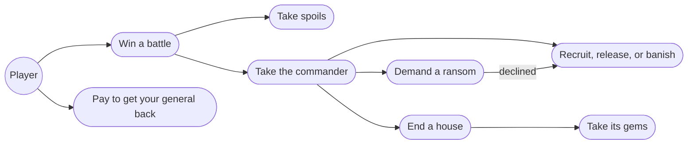
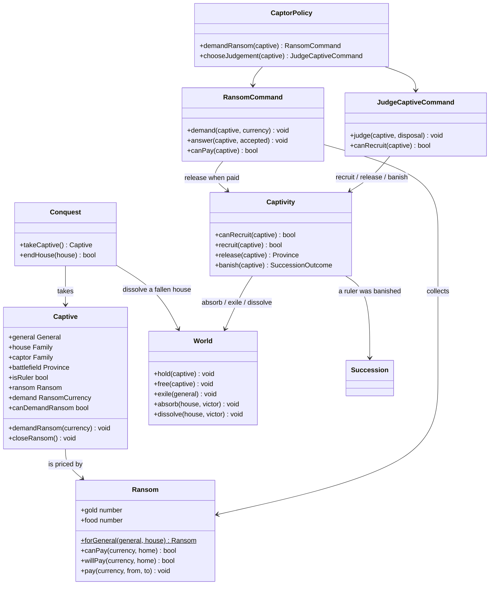
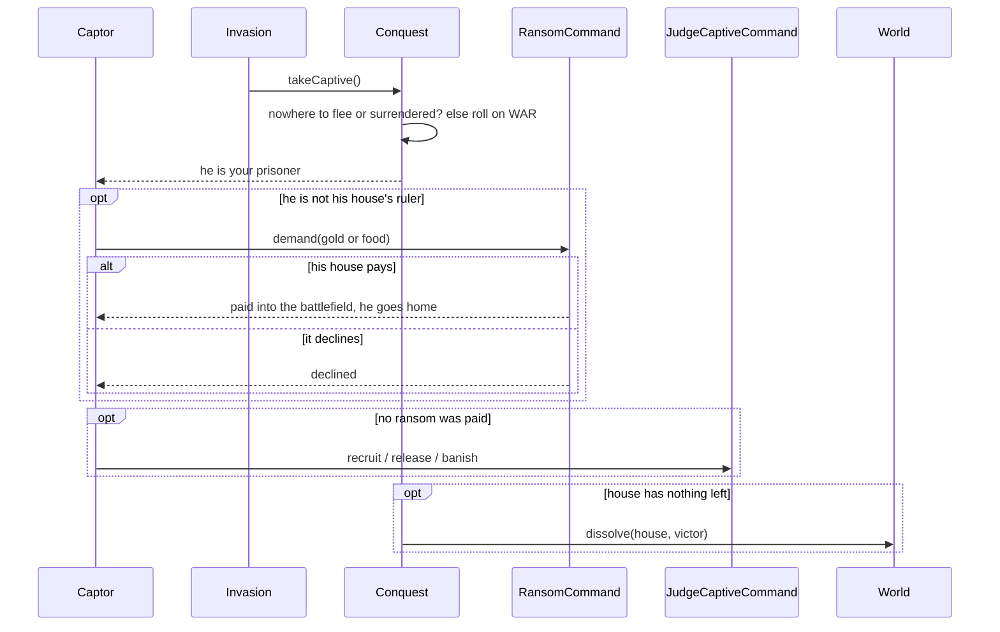

# 9. Conquest & captives

## Description

A won battle currently ends with the province changing hands and both armies going home — and because resources sit on the province, its gold and food already come with it. What is missing is everything that happens to the _people_: the losing commander may be led away in chains, ransomed, turned, freed or exiled, and a house that has nothing left stops existing — handing its gems to whoever finished it.

The battle itself is done. Everything here happens after `Invasion.settle`, on the strategic map, and most of it is a decision the player makes about a person rather than a place.

## Glossary

- **Spoils** — what the victor takes beyond the ground. Land, and the gold and food standing on it, already change hands in 8.1: resources belong to the province, and `Invasion.capture` reassigns the province. What this feature adds to the pile is ransom money.
- **Captive** — a commander taken after losing a battle, including one taken while retreating. A captive belongs to the captor's house until disposed of, and is not a member of it.
- **Ransom** — the price the captor may demand for a captive who is not his house's ruler, in gold _or_ food. His house pays it out of its ruler's home province, or declines; the money goes into the province that was fought over.
- **Disposal** — what the captor does with a captive who was not ransomed: **Recruit**, **Release**, or **Banish**.
- **Fallen house** — a family with no provinces left whose ruler is not held captive. A fallen house leaves the game and its gems pass to whoever ended it. Recruiting a ruler absorbs his house instead, and banishing one hands it to succession (feature 11).
- **Exile** — a banished general: out of Aureth, out of the game, never recruitable again.

## Functionality

- take the province's gold and food as spoils when it falls
- capture the losing commander, whether beaten or retreating
- always capture a commander with nowhere to flee to, or one whose house surrendered
- let the captor demand a ransom in gold or food for a captive who is not a ruler
- recruit, release, or banish a captive who was not ransomed
- let a computer captor ransom and judge its captives on its own
- end a house that has lost everything, and take its gems

## Use cases



## UI

**Captives are reported, then decided.** The battle report from 8.1 already fills the screen after a fight, so the capture line belongs in it — one sentence under the verdict, naming who was taken. The decision comes after the player closes that report, because it is a different question: the report says what happened, the dialog asks what to do about it.

**The dialog asks for a ransom first, then offers the three choices.** For a captive who is not a ruler, the player first picks whether to demand gold or food. If his house pays, he goes home and the dialog ends. If it declines, or the captive is a ruler, the three choices follow. Recruit is disabled when the captor's ruler cannot recruit him. Each choice says what it does, because the original left the player guessing and the difference between Release and Banish is not obvious from the words.

```text
┌─ Marven is your prisoner ──────────────────────────┐
│  Marven of Stormmere         WAR 77  CHA 70             │
│                                                  │
│  [ Recruit ]  take him into your house           │
│  [ Release ]  send him back to his house         │
│  [ Banish  ]  out of Aureth, for good          │
└──────────────────────────────────────────────────┘
```

**Paying for your own general is a yes-or-no question.** When a rival holds one of your generals and demands a ransom, the dialog names the price and asks whether to pay it out of your home province. You cannot agree to more than that province holds. You lose the gold instead of the man.

**A house falling needs no dialog** — only a line in the report and a redraw of the map: `Stormmere is no more. Asterion passes to Alderwyn.`

## Research

**The rules follow the spec's detailed rules**, which the implementation honours exactly and this design does not repeat: the capture chance in [Tactical Battle](../spec/09-tactical-battle-system.md#detailed-rules-tactical-battle), what happens to the generals in [Generals After an Attack](../spec/06-military-system.md#detailed-rules-generals-after-an-attack), and ransom, the recruit gate, the three disposals and the computer captor in [Prisoners](../spec/05-characters.md#detailed-rules-prisoners). In short:

- A commander with nowhere to flee, or whose house surrendered, is always captured. Otherwise the chance falls with his WAR. A commander who led from a distance, and the one general marked capture-immune, are never taken.
- A retreating commander can still be taken — capture is not conditional on losing the field outright.
- Only the commander is taken; his court is not.
- A captive who is not a ruler can be ransomed first. A computer house pays depending on how far its home province's stock covers the demand. A ruler is never ransomed.
- Recruiting needs enough Fame on the captor's ruler for the captive's recruit class. A ruler of a human house, or a ruler with an heir, cannot be recruited. Recruiting a ruler brings the whole house — lands, vassals and gems — with him.
- Release sends a vassal back to his ruler's court. A released ruler moves to another province of his house, or claims an unowned neighbour of the battlefield; with neither, his house is destroyed.
- Banishing a ruler hands his house to succession; with no heir it splits, and its gems go to the banisher.
- None of the three disposals changes Fame directly.

**Where the aftermath should live** is the real structural question. `Invasion.settle` already runs losses, burials, gem rest and the province transfer, and it is the obvious place to hang capture off. It is also 90 lines that answer one question — what happened to the two armies — and captives ask a different one, about people and houses, with a UI conversation in the middle of it. Three options:

|                        |                                                                                                                                                                     |
| ---------------------- | ------------------------------------------------------------------------------------------------------------------------------------------------------------------- |
| Extend `Invasion`      | Cheapest. But `Invasion` would then own a dialog that may be answered several turns later, and it is currently a thing that starts and finishes inside one command. |
| A `Conquest` beside it | `Invasion` reports; `Conquest` takes what the report says can be taken. Clean seam, one more concept, and the two must agree about ordering.                        |
| Put it on `Family`     | Captives are really a relation between two houses. But `Family` has no idea a battle happened, and would grow a second life as a workflow.                          |

**Chosen: a `Conquest` beside `Invasion`.** It reads the `InvasionReport`, takes the captive and decides whether a house has fallen. It keeps `Invasion` answering only the question it already answers.

The disposals went to a second class, `Captivity`, rather than onto `Captive` as first sketched. Recruiting moves a general between houses, banishing writes to an exile register, and both can dissolve a family and reassign its provinces — all of which need the `World`. A `Captive` that held a `World` would be a record with a map in its pocket, so `Captive` stays the fact (who is held, by whom, where, and the open ransom) and `Captivity` performs the change.

**The ransom and the judgement are two commands.** A ransom is a conversation that may wait on the player, so `RansomCommand` carries both the demand and the answer. `JudgeCaptiveCommand` carries out a disposal once no ransom is open. Neither uses up a province's turn. A computer captor issues the same commands through `CaptorPolicy`: it demands gold or food with equal chance, recruits when it can, and otherwise banishes with a chance that falls as its ruler's CHA rises, else releases.

**Heirs come from feature 11.** Banishing a ruler runs `Succession`, which crowns an heir or splits the house.

## Overview

Six pieces. **`Conquest`** settles the aftermath of an invasion: who is taken, and whether a house is finished. **`Captive`** is the commander held by another house. **`Ransom`** prices him. **`RansomCommand`** demands and answers a ransom. **`Captivity`**, through **`JudgeCaptiveCommand`**, performs the three disposals. **`CaptorPolicy`** makes those choices for a computer captor. **`CaptiveDialog`** offers them to the player, on the battle report's frame.

## Domain model



| Class                 | Responsibility                                                                         |
| --------------------- | -------------------------------------------------------------------------------------- |
| `Conquest`            | What a won invasion yields: the captive, and whether a house is finished.              |
| `Captive`             | A commander held by another house, where he was taken, and his open ransom.            |
| `Ransom`              | A price in gold or food, and whether a home province can and will pay it.              |
| `Captivity`           | The recruit gate and the three disposals.                                              |
| `RansomCommand`       | Demands a ransom and settles the answer; a computer house answers at once.             |
| `JudgeCaptiveCommand` | Carries out a disposal once no ransom is open, and reports it.                         |
| `CaptorPolicy`        | A computer captor's choice of currency and disposal.                                   |
| `World`               | Holds and frees captives, keeps the exiles, and absorbs or dissolves houses.           |

## Flow



## Persistence

A captive outlives the turn that took him, so a save carries who is held, by whom, where he was taken, and any open ransom demand. Exiles are a flat list of general ids that nothing may recruit again. A fallen house leaves no record beyond its absence — its gems already moved, and its provinces already carry their new owner.

## Tests

- **Spoils** — taking Pineward hands its 136 gold and 145 food to the victor. This passes today; the test exists to pin a rule nothing currently asserts.
- **Capture is certain where the rules say so** — a commander with nowhere to flee, or whose house surrendered, is always taken.
- **Capture is possible where the rules say it is chancy** — a retreating commander is taken with the RNG pinned, and is not taken with it pinned the other way; a remotely commanded army and a capture-immune general are never taken.
- **A ransom is paid by the table** — a computer house holding 1.5 times the demand always pays; the money moves from its home province into the battlefield and the captive goes home.
- **A declined ransom leads to judgement** — and a ruler is never offered for ransom.
- **Recruit is gated** — without the Fame his recruit class needs, or when he is a human house's ruler or a ruler with an heir, he cannot be recruited.
- **Release returns** — a released vassal rejoins his ruler's court; a released ruler moves to another province of his house, or claims an unowned neighbour, or his house is destroyed.
- **Banish is final** — an exile cannot be recruited later, by anyone; a banished ruler is succeeded by his heir.
- **Recruiting a ruler takes the house** — his lands, his vassals and his gems change owner in one move.
- **A house with nothing left falls** — it leaves the family list, its gems pass to the captor, and no province still points at it.
- **The computer captor judges** — it recruits when it can, otherwise banishes or releases by its ruler's CHA.
- **The player can be on the receiving end** — losing an attack can cost the player a general, unless the player pays the ransom demanded for him.
