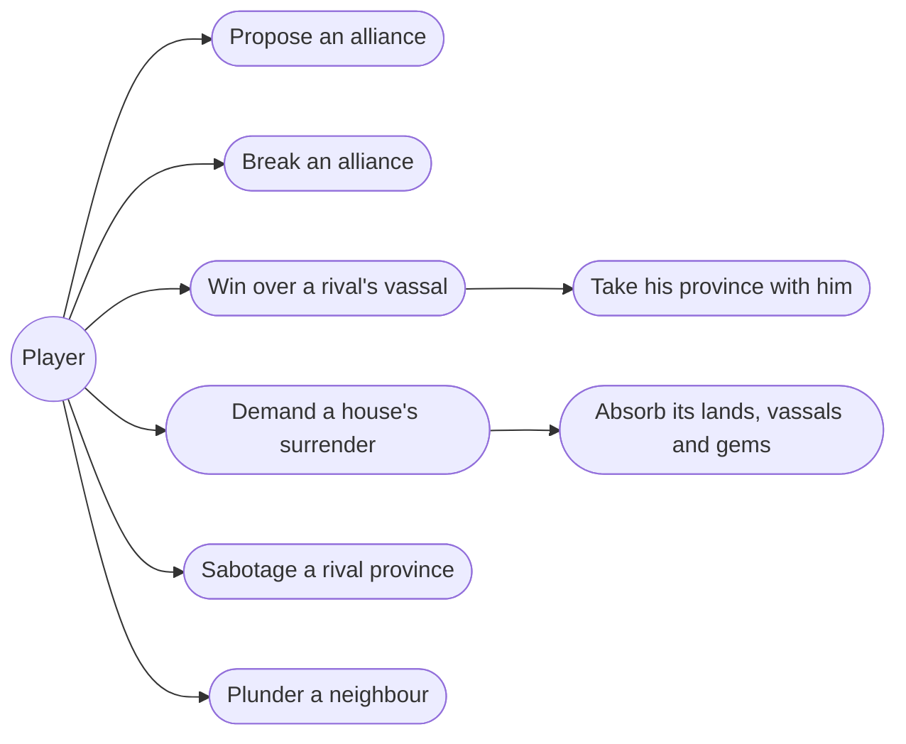
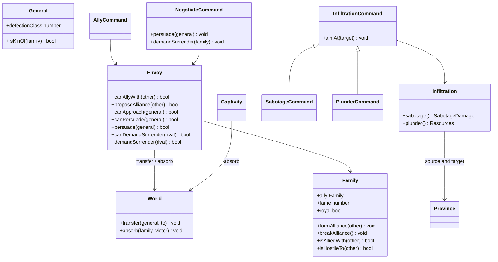
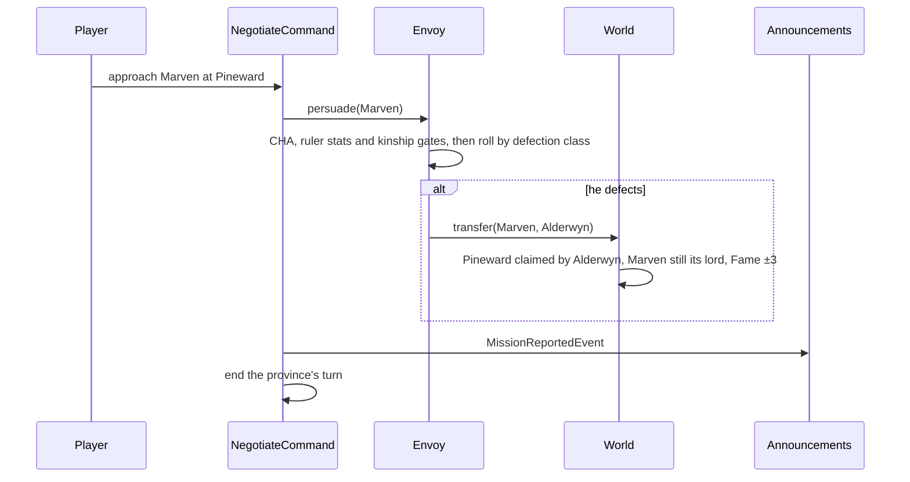
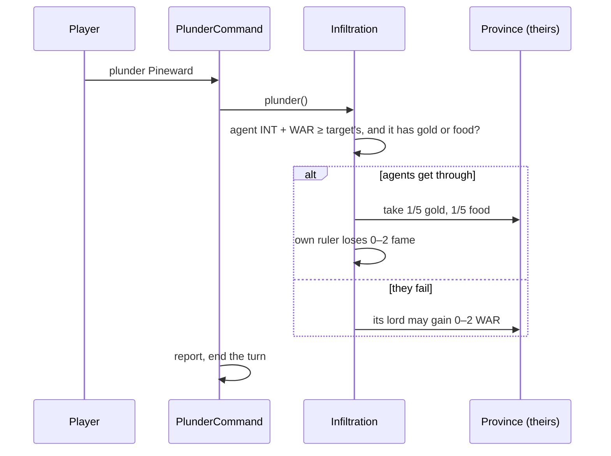

# 10. Diplomacy

## Description

Diplomacy is war fought without armies. It covers four province orders: **Ally** makes or breaks a non-aggression pact, **Negotiate** turns a rival's vassal or forces a whole house to yield, **Sabotage** wrecks a rival province, and **Plunder** robs a neighbouring one. Each order uses up the province's turn just as Develop or Attack would, so choosing diplomacy always means giving up something else.

The groundwork is already in place. `Family.ally` exists and `AttackCommand` already refuses to target an ally, but nothing ever sets the field. `AllyCommand` and `NegotiateCommand` are stubs that only use up the turn. Feature 9 built everything a house needs in order to change hands, including absorbing a fallen house and handing over its gems. Surrender is the second thing that needs that machinery, so this feature lifts it out of `Captivity` instead of copying it.

## Glossary

- **Alliance** — a non-aggression pact between two houses. Neither may attack the other, and that is all it does: allies send no help, pay no tribute and never join a war. A house has at most one ally, and the royal house of Varrengard never takes one.
- **Defection** — persuading a vassal to leave his house for yours. If he is the lord of a province, the province comes with him, including its gold, food, troops and hired units.
- **Surrender** — a demand that a whole house yield. If it succeeds, the house is absorbed exactly as when its ruler is recruited: its lands, vassals and gems all pass to you.
- **Sabotage** — agents sent into a rival province, at any distance, to destroy a fifth of one of four things: its troops, its loyalty, its cultivation or its protection.
- **Plunder** — agents sent into a neighbouring province of a computer house to steal a fifth of its gold and a fifth of its food. It costs the plundering ruler some fame.
- **Kin** — a general of a house's own family line, shown in the original by the family-line symbol on his card. Kin never defect.
- **Agent** — the general whose skill a covert order relies on. That is the acting province's resident governor, set against the target's. A province without one is represented by its ruler at half strength.

## Functionality

- propose an alliance from your home province to any house but Varrengard, which may accept or refuse
- break an alliance at any time, which you must do before attacking your ally; a new alliance replaces the old one
- send an envoy from your home province to any rival province, at any distance, to win over its lord or, at its home, a vassal with no province
- take a defecting lord's province with him: resources, troops and hired units
- demand a rival computer house's surrender, which only a house of one or two provinces facing a far larger one will accept
- sabotage any rival province, hitting its troops, loyalty, cultivation or protection
- plunder a neighbouring province of a rival computer house for a fifth of its gold and food, at a small cost in your own fame
- hear the outcome of every mission once it has run

## Use cases



## UI

**The Diplomacy group gets four tiles, following the original's own command table:** Ally, Negotiate, Sabotage and Plunder. Every other group already has four, so the panel stays square.

**Ally is a single tile whose action depends on whether you have an ally.** Making and breaking an alliance are two sides of one transaction, so they share a command, a tile and a dialog. With no ally the tile proposes; with an ally it offers to break the pact. A house with an ally can still be proposed to by others, and accepting a new alliance drops the old one. The tile is disabled anywhere but the home province.

With no ally, the tile lights every province of every house you could ask. Picking any one of them addresses that house:

```text
┌─ Ally with Stormmere ─────────────────────────────┐
│  Darian of Stormmere        Fame 9    3 provinces  │
│                                              │
│  Peace between Alderwyn and Stormmere: neither     │
│  house may attack the other.                 │
│                              [ Yea ] [ Nay ] │
└──────────────────────────────────────────────┘
```

With an ally, the tile opens straight onto the pact, with no targeting step:

```text
┌─ Alliance with Stormmere ─────────────────────────┐
│  Peace holds between Alderwyn and Stormmere.       │
│  Break the alliance?         [ Yea ] [ Nay ] │
└──────────────────────────────────────────────┘
```

**Negotiate puts two missions behind one tile, as the original did.** Like Ally, it works only from the home province. The tile lights every rival province at any distance, leaving out your ally's provinces. The dialog switches between the two missions:

```text
┌─ Negotiate: 2 Rimewatch (Stormmere) ────────────────┐
│  ( Defection )  ( Surrender )                │
│                                              │
│  ◉ Brennor   no province      WAR 56  CHA 37  │
│                                              │
│                              [ Yea ] [ Nay ] │
└──────────────────────────────────────────────┘
```

At most provinces the list is just the lord, so Negotiate at Pineward offers only Marven. At a house's home province the lord is the ruler, who cannot defect, so the list instead shows that house's vassals who hold no province, because that is where they sit. The Surrender tab names only the house: _Demand that Stormmere yield all its lands and gems to Alderwyn._

**Sabotage and Plunder work like Search:** the tile lights the provinces it can reach — every rival province for Sabotage, neighbouring provinces of rival computer houses for Plunder — and a one-line confirm sends the agents. Neither dialog shows a chance of success, because guessing the odds is part of the game. The player can still read both governors' INT and WAR through View, just as the original allowed.

**Every outcome is announced** through the queue features 6 and 7 built, so a mission's result reads like any other news:

```text
┌─ over the map ───────────────────────────────┐
│  Marven has left Stormmere for Alderwyn,             │
│  and Pineward comes with him.                  │
│                                 [ Continue ] │
└──────────────────────────────────────────────┘
```

A refusal is a single line, such as _Stormmere will not ally with you._, _Marven stays loyal to Stormmere._ or _Your agents were caught in Pineward and came back empty-handed._ A success names what was taken or damaged, such as _Your agents plundered Pineward: 27 gold, 29 food._ or _Your agents burned the walls of Pineward._ A surrender gets the same line a fallen house got in feature 9: _Stormmere yields. Asterion passes to Alderwyn._

## Research

**The rules follow the spec's [Diplomacy](../spec/10-diplomacy.md#detailed-rules-diplomacy) detailed rules**, which the implementation honours exactly and this design does not repeat. In short:

- An alliance is a mutual non-aggression pact and nothing more. A house has one ally at a time; accepting a new alliance drops the old one, and breaking one has no penalty. Lankshire never takes part in diplomacy.
- Ally, Defection and Surrender are issued from the ruler's home province and reach any distance. Only Plunder needs a neighbour.
- A computer house accepts an alliance, with no randomness, when the proposer's ruler has at least its ruler's CHA and their gem counts differ by at most 2.
- Defection first has to pass three gates: the acting lord's CHA (or half the ruler's, with no lord present) beats the target's, the acting ruler's INT + WAR + CHA beats the target ruler's, and the target is not kin of his ruler. Then it succeeds with a fixed chance set by the target's defection class. A ruler can never be targeted. A defecting lord brings his province, and the two rulers' Fame moves by 3.
- Surrender has no randomness. Only a computer house of one or two provinces yields, to a house at least 10 provinces and five times larger whose ruler's INT + WAR + CHA is at least its ruler's. The yielding house is absorbed, and the demander's ruler gains 3 Fame per province.
- Sabotage compares INT + WAR of the two agents, with a random swing on the defence and a bonus if the target's house has an ally. Success destroys a fifth of troops, loyalty, cultivation or protection; failure may train the acting agent.
- Plunder has no randomness. It succeeds against a computer house when the agent's INT + WAR is at least the target's and the target has any gold or food. Success moves a fifth of both and costs the acting ruler 0–2 Fame; failure may raise the defending lord's WAR.
- Protection defends against neither covert order.

**Allies are off-limits for every hostile order.** The sources only spell this out for attack. But a pact whose partner can still rob you, wreck you or poach your lords is not peace, and treating all hostile orders alike lets one rule (`Family.isHostileTo`, which also decides who Attack can reach) gate all five orders. If a version is found that allows plundering an ally, only that rule changes.

**Where the work lives.** The three persuasions belong together. They read the same facts about two houses (their rulers' stats, gem counts, province counts and kinship), so they sit on one `Envoy`, which acts for a house and returns whether it succeeded, the way `Captivity` does for disposals. The two covert orders share the comparison between agents and nothing else, so they sit on one `Infiltration` rather than two classes. Moving houses around goes onto `World`: `absorb` (shared by Surrender and recruiting a ruler) and `transfer`, which moves a general to a new house and takes his province with him if he governs one.

**Computer houses use the same rules.** `DiplomacyPolicy` issues the same Ally and Negotiate commands for a computer house; computer houses do not plunder or sabotage, and an alliance offered to the player arrives as a question (`AllianceOfferedEvent`) answered by `AllianceAnswerCommand`.

## Domain model



| Class          | Responsibility                                                                                  |
| -------------- | ----------------------------------------------------------------------------------------------- |
| `Envoy`        | Speaks for one house: proposes alliances, persuades vassals, demands surrender, and makes the result happen. |
| `Infiltration` | Agents from one province into another: the comparison between agents, and what sabotage or plunder does. |
| `Family`       | Holds its one ally on both sides of the pact, and knows whether it is the royal house.          |
| `General`      | Knows his family line and his defection class, which decide whether he can be turned.           |
| `World`        | Moves a general, his province, or a whole house between families.                               |

Each command publishes a `MissionReportedEvent` carrying the mission, its target and its outcome, and the announcements queue turns it into a line of text. `royal`, `lineage` and the defection class come from scenario config.

## Flow





## Persistence

A save carries each house's ally and each ruler's fame, since Plunder, defection and surrender change fame. A general's lineage is scenario data, but it stays with him when he defects, so it is saved with the general rather than re-derived from his current house. Missions leave no record beyond their effects.

## Tests

- **Alliance is mutual and single** — forming one sets both sides; accepting a second alliance drops the first on both sides; breaking clears both sides and lets either attack again.
- **Ally obeys its limits** — only the home province may issue it, and Varrengard's provinces are never offered.
- **Ally terms are deterministic** — a house accepts when the proposer's ruler has at least its ruler's CHA and their gem counts differ by at most 2, and refuses otherwise.
- **Defection takes the province** — a lord who defects brings his province, its resources and its hired units, he stays its lord, and the two rulers' fame moves by 3.
- **Kin never defect** — whatever the roll, a member of his ruler's house stays.
- **Defection is gated, then rolled** — without the higher CHA or the stronger ruler no roll succeeds; past the gates the defection class sets the odds.
- **Rulers cannot defect** — a ruler is never offered as a Defection target.
- **Surrender is gated** — only a computer house of at most two provinces, facing one at least 10 provinces and five times larger with a ruler at least as strong, yields; a yield absorbs lands, vassals and gems through the same `World.absorb` that recruiting a ruler uses.
- **Sabotage reaches any rival** — it hits one of four values for a fifth, and a failure can train the acting agent.
- **Plunder moves a fifth** — the target loses a fifth of its gold and food, the plundering province gains it, and the plundering ruler loses up to 2 fame; a human house's provinces are never offered.
- **Allies are safe** — none of Negotiate, Sabotage, Plunder or Attack offers an ally's province.
