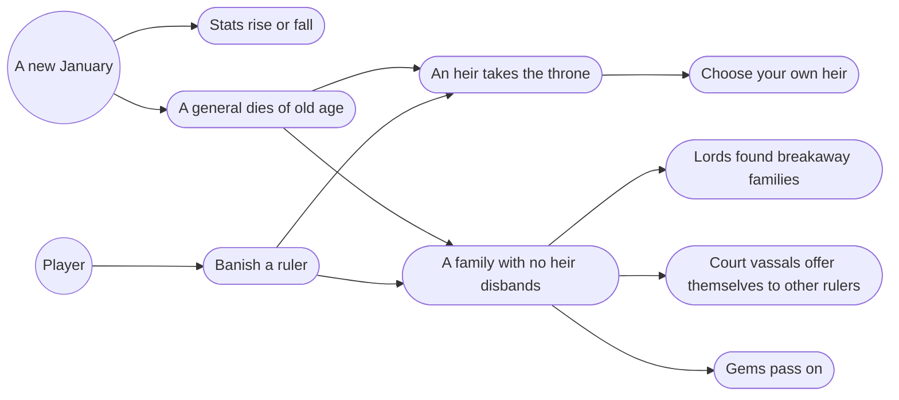
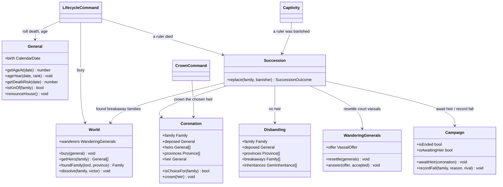
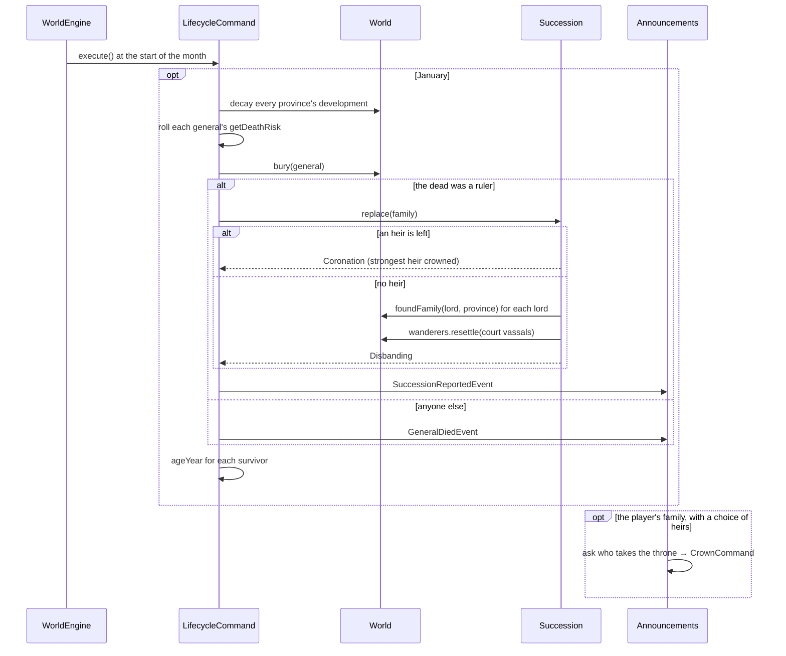

# 11. Character lifecycle

## Description

Generals are mortal. Every January each general's stats may move: up with a chance that depends on his rank, and down by 5 once he reaches 65. From 75 he may die each January, with odds that grow with his age. When the one who dies, or is banished, is a family's ruler, the family looks for an heir among the ruler's blood relatives. With an heir it carries on under a new ruler. Without one it disbands: each lord keeps his province and founds a family of his own, the provinces the ruler governed directly become unclaimed, its court vassals wander off to other rulers, and its gems pass on — to whoever banished the ruler, or to random surviving families after a death.

Most of this already has a place to land. `General` has a `birth` date, and the family overview already shows each general's age. `General.lineage` (feature 10) records each general's family line, which is exactly what makes someone an heir. Feature 9 left this step open on purpose: there, a family falls the moment its ruler is banished. This feature puts succession in front of that, and corrects the fall itself to what the sources describe.

## Glossary

- **Heir** — a member of a family who shares its family line (`lineage`) and still holds his house membership, shown in the original by the family-tree icon on his card. Only an heir can become the family's ruler. The ruler's kin who serve another family are not heirs of this one, and neither is a kinsman held captive by another family.
- **Succession** — an heir taking the throne when the ruler dies or is banished. The family keeps its provinces, members, gems and ally. The heir inherits the old ruler's fame in full if his CHA is at least the old ruler's, otherwise half.
- **Disbanding** — the end of a family that loses its ruler with no heir left. Unlike a family that falls in war (feature 9), it leaves pieces behind: new families, unclaimed land, and wandering generals.
- **Breakaway family** — a family founded when a family disbands, by one of its lords together with the province he governs. It takes a random free family name and that name's crest, and starts with 3 fame.
- **Wandering general** — a general left without a family. He is offered to the surviving rulers, smallest court first, until one takes him.
- **Old age** — the death a general may meet each January from 75. It is not the only way to die: the Banshee event can take a court vassal, and banishment removes a general for good.

## Functionality

- every January, give each general under 65 a chance to grow — rulers most often and by the most, then lords, then court vassals — and take 5 from every stat of each general 65 or older
- let every general 75 or older die each January with odds equal to his age in percent
- crown an heir when a ruler dies or is banished, and let the player choose the heir for their own family
- disband a family that has no heir: its lords found breakaway families, its directly ruled provinces become unclaimed, its court vassals wander to other rulers, and its gems pass on
- announce the deaths that matter to the player, and every succession and disbanding

## Use cases



## UI

**Growth and decline need no screen.** The family overview already shows each general's age and stats, and the change is a point or two a year. Announcing it every January for dozens of generals would bury the news that matters.

**Deaths are announced, through the queue features 6, 7 and 10 built.** The player hears about every death in their own family and the death of every ruler anywhere, because a ruler's death can change the map. A rival vassal dying of old age is not news.

```text
┌─ over the map ───────────────────────────────┐
│  ▒▒  Sarnic of Thornvale has died of old age. │
│      Voric takes the throne.                 │
│                                 [ Continue ] │
└──────────────────────────────────────────────┘
```

**Your own succession asks a question.** The original asks the player to "select a new leader from its list of successors", so the announcement offers the heirs in the same picker the artifact grant uses (feature 7). It asks only when there is more than one heir; a single heir is crowned without a question. Continue is withheld until one is chosen, and the strongest is preselected, so the fast path is one click.

```text
┌─ over the map ───────────────────────────────┐
│  ▒▒  Avar is banished from Aureth.         │
│      Who takes the throne of Alderwyn?        │
│  [ Beran     age 21   ▾ ]          [ Crown ]  │
└──────────────────────────────────────────────┘
```

**A disbanding is one line, followed by a map redraw**. In scenario 1, banishing Tovren leaves Emberholt with no heir: _Emberholt has no heir and is no more. Halric now rules Duskcrag as Blackharbor. Cindrath passes to Stormmere._ Cinderpeak, which Tovren ruled himself, turns neutral on the map. The breakaway name is drawn from the free ones, so Halric's house may be called something else next game.

**A wandering general asks the player in turn.** When one is offered to the player's court, a dialog asks Accept or Reject; Reject passes him on to the next ruler. Offers to computer rulers are always accepted and need no screen.


## Research

**The rules follow the spec's detailed rules**, which the implementation honours exactly and this design does not repeat: yearly change and death in [January: Decay, Ageing, Death](../spec/05-characters.md#detailed-rules-january-decay-ageing-death), heirs and disbanding in [Succession](../spec/05-characters.md#detailed-rules-succession), and homeless generals in [Wandering Generals](../spec/05-characters.md#detailed-rules-wandering-generals). In short:

- Everything happens once a year, in January. A general 65 or older loses 5 in every stat. Anyone younger may grow: a ruler by 2 in every stat with an 80% chance, a lord by 1 with 50%, a court vassal by 1 with 15%. Stats are capped at 200.
- A general older than 74 dies that January with a chance equal to his age in percent.
- Heirs are members of the ruler's house: `General.lineage` matching the family's name, while he still holds his house membership. A human family chooses among them; a computer family crowns the one with the highest INT + WAR + CHA. The player's picker preselects the same heir.
- The heir's province becomes the family's home province. He inherits the old ruler's fame in full if his CHA is at least the old ruler's, otherwise half.
- A family with no heir splits. Each province with a lord becomes a new family under that lord, starting with 3 fame and a random free family name. Each province without one becomes unclaimed. Each court vassal offers himself to the surviving rulers, smallest court first; a computer ruler always accepts, and if no one takes him he leaves the game.
- A banished heirless ruler's gems go to the banisher. A dead heirless ruler's gems each go to a random surviving family.
- A human family with no heir is out of the game.

**The scenario tables are not the growth rule.** Comparing one general across DragonAtma's four scenarios shows changes no yearly rule could produce. Pender's WAR rises while his CHA falls; Roland's WAR drops at 44; Geolug declines in everything at 37. Like gem ownership (feature 7), each scenario's stats are authored, so the yearly rule is what runs during play, and nothing tries to reproduce the tables.

**Banishing a ruler goes through succession.** Banishing runs `Succession` like a death does: an heir is crowned if there is one, and otherwise the family disbands by the rules above, with the gems going to the banisher. Recruiting a ruler is unchanged: "successfully Recruiting a family leader immediately puts all of his territories, vassals, and armies under the player's control" (FAQ), so it is still an absorption, not a succession.

**Where the work lives.** How a general ages and how likely he is to die are facts about one general, so they live on `General`, the way `HiredUnit.getDesertionRisk` does for a hired unit: `ageYear` applies this year's change for his rank, and `getDeathRisk` says how likely he is to die this January. What happens to a family without its ruler spans the family, its provinces and the world, so it is a domain service, `Succession`. Generals left without a family go to `WanderingGenerals`, which `World` owns as `wanderers`, so disbanding and a released ruler with nowhere to go (feature 9) share one queue of offers. `LifecycleCommand` runs in January, from `WorldEngine`, before tax: it decays development, rolls deaths, runs succession, and then ages the survivors. It pauses while the player chooses an heir or answers an offer, and resumes where it stopped. Removing a general from the world goes on `World.bury`, next to `World.exile`: a buried general leaves his family, any captivity and any governorship, and his province falls back to remote rule by his ruler. A captive stays a member of his family until he is disposed of (feature 9), so `World.getHeirs` takes the world's captives into account: a kinsman in chains cannot be crowned.

**Defeat lives on `Campaign`.** When the player's family disbands, `Campaign` records the fall and the campaign ends (`Campaign.isEnded`); no month starts for a player with nothing left. Feature 14 gives it its screen.

## Overview

Two rules on the general, one service, two outcomes, one queue and one choice. **`General`** ages a year and knows how likely he is to die. **`Succession`** crowns an heir or disbands the family, and returns a **`Coronation`** or a **`Disbanding`** that says what happened. **`WanderingGenerals`** finds a court for each general left without one. **`LifecycleCommand`** runs January — decay, deaths, succession and ageing — and reports the news. **`CrownCommand`** lets the player overrule the preselected heir from the announcement.

## Domain model



| Class               | Responsibility                                                                                   |
| ------------------- | ------------------------------------------------------------------------------------------------ |
| `General`           | Applies his yearly stat change for his rank, and knows how likely he is to die this January.     |
| `Succession`        | Crowns the strongest heir of a family without a ruler, or disbands it.                           |
| `Coronation`        | A crowning: the heirs there were, who wears the crown, and the seats that went with it.          |
| `Disbanding`        | A family's end: the breakaway families it left, and which family each gem went to.               |
| `WanderingGenerals` | Offers each homeless general to the rulers, smallest court first, and exiles him if none accepts. |
| `World`             | Buries the dead everywhere they appear, lists a family's heirs, and founds breakaway families.   |
| `Campaign`          | Waits for the player's heir, records fallen families, and ends the game on defeat.               |
| `LifecycleCommand`  | Runs January: decay, death, succession and ageing, and publishes the news.                       |

The breakaway names are config, `BREAKAWAY_NAMES`: the canonical family names except Varrengard, since the royal line cannot be refounded by a vassal. `LifecycleCommand` publishes `GeneralDiedEvent` for a general who was not a ruler, and `SuccessionReportedEvent` (with the coronation or disbanding, and whether it came from a death or a banishment) for a ruler; banishing a ruler from the captive dialog publishes the same event. An offer to the player's court arrives as `VassalOfferedEvent` and is answered by `AnswerVassalOfferCommand`.

## Flow



## Persistence

A save carries each general's stats as they now stand, and whether he still holds his house membership, since crowning or recruiting him ends it. Breakaway families are saved like any other family; nothing records that they broke away. The dead leave no record.

## Tests

- **Growth follows age and rank** — with the roll pinned, a 40-year-old court vassal gains 1 in every stat, a lord 1, a ruler 2, and a 65-year-old loses 5; outside January nothing moves.
- **Death follows age** — a general under 75 never dies of old age; one of 80 dies with odds 0.8, checked once a year.
- **The dead leave the world** — a buried lord leaves his family and the generals, and his province falls back to remote rule by his ruler.
- **An heir carries the family on** — when a ruler dies, his strongest kinsman becomes ruler, his province becomes the home, and the family keeps its provinces, gems and ally.
- **Fame passes by CHA** — an heir with at least the old ruler's CHA inherits all his fame, one with less inherits half.
- **A captive cannot inherit** — a kinsman held by another family is passed over for the next heir, and with no other heir the family disbands.
- **Only kin inherit** — a sworn vassal never takes the throne, however senior.
- **A family with no heir disbands** — each lord founds a breakaway family under a free name with 3 fame, his province and its contents; directly ruled provinces become unclaimed; the family leaves the world.
- **Court vassals wander** — each is offered to the smallest surviving court first; a computer ruler accepts; if every ruler refuses he leaves the game.
- **Gems follow the rules** — a banished heirless ruler's gems go to the banisher; a dead heirless ruler's gems each go to a random surviving family.
- **Banish goes through succession** — banishing a ruler with an heir crowns the heir instead of ending the family.
- **The player chooses their own heir** — with more than one heir, the announcement of the player's ruler's death offers only the family's heirs, preselects the strongest, and crowning another makes that general ruler.
