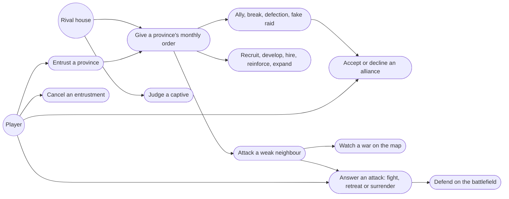
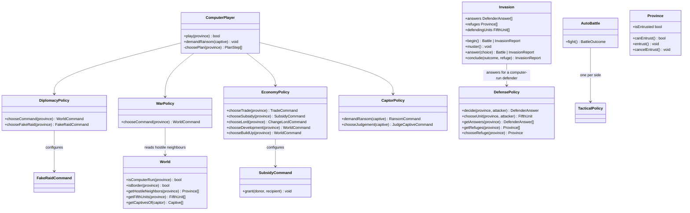
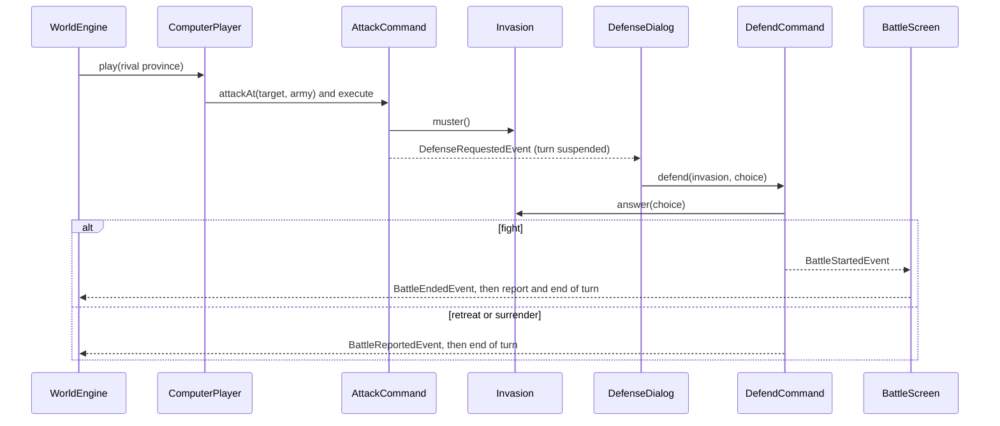
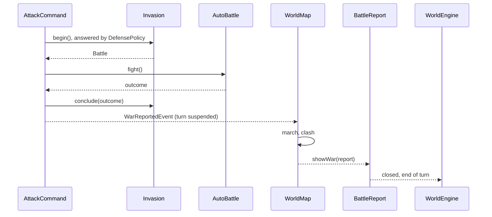

# 12. Strategic AI

## Description

So far only the player acts. A rival province's turn comes up in the monthly queue and is skipped, so Aureth stands still around the player. This feature gives every province the computer runs a monthly order of its own: rival houses develop, recruit, shift troops to their borders, hire monsters, make and break alliances, and attack weak neighbours, including the player. When an attack lands on the player's land, the player answers it: fight, retreat or surrender. And the player can hand a province to the computer with Entrust, so the computer gives that province's orders too.

The routine itself follows the spec's [Detailed rules: Computer Play](../spec/13-ai-specification.md#detailed-rules-computer-play). That section holds every threshold and share; this design names the steps and links there for the numbers.

The sources are clear that the original AI is a handful of simple, opportunistic rules, not a planner: "Generally, the computer is an idiot" (FAQ), "the computer will not impress you with how it chooses to govern your provinces" (Hartman). Its job is to keep the map moving and to punish weak borders (spec §13). That is the bar here too. Much of the work already exists: every order is a command with its own rules and costs, `DefensePolicy` already answers attacks for houses the player does not control (feature 8.1), and `TacticalPolicy` can fight a battle with nobody at the controls (feature 8.5).

## Glossary

- **Computer-run province** — a province whose monthly order the computer gives: every province of a rival house, plus the player's entrusted provinces. The player gives the orders for every other province of their own.
- **Entrusted province** — a province of the player's handed to the computer, which then gives its orders every month until the player cancels. The original marks it with a tower.
- **Border province** — a province with at least one hostile neighbour: a province of another house that is not its ally. A province with none is an interior province.
- **Temperament** — how a province's lord leans, set by comparing INT with WAR. It weights the roll that picks the month's plan.
- **Plan** — a chain of steps (Offence, Build-up, Develop, Diplomacy, fake raid). The first step that can act gives the month's one order.
- **Short** — a province is short of Gold or Food when it holds less than a reserve that grows with its soldiers.
- **Map battle** — a battle in which neither army is the player's to command: between two rival houses, or on the player's entrusted province. The tactical AI fights it to the end on both sides without opening the battlefield. The player watches it as a clash on the map, then reads its result.
- **Refuge** — where a defender flees: a neighbouring province of its own house, an unowned neighbour, or its home province.

## Functionality

- on a computer-run province's turn, give it at most one order with the same commands, costs and rules the player has; no difficulty setting is read
- before the order, take the free preparations: a market trade when short of exactly one of Gold and Food; for a computer-owned province short of both, a subsidy from the house's richest province; from the home province, a court vassal seated as lord of a province with none
- pick a plan by the lord's temperament — Military first, Develop first or Diplomacy first — and give the first order in its chain that can act; if none can, do nothing
- Offence: attack the hostile neighbour with the fewest soldiers when ahead of every hostile neighbour by the lord's WAR band, never while any neighbour is unowned; otherwise expand into a random unowned neighbour with a third of the province's Gold, Food and soldiers
- Develop: raise the lowest of Cultivation, Loyalty and Protection, Loyalty with the smallest Give Food
- Build-up: on an even roll, reinforce a weak own border neighbour from an interior province, or recruit; if that fails, hire a Fifth Unit when the province has none
- Diplomacy, from the ruler's province only: propose or break an alliance by the strongest neighbouring family (to the player too, who accepts or declines), or try a defection on a CHA roll
- a cosmetic fake raid on the Diplomacy plan: a player neighbour with the sharper lord sees agents caught; nothing is stolen or damaged
- judge captives a rival house takes: demand a ransom, then recruit those it can, otherwise banish by a CHA roll or release
- when a rival attacks one of the player's provinces, ask the player to fight, retreat or surrender, letting them pick the Fifth Unit to fight with or the refuge to retreat to: an own or unowned neighbour, or home
- answer attacks on computer-run provinces with the computer defender's rule, which picks the answer, the refuge and the Fifth Unit
- fight the battle on the battlefield with the player as the defender
- let a defender who withdraws mid-battle lead its survivors and food to a refuge, chosen by the player for their own army
- carry the province's gold along too when the refuge is an adjacent home province; a home that is not adjacent receives the commander only, and the troops and food are abandoned
- word the battle report from the player's side, whichever side they fought on
- fight map battles to the end without opening the battlefield, show each rival war on the map as an army marching and clashing, then announce its result
- entrust any of the player's provinces except the one the ruler is in, with or without a lord, and cancel it at any time; it then runs the full computer routine, minus the subsidy and the fake raid, answers attacks by the computer defender's rule, and its battles are map battles
- tell the player about whatever a rival does to them: a battle on their land, a mission against their province, an alliance broken with them, a general who defected from them, the fate of their captured general

## Use cases



## UI

**An attack on the player's land** stops the month and asks. The question shows what the player can see for themselves: who comes, from where, with how many troops, and what the province has to meet them with. It never guesses the outcome. Only the answers the province can give are enabled (Research: the defender's answer). The Fifth Unit list holds the province's hired units and the house's rested Guardians, strongest first.

```text
┌─ Pineward is attacked ───────────────────────┐
│  Voltryn of Stormmere marches from Wintercairn       │
│  with 300 troops.                          │
│                                            │
│  Pineward      132 troops    80 food         │
│  Fifth Unit  [ Asterion            ▾ ]      │
│                                            │
│  [ Fight ]    [ Retreat ]    [ Surrender ] │
└────────────────────────────────────────────┘
```

Fight opens the battlefield with the player's army on the right, as defender. Retreat with one refuge goes there at once. With more than one, the map highlights them (the house's neighbouring provinces, unowned neighbours and its home province) and the player picks one, the way the manual describes: "If there is more than one neighboring province, you will have to choose a path of retreat on the map." Either way the battle report follows, as it does after the player's own attacks.

**Entrust** sits in the Vassal group. It can be issued from any province of the house, costs no turn, and targets a province on the map: any of the house's provinces except the one the ruler is in can be picked, with or without a lord. One dialog both entrusts and cancels, with a toggle, as Hire/Dismiss and Buy/Sell do.

```text
┌─ Entrust ──────────────────────────────────┐
│  Rimewatch — Lord Rhovan                     │
│                                            │
│  ( ● Entrust )  (   Cancel )               │
│                                            │
│                 [ Cancel ]   [ Confirm ]   │
└────────────────────────────────────────────┘
```

An entrusted province shows a tower marker on the map. In the family overview's Land tab its status reads "entrusted", the fourth beside capital, lorded and ruled remotely, matching Hartman's four symbols: shield, crossed swords, flag, tower.

**A rival's war is shown on the map, then announced.** Every invasion a rival launches, wherever it lands, plays on the map: the attacker's crest marches from its province to the target, and when the defender fights, the two clash there for a moment. Then an event dialog gives the result, and the month goes on when the player dismisses it. Nothing in the dialog is a prediction; it is all past.

```text
┌─ War ──────────────────────────────────────┐
│  Stormmere attacks Pineward, held by Emberholt.      │
│                                            │
│  Voltryn   300 troops   Asterion             │
│  Tovren     132 troops   —                   │
│                                            │
│  Pineward falls to Stormmere on the second day.   │
│  Voltryn holds it with 212 troops.          │
│                                [ Continue ]│
└────────────────────────────────────────────┘
```

A retreat or a surrender marches without a clash, and the dialog says so: `Tovren flees to Rimewatch with 132 troops. Pineward falls to Stormmere.` A war on the player's entrusted province plays the same way.

**A rival's alliance offer asks the player.** It stops the month like an attack does:

```text
┌─ An envoy from Stormmere ───────────────────────┐
│  Darian of Stormmere proposes an alliance.       │
│                                            │
│                 [ Decline ]    [ Accept ]  │
└────────────────────────────────────────────┘
```

**Everything else a rival does is announced only when it touches the player.** Rival turns with no war in them run back to back, and the map redraws as provinces change hands. The player is told:

- `Stormmere has broken the alliance with you.`
- `Agents from Stormmere were caught in Rimewatch.` (the fake raid; nothing is taken or damaged)
- `Rhovan has defected to Stormmere, taking Rimewatch with him.`
- `Stormmere recruited Rhovan.` / `Stormmere released Rhovan.` (banishment already has its own announcement, feature 11)
- the battle report for an attack the player answered, as after the player's own attacks

## Research

**One order per province, from a plan picked by temperament.** The spec reconstructs the AI as province-level heuristics: "AI operates through province activations... each province can make a local decision" (§13.9). The [detailed rules](../spec/13-ai-specification.md#monthly-command-choice) give the routine. The lord's temperament weights a roll: a lord whose INT is at least his WAR is more likely to put diplomacy or development first, one whose WAR is higher leans to the military. The roll picks one of three plans, each a chain of steps:

- **Military first:** Offence → Build-up → Diplomacy
- **Develop first:** Develop → Build-up → Offence
- **Diplomacy first:** Diplomacy → fake raid → Develop → Offence

The first step that can act gives the month's one order. If none can, the province does nothing. A province run directly by the ruler uses half his stats, so its temperament and WAR band come from those (`Province.effectiveStats`).

**Free preparations come first.** The computer's advantages are procedural, not hidden income (spec "No hidden bonuses"). Before its order, a computer-run province takes up to three free actions:

1. **Trade**, when short of exactly one of Gold and Food: it sells half its Food or spends half its Gold at the market.
2. **Subsidy**, when short of both and the province belongs to a computer house: `SubsidyCommand` ships a quarter of the Gold and Food of the house's richest province to it, from anywhere on the map.
3. **Lord assignment**, from the home province: the first court vassal becomes lord of a province with no lord, through Change Lord.

None of these consumes the turn. "Short" is measured against a reserve that grows with the province's soldiers; the spec gives the formula.

**Offence.** Attack is tried first. There is no attack while the province has no soldiers or while any neighbour is unowned. The lord's WAR falls into one of four bands. The bolder the band, the smaller the edge it needs over **every** hostile neighbour, and the target is the one with the fewest soldiers. The army sent is the larger of a band share of the target's soldiers and half its own, with five days of food and the strongest available Fifth Unit. The attack is cancelled when the province cannot pay for it. Allies are never attacked. The comparison reads enemy soldier counts directly, which the spec lists as one of the computer's procedural advantages. If there is no attack, **Expand** moves a third of the province's Gold, Food and soldiers into a random unowned neighbour (`WarPolicy`).

**Develop** raises the lowest of Cultivation, Loyalty and Protection, ties going in that order. Loyalty is raised with the smallest Give Food. Only that one command is tried: if the province cannot afford it, Develop fails and the plan moves on.

**Build-up** rolls evenly between Reinforce and Recruit. Reinforce works only from an interior province: half its soldiers go to the own neighbour that borders an enemy and has the fewest soldiers. Recruit spends what the Gold allows at eight Gold per soldier. If the chosen one cannot act, Hire is tried: only with no hired unit, the first offered unit the province can afford and whose Fame requirement the house meets (`EconomyPolicy`). The computer never dismisses a unit.

**Diplomacy runs only from the ruler's province.** The "strongest neighbour" is the family with the most provinces among those bordering that province, and at least two different families must border it. The royal house counts toward the two but is never chosen. An unallied house of 10 provinces or fewer proposes an alliance to the strongest neighbour, the player included. An allied house breaks the alliance when it has outgrown the ally, or when the ally is no longer the strongest neighbour. Otherwise the ruler tries a defection on a roll of CHA ÷ 2 per cent, against a random general another house could lose (`DiplomacyPolicy`). Every one of these goes through the command the player uses, so the same costs, the same Envoy rolls, and the same Fame loss for breaking apply. The one exception is an offer to the player. There the Envoy's roll, which stands in for a computer house's judgement, gives way to the player's own answer, and the rival's turn waits for it.

The computer never uses Surrender, Search, or real Plunder and Sabotage. Its only covert order is the **fake raid**: on one roll in nine, in the Diplomacy plan, `FakeRaidCommand` uses the turn. If a neighbouring player-run province has a lord with higher INT + WAR than the raider's, the player hears that agents were caught there. Otherwise nothing happens. Nothing is ever stolen or damaged.

**Captors demand a ransom, then judge.** A rival house that takes a commander demands a ransom at once, in Gold or Food at even odds (feature 9). On its next turn it demands again if it may, then judges every captive still held whose ransom is not pending. It recruits a captive when its Fame allows and the captive is not a protected ruler. Otherwise it banishes him on a roll that grows as its ruler's CHA falls, and releases him if the roll fails (`CaptorPolicy`). Judging is one `JudgeCaptiveCommand`, shared by the captor's turn and the player's captive dialog, so both carry out a verdict and announce it the same way.

**The defender's answer is already a rule. The question is now the player's.** The FAQ gives the menu: "The person being invaded will have the option to Fight, Retreat, or Surrender. Surrender isn't an option unless the person being attacked has no men or food and doesn't have somewhere to retreat." The manual agrees: "If you still have soldiers or food, you will be forced to fight or flee." Feature 8.1 wrote that as `DefensePolicy`: Fight needs troops, Retreat needs a refuge, and Surrender is there only when neither is. The same gates now enable the player's buttons, and `DefensePolicy` still answers for every computer-run province. The manual says the defender "calls up a Fifth Unit", and the FAQ says "both sides get to pick a 5th Unit of their choosing", so the player picks their own instead of the strongest being picked for him.

**The computer defender follows the spec's rule.** `DefensePolicy.decide` answers for every computer-run province, entrusted ones included ([Defender's choice before battle](../spec/13-ai-specification.md#defenders-choice-before-battle)). A cornered province fights if it can, otherwise surrenders. A province with a refuge always retreats when it is out of food or nearly so; when the attacker heavily outnumbers it, it retreats on a high roll, lower if it has a hired Fifth Unit; otherwise it fights. `DefensePolicy.chooseUnit` picks its Fifth Unit: a hired Nerith always; none when its own troops dwarf the attacker's whole army; otherwise the strongest available unit, hired or a rested Guardian.

That splits `Invasion.begin` into two steps: mustering, and the answer. The one constraint is the turn: the attacker's turn waits for the answer, then for the battle, and ends when the report is in, as the player's own attacks already do.

**A defender who withdraws mid-battle flees with what is left.** Today a defender's mid-battle retreat loses its survivors with the province, which went unnoticed while only computer houses defended. The manual's battle menu says otherwise: "Retreat: Pull out of war and flee to your home or a neighboring province. You must choose the province by number." So a withdrawal by the defender moves its surviving troops and food to a refuge, picked on the map by the player, or by `DefensePolicy` for a computer-run province, exactly like a Retreat answered before the battle. The same line goes on: "In retreating, some you can take gold, food and soldiers, but the lord or lady will return to their own province. In retreating to any other province, you can only take food and soldiers." The scan is garbled, but the contrast is clear: fleeing home also carries the province's gold, and fleeing to a neighbour does not. The spec adds that a home which is not adjacent can only take the commander: troops and food are abandoned (`Invasion.evacuate`). So troops and food go to any adjacent refuge, Gold goes too when that refuge is the home, and a distant home receives nothing. Both kinds of retreat, before and during the battle, follow that rule. The capture roll on a retreating commander stays as it is (feature 9).

**The battle report is written from the player's side.** Its lines assume the player attacked: "Hyland is yours". Defending, it reads from the other end: `Hyland falls to Lyle. Zendor holds it with 212 troops.`, `Hyland holds. Zendor's army goes home with 140 troops.`, `Seth flees to Carveti with 132 troops. Hyland falls to Lyle.` The same report, with a line naming who attacked whom (`Lyle attacks Hyland, held by Coryll.`), is the event dialog that follows a rival's war on the map. Closing it ends that rival's turn.

**Captives are judged on the captor's next turn.** The captor's ruler decides, like any other order, so the first time one of the captor house's provinces takes its turn, it judges every captive it holds before it gives its order. The ransom is demanded at capture and again here when it may be, and a captive whose ransom is pending is not judged (feature 9).

**The home province is always a refuge.** The manual says it twice, once for the answer ("Flee to the home province or a neighboring province") and once for the battle menu ("flee to your home or a neighboring province"). The FAQ and Hartman only describe the neighbour case, which is the common one rather than a contradiction. So the refuges are the house's provinces and the unowned provinces next to the attacked one, plus its home province when the attacked province is not the home itself. A defender who retreats into an unowned refuge claims it. `DefensePolicy` chooses among the same refuges for a computer-run province: the own neighbour with the most troops, then an unowned neighbour, then home. Being cornered, which makes capture almost certain (feature 9), still means having no neighbouring province of one's own: the FAQ ties it to "no neighboring provinces to retreat to", so a distant home does not save a commander from capture.

**The battlefield is the same screen with the sides swapped.** The battle screen fixes the player as the attacker today (`PLAYER_SIDE`). It takes the player's side from the battle instead: whichever army belongs to the player's house. The attacker still moves first, and the enemy's tactical AI keeps the shipped depth of four, because a human is watching.

**Map battles run at depth one.** Feature 8.5 suggested depth three for battles nobody watches. Measured on a full battle with both sides played by the policy, depth three takes 1.4–7 s, depth two about 0.5 s, and depth one about 50 ms. A month can hold several rival wars. The march on the map can cover the search, but not seconds of it, so only depth one is affordable. Both sides play at the same depth, so the outcome still follows strength. The fight is a domain loop over the calls the battle screen already makes. There is no second formula, which is the reason `AutoResolver` was deleted in 8.2.

**Where the decisions live.** The AI is a peer of the UI: the UI configures a command from a dialog, the AI configures it from a rule, and the command enforces the rule either way. That rules out a parallel "AI order" type that would map one-to-one onto the commands. Each spec layer becomes one policy that hands back a configured command or nothing: `WarPolicy` (Offence), `EconomyPolicy` (free preparations, Develop, Build-up) and `DiplomacyPolicy` (Diplomacy, fake raid), plus `CaptorPolicy` for ransoms and judging captives. `ComputerPlayer` owns the temperament roll and the plan chains, and asks the policies for each step in turn. Two commands exist only for the computer: `SubsidyCommand` for the free transfer and `FakeRaidCommand` for the cosmetic raid. Facts the rules read go on the entity that owns them: `World.isBorder`, `World.getHostileNeighbors` and `World.getFifthUnits` (the last also feeds the player's Attack dialog, strongest first), `Province.effectiveStats`, `Province.isEntrusted`, `Army.measureDailyFood`.

**Entrust is a free order.** Appendix D files it as a setup command that costs no turn, and the manual pitches it as freeing "the ruler from monthly commands". The spec's [Change Lord and Entrust](../spec/03-turn-structure.md#entrust) rules settle the rest. It can be issued from any province of the house and toggled on several provinces in one visit. Any province of the house except the one the ruler is in can be entrusted, with or without a lord. It is cleared when the province changes hands or becomes unowned, when the ruler arrives in it, and when the You choice of Change Lord recalls its lord; losing its lord does not clear it. The FAQ's "simply Cancel the Entrust at any time" is the toggle's second side.

An entrusted province runs the same routine as a computer house's province, with the same plans and thresholds. It can attack, recruit, propose or break alliances, and try defections on the player's behalf. Two things are withheld: the subsidy and the fake raid. Its defence follows `DefensePolicy` and its battles are map battles. A player who wants to defend a border province themselves cancels its entrustment first, which is also the FAQ's advice: entrusting "is not a good idea if that territory is on the border of enemy territory".

**Pacing.** A rival turn without a war runs at once. A turn with one waits for its march, clash and dialog, then the next province goes. A message speed is feature 18's subject. The march is the map's own animation, separate from the battle screen: it plays in the time the map battle takes to compute, and the result is computed before the dialog opens, so the screen decides when the result is shown, never what it is.

**Every dialog holds the month.** A war report, a defence prompt, an announcement or a captive to judge can open while the computer is playing, and the next province must not move underneath it. Each such dialog holds the turn while it is open (`TurnHold`), and the engine starts no turn while anything holds it. The engine also starts each turn through a queued event of its own, so a hold that the same chain of events raises always lands before the next turn begins. A turn end that does not belong to the turn in progress is ignored, so a stray click can never end a rival's turn. While the computer plays, the command rail is hidden.

## Overview

- **`ComputerPlayer`** (core/ai) — on a computer-run province's turn: ransoms and captive judgements, then the free preparations, then the temperament roll and the first plan step that can act, then the end of the turn unless the order suspends it.
- **Policies** (core/ai) — `WarPolicy` (Offence), `EconomyPolicy` (trade, subsidy, lord, Develop, Build-up), `DiplomacyPolicy` (Diplomacy, fake raid), `CaptorPolicy` (ransom, judgement). Each one reads the world and hands back a configured command, or nothing.
- **`SubsidyCommand`** — the free transfer from the house's richest province to a computer-owned province short of both Gold and Food; costs no turn.
- **`FakeRaidCommand`** — the cosmetic raid: may report agents caught in a sharper player neighbour, and changes nothing.
- **`AutoBattle`** (domain/battle-ai) — fights a battle to its outcome with a `TacticalPolicy` on each side.
- **`Invasion`** — split into `muster` (deploy and raise the defence) and `answer` (fight, retreat or surrender); `begin` does both for a computer-run defender.
- **`DefendCommand`** — carries the player's answer into the invasion, the way `CrownCommand` carries the choice of heir.
- **`EntrustCommand`** — entrusts or cancels; costs no turn.
- **`AllianceAnswerCommand`** — carries the player's answer to a rival's alliance offer.
- **`JudgeCaptiveCommand`** — recruits, releases or banishes a captive and announces it; used by the captor's turn and the captive dialog alike.
- **`TurnHold`** (ui) — what a dialog uses to hold the next turn while it is open.
- **UI** — `DefenseDialog`, the alliance offer, the Entrust dialog, a battle screen that takes the player's side from the battle, the war march on the map followed by the battle report as its event dialog, the tower marker, and announcements for rival actions against the player.

## Domain model



## Flow

A rival attacks the player:



A rival's war elsewhere settles inside the attack command, and its turn waits for the map to show it:



## Persistence

The entrusted flag joins each province's save (feature 17). Everything else the AI uses is read from the world each turn and never stored.

## Tests

- **Computer-run provinces (unit):** a rival province and an entrusted province act on their own turns, and the player's other provinces still wait for the player.
- **Plans (unit):** the temperament roll picks Military, Develop or Diplomacy first by INT against WAR; the first step that can act is the order; a province where no step can act does nothing. Rolls pinned.
- **Free preparations (unit):** trade only when short of exactly one resource, by half the offered stock; subsidy only for a computer-owned province short of both, from the richest province; the home province seats a court vassal in a lordless province; none of them uses the turn.
- **War policy (unit):** each WAR band attacks at its edge over every hostile neighbour but not just below it; picks the neighbour with the fewest soldiers; sends the larger of the band share and half its troops; never attacks an ally or while a neighbour is unowned; expands a third of its stock into an unowned neighbour instead.
- **Economy policy (unit):** develops the lowest of Cultivation, Loyalty and Protection and fails rather than trying another; Reinforce only from interior provinces to the weakest own border neighbour; Recruit spends Gold at eight per soldier; Hire only with no hired unit and when Fame allows.
- **Diplomacy policy (unit):** only from the ruler's province; needs two neighbouring families and never picks the royal house; proposes at 10 provinces or fewer; breaks when outgrowing the ally or when it is no longer the strongest; defects on the CHA roll. Rolls pinned.
- **Fake raid (unit):** reports agents caught only to a sharper player neighbour; changes no resources; never used by an entrusted province.
- **Captor policy (unit):** demands a ransom first; recruits when Fame allows and the captive is not a protected ruler; otherwise banishes on the CHA roll or releases.
- **Computer defender (unit):** a cornered province fights or surrenders; starving provinces retreat; the outnumbered retreat on the roll; the refuge prefers the strongest own neighbour, then unowned, then home; the Fifth Unit rule holds.
- **Mid-battle withdrawal (unit):** a defender that withdraws takes its survivors and food to an adjacent refuge; an attacker that withdraws brings them home, as now.
- **Defender's answer (unit):** the player is asked instead of `DefensePolicy`; the offered answers follow the gates; the chosen Fifth Unit and refuge are the ones used; the attacker's turn ends only after the report.
- **Rival war (jsdom):** the war report reads from the winner's side and names who attacked whom, and closing it ends the rival's turn. The march itself is visual and checked by hand.
- **Turn hold (unit):** no turn starts while a dialog holds it, and a turn end for a turn not in progress is ignored.
- **Alliance offer (unit + jsdom):** the player's answer decides, not the Envoy roll; the rival's turn waits for it and goes on once the player answers.
- **Refuges (unit):** the home province is a refuge from anywhere and unowned neighbours are refuges; fleeing to an adjacent home carries the gold, fleeing to another neighbour does not, and fleeing to a distant home abandons troops and food.
- **Auto battle (unit):** always reaches an outcome, and a decisively stronger side wins; node cost counted, not timed.
- **Entrust (unit):** any own province except the ruler's, with or without a lord; free; cleared when the province changes hands, the ruler arrives, or You recalls its lord, but not when it merely loses its lord; it runs the full routine without subsidy or fake raid; an attack on it is answered by `DefensePolicy` without asking the player, and fought as a map battle.
- **UI (jsdom):** the defense dialog enables only allowed answers and sends the choice; the battle screen plays the player as defender; announcements appear only for actions against the player.
