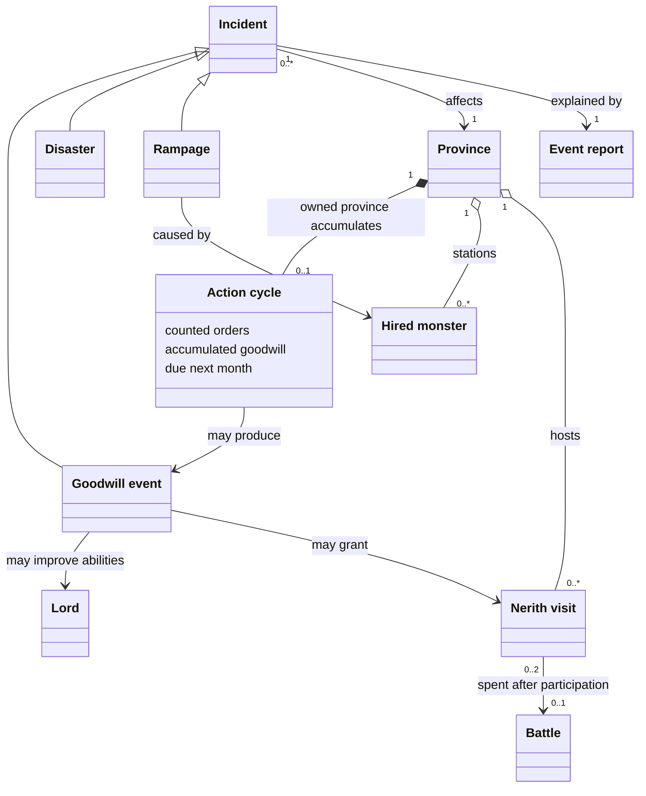
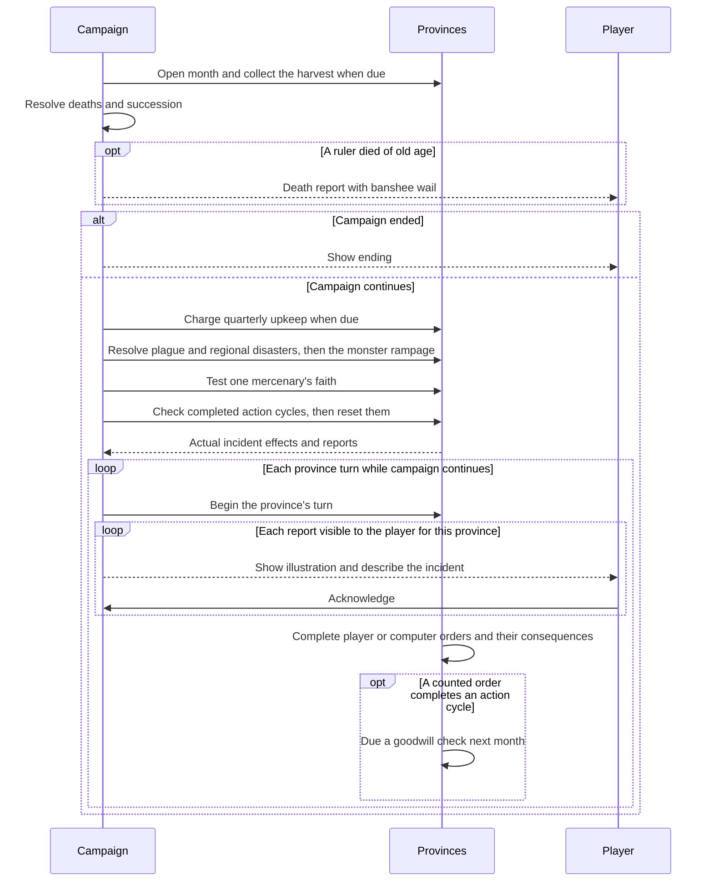

# 15. Events

**Status:** IMPLEMENTED

## Description

Province management attracts helpful visitors or harmful encounters. Seasonal disasters threaten particular regions, hired monsters may rampage, and Nerith rewards good rule with one battle of service. Illustrated reports introduce each province's turn before its orders begin.

## Glossary

| Term | Meaning |
| --- | --- |
| Goodwill | A province's hidden balance of beneficial and harmful orders during its current action cycle. |
| Action cycle | Three counted province orders, followed by one goodwill event check. Skipped turns and free orders do not advance it. |
| Incident | One goodwill encounter, disaster, or rampage and its consequences for a province. |
| Goodwill event | A helpful or harmful encounter whose likelihood depends on the completed action cycle. A check can also produce no encounter. |
| Disaster | A seasonal threat determined by geography and month, independently of goodwill. |
| Rampage | Damage caused by a stationed hired monster whose family's Fame is below its requirement, independently of goodwill. Mercenaries, Gem Guardians, and Nerith do not rampage. |
| Event report | An account of an incident, naming its date, province, and participants. |
| Nerith | A water ashwing stationed in a province, available for one battle as its army's Fifth Unit. No new offer arrives where one is already stationed. |

## Functionality

- Count completed orders using the [established goodwill values](../spec/appendix-d-rules-data.md#d5-goodwill-rules). After the third counted order, the province is due one check at the next month's opening. Reset its cycle after that check, including when nothing happens.
- At month opening, follow [The Month](../spec/03-turn-structure.md#detailed-rules-the-month): the September harvest, then January deaths and succession, then quarterly upkeep. Then resolve plague and regional disasters, the monster rampage, mercenary desertion, and due goodwill checks, all before ordinary turns. Keep reports for each province's turn opening, before player or computer orders. An ended campaign receives no further incidents.
- Apply the same rules to player, entrusted, and rival provinces. Unowned provinces have no event checks. A change of owning house clears the province's unfinished or pending cycle; changing its lord or entrusting it does not.
- A goodwill check produces at most one encounter. Disasters and rampages are independent and may affect that province in the same month. An incident does not count as an order or generate another goodwill check.
- Apply event effects within the existing stat limits. Character rewards go to the province's current lord, including the family ruler when ruling remotely; they improve the character's full abilities.
- Resolve each incident completely before the next. Stat limits and mitigation apply before recording the outcome.

### Event selection

Use the encounters and effects in the [event catalogue](../spec/11-events.md#114-good-events), and the [regional disaster schedule](../spec/11-events.md#116-seasonal-and-natural-disasters).

A completed cycle fires an event with a 40% chance. The goodwill sum, from −3 to +3, picks the tier, and each encounter of that tier is equally likely; a sum of 0 never fires. Sum +3 offers Nerith, the unicorn, or Gwraig. An encounter that cannot apply, such as a blocked Nerith or a Banshee with no court, produces no event; do not reroll. See [Policy Events](../spec/11-events.md#detailed-rules-policy-events).

Protection does not affect goodwill encounters, in chance or in size. It reduces the losses from earthquake, flood, and fire only, and at 100 Protection those do nothing. Snow, plague, and rampage ignore it. Use the province's Protection before each disaster to determine all of its losses.

Check plague and each scheduled regional disaster independently for every eligible owned province. A regional disaster and plague may both strike the same province. Every month there is a 50% chance that one random hired monster, anywhere on the map, is tested; it rampages if its family's Fame is below its requirement, whatever the province's goodwill or skipped orders. At most one monster rampages per month across the whole map; it remains in service afterward. See [Upkeep, Rampage, Desertion, and Disasters](../spec/11-events.md#detailed-rules-upkeep-rampage-desertion-and-disasters).

### Nerith's service

- Nerith is free, needs no upkeep or food, and neither deserts nor rampages. The offer is blocked if the province already hosts a Nerith or a hired monster, has no room for another unit, or belongs to the royal family.
- It may move to an adjacent friendly or unowned province with Move Troops. Unused visits remain available without a time limit; peaceful house absorption transfers them with their province. Visits left in a province taken by force depart.
- Use the [recorded combat characteristics](../spec/appendix-c-military-data.md#c5-pastha). Nerith shares the Guardians' attack fatigue and can fight without ordinary troops.
- A visit is spent when its Nerith participates in an actual battle, whether fought manually or automatically, won, lost, or abandoned by retreat. Selecting it and cancelling, or taking a province without a battle, does not spend it. An unspent attacking Nerith accompanies a successful occupation.

### The death banshee

A ruler's death of old age sounds a banshee's wail, including a rival ruler's death and an heirless death that ends the campaign. It accompanies the death report once and replaces that report's ordinary death bell. It is separate from the harmful banshee encounter, causes no stat loss, and does not sound for banishment or a non-ruler's death.

## Use cases

- **A skipped month:** A province develops twice, skips its next turn, then develops again. Its cycle completes on that third development; the following month can bring a reward. Skipping has neither reset the cycle nor supplied the missing action.
- **A change of owner:** A province completes three harmful orders, then is conquered before the next month. The new owner starts a fresh cycle. Seasonal disaster and monster risks still apply.
- **Two incidents in one province:** A June flood damages a wetland province, then its due goodwill check brings Far Gorta. The food gift does not undo the damaged development; each encounter receives its own report.
- **An obscure house's monster:** A well-managed province still suffers a rampage when its family's Fame is below its monster's requirement. Protection does not reduce the damage, and the report identifies the stationed monster responsible.
- **Saving Nerith for a battle:** The player selects Nerith for an invasion whose defender concedes. Nerith remains available in the occupied province. It leaves after participating in a later battle, even if the player retreats immediately.

## UI

```text
┌────────────────────────────────────────────┐
│  <Province> — Nerith offers aid            │
│  <House> · <Month Year>                    │
├────────────────────────────────────────────┤
│                                            │
│                       /\   /\              │
│                  /\__/  \_/  \             │
│            _____/             \            │
│       ____/      (o)    /\     \           │
│      /  _    __________/  \    |           │
│     /__/ \__/              |   |           │
│           \_/              |   |           │
│                           /   /            │
│                          /   /             │
│                  _______/   /              │
│         ________/          /___            │
│     ~~~/_______________________\~~~        │
│   ~~~~~    ~~~~~~    ~~~~~~    ~~~~~       │
│      ~~~~~~    ~~~~~~    ~~~~~~            │
│                                            │
│  Nerith has offered to fight for you.      │
│                                            │
│  Fifth Unit: Nerith joins this province    │
│  Available for one battle. No upkeep.      │
│                                            │
│                           [ Continue ]     │
└────────────────────────────────────────────┘
```

At each province's turn opening, show its incident reports before orders begin. Show all incidents in the player's provinces, including entrusted ones; show only disasters in other houses' provinces. Put the province and event in the heading, with its owning house and date beneath. Describe what happened without numerical stat changes; character rewards name the recipient. The left panel and map follow the report's province, then return to the active turn after the reports close.

A province's reports wait for acknowledgment one at a time, in resolution order: plague, regional disaster, rampage, then goodwill encounter. Orders wait until those reports close; acknowledging them never applies effects again. Other provinces' reports wait for their own turns. Omit queue counts and unsuccessful checks.

The province's Fifth Unit roster and battle selection show each available Nerith visit and its single-battle service. Goodwill, action counts, and random chances remain hidden.

## Research

### When should a completed cycle resolve?

Resolving immediately after the third order gives quick feedback, but the [specification's example](../spec/11-events.md#112-province-action-count) places three January–March actions before an April check. [Hartman's guide, section VI](https://gamefaqs.gamespot.com/snes/588352-gemfire/faqs/31840), also places encounters between months. Resolve due cycles at the following month opening. This lets attacks and their aftermath finish before an unrelated encounter.

Keeping a cycle through conquest would make the conqueror inherit the previous house's moral account. Clear it on ownership changes, while retaining it through changes of lord within the same house. Resolve succession first so rewards cannot target a deceased lord. The September harvest comes before upkeep and disasters, so disaster damage to Cultivation shows in the next year's harvest.

### How frequent and disruptive should incidents be?

The probabilities and amounts follow the spec's detailed rules for [policy events](../spec/11-events.md#detailed-rules-policy-events) and [disasters and rampage](../spec/11-events.md#detailed-rules-upkeep-rampage-desertion-and-disasters). Playtesting must still establish whether incidents leave room for ordinary development as a house grows.

### Does good management prevent a rampage?

Hartman's section VI explicitly separates rampages and natural disasters from goodwill, so skipping orders cannot make hired monsters harmless. What does prevent one is Fame: a monster rampages only while its family's Fame is below its requirement. The check tests one random monster per month across the map, so holding several monsters does not multiply the risk. Upkeep and mercenary desertion follow [Fifth Units](./06-fifth-units.md).

### When is Pastha spent, and can offers accumulate?

The [FAQ's Pastha entry](https://gamefaqs.gamespot.com/snes/588352-gemfire/faqs/34164) describes losing a visit after one battle; the [manual](https://www.videogamemanual.com/snes/Gemfire%20%28USA%29.pdf) describes departure after service. Consuming a visit on selection would waste it on cancelled or conceded invasions. Spend the visit only after an actual battle. The [detailed rules](../spec/11-events.md#detailed-rules-policy-events) block a second Pastha offer in a province that already hosts one, so offers do not pile up in one place. Provincial availability and movement follow stationed Fifth Units; Pastha's free service and departure distinguish it from hired units.

## Domain model



## Flow



## Persistence

When saving arrives, retain each province's partial or pending action cycle, unused Nerith visits, and reports still awaiting their province's turn or acknowledgment. Resuming during an announcement must show the remaining reports without applying damage, granting rewards, or checking that month again.

## Tests

- **Cycle timing:** Two counted orders followed by a skipped turn remain incomplete. The third makes exactly one check due next month; free orders, failed validation, and announcements cannot advance it. A no-event result also clears the cycle.
- **Ownership:** Conquest and absorption clear prior goodwill and a pending check. Reassigning a lord or entrusting the province preserves both. Unowned land gets no incidents.
- **Outcome selection:** A completed cycle fires with a 40% chance; the sum picks the tier, and a sum of 0 never fires. A blocked Nerith or a Banshee with no court yields no event, without rerolling.
- **Effects:** Every encounter changes its specified target only. Remote rule improves the ruler's full abilities. Stat limits bound gains and losses.
- **Protection:** Protection does not change goodwill encounters, snow, plague, or rampage. It reduces earthquake, flood, and fire losses, and at 100 they do nothing. Damage to Protection does not change that disaster's other losses, but affects later ones.
- **Disasters:** Region boundaries and months exclude ineligible provinces. Plague remains possible outside regional disaster zones; a province can receive both incidents. The September harvest is collected before September disasters.
- **Rampage:** Positive goodwill and skipped turns do not prevent it; a family whose Fame meets the monster's requirement does. The named culprit must be a stationed monster; it remains in service afterward. At most one rampage happens across the map each month.
- **Nerith:** An offer is blocked where a Nerith or hired monster is already stationed, where there is no room, or for the royal family. A visit can move between provinces. Cancelling or winning without battle preserves the selected visit; every actual battle outcome spends it exactly once, including automatic combat and retreat. Nerith has no upkeep, food cost, or desertion.
- **Reports and finality:** The player's incident reports and other houses' disaster reports appear only at the affected province's turn opening, before orders. Other enemy incidents stay silent. The left panel and map follow the displayed report and return to the active province afterward. Acknowledgment never repeats effects. An heirless death ending the campaign prevents subsequent incidents and income.
- **Death banshee:** Each old-age ruler death sounds once alongside its report, including rivals and the final defeat. Ordinary deaths, banishment, and the stat-damaging banshee encounter do not trigger that death cue.
